## 1. crate 与源码目录

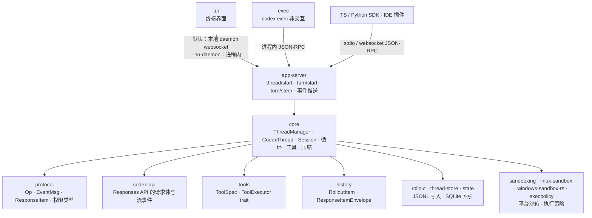

TUI、`codex exec`、SDK 这些客户端都不直接碰 core，而是通过 app-server 的 JSON-RPC 接口来建线程、发输入、收事件。TUI 默认连一个共享的本地后台 app-server daemon：`DaemonAutoStart` 是 Stable 且默认开启（`features/src/lib.rs`），`tui/src/startup_orchestration.rs` 在启动时判断要不要拉起 daemon，连接目标是 `AppServerTarget::{Embedded, LocalDaemon, Remote}` 三选一（`tui/src/lib.rs:331`）。加 `--no-daemon`、打开 agents 总览或连远程工作区时才退回进程内 app-server；另外还有几种情况也会退回：要先走 Bedrock 登录向导，WSL 的 codex home 放在 Windows 盘上，Windows 下以管理员权限启动（无法拉起分离的后台进程），以及本地开关和已在跑的 daemon 对不上。`codex exec` 仍然固定走进程内。真正的执行循环和状态都在 core 里，这也是本篇要重点看的部分。

下文沿着 app-server → core 这条路径往下讲，源码路径都以 `codex-rs/` 为根。主要入口在 `core/src/thread_manager.rs`、`core/src/session/turn_input.rs`、`core/src/tasks/` 和 `core/src/session/turn.rs`。

---

## 2. 线程创建与服务初始化

客户端先调 `thread/start` 建一条线程，这一步会把会话、输入和事件通道、对话历史，以及模型和工具要用的服务都准备好。之后再调 `turn/start` 提交输入，才真正开始干活。

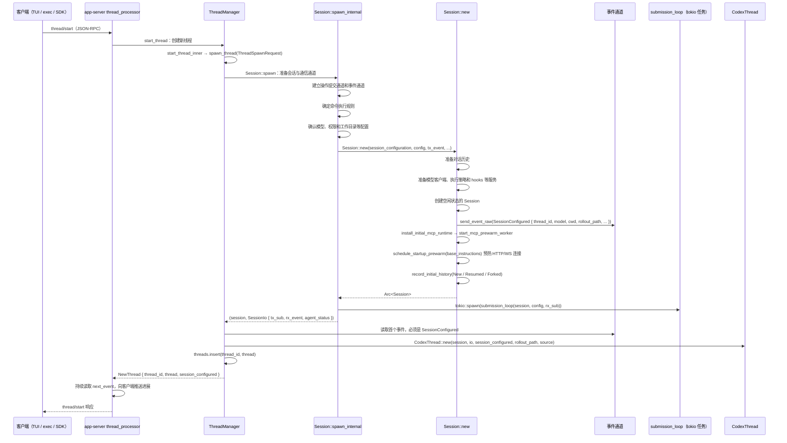

建线程其实就是在为后面的对话做准备：定下模型和执行权限，建好输入和事件通道，把历史记录和各项服务准备好。新建、恢复、fork 走的都是 `spawn_thread`，区别只是历史从空白开始，还是沿用已有的内容。

客户端收到的第一个事件一定是 `SessionConfigured`，里面有线程 id、模型、工作目录这些基本信息，之后才会收到 MCP 连接之类的事件。模型连接也会提前预热，第一轮请求能少等一会儿。

准备完之后，`submission_loop` 就在后台一直等着收操作。这时会话已经能用了，但还没开始处理任务；之后发消息、steer、关闭会话，都是往这条输入通道里送。

三种客户端的接入方式：

| 客户端 | 创建线程 | 提交输入 | 读取事件 |
|---|---|---|---|
| app-server（网络 / stdio） | `thread_processor` 处理 `thread/start` | `turn_processor` 调 `thread.start_or_steer_turn(...)` | 每线程一个 `next_event` 循环，转成 `ServerNotification` |
| TUI | `start_thread` → 发 `thread/start` 给 app-server（默认是本地 daemon，`--no-daemon` 时是进程内） | `submit_op` → `AppCommand` → app-server 请求 | `app_server.next_event()` |
| `codex exec` | `InProcessAppServerClient::start` | `ClientRequest::TurnStart` | `client.next_event()` 循环，`TurnCompleted` 时退出 |

不管哪种客户端，最后都走 app-server，调的是同一套 core 入口。

### 主要对象之间的关系

`ThreadManager` 管着多条线程，每条线程对外就是一个 `CodexThread`。`CodexThread` 里有会话本身和通信通道；`Session` 再把对话状态、当前任务和要用的服务放在一起。图里只画了主线相关的字段，箭头表示持有关系。

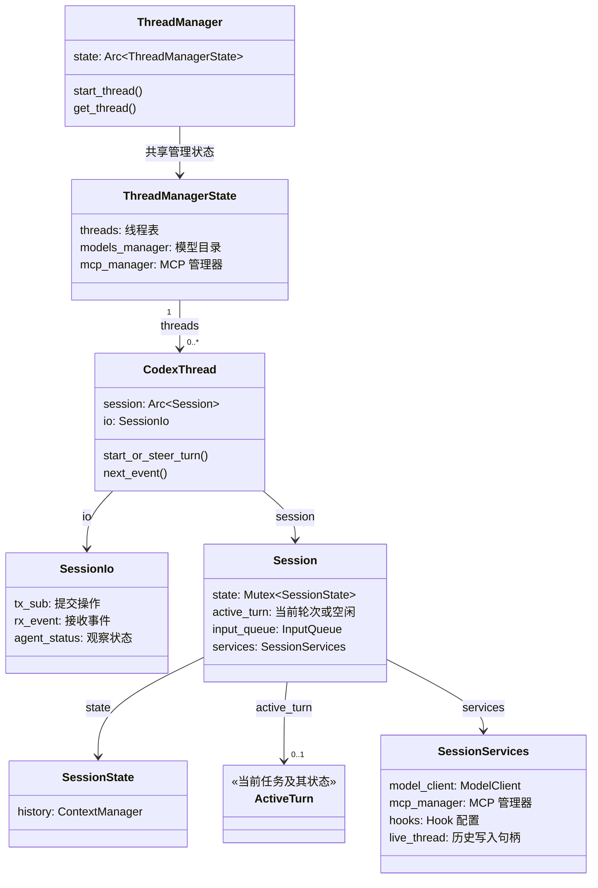

线程建好后 `Session` 就一直在，`ActiveTurn` 则只在处理任务时才有。`SessionServices` 里有些服务是从 `ThreadManagerState` 拿来的，多条线程共用一份，比如模型目录和 MCP 管理器。`CodexThread` 和 `SessionIo` 的输入、事件接口放到 §4 讲，任务状态放到 §5 讲。

### `ThreadManager`

`ThreadManager` 是进程里管线程的地方：建线程、存线程，再给各线程提供共用的模型目录、MCP 管理器、技能服务、插件管理器和环境管理器。

| 方法 | 干什么 | 谁调它 |
|---|---|---|
| `new(config, auth_manager, session_source, ...)` | 创建管理器，顺便把各线程共用的服务建好 | app-server 启动时 |
| `start_thread(options)` | 创建一条新会话 | app-server `thread/start` |
| `resume_thread_with_history(...)` | 用已经读出来的历史恢复会话 | app-server `thread/resume` |
| `fork_prepared_thread(...)` / `fork_thread_from_history(...)` | 从已有对话的某个位置分出一条新会话 | app-server `thread/fork` |
| `resume_legacy_thread_from_rollout` / `fork_legacy_thread` / `spawn_legacy_subagent` | 旧入口，直接读 rollout 文件或按旧方式派生子线程 | 测试和旧调用方；子线程由 `ext/agent` 的 `AgentRunner` 调 |
| `spawn_thread(request)` | 上面几种最后都走到这里：创建会话，确认初始化成功后把线程登记到表里，之后的请求按 id 就能找到 | 新建、恢复和 fork 流程 |
| `get_thread(thread_id)` | 按 id 找线程 | app-server 每个请求 |
| `shutdown_all_threads_bounded(timeout)` | 关掉所有线程，最多等 `timeout` 这么久 | 进程退出 |

### `Session`

`Session` 装着一次对话的历史、当前任务、待处理输入和各项服务。它自己不跑循环：`submission_loop` 收 Op，`send_event` 发事件，真正请求模型、执行工具的循环在任务和 `run_turn` 里。

主要字段：

| 字段 | 含义 |
|---|---|
| `thread_id` | 线程 id，和 rollout 文件名里的一致 |
| `tx_event: Sender<Event>` | 事件出口。`send_event` 最终写这里 |
| `agent_status: watch::Sender<AgentStatus>` | 最新的 agent 状态（PendingInit / Running / Idle / Interrupted …），由事件推导（`deliver_event_raw`） |
| `state: Mutex<SessionState>` | **对话历史在这里面**（`SessionState.history`）。改历史要先拿这把锁 |
| `active_turn: Mutex<Option<ActiveTurn>>` | 当前活跃轮次。`None` 就是空闲。**启动新轮次、steer、审批回复全靠它判断** |
| `input_queue: InputQueue` | 邮箱和待处理输入的操作入口（真正的存储在 `ActiveTurn.turn_state.pending_input`） |
| `services: SessionServices` | 所有服务，见 §2 |
| `features: ManagedFeatures` | 实验功能和可选能力的开关 |
| `conversation` / `realtime_history` | 实时语音对话的状态，本篇不讲 |
| `async_hook_results` | 异步 hook 跑完的结果通道，分别在处理新输入前、模型和工具返回后读取（§10） |

主要方法：

| 方法 | 干什么 | 谁调它 |
|---|---|---|
| `spawn(args)` → `spawn_internal` | 创建会话，把通信用的通道交给调用方 | `ThreadManager::spawn_thread` |
| `new(...)` | 准备历史、模型连接、MCP 等服务，发出 `SessionConfigured`，再处理已有历史和启动预热 | `spawn_internal` |
| `send_event(turn_context, msg)` | 给客户端发事件；需要同步给父 agent 的信息也在这里转发 | 全项目 |
| `send_event_raw_with_persistence(event, persist)` | 先把事件交给持久化，再通知客户端。交给持久化不等于已经落盘 | `send_event` / `send_event_raw` |
| `record_conversation_items(tc, model_info, items)` | 往历史里写条目的统一入口：写内存、写 rollout、发事件 | 每条进历史的东西 |
| `record_user_prompt_and_emit_turn_item(...)` | 把用户消息写进历史，发事件让 UI 显示，顺便确保 rollout 文件已经建好 | `record_pending_input` |
| `capture_step_context(tc, token)` / `capture_step_context_inner` | 给这次模型请求拍一份配置、环境、工具列表的快照，见 §6 | `run_turn` 每步 |
| `record_context_updates_and_set_reference_context_item(step)` | 往历史里补上下文：第一次全量写，之后只写变化，见 §6 | `run_turn` |
| `request_command_approval(...)` | 发审批请求给用户，等用户回复 | exec / apply_patch 的审批 |
| `notify_approval(id, decision)` | 把用户的决定交给正在等的那个审批请求 | `handlers::exec_approval` |
| `spawn_task(tc, input, task)` | 用新任务替换当前任务 | 开新轮 |
| `start_task(tc, input, task)` | 启动后台任务，登记运行状态，安排结束后的收尾 | `spawn_task` / `start_if_idle` / `maybe_start_turn_for_pending_work` |
| `abort_all_tasks(reason)` | 取消当前任务并通知客户端 | `interrupt_task` / `spawn_task` |
| `on_task_finished(tc, result)` | 任务结束后收尾：保存没处理的输入、发结束事件、清状态；邮箱里还有活就再开一轮 | `start_task` 里 spawn 的闭包 |
| `interrupt_task()` | 用户中断时停掉当前任务 | `Op::Interrupt` |
| `clone_history()` | 拿一份历史快照，发请求前用 | 每次发请求前 |
| `persist_rollout_items(items)` | 把记录交给持久化 | 所有落盘 |

### `SessionServices`

`SessionServices` 把会话要用的服务放在一起，字段基本都是 `Arc<...>` 或资源句柄。和本篇流程有关的是这些：

| 字段 | 用途 |
|---|---|
| `model_client: ModelClient` | `run_turn` 通过 `new_session()` 创建模型客户端，或使用预热实例（§7） |
| `mcp_runtime` / `mcp_manager` / `mcp_handler_cache` | 每步获取 MCP 快照、注册 MCP 工具 |
| `unified_exec_manager: UnifiedExecProcessManager` | `exec_command` / `write_stdin` 的进程表 |
| `exec_policy: Arc<ExecPolicyManager>` | 命令要不要审批的规则引擎（starlark 规则文件） |
| `hooks: ArcSwap<Hooks>` | hook 配置，可热替换 |
| `extensions` / `thread_extension_data` / `session_extension_data` | 扩展注册表，以及按类型索引的状态存储（`ExtensionData`）；用于模块之间共享状态 |
| `agent_control: Arc<dyn AgentControl>` / `local_agent_runtime` | 多 agent 的执行配额和父子关系。`agent_control` 是 trait 对象，宿主可以通过 `ThreadManager::with_agent_control_factory` 注入自己的实现，本地默认是 `LocalAgentControl` |
| `live_thread` / `thread_store` / `state_db` | 持久化相关对象：写 rollout 的句柄、线程元数据存储、SQLite 索引 |
| `executed_tool_calls` | 已执行工具调用的记录，发请求前会 `attach_to_prompt` |
| `code_mode_service` | Code Mode 的 V8 worker |
| `turn_environments: Arc<ThreadEnvironments>` | 执行环境（本机 / 远程 executor）的连接状态 |

---

## 3. 执行流程总览

执行过程可以分三层看：`Session` 用 `submission_loop` 一直收操作；`ActiveTurn` 存当前任务和它的状态；任务里的 `run_turn` 可以请求好几次模型。模型回一次之后，可能还要执行工具、再请求模型，所以“结束”也要分三层看：一次模型请求什么时候结束，`run_turn` 什么时候结束，整个任务什么时候结束。

下图画了什么时候继续、压缩后从哪接着跑、任务怎么结束。出错、中断、输入被拒这些情况放到后面几节讲。

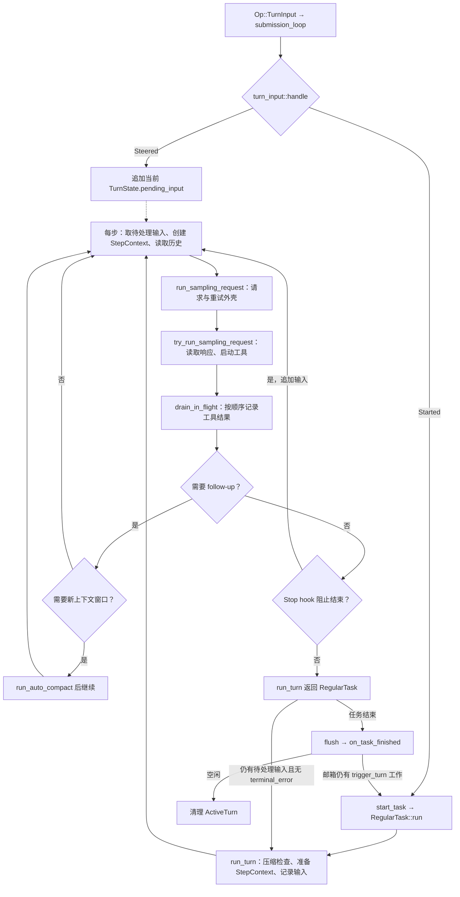

后面按这个顺序讲：§4–§5 是输入处理和任务启动，§6–§9 是请求准备、模型响应和工具执行，§10 讲任务什么时候继续、什么时候结束，§11–§13 是 steer、重试和持久化。

---

## 4. 输入提交与任务路由

客户端调 `CodexThread::start_or_steer_turn` 提交输入。Session 看情况决定是开一个新任务、steer 到当前任务，还是直接拒绝，分别返回 `Started / Steered / NotSubmitted`。这个结果在输入处理完就返回了，不用等模型跑完。

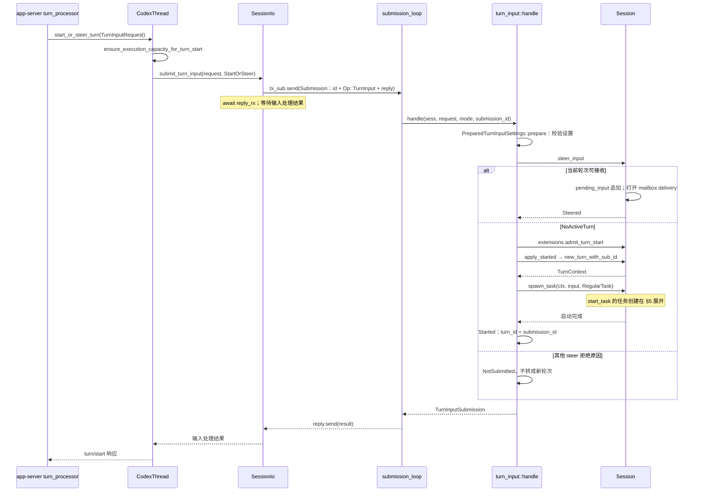

### `turn_input::handle` 的路由分支

| 模式 | 函数 | 功能 |
|---|---|---|
| `StartOrSteer` | `start_or_steer` | 正常发消息时使用：Codex 还在处理任务，就把新输入补充给它；没有任务在运行，就开始新一轮。如果当前任务不接受补充输入，会拒绝这次提交。 |
| `StartIfIdle` | `start_if_idle` | 只在空闲时开始新一轮，不中断正在进行的任务。自动触发的输入还要遵守 Plan 模式等限制，并给等待处理的触发消息让路。内部续跑会带上 `expected_previous_turn_id`，如果最近开始的轮次已经不是它，说明有新工作插进来了，返回 `Superseded`。 |
| `Steer { expected_turn_id }` | `steer` | 给指定的当前轮次补充用户输入，比如追加要求或纠正方向。这一轮已经结束或被换掉了就拒绝，免得消息送错轮次。 |
| 恢复 | `handle_recovery` | 不添加新的用户消息，沿用已有的对话内容继续请求模型，用于恢复执行。也需要等到会话空闲才能启动。 |

`steer_input` 判断当前任务能不能 steer。比如正在做 Review 或压缩上下文时就不行，也不能借 steer 改掉这一轮约定好的输出格式。收下的输入先排队，等当前轮次来取；其他 agent 发来的邮箱消息也可以这样送进这一轮（见 §11）。

`apply_started` 准备新一轮要用的设置和上下文。用户发消息时顺便换了模型，这一轮就直接用新设置。新轮次的 id 就是这次提交的 id，调用方拿它就能把提交结果和后面的事件对上。

`spawn_task` 把后台任务建好之后才返回结果。这时候任务已经开始跑了，所以 `turn/start` 的响应、轮次事件、模型输出谁先到客户端是不一定的。

### `CodexThread`

`CodexThread` 是外部操作一条线程的入口，里面持有 `Session` 和 IO 通道。发输入、读事件、查状态、关会话都通过它，但它自己不干活，都转给内部的 `Session` 和 `SessionIo`。

主要字段：

| 字段 | 含义 |
|---|---|
| `session: Arc<Session>` | 运行时本体。`pub(crate)`，只有 core 内部能直接用 |
| `io: SessionIo` | 提交通道 + 事件通道 + agent 状态 watch |
| `session_source` | 谁开的这条线程（CLI / VSCode / 子 agent / 内部任务） |
| `session_configured` / `rollout_path` | 启动时的第一个事件和 rollout 文件路径，方便客户端随时再拿 |

主要方法：

| 方法 | 干什么 | 谁调它 |
|---|---|---|
| `submit(op)` | 提交一个 Op，返回提交 id | 所有不需要回复的 Op |
| `start_or_steer_turn(request)` | 当前有任务就补充输入，否则开始新一轮 | app-server `turn/start` |
| `start_turn_if_idle(request)` | `StartIfIdle`，忙就拒 | 自动化触发（hook 继续执行、定时） |
| `steer_turn(request, expected_turn_id)` | 只向指定轮次补充输入，防止误投到另一轮 | app-server `turn/steer` |
| `submit_turn_input_with_mode` | 上面三个最后都走这里；可能开新任务的话，先检查执行配额 | 上面三个 |
| `recover_turn_if_idle` | `Op::RecoverTurn`，恢复被中断的轮次 | worker 交接 |
| `suspend_turn_and_shutdown` | `Op::SuspendTurnAndShutdown`，停轮但不记终止事件，让别的 worker 接手 | worker 交接接口 |
| `next_event()` | 等待并取出下一条执行事件 | app-server 每线程一个读循环 |
| `inject_if_running(items)` | 往正在跑的任务里塞上下文；空闲时直接拒绝 | hook 异步结果、IDE 上下文 |

### `SessionIo`

| 字段 / 方法 | 含义 |
|---|---|
| `tx_sub: Sender<Submission>` | 有界通道，容量 512（`SUBMISSION_CHANNEL_CAPACITY`）。另一头是 `submission_loop` |
| `rx_event: Receiver<Event>` | 无界通道。`Session.tx_event` 往里写 |
| `submit(op)` | 给 Op 分配 id，发给会话 |
| `submit_turn_input(request, mode)` | 提交输入，等会话给出处理结果。返回时就知道是启动、steer 还是拒绝了，不用等模型跑完 |
| `next_event()` | 收一个事件，通道关了返回 `InternalAgentDied` |

### 输入类型与转换

客户端通过 `turn/start` 或 `turn/steer` 提交文字、图片这类 `UserInput`。app-server 把它转成 core 的格式，连同线程设置、新轮次参数一起交给 `CodexThread`。这里涉及三个类型：`TurnInputRequest` 是提交的内容，`TurnInputMode` 是怎么处理，`TurnInputSubmission` 是处理结果。

进了 core 之后，`UserInput` 有两个用处：

- 转成 `ResponseItem::Message` 写进历史，之后发给模型的就是这条（`record_user_prompt_and_emit_turn_item`）；
- 直接用 `UserInput` 生成 `TurnItem::UserMessage` 发给 UI，因为 `text_elements` 这类 UI 字段在 `ResponseItem` 里没有。

`Skill` / `Mention` 两种会在新轮次开始时展开成注入的上下文（§6）。

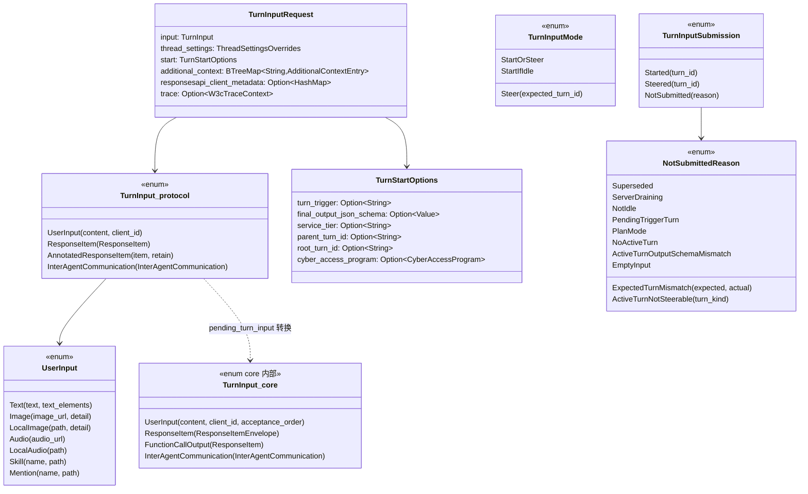

| 类型 | 作用 |
|---|---|
| `UserInput` | 七种。`Text` 里的 `text_elements` 是 UI 用的高亮区间，不发给模型。`Skill` / `Mention` 是 `@技能` `@应用` 的引用，§6 会展开成注入的上下文。 |
| `TurnInputRequest` | 一次提交的全部参数。`thread_settings` 是"顺便改一下线程设置"（模型、审批策略等），**开新轮和 steer 都会应用**，只是 steer 时对当前轮不生效。 |
| `TurnInput`（协议版） | 四种。`ResponseItem` 变体让客户端直接提交一条历史条目（比如 IDE 给的上下文）。`AnnotatedResponseItem` 带一个只给 harness 看的 `retain` 标注：客户端提交的工具输出标了 `retain: true`，历史里会记成“客户端写的”，标注本身不进模型请求。配合默认关闭的 `retain_client_tool_outputs` 特性，这类输出（客户端常用它来下达任务说明）在压缩和开新窗口时会整条保留，不被截掉。 |
| `TurnInputMode` | 三种路由。`Steer { expected_turn_id }` 是乐观并发控制：你决定 steer 到 Session 收到之间那一轮可能已经结束，带上你以为的 turn_id，不匹配就拒绝。 |
| `TurnStartOptions` | 只在这次提交启动了新轮次时才用。`parent_turn_id` / `root_turn_id` 在多 agent 场景下记录父轮次和根轮次的 id。 |
| `TurnInputSubmission` | 三种结果。`Started` / `Steered` 只表示"core 收下了"，不等 hook、不等落盘、不等模型请求完成。 |
| `NotSubmittedReason` | 十种拒绝理由，每种对应的判断逻辑见 §4。 |
| `TurnInput`（core 版） | core 内部多了 `acceptance_order`（用户输入的受理顺序，用来在回放时排序）和 `FunctionCallOutput`（客户端直接提交的工具输出）。 |

### 操作与事件通道

调用方用 `Op` 告诉会话要做什么：提交输入、中断、回复审批、压缩、关闭等。所有 Op 都从 `SessionIo` 的提交通道送进去，外面包一层 `Submission` 带上 id。`Submission` 定义在 core 内部（`core/src/session/submission.rs`）；`residency_guard` 用来在这条提交处理完之前，让 V2 多 agent 的接收方一直留在内存里。`InterruptIfNoPendingInput` 只在没有待处理输入时才中断；`ThreadSettings` 的可选字段 `reply` 用来在校验失败时直接回复调用方。有些 Op 要等会话回复处理结果，其余的发完就返回。反方向上，执行过程中的进展都通过 `Event` 通道发出来。

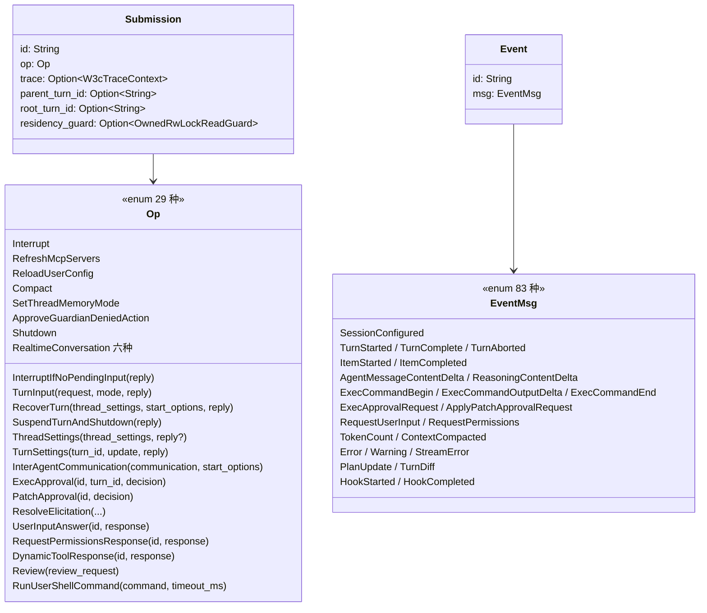

| 类型 | 作用 |
|---|---|
| `Submission` | `id` 是提交 id。**如果这次提交开了新轮次，轮次 id 就是它**（`Started { turn_id: submission_id }`）。 |
| `Op` | 发给会话的操作。带 `reply` 的要等会话回复，其余的提交完就返回。 |
| `Event` | `id` 对应 `Submission.id`。启动阶段的事件 id 是常量 `INITIAL_SUBMIT_ID`。 |
| `EventMsg` | 83 个变体。分五类：生命周期（Turn*/Item*）、流式增量（*Delta）、工具（Exec*/Patch*/McpToolCall*）、等用户（*ApprovalRequest/RequestUserInput/ElicitationRequest）、状态（TokenCount/Error/Warning）。 |

---

## 5. 任务启动与运行状态

§4 走到启动分支时，先生成 `TurnContext`，再调 `spawn_task`，最后由 `start_task` 把任务真正跑起来。任务的 handle、取消令牌和待处理输入都存在 `ActiveTurn` 里，steer 和中断就是靠它找到当前任务的。

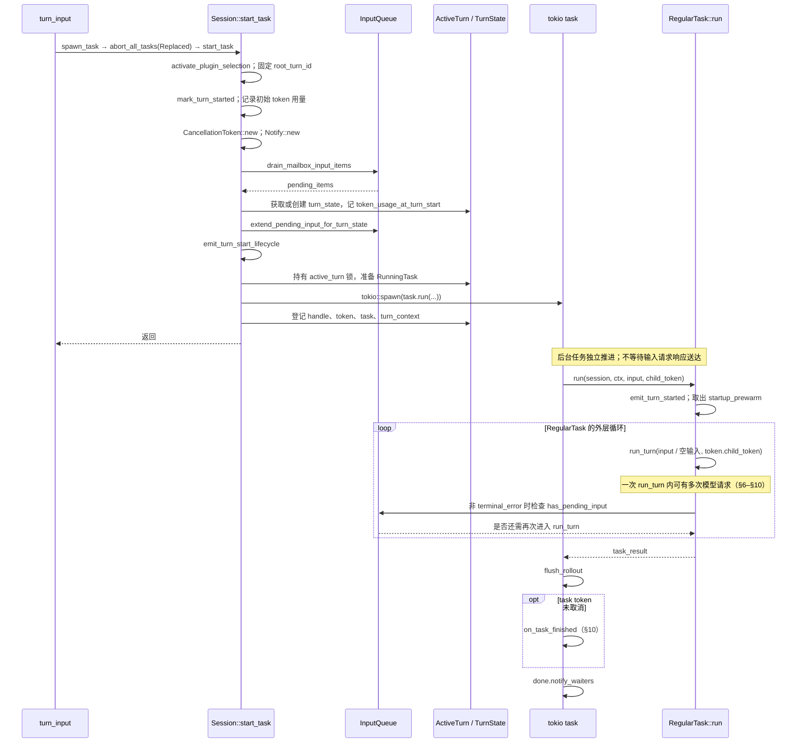

开一轮时先建 `ActiveTurn`，再准备上下文、创建任务，所以有一小段时间 `ActiveTurn` 已经在了，里面却还没有 `RunningTask`。`start_task` 登记 `RunningTask` 时会一直拿着 `active_turn` 锁；工具审批这类还在等的请求放在共享的 `TurnState` 里，这一轮结束时一起清掉。

任务跑完后，后台闭包会先 `flush_rollout`，再走正常的完成处理。如果任务被取消，就跳过这里的 `on_task_finished`，交给显式中断路径收尾，免得处理两遍。

### `ActiveTurn` / `RunningTask` / `TurnState`

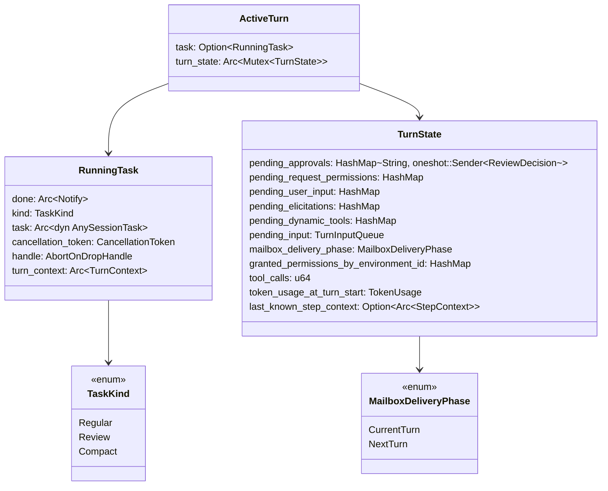

| 类型 | 作用 |
|---|---|
| `ActiveTurn` | 有它就说明会话已经被一轮占上了，哪怕任务还在准备。这样两个启动请求不会同时以为会话是空闲的。 |
| `RunningTask` | 后台任务的句柄和取消令牌，中断、等待结束时要用。`AbortOnDropHandle` 被 drop 时任务也会跟着终止。 |
| `TurnState` | 这一轮的 steer 输入，以及所有在等用户回复的请求（审批、权限申请、补充信息）都放这里。任务中断时这些等待一起取消。 |
| `MailboxDeliveryPhase` | 这一轮还收不收子 agent 发来的邮件。开局是收（`CurrentTurn`）；模型给出最终答案后改成不收（`NextTurn`），晚到的邮件留到下一轮；接着又有工具调用或用户 steer，就重新打开。详见 §11。 |

### `SessionTask` trait

| 方法 | 含义 |
|---|---|
| `kind()` | 普通、审查还是压缩任务，决定能不能 steer 等 |
| `run(self, session, ctx, input, cancellation_token)` | 一直跑到完成或被取消，返回最后一条 agent 消息或错误 |
| `abort(session, ctx)` | 中断时要额外清理的东西，比如退出审查模式；没有就不用管 |

`AnySessionTask` 用来把不同类型的任务放进同一个 `Arc<dyn AnySessionTask>` 里。普通对话、审查、手动压缩都是会话任务，所以运行状态、中断、收尾这些逻辑三者共用一套。

### `start_task` 的初始化与收尾

`start_task` 启动任务前要做几件事：定下本轮用哪些插件、根轮次是谁，记下开始时的 token 用量，把邮箱里已有的消息加进待处理输入，再通知扩展“任务开始了”。

然后建一个整轮共用的 `CancellationToken`，模型请求和工具执行都从它派生子令牌，一次中断就能传到所有地方。任务丢到后台跑，句柄存进 `RunningTask`。

任务正常返回后，先 flush 历史再做完成处理；已经被取消的任务交给中断流程收尾，免得结束事件发两遍。

### `RegularTask::run`：外层循环

`RegularTask::run` 先通知客户端任务开始，有预热好的连接就拿来用，然后进 `run_turn`。

`run_turn` 返回的时候，可能又来了新的 steer 或邮箱消息。只要还有本轮能处理的输入，又没有致命错误，`RegularTask` 就再调一次 `run_turn`。队列空了，任务才结束。

所以这里有两层循环，管的是不同的“继续”：外层 `RegularTask` 接住执行期间新来的输入；内层 `run_turn` 管模型调了工具之后要再请求一次模型。

---

## 6. 上下文准备与历史记录

`run_turn` 第一次请求模型之前，要先从 `TurnContext` 捕获这一步的 `StepContext`，把设置和工具绑定定下来，再生成模型要看的上下文。然后按顺序把运行状态、用户输入、用户点名的 skill / plugin 写进历史。

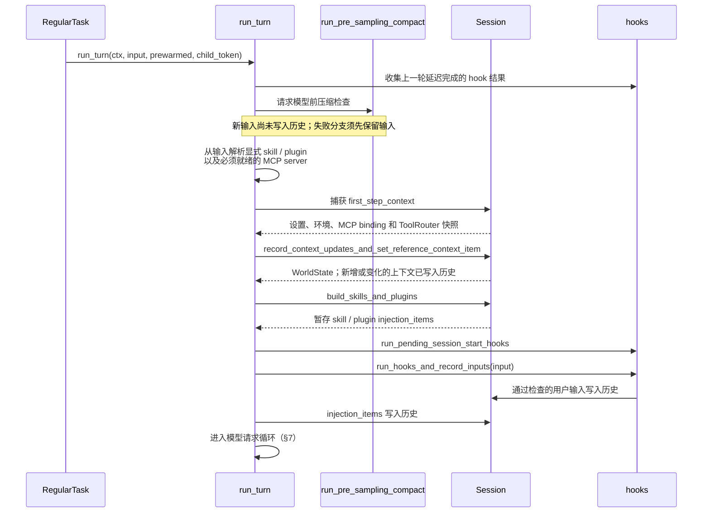

捕获 `StepContext` 只是拍一份快照，给后面构造上下文和执行工具用，不写历史。用户点名的 skill / plugin 先解析成 `injection_items` 暂存，等会话启动 hook 和输入 hook 都通过了才写进去；通用的 `WorldState` 上下文则在这些 hook 之前就写了。

`TurnContext` 和 `StepContext` 的区别：前者是一轮的信息和当前设置，后者是某一次模型请求用的设置、MCP 绑定和工具列表。设置在中途改了，要等下次 `capture_step_context` 才会读到，当前这次请求和工具执行还用旧的那份。这样发给模型的工具定义和执行时查的工具就是同一份，当然远端 MCP 服务该断还是可能断。

### `TurnContext` 与 `StepContext`

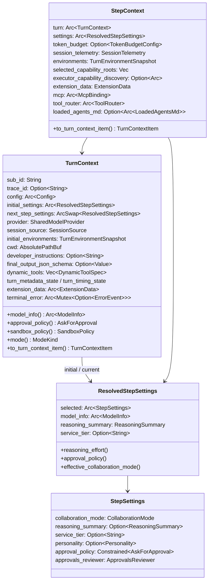

| 类型 | 作用 |
|---|---|
| `TurnContext` | 轮次身份、初始配置和下一步设置入口。`next_step_settings` 是 `ArcSwap`，`Op::TurnSettings` 能在轮次中途换模型或推理强度，但已经创建的 `StepContext` 不受影响。每一步的环境从线程级的 `services.turn_environments` 取快照，所以 `TurnSettingsUpdate.environments` 可以在轮次中途换执行环境。`terminal_error` 非空表示这轮已经报过致命错，外层循环看到它就不再继续执行。它在轮次开始时根据会话配置、环境和技能信息创建。 |
| `StepContext` | 一次模型请求用的配置快照：环境、AGENTS.md、token 预算、MCP binding、工具路由。发请求和执行工具用的是同一份，两边不会对不上。base instructions 不在这里，由 `Session` 单独提供。 |

### 首个 `StepContext` 的捕获过程

这里的“首个”指一次 `run_turn` 里第一次模型请求用的快照，不是线程的第一轮。捕获之前，`run_turn` 先从本轮输入里找出哪些 MCP server 和 plugin 必须就绪；然后 `capture_step_context_with_required_mcp_servers` 把当前设置、环境和工具绑定一起固定进一个 `StepContext`。

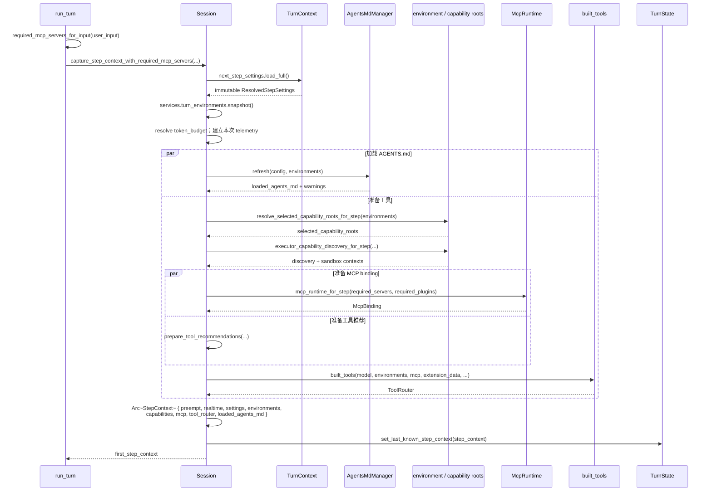

第一步在持有 `active_turn` 锁的情况下，同时读 `next_step_settings` 和环境快照。后面加载 AGENTS.md、发现 capability、刷新 MCP、构建工具，中间哪怕要等，也一直用这一份 settings 和环境，捕获过程中新来的设置不会混进来。AGENTS.md 的加载和工具准备用 `tokio::join!` 并行跑。

`StepContext` 的字段中，`preempt` 是开启 `InstantInterrupt`（默认开启）时才有的取消令牌，用户 steer 时靠它打断正在进行的模型请求（见 §11）；`realtime` 是这一步开始时实时语音会话的状态快照。`extension_data` 中，这一步选中的 plugin、executor 的 skill 清单等扩展数据也存在这一步自己身上，构建工具和渲染 `WorldState` 用的是同一份，不会因为另一步同时刷新目录而串用。

MCP binding 和工具推荐并行准备。拿到 binding 之后，`built_tools` 再结合模型能力、权限、环境、Apps/plugins、扩展工具，生成最终的 `ToolRouter`。做好的 `StepContext` 记到当前 `TurnState` 上，再交回 `run_turn`，后面构造 `WorldState` 和第一次模型请求都用它。这一步不写对话历史。

之后内层循环如果收到 steer，或者要重新读动态设置，`run_turn` 会再捕获一份新的 `StepContext`，下一次请求和工具执行就换成新快照，请求前把 `WorldState` 的变化记下来。

### `SessionState` 与 `ContextManager`

`StepContext` 是快照，用完就换；历史则要一直留着，放在 `Session.state`（`SessionState`）里的 `ContextManager` 中，`run_turn` 就是通过它读写历史的。

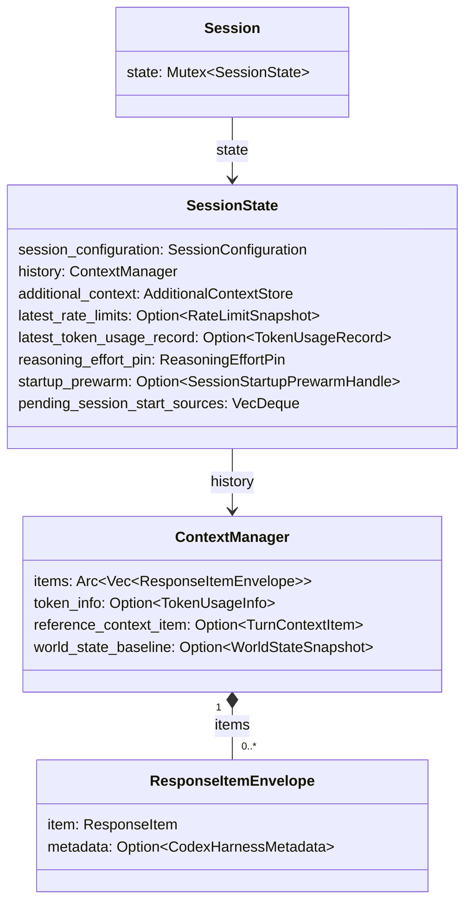

| 字段 | 含义 |
|---|---|
| `session_configuration` | 线程级设置：模型、审批策略、沙箱策略、cwd、provider、`base_instructions`。`Op::ThreadSettings` 改的就是它 |
| `history: ContextManager` | 对话历史本体，以及与历史一起维护的 token 统计和上下文 diff 基线 |
| `latest_rate_limits` / `latest_token_usage_record` | 最近一次响应里的限流和用量 |
| `additional_context: AdditionalContextStore` | 客户端通过 `TurnInputRequest.additional_context` 给的键值上下文，按 key 合并 |
| `reasoning_effort_pin` | 某个模型固定设置的推理强度 |
| `startup_prewarm` | 启动时预热的 HTTP/WebSocket 连接句柄，第一轮取出使用 |
| `pending_session_start_sources` | 还没跑的 SessionStart hook 来源（startup / resume / fork / clear） |

`ContextManager` 的字段分两类：`items` 是真正的对话条目，其余字段是请求前整理、压缩、上下文更新要用的状态。

| 字段 | 含义 |
|---|---|
| `items: Arc<Vec<ResponseItemEnvelope>>` | 对话历史。多个快照可以共享内容，只有修改时才按需复制 |
| `history_version` / `user_message_revision` | 版本号，用来判断历史和用户消息有没有变过 |
| `token_info: Option<TokenUsageInfo>` | 最近一次响应报的用量，`get_total_token_usage` 从它算 |
| `reference_context_item: Option<TurnContextItem>` | 上下文 diff 的基线（§6）。`None` 表示下一轮要全量注入（新线程、回滚删掉了最初的上下文时出现） |
| `world_state_baseline` | 上次告诉模型的工作目录、Git 分支等状态，用来比较后面有没有变 |

| 方法 | 干什么 | 谁调它 |
|---|---|---|
| `record_items(items, policy)` / `record_annotated_items` | 追加。工具输出按 `policy` 截断 | `record_prepared_conversation_items` |
| `for_prompt(input_modalities)` | 把历史整理成能发给模型的列表 | `run_turn`、`run_sampling_request` |
| `normalize_history` | 四个不变量：每个工具调用都有输出（缺的补合成输出）、每个输出都有调用（孤儿删掉）、模型不支持图就删图、不支持音频就删音频 | `for_prompt` |
| `estimate_token_count` | 本地估算（按字节和条目类型加权），没有服务端用量时用 | 压缩判定 |
| `replace_compacted(items)` | 用压缩结果替换历史，并标记历史已经变化 | `replace_compacted_history` |
| `drop_last_n_user_turns(n)` | 按用户轮次回退，删掉最近 n 轮 | 只在恢复会话、重放 rollout 里遗留的回滚标记时调用。 |

### 模型可见上下文的生成

一次模型请求里，模型能看到的东西来自两个字段：

| 请求字段 | 来源 | 更新时机 |
|---|---|---|
| `input` | 开头是 base instructions（`Session::get_prompt_base_instructions()`），后面是 `ContextManager::for_prompt()` 整理后的历史 | base instructions 每次请求都放在最前面，创建 Session 时按“配置显式覆盖 → 恢复记录中的 base instructions → 当前模型模板”的顺序确定。历史部分是用户消息、模型输出、工具结果，以及 Codex 追加的 developer / user 上下文 |
| `tools` | `StepContext.tool_router.model_visible_specs()` | 每次捕获新的 `StepContext` 时确定，和实际执行工具使用同一份绑定 |

base instructions 相当于常说的 system prompt。`build_responses_request` 把 base instructions 包成一条 developer 消息，插到 `input` 最前面。这条消息不存进历史，每次请求都重新生成；它的 id 由线程 id 和指令文本算出来（UUID v5），所以重试和恢复会话时 id 都不变。这样一来，普通 Responses 和 `Responses Lite` 的写法就统一了，只剩一个区别：Lite 模式下工具定义也会变成 `input` 开头的一条 `AdditionalTools` 条目（排在 base instructions 前面），`tools` 字段留空。

要注意，AGENTS.md、权限、工作目录、skill 清单、多 agent 模式这些都不在 base instructions 里，而是历史里另外的消息。

还有一个开发中、默认关闭的开关 `incremental_tools`，只对 Lite 模式生效。打开后，工具定义和 base instructions 不再每次请求都拼到 `input` 前面，而是作为两个 `WorldState` section（`TopLevelToolsState`、`ModelInstructionsState`）在每个上下文窗口开头写进历史一次。之后工具有增删，只追加一条描述变化的 `AdditionalTools` 或说明消息，不再整份重发。每批新增或变化的命名空间前面统一加一条 developer 说明，告诉模型“之前的工具除非明确移除都还能用，新定义覆盖旧定义”（措辞可以由模型目录的 `model_messages.tools.incremental_tools` 覆盖）；模型或指令内容任一变化都会追加一条 `model_instructions` developer 消息，压缩后的新窗口直接用最新的指令。

#### `WorldState` 的全量注入与增量更新

`WorldState` 是 Codex 根据当前 `StepContext` 汇总出来的、要让模型知道的运行状态：当前加载的 AGENTS.md、cwd 和 Git 分支、审批和沙箱策略、personality、可用的 skill / Apps / plugins、多 agent 模式等。每一类状态是一个带固定 ID 的 `WorldStateSection`，它干三件事：存结构化快照、渲染第一次的完整内容、比较前后变化并生成更新说明。

几个典型的 section：

| section（示意） | 当前结构化状态 | 渲染给模型的内容 |
|---|---|---|
| `agents_md` | 当前加载的指令内容 | contextual user 形式的 AGENTS.md 指令 |
| `environments` | cwd、Git 分支、日期、shell、网络和文件系统权限等 | `<environment_context>` |
| `permissions` | 审批和沙箱策略 | developer 权限说明 |
| skills extension section | 当前可用 skill 的名称、描述和入口 | developer `<skills_instructions>` |

`WorldStateSnapshot` 是这张表的可序列化快照，只拿来做比较和恢复，模型看不到；模型看到的是各 section 渲染出来的 developer / user 消息。第一次（没有可信历史时）渲染整张表，之后拿新旧快照逐个 section 比，只把变化追加到历史里。

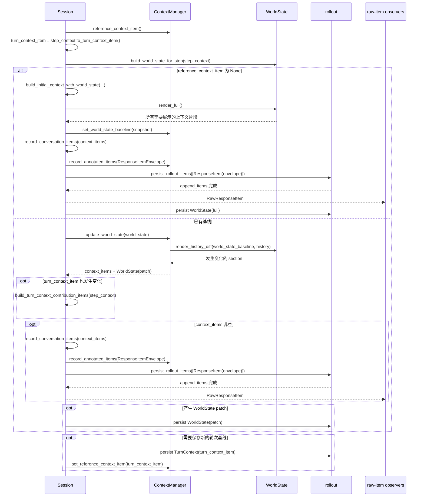

上图就是 `record_context_updates_and_set_reference_context_item` 展开的样子。它只管通用的运行上下文和基线，不管用户刚发的消息，也不注入本轮点名的 skill 正文。图里有两种状态别搞混：`WorldState` 用来比较模型能看到的运行环境，`TurnContextItem` 是恢复会话要用的轮次设置基线。

#### 初始上下文的组成

没有基线时，`build_initial_context_with_world_state` 调 `WorldState::render_full()`，再把相邻的同角色片段合并。最后一般是一条大的 developer 消息、几条必须单独成条的 developer 消息，加一条 contextual user 消息。各部分的来源：

| 段 | 角色 | 来源 |
|---|---|---|
| 客户端 developer instructions | developer | `TurnContext.developer_instructions`，合并进主 developer 消息 |
| 模型切换、personality、审批与沙箱、协作模式、持久执行规则 | developer | `build_world_state_for_step` 中对应的 `WorldStateSection` |
| 可用 skill 清单 | developer | skills extension 提供的 `skills` / `cloud_skills` / `host_skills` section，使用 `<skills_instructions>` 标记 |
| Apps / plugins 的通用使用规则 | developer | 当前确实有可用能力且模型配置允许时加入 |
| 多 agent 模式、token budget、guardian 或托管策略 | 独立 developer 消息 | 这些片段必须单独成条，不与普通 developer 内容合并 |
| AGENTS.md | user（contextual user） | `StepContext.loaded_agents_md`，使用 `# AGENTS.md instructions` 标记 |
| 环境信息 | user（contextual user） | cwd、Git 分支、日期、时区、shell、网络和文件系统等 `<environment_context>`。日期和时区可以用 `include_environment_context_time = false` 关掉（默认开） |
| 推荐但尚未安装的插件 | developer（并入主 developer 消息） | `RecommendedPluginsInstructions`，使用 `<recommended_plugins>` 标记。 |

“contextual user”是 Codex 用 `role: user` 写进历史的运行时上下文，和用户真正发的消息分开记。模型会看到它们，但 UI 一般不会把它们当成普通聊天消息显示。

#### skill 清单与正文注入

skill 分两层注入。第一层是可用 skill 的清单。捕获 `StepContext` 时，skills extension 根据当前 cwd、选中的执行环境、插件和各类 skill provider 生成一份目录，作为 `WorldState` 的一个 section 写进 developer 上下文。目录里只有名称、描述和入口位置，没有 `SKILL.md` 的正文。

第二层是本轮点名的 skill 正文。`build_skills_and_plugins` 从本轮用户输入里找显式的 skill mention，只读命中的那个主提示文件，生成一条这样的 contextual user 消息：

```xml
<skill>
  <name>skill-name</name>
  <path>/path/to/SKILL.md</path>
  ...SKILL.md 正文...
</skill>
```

这条消息在用户消息被接受之后写进历史，紧接着的模型请求就能看到。如果同一个 skill 已经被 extension 注入过，`InjectedHostSkillPrompts` 会让 core 跳过，不重复写。另外在捕获 `StepContext` 之前，`required_mcp_servers_for_input` 会检查点名的 skill 依赖哪些 MCP，把它们加进 `required_servers`，这样本轮会等这些服务就绪了再定工具绑定。

点名 plugin 走的是另一条类似的路：Codex 生成一条 developer 提示，告诉模型这个 plugin 现在有哪些 skill 前缀、Apps 和 MCP server，同时把点名的 connector 合并进会话的选择里。

这三类内容，生成和写入的时机都不一样：

| 内容 | 生成时机 | 写入时机 |
|---|---|---|
| 通用 `WorldState` 上下文 | 捕获首个 `StepContext` 之后 | 有新增或变化时，立即由 `record_context_updates_and_set_reference_context_item` 写入 |
| 本轮用户输入及附加上下文 | 输入 hook 逐条检查时 | 每条通过检查后立即写入；如果全部被阻止，本次 `run_turn` 到此结束 |
| 显式选择的 skill / plugin 注入项 | `WorldState` 写入之后、输入 hook 之前先构造并暂存 | 用户输入被接受后再写入，因此不会把被拦截请求选择的能力正文留在历史里 |

所以第一次请求前，历史一般是这个顺序：通用的 developer / contextual user 上下文 → 用户消息 → 本轮点名的 skill 正文或 plugin 说明。它们都在同一个 `ContextManager.items` 里，只是来源和生命周期不同。

#### 上下文基线与状态更新

Codex 维护了两套基线，一套判断历史里还有没有完整可信的上下文，一套判断哪些运行状态变了。

| 基线 | 回答的问题 | 保存的内容 |
|---|---|---|
| `reference_context_item: Option<TurnContextItem>` | 历史里还能不能沿用此前的完整上下文？轮次设置是否变化？ | 最近一次持久化的轮次设置快照，同时充当完整上下文仍然有效的锚点 |
| `world_state_baseline: Option<WorldStateSnapshot>` | 和上次相比，具体哪个模型可见 section 变了？ | AGENTS.md、环境、权限、skill 清单等各个 `WorldStateSection` 的结构化快照 |

`record_context_updates_and_set_reference_context_item` 先看 `reference_context_item`：

- 是 `None`：不认为历史里还有完整上下文，重新注入全部 developer / contextual user 内容，并用这次的 `WorldState` 重建 `world_state_baseline`。
- 不是 `None`：可以在已有上下文上接着来。这时才用 `world_state_baseline` 逐个 section 比较，只生成变了的部分；`TurnContextItem` 本身变了的话，还会调 extension 的 turn-context contributor。

为什么不能只要一套？因为“记得上次各项是什么”和“历史里还留着上次的完整说明”是两回事。比如回滚把最早那段 AGENTS.md 上下文删掉了，但 AGENTS.md 文件本身没改：只看 `world_state_baseline` 的话，diff 会认为什么都不用补，结果模型就再也看不到 AGENTS.md 了。所以重放旧 rollout 里的回滚标记时，如果删到了最初那批上下文，`drop_last_n_user_turns` 会把 `reference_context_item` 清掉，下一次强制全量注入，重新建立一个可信的锚点。

举个例子，线程一开始在 `/repo`，分支是 `main`，加载了根目录的 AGENTS.md。之后发生几次变化，两套基线分别这样更新：

| 时刻 | 处理过程 | `reference_context_item` | `world_state_baseline` |
|---|---|---|---|
| 第一次请求前 | 发现 `reference_context_item = None`，把 AGENTS.md、`/repo`、`main`、权限和 skill 清单等全部写入历史 | 保存当前轮次设置为 `T1`，作为“这份完整上下文还在历史里”的锚点 | 保存所有 section 的快照 `S1` |
| 外部把分支切到 `feature/login` | 轮次设置仍是 `T1`，所以不用全量重发；`environments` section 用 `S1` 比较出分支变化，只追加一条环境更新 | 仍是 `T1` | 无论是否有其他 section 变化，都更新为最新快照 `S2`；rollout 保存 `S1 → S2` 的 patch |
| 下一轮把 cwd 改成 `/repo/apps/web` | 新 `StepContext` 形成轮次设置 `T2`，并加载子目录的 AGENTS.md；Codex 追加 cwd 更新和“新指令替换旧指令”的消息 | 持久化并更新为 `T2` | 更新为包含新 cwd、新分支和新 AGENTS.md 的 `S3` |
| 压缩把最初那批完整上下文换成了摘要 | 压缩当场就用当前 `StepContext` 重新渲染完整上下文，放进新历史 | 直接设为当前 `T2`，不会出现 `None` | 用这次渲染对应的快照重新建立 `S3` |

可以看到两套基线更新的节奏不一样：只切 Git 分支，模型看到的环境变了，`world_state_baseline` 要更新，但轮次设置没变，`reference_context_item` 不用动；cwd、模型、审批策略这些轮次设置变了，两个一般都会更新；锚点丢了，就不信现有的 diff 基线，直接全量重建。

每个 section 自己比较、自己生成更新说明，作为新的 developer 或 user 消息追加到历史后面，旧消息不动。常见的几种：

| 变化 | 追加给模型的内容 |
|---|---|
| skill 目录变化 | 新的 developer `<skills_instructions>`。内容没变则什么都不写；skill 全部消失时会明确说明当前没有可用 skill |
| 本轮显式选中一个 skill | 不走 world-state diff；读取该 `SKILL.md`，追加 user `<skill>` 正文 |
| cwd 改变，因而加载到另一组 AGENTS.md | 新的 user 指令会明确说明它替换此前所有 AGENTS.md；如果不再有 AGENTS.md，则追加失效说明 |
| Git 分支、日期、shell、网络或文件系统状态改变 | 追加 user `<environment_context>` 更新，只列需要告诉模型的变化 |
| 审批策略、沙箱、协作模式、personality 或模型改变 | 对应 section 追加 developer 更新；切换模型时还会补新模型自己的 instructions |
| Apps、plugins 或延迟工具的可用性改变 | 对应 section 需要时追加 developer 使用说明；真正的工具 schema 仍以当前 `StepContext.tools` 为准 |

变化也可能发生在一轮中间。比如用户 steer 之后重新捕获了 `StepContext`，`run_turn` 会在下一次请求前调 `record_step_world_state_if_changed`，和本轮上一份 `WorldState` 比较，把 diff 写进历史。也就是说变化不用等到下一轮才生效。

`reference_context_item` 丢失的情况有两种：新线程、重放旧回滚标记时删掉了最初的上下文。这时下一次就走全量注入，顺便重建 `world_state_baseline`。另外 `TurnContextItem` 和变化时的 `WorldStateItem` 也会写进 rollout，恢复会话后能接着从正确的基线比较，不用把所有上下文再塞一遍。

### 历史条目的生成与保存

前面说的用户输入、developer / user 上下文、skill 正文，最后都是 `ResponseItem`。这是 OpenAI Responses API 的条目格式，Codex 直接拿它来存历史。历史里的条目有四个来源：

- 用户输入：`UserInput` 转成 `Message { role: "user" }`；
- 模型输出：模型流里每个 `OutputItemDone` 带的就是一个 `ResponseItem`（助手消息、推理、工具调用），收到就写进历史（§8）；
- 工具结果：工具执行完产出 `ResponseInputItem`，`into()` 成 `FunctionCallOutput` 等写进历史（§9）；
- core 自己加的：初始上下文、设置变化时的 developer / user 消息，以及压缩后的摘要（§12）。

`record_conversation_items` 一次收一批条目，写内存和写 rollout 在同一次调用里做完：

1. `prepare_conversation_items_for_history` 补齐元数据，按当前模型的策略截断工具输出。
2. 每个 `ResponseItem` 包成 `ResponseItemEnvelope`，`record_annotated_items` 追加到内存里的 `SessionState.history`（`ContextManager`）。本文说的“写进历史”指的就是这一步。
3. 接着把同一批 envelope 转成 `RolloutItem::ResponseItem`，调 `persist_rollout_items` 并等它返回；线程有 `live_thread` 的话，会通过 `append_items` 写进 rollout。所以用户输入、模型输出、工具结果、上下文条目都是一批批随时存的，不用等轮次结束。
4. rollout 写完之后，才给 raw-item observers 发 `RawResponseItem` 事件。给 UI 的 `ItemStarted` / `ItemCompleted` 是输入、模型输出、工具执行各自的路径上发的，和这里无关。

下一次请求模型前，`ContextManager::for_prompt()` 只是把内存里的历史读出来，去掉 envelope 的元数据，当作请求体的 `input`（§7），不会在这时候再做持久化。

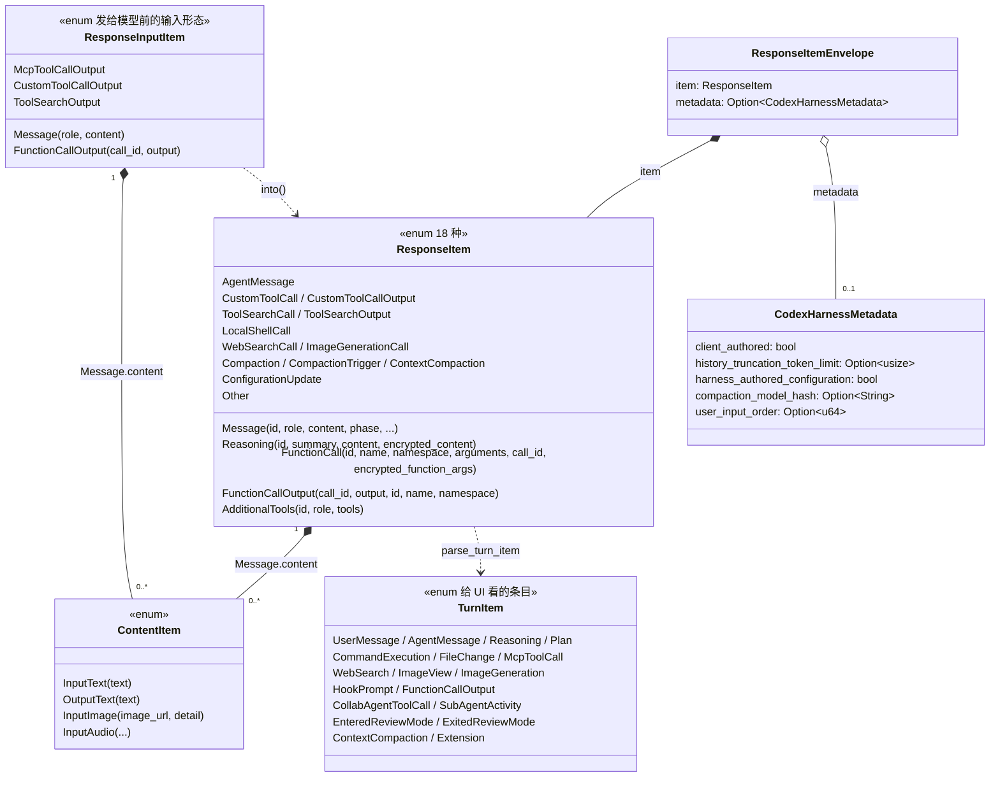

`ContentItem` 是 `Message.content` 里的一个内容块，文字、图片、音频都用它表示。`ResponseInputItem` 通过 `into()` 转成 `ResponseItem` 再写进历史。

| 类型 | 作用 |
|---|---|
| `ResponseItem` | **历史里存的就是它，发给模型的也是它**，没有第二套内部消息模型（对照 pi 的 `AgentMessage` → `Message` 两层）。18 个变体里 `Compaction` / `ContextCompaction` / `ConfigurationUpdate` / `AdditionalTools` 是 Codex 自己加的，发给非 OpenAI 提供方前会被处理。 |
| `ContentItem` | 消息正文的三种内容。`InputImage.detail` 发请求前会按模型能力归一化。 |
| `ResponseInputItem` | 还没进历史的输入，比如工具输出、用户消息，进历史前转成 `ResponseItem` |
| `ResponseItemEnvelope` | 历史里每条 `ResponseItem` 外面包一层元数据。**`ContextManager` 保存的是消息及其元数据，不只是消息本身。** |
| `CodexHarnessMetadata` | 13 个字段，模型都看不到。一部分给回放和截断用，比如 `history_truncation_token_limit` 记的是这条工具输出当时按什么预算截断的；还有一部分记录来源和归属，比如 `guardian_sources`、`retained_source`、`compaction_output`、`mcp_attribution`（MCP 调用归因）。 |
| `TurnItem` | 给 UI 的条目，`ItemStarted` / `ItemCompleted` 事件里带的就是它。由 `ResponseItem` 解析出来。 |

---

## 7. 模型请求的构造与发送

到这里，上下文和用户输入都已经写进 `ContextManager` 了。一次请求的数据来自两个地方：`ContextManager` 提供历史，整理后变成 `Prompt.input`；`StepContext` 提供模型能力、工具定义、输出约束，以及后面执行工具要用的 MCP、权限和环境绑定。

工具 schema 和执行工具用的本地对象都在 `StepContext` 里，构造请求和执行工具用的是同一份快照，所以模型看到的工具和实际执行的工具是对得上的。

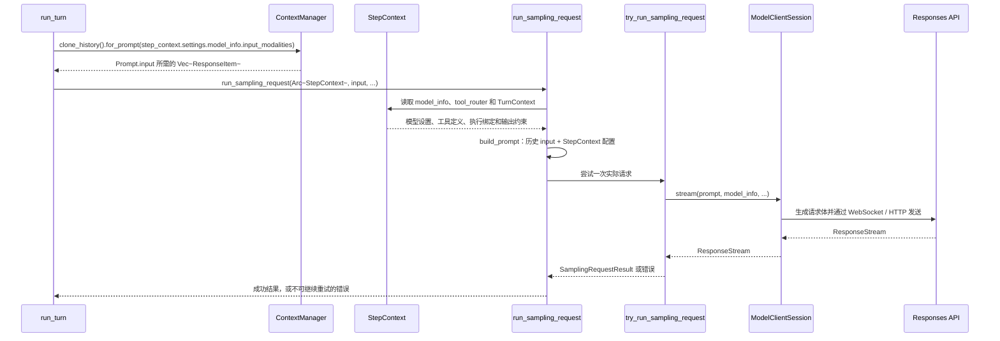

`for_prompt` 把历史整理成这次请求的输入，`run_sampling_request` 把输入和配置拼成 `Prompt`，失败了还负责重试。

### `for_prompt` 的历史整理

`ContextManager` 存的是 `Vec<ResponseItemEnvelope>`，里面既有要发给模型的 `ResponseItem`，也有只给 Codex 回放、截断用的元数据。`run_turn` 先 `clone_history()` 拿一份快照，再在快照上调 `for_prompt`。所以下面这些整理只改这次请求的副本，补出来的合成结果、替换掉的媒体都不会写回历史。

参数 `input_modalities` 来自当前 `StepContext.settings.model_info`，决定这次请求能保留图片、音频里的哪些。

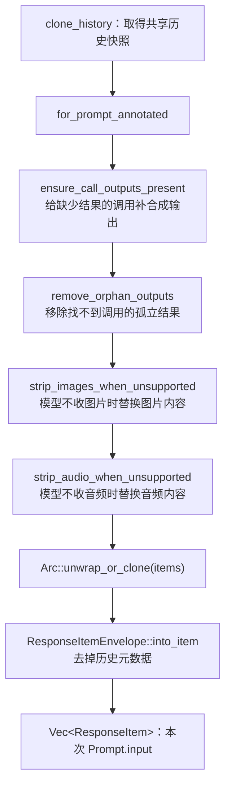

整理主要做两件事：补齐工具调用的结果，处理模型不支持的内容类型：

| 历史状态 | `for_prompt` 的处理 |
|---|---|
| `FunctionCall`、`CustomToolCall`、`ToolSearchCall` 或 `LocalShellCall` 后没有对应结果 | 紧跟调用插入合成结果。普通函数、自定义工具和本地 shell 使用 `"aborted"`；工具搜索补一个空的已完成结果 |
| 有工具结果，却找不到相同 `call_id` 的调用 | 删除这个孤立结果；由服务端执行的工具搜索结果可以单独存在 |
| 当前模型不支持图片或音频 | 将消息和工具结果中的对应媒体换成“当前模型不支持该媒体”的文本；图片生成结果会清空 |
| `ResponseItemEnvelope` 带有截断预算等元数据 | 元数据留在 Codex 内部，只取出其中的 `ResponseItem` 发给模型 |

合成结果的 id 是根据原调用的 id 算出来的，固定不变。同一段历史在重试或恢复后再跑一次 `for_prompt`，合成 id 还是一样的，不会因为本地补了一条就把 prompt cache 弄失效。整理完条目顺序不变，唯一新插进去的就是紧跟在缺结果的调用后面的那条合成结果。

### `run_sampling_request` 的请求与重试

`run_sampling_request` 是请求加重试的外壳，每次尝试都调 `try_run_sampling_request`，由它真正发请求、处理流式事件。

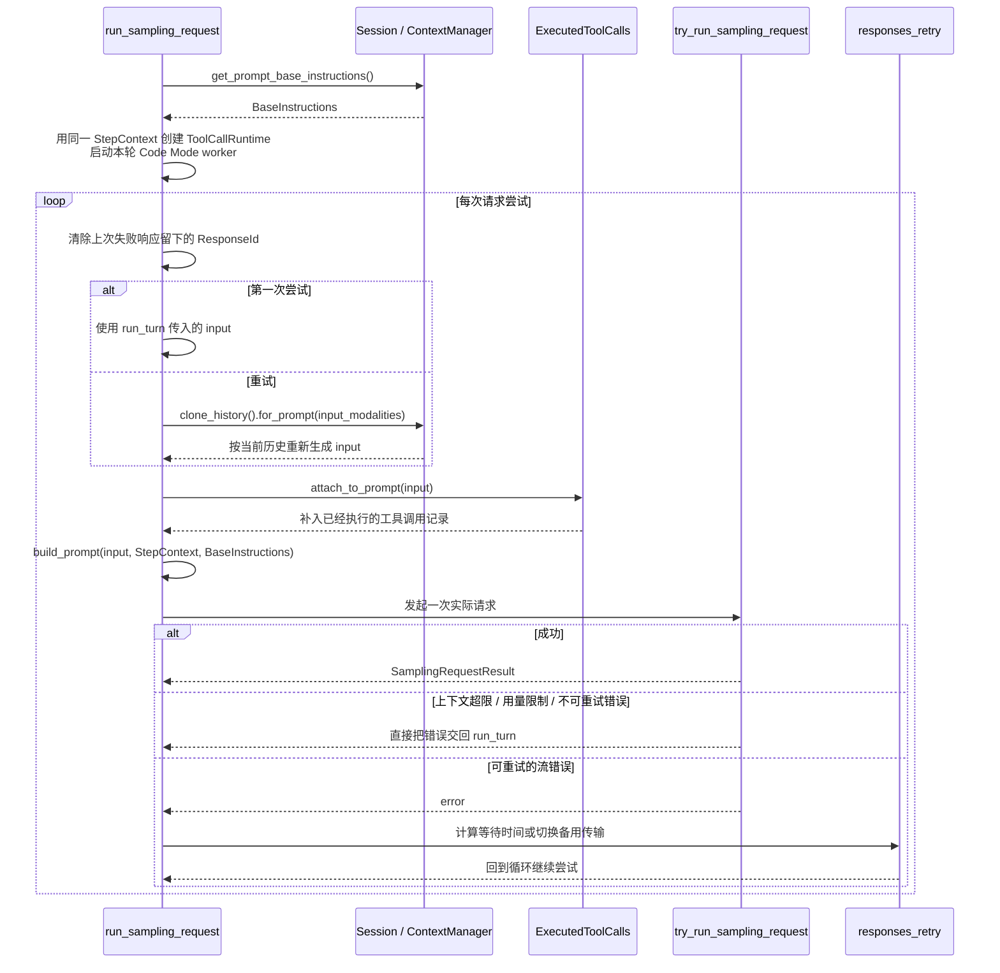

第一次尝试直接用 `run_turn` 准备好的 `input`。如果流中途断了，从第二次开始就不用这份旧数组了，而是重新读当前历史。因为断之前已经完成的模型输出、工具结果可能已经写进 `ContextManager`，重新读才能从实际进度接着来，不用让模型重新生成一遍。

每次尝试都要重新做三件事：把 `executed_tool_calls` 里要给模型看的记录附到输入上；用同一个 `StepContext` 调 `build_prompt`；清掉上次失败留下的 `ResponseId`，不然重试后的工具调用会被记到那个已经失败的响应下面。

`build_prompt` 拼出来的 `Prompt`：

| `Prompt` 字段 | 来源 |
|---|---|
| `input` | 本次尝试整理出来的历史 |
| `tools` | `StepContext.tool_router.model_visible_specs()`，与实际执行工具使用同一份绑定 |
| `base_instructions` | `Session::get_prompt_base_instructions()`；进入重试循环前读取一次 |
| `parallel_tool_calls` | 固定为 `true` |
| `output_schema` / `output_schema_strict` | 当前 `TurnContext` 的最终输出约束 |
| `cyber_access_program` | 当前 `TurnContext` 的网络访问程序配置 |

总结一下：同一个 `run_sampling_request` 里 `StepContext` 不变，模型、工具、权限、输出格式都一样，只有 `input` 每次按当前历史重建。错误怎么分类、怎么退避、怎么降级传输，见 §12。

`ModelClient` 是建会话时创建的。`run_turn` 用它 `new_session()` 出一个 `ModelClientSession`，或者直接拿启动时预热好的那个，这一轮后面的多次请求都用它。连接是复用的，但每次请求用什么配置和工具，还是看当次的 `StepContext`。

### 模型客户端与请求对象

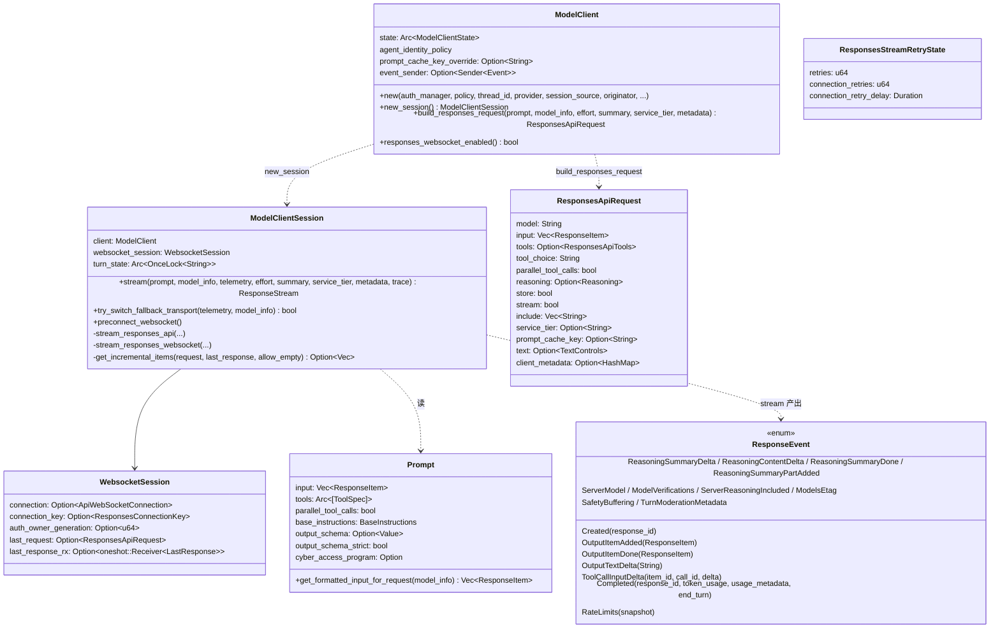

| 类型 | 作用 |
|---|---|
| `ModelClient` | 会话级的模型客户端，管连接和认证，认证恢复之类的状态也从这里报出去 |
| `ModelClientSession` | 一个 `run_turn` 用一个，新建或者拿预热的。里面缓存了 WebSocket 状态和 `x-codex-turn-state` 路由 token。源码里明确说它是 turn-scoped 的，不能跨轮复用 |
| `WebsocketSession` | 记着上一次的请求和响应。配置没变、新输入又是在上次基础上追加的，就只发新增的部分。base instructions 是 `input` 的第一条，它一变，新输入就不再是旧输入的延续，会自动退回发完整请求（不带 `previous_response_id`） |
| `Prompt` | 一次请求的数据结构。`tools` 是 `Arc<[ToolSpec]>` 直接指向 `ToolRouter.model_visible_specs` |
| `ResponsesApiRequest` | 真正序列化的请求体，字段见 §7 |
| `ResponseEvent` | provider 流被归一化成的 17 种事件。`Completed.end_turn` 是 `Option<bool>`：`Some(false)` 表示模型明确说"我还没完"，会置 `needs_follow_up` |
| `ResponsesStreamRetryState` | 普通重试计数和连接重试计数分开 |

走 Responses 接口时，WebSocket 开着就优先用 WebSocket；降级到 HTTP 之后，后面的请求就一直用 HTTP 了。

### 请求体字段及其来源

| 字段 | 来源 | 每步会变吗 |
|---|---|---|
| `model` | `StepContext` 里选定的模型 | 轮次中途 `Op::TurnSettings` 换模型时下一步变 |
| `input` | 开头一条 developer 消息放 base instructions（lite 模式下前面还有一条 `AdditionalTools`），后面是 `for_prompt` 整理后的历史，加上工具调用记录。发给非 OpenAI 提供方时会去掉内部字段 | 每步增长；压缩后整体替换 |
| `tools` | `ToolRouter.model_visible_specs()` | 同一轮内只在重新 `capture` 时变（steer 提到新 MCP） |
| `tool_choice` | 常量 `"auto"` | 不变 |
| `parallel_tool_calls` | `Prompt.parallel_tool_calls`（`build_prompt` 写死 `true`）且非 lite | 不变 |
| `reasoning` | 推理强度：用户指定的 > pin 住的 > 模型默认 | 换设置时变 |
| `store` / `stream` | `false` / `true` | 不变 |
| `include` | `["reasoning.encrypted_content"]` | 不变 |
| `service_tier` | `model_info.service_tier_for_request(turn 级 service_tier)` | `TurnStartOptions.service_tier` 只管这一轮 |
| `prompt_cache_key` | `prompt_cache_key(responses_metadata)`：默认线程 id，审查子会话用父线程 id | 不变 |
| `text` | 回答详细程度 + 本轮的输出 schema | 不变 |
| `client_metadata` | 会话、线程、轮次 id，触发原因，客户端名称等 | 每轮变 |
| 请求头 | 路由、客户端身份、能力标记等；路由 token 存在 `ModelClientSession` 里 | 同轮内固定 |

---

## 8. 模型响应处理

模型开始往回吐数据后，`try_run_sampling_request` 一个个处理 `ResponseEvent`：文字增量发给 UI，完整的消息写进历史，工具调用交给工具执行。等工具结果也写进历史，才返回 `SamplingRequestResult`。

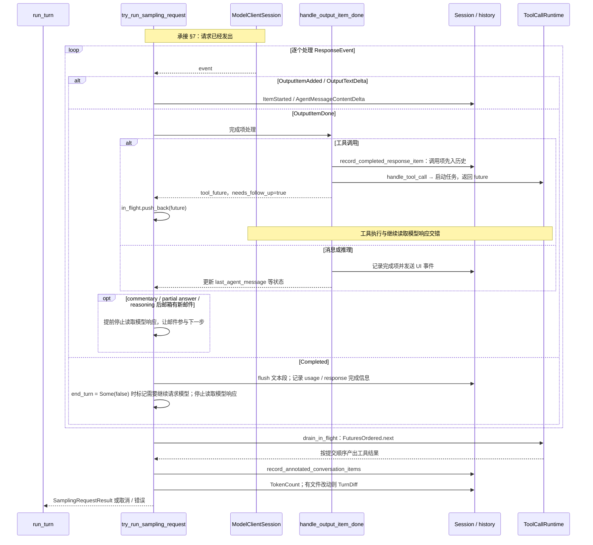

有几点要注意。工具调用项在工具启动前就写进历史了，就算后来被取消，也能看到模型调过什么。工具可以并发跑，`FuturesOrdered` 保证结果按提交顺序记录。future 入队后就接着读响应，不等工具，所以收到 `Completed` 的时候工具可能还没跑完。

另外，处理完一条 `OutputItemDone`，如果发现邮箱里有新消息，也可能提前不读了，让新消息进下一次请求。所以退出这个循环不一定是因为收到了 `Completed`；退出后还要等正在跑的工具，并检查任务有没有被取消。

### 流事件类型

| `ResponseEvent` | 作用 |
|---|---|
| `Created` | 记下响应 id，后面的输出和工具调用都挂在它下面 |
| `OutputItemAdded` | 模型开始输出一条消息、推理或工具调用。UI 可以先把这条显示出来；编辑类工具还能提前展示改动 |
| `OutputTextDelta` | 文字增量，发给 UI，顺便处理 plan 标记之类的内部格式 |
| `ToolCallInputDelta` | 工具参数的增量，比如让文件改动边生成边显示 |
| `ReasoningSummaryDelta` 等推理事件 | 推理内容的增量或摘要，发哪种看功能开关 |
| `OutputItemDone` | 一条输出完整了，写进历史。消息就通知 UI 完成，工具调用就交给工具执行。这时邮箱里有消息的话，可能提前结束这次响应 |
| `Completed` | 这次响应结束，带上用量。工具可能还没跑完，模型也可能说还要继续，所以不代表任务结束 |
| `RateLimits` | 服务端的额度和限流，和用量一起发给客户端 |
| 模型信息、安全状态等事件 | 实际用的是哪个模型之类的附加信息 |

不读响应之后，还要等已经启动的工具跑完，按顺序记下结果，然后才发 token 用量和文件改动。任务被取消的话，就交给中断流程。

---

## 9. 工具执行、审批与沙箱

`ToolCallRuntime` 去工具注册表里找 handler 来执行调用。下面用 `exec_command` 做例子，看工具怎么调度、怎么审批、怎么起进程。

```mermaid
sequenceDiagram
  participant SR as try_run_sampling_request
  participant HO as handle_output_item_done
  participant TR as ToolCallRuntime
  participant RG as ToolRegistry
  participant HK as hook_runtime
  participant H as ExecCommandHandler
  participant S as Session
  SR->>HO: OutputItemDone(FunctionCall)
  HO->>HO: ToolRouter::build_tool_call
  HO->>S: 重新打开 mailbox delivery；调用项入历史
  HO->>TR: handle_tool_call(call, child_token)
  HO-->>SR: InFlightFuture + needs_follow_up
  SR->>SR: push_back 到 FuturesOrdered
  Note over TR: 下方在工具任务中执行
  TR->>TR: wait_until_ready；取得并行读锁或独占写锁
  TR->>RG: dispatch_tool_call_with_state
  RG->>RG: 计数；查 runtime；matches_kind
  RG->>HK: run_pre_tool_use_hooks
  break hook 拦截
    HK-->>RG: Blocked(message)
    RG-->>TR: 文本作为工具结果
  end
  RG->>S: notify_tool_start
  RG->>H: handle(invocation) → handle_call
  Note over H: 参数、审批与沙箱见下一张图
  H-->>RG: ToolOutput
  RG->>HK: run_post_tool_use_hooks
  RG->>S: notify_tool_finish
  RG-->>TR: AnyToolResult
  TR-->>SR: future 完成，释放并行门
  SR->>S: drain_in_flight 按提交顺序记录输出
```

### 工具执行与历史记录的顺序

| 规则 | 相关函数 | 说明 |
|---|---|---|
| 工具调用项在执行前就入历史 | `record_completed_response_item` | 就算任务中途被取消，历史里也能看到模型调过什么。下次请求前会给缺结果的调用补一条合成输出。 |
| 结果按提交顺序写入历史 | `FuturesOrdered` | 工具可以并发跑，但结果按模型调用的顺序存，不按谁先跑完。 |
| 独占工具不能和别的调用同时跑 | `supports_parallel_tool_calls` | 能并行的可以一起跑，要独占的得等别的都结束。比如两个 `exec_command` 可以并发，`apply_patch` 要独占。 |

### `ToolCallRuntime`

| 字段 / 方法 | 含义 |
|---|---|
| `parallel_execution: Arc<RwLock<()>>` | 并行门：能并行的调用拿读锁一起跑，要独占的拿写锁单独跑 |
| `handle_tool_call_with_source(call, source, token)` | 启动一次工具执行：等工具就绪、过并行门、处理取消。没跑完就被用户中断的，给模型记一条 aborted 结果 |

### `ToolRegistry` 与 `ToolRouter`

| 方法 | 干什么 |
|---|---|
| `ToolRegistry::add` / `add_with_exposure` | 注册内置工具，默认 `Direct` |
| `register_external` | 注册 MCP 或动态工具；重名就拒绝，记一条冲突 |
| `dispatch_any_with_state(invocation, call_state)` | 找到工具并执行，前后跑 hook。执行前的 hook 能拦截调用或改参数；找不到工具就把错误返回给模型 |
| `ToolRouter::build_tool_call(item)` | 从模型输出里认出要本地执行的工具调用，拿到工具名和参数；普通消息不管 |
| `ToolRouter::model_visible_specs()` | 这一步发给模型的工具清单，`build_prompt` 直接用 |
| `ToolRouter::tool_supports_parallel(call)` | 这个工具能不能并行；查不到就当不能 |

`ToolRouter` 把内置工具、MCP 工具、扩展工具和客户端给的动态工具汇到一起，决定这次请求能执行哪些工具、模型能看到哪些。开了 Code Mode 的话还会准备对应的命名空间。

### 工具接口和调用对象

一次工具调用要经过三层：

- 路由：每一步的 `StepContext` 里有一个 `ToolRouter`，它包着 `ToolRegistry`（名字 → handler）和这一步给模型看的工具清单。
- 调度：`ToolCallRuntime` 管一次调用的执行，`ToolRouter` 补上需要的上下文，`ToolRegistry` 找到对应的 handler。
- 执行：handler 实现 `CoreToolRuntime`，干具体的活。要跑命令或改文件的，再交给 `ToolOrchestrator` 处理审批、沙箱和重试。

```mermaid
classDiagram
  direction TB
  class ToolCallRuntime {
    parallel_execution: RwLock 并行门
    +handle_tool_call(call, token)
  }
  class ToolRouter {
    registry: ToolRegistry
    model_visible_specs
    +build_tool_call(item) ToolCall
    +dispatch_tool_call(...)
  }
  class ToolRegistry {
    tools: name → RegisteredTool
    +dispatch_any(invocation) AnyToolResult
  }
  class ToolCall {
    tool_name / call_id / payload
  }
  class ToolInvocation {
    session / step_context / payload
    cancellation_token / tracker
  }
  class AnyToolResult {
    +into_response() ResponseItem
  }
  class CoreToolRuntime {
    <<trait>>
    +handle(invocation)
    +pre/post_tool_use_payload()
  }
  class XxxHandler {
    ExecCommandHandler
    ApplyPatchHandler ...
  }
  class ToolOrchestrator {
    +run(tool, req, ctx)
  }
  class ToolRuntime {
    <<trait>>
    UnifiedExecRuntime / ApplyPatchRuntime
    +exec_approval_requirement(req)
  }

  ToolCallRuntime ..> ToolCall : 接收
  ToolCallRuntime --> ToolRouter : dispatch
  ToolRouter *-- ToolRegistry
  ToolRouter ..> ToolInvocation : 造
  ToolRegistry o-- "N" CoreToolRuntime : 按名字查
  ToolRegistry ..> AnyToolResult : 返回
  CoreToolRuntime <|.. XxxHandler
  XxxHandler ..> ToolOrchestrator : 跑命令/改文件时
  ToolOrchestrator ..> ToolRuntime : 审批 + 沙箱 + 重试
```

### trait 与暴露方式

| 类型 | 作用 |
|---|---|
| `ToolExecutor<Invocation>` | 最小契约：名字、给模型看的 `ToolSpec`、`handle`。`supports_parallel_tool_calls` 默认 `false`；`exec_command` 和一批只读工具覆盖为 `true` |
| `CoreToolRuntime` | core 内部扩展：传给 hook 的数据、就绪等待（MCP 工具要等服务器连上）、参数流式 diff。所有 handler 都实现它 |
| `ToolExposure` | 六种。`Direct` 进初始工具清单；`Deferred` 只能靠 `tool_search` 找到；`Hidden` 注册了但模型看不见（比如 hook 专用） |
| `ToolInvocation` | handler 收到的全部参数。`step_context` 是那一步的快照，`tracker` 是这一轮的文件 diff 累加器 |

### 命令审批与进程启动

```mermaid
sequenceDiagram
  participant H as ExecCommandHandler
  participant PM as UnifiedExecProcessManager
  participant EP as ExecPolicyManager
  participant S as Session / TurnState
  participant U as 客户端
  participant SB as executor / sandbox
  H->>H: parse_arguments；resolve_tool_environment；权限参数
  H->>PM: exec_command → open_session_with_sandbox
  PM->>EP: create_exec_approval_requirement_for_shell（规则匹配，无命中走未匹配回退）
  EP-->>PM: Skip / NeedsApproval / Forbidden
  Note over PM: 非 shell 工具若无自带审批要求，改由 ToolOrchestrator 调用 default_exec_approval_requirement
  break Forbidden
    PM-->>H: 拒绝执行
  end
  opt NeedsApproval
    PM->>S: request_command_approval
    S->>S: pending_approvals[call_id] = oneshot sender
    S-->>U: ExecApprovalRequest
    U->>S: Op::ExecApproval
    S->>S: notify_approval；Abort 走中断路径
    S-->>PM: ReviewDecision
    break Denied / Abort
      PM-->>H: 拒绝或中断
    end
  end
  PM->>SB: 按环境、权限和 SandboxType 启动进程
  SB-->>PM: 输出、退出码或 SandboxDenied
  PM-->>H: ExecCommandToolOutput（可带 process_id）
  Note over H: 回到上一图的 ToolOutput → hooks → future → 历史
```

### 执行规则与默认审批策略

上图 `PM->>EP` 这一步是 shell 命令的路径：`ExecPolicyManager` 先拿 starlark 规则去匹配（允许、禁止、询问），没匹配上的走 `render_decision_for_unmatched_command` 兜底：危险命令或者没有沙箱保护时要问，`Never` 下直接放行，`UnlessTrusted` 下一律要问。最后返回 `Skip / NeedsApproval / Forbidden` 其中一个。

不是 shell 命令的工具（比如 `apply_patch`）如果自己没给审批要求，`ToolOrchestrator` 就调 `default_exec_approval_requirement`（`core/src/tools/sandboxing.rs`），只看审批策略和文件系统沙箱种类来判断：

| `AskForApproval` | 文件系统沙箱种类 | 结果 |
|---|---|---|
| `Never` | 任意 | `Skip`，不询问 |
| `OnRequest` / `Granular` | `Restricted` | `NeedsApproval`；`Granular` 且禁用 sandbox approval 时为 `Forbidden` |
| `OnRequest` / `Granular` | `Unrestricted` / `ExternalSandbox` | `Skip`，先在沙箱里跑 |
| `UnlessTrusted` | 任意 | `NeedsApproval` |

另外，有些允许规则还能指定绕过沙箱。

需要审批时，`request_command_approval` 把请求发给客户端，这次工具调用就停在那等。等待方是按 id 存在 `pending_approvals` 里的 oneshot，用户的决定靠 id 送回来。用户可以批准、拒绝或中断；选了“本会话内都批准”，同样的命令这个会话里就不再问了。

`apply_patch` 也是先查审批再执行。如果被沙箱拦了，而策略允许放宽权限，会再问一次用户，批准后重试。

### 沙箱类型的确定

用哪种沙箱看权限配置、平台和执行需求：macOS 用 Seatbelt，Linux 用 Seccomp，Windows 用受限令牌。完全访问模式，或者规则明确允许绕过沙箱时，就不套沙箱。

远程执行环境（`environment.is_remote()`）不在本机起沙箱，权限以 URI 的形式发给远端 executor，由它自己处理。

### `ToolOrchestrator` 与 `ExecApprovalRequirement`

`ToolOrchestrator` 把审批、选沙箱、被沙箱拦了之后的重试放在一起，跑命令、改文件的工具都用它。

`apply_patch` 的 handler 直接调它，`exec_command` 是在进程管理器准备执行环境时调它。工具可以自己给审批要求，没给就用默认策略。结果是一个 `ExecApprovalRequirement`：直接跑（`Skip`）、先问（`NeedsApproval`）、不让跑（`Forbidden`）。

### 工具结果的回写路径

工具结果转成 `FunctionCallOutput` 这类条目，靠 `call_id` 和之前的调用对上。写进历史后，下一次请求模型就能看到，然后接着回答或者再调别的工具。

输出太长会按预算截断，用的预算记在历史元数据里。截掉的部分还能不能读到，要看工具有没有留着进程或资源句柄，`chunk_id` 不能拿来通用地读原文。

### 工具未成功执行的三种输出

| 情况 | 来源 | 返回给模型的内容 |
|---|---|---|
| 模型调了不存在的工具 | `unsupported_tool_call_message` | 一条说明工具不存在的工具输出 |
| hook 拦截 | `PreToolUseHookResult::Blocked(message)` | hook 给的文本作为输出 |
| 被中断 | `aborted_response(call, secs)` | "aborted by user after N seconds" |

### 内置工具清单

| 工具名 | 注册条件 |
|---|---|
| `exec_command` + `write_stdin` | `Feature::ShellTool` 且 `Feature::UnifiedExec`；关掉 UnifiedExec 就只有一次性的 `exec_command` |
| `apply_patch` | 模型的 `apply_patch_tool_type` 非空 |
| `update_plan` | `config.update_plan_enabled` |
| `request_user_input` / `request_user_input_async` / `send_message_to_user_async` | 实验开关 + 非子 agent |
| `request_permissions` | `Feature::RequestPermissionsTool` |
| `new_context_window` / `get_context_remaining` | `Feature::TokenBudget` |
| `current_time` / `sleep` | `Feature::CurrentTimeReminder` / `Feature::SleepTool` |
| `view_image` | `Feature::ViewImage` |
| `list_mcp_resources` / `read_mcp_resource` 等 | 有 MCP 资源 |
| `spawn_agent` / `send_message` / `wait_agent` / `list_agents` / `interrupt_agent` / `followup_task` | `collab_tools_enabled` |
| `tool_search` | 有 `Deferred` 工具时在 `finalize_tool_router` 里自动加 |
| `exec` / `wait`（`codex_code_mode::PUBLIC_TOOL_NAME` / `WAIT_TOOL_NAME`） | `ToolMode::CodeMode` |

---

## 10. 执行循环与任务结束

`SamplingRequestResult` 返回之后有三处判断：`run_turn` 判断还要不要再请求模型；`run_turn` 返回后，`RegularTask` 判断还有没有输入要处理；任务结束后，Session 再清理当前轮次。下图把这三处和各自回到哪里都画出来了。

```mermaid
sequenceDiagram
  participant RT as run_turn
  participant IQ as InputQueue
  participant CP as run_auto_compact
  participant HK as Stop hooks
  participant RG as RegularTask
  participant S as Session::on_task_finished
  Note over RT: 模型响应和这次调用的工具均已处理完
  RT->>IQ: model_needs_follow_up 时重新允许当前轮次接收邮箱消息
  RT->>RT: can_drain=true；drain_async_hook_results
  RT->>IQ: has_pending_input
  RT->>RT: context_window_token_status；计算 needs_follow_up
  alt 需要继续执行，且达到压缩阈值或明确要求新窗口
    RT->>CP: run_auto_compact(MidTurn)
    CP-->>RT: 成功后更新 can_drain，continue
  else 需要继续执行
    RT->>RT: continue，回到 §7
  else 不需要继续执行
    RT->>HK: run_turn_stop_hooks
    alt hook 阻止结束并提供输入
      HK-->>RT: should_block + 文本
      RT->>RT: 输入入历史，continue
    else 可以结束
      RT->>RT: 按 hook 结果收尾，退出内层
      RT-->>RG: last_agent_message
    end
  end
  RG->>IQ: has_pending_input（外层复查）
  alt 有输入且没有 terminal_error
    RG->>RG: 空输入再次 run_turn（§6）
  else 任务返回且 token 未取消
    RG->>S: spawn 闭包先 flush，再 on_task_finished
    S->>S: task.take + handle.detach
    S->>IQ: take_pending_input_for_turn_state
    S->>S: 剩余输入经 hook 写入历史；计算用量
    S->>S: TurnComplete / TurnAborted；条件满足时清 active_turn
    S->>S: flush；maybe_start_turn_for_pending_work
  end
```

`needs_follow_up` 为真，说明模型还要继续，或者队列里还有输入；为假也不是马上结束，还要过一遍 Stop hook。`run_turn` 返回后 `RegularTask` 再查一次队列；任务结束后，`on_task_finished` 处理剩下的输入、发轮次结束事件，再看邮箱里有没有消息要开新任务。

清 `active_turn` 之前还要确认 task 已经取走、turn_state 还是同一个对象，免得旧轮次收尾时把新登记的状态清掉。上图只画了正常结束的情况，被取消的任务走中断路径收尾。

### 执行函数及其调用关系

| 函数 | 干什么 | 谁调它 |
|---|---|---|
| `run_turn` | 处理一批输入：准备上下文，然后反复请求模型、执行工具，直到没活了或者跑不下去 | `RegularTask::run` |
| `run_hooks_and_record_inputs` | 先过输入 hook，通过的写进历史；全被拦了就停 | `run_turn` 三处、`on_task_finished` |
| `run_pre_sampling_compact` | 处理新输入前看要不要压缩，换模型导致窗口变小也在这里处理 | `run_turn` |
| `run_auto_compact` | 按功能开关和 provider 能力，选窗口重置、远程压缩还是本地总结 | `run_pre_sampling_compact`、内层循环两处 |
| `build_prompt` | 汇总本次请求的历史、工具和指令（§7）。 | `run_sampling_request` |
| `run_sampling_request` | 一次请求加重试：临时错误等一会再试，不能重试的交回上层 | 内层循环 |
| `try_run_sampling_request` | 真正发一次请求，处理流式输出和工具调用，等工具结果记完 | `run_sampling_request` |
| `drain_in_flight` | 等已启动的工具跑完，按提交顺序存结果 | `try_run_sampling_request` |
| `built_tools` | 汇总这一步能用的工具，生成 `ToolRouter` | `capture_step_context_inner` |
| `handle_output_item_done` | 处理一条完整输出：消息就存下来通知 UI，工具调用就启动执行；解析不了的工具调用给一条错误结果 | `try_run_sampling_request` |

### `run_turn` 的循环逻辑

每一圈请求模型之前，先取出能处理的新输入，过一遍输入 hook。然后准备这一步的配置和工具清单，把时间、工作目录这些变化补进历史，再整理成能发给模型的列表。

`can_drain_pending_input` 决定这一圈要不要从队列里取 steer。如果这次 `run_turn` 本来就带了用户输入，第一圈先处理它，请求完模型之后才去取队列；压缩之后也可能先关掉，让模型先接着处理压缩后的上下文。这样原始输入、执行中的 steer、压缩后的续接内容不会挤在同一次准备里。

模型响应和工具结果都记完之后，依次检查：

- 还有没有活：工具结果要交回模型、模型说了还要继续、又来了新输入，都要再请求一次。
- 上下文够不够：要继续，但上下文到了阈值或者明确要求换窗口，就先压缩或换窗口再继续。
- 能不能结束：没活了还要跑 Stop hook。hook 可以追加要求，让模型再来一轮；hook 放行了 `run_turn` 才返回。

出错也会影响结果。用户中断就直接结束；部分上下文超限的情况可以压缩后继续；其他跑不下去的错误会通知客户端，结束这次执行，用户之后还能接着聊。

### `on_task_finished`

`on_task_finished` 做一轮结束后的收尾：记下执行结果和本轮用量，把还没来得及处理的 steer 写进历史，然后告诉客户端任务是完成了还是被中断了。注意这些 steer 只是写进了历史，模型并没有处理过，要等下一次请求才会看到。

开始取最后一批之前先把当前轮次标成“收尾中”（`ActiveTurn.finishing`，一个取消令牌），等最后一批写完再取消它。收尾中的轮次不再接受注入，新来的 steer 会被当成没有活动轮次处理；迟到的客户端回复和通知则等这个令牌取消后再追加，保证排在最后一批后面。已经预留、还没开始的轮次不受影响，照常收输入。

然后清掉当前任务状态，flush 历史。清之前会确认状态还是这一轮的，免得把新任务的状态删了。最后看邮箱里有没有要自动开一轮的消息，有的话就接着开下一轮。

---

## 11. steer、邮箱与中断

任务跑着的时候用户补一句“再加个测试”，`steer_input` 只是把它放进 `TurnState.pending_input`，别的什么都不做。要不要因为它再请求一次模型，是 `run_turn` 在这次请求和工具都处理完之后才判断的。

入队之后，`run_turn` 会检查队列，在下一圈把输入取出来。邮箱消息比 steer 多一个投递阶段的限制；中断则是靠取消令牌。

### `needs_follow_up` 的赋值与判断

源码里有两个 `needs_follow_up`，作用域不一样：一个记这次模型响应要不要继续，一个决定 `run_turn` 要不要继续循环。前一个通过返回值传给后一个。

**第 1 步：处理模型响应时，累积继续标记**

`try_run_sampling_request` 读响应之前先把局部变量设成 `false`：

```rust
let mut needs_follow_up = false;
```

每处理一条 `OutputItemDone`，就把 `handle_output_item_done` 的结果合并进来：

```rust
needs_follow_up |= output_result.needs_follow_up;
```

用的是 `|=`，所以只要有一条输出要求继续，后面的普通文本也改不回 `false`。会把它置成 `true` 的情况：

| 触发条件 | 标记赋值 | 后续请求的用途 |
|---|---|---|
| 收到可执行的工具调用 | `handle_output_item_done` 将 `output.needs_follow_up` 设为 `true`，随后通过 `|=` 合并 | 需要把工具结果交回模型 |
| 工具调用解析返回 `RespondToModel` 错误 | 写入可供模型读取的错误结果，同样将 `output.needs_follow_up` 设为 `true` | 让模型看到错误并继续处理 |
| 收到 `Completed`，且 `end_turn == Some(false)` | 直接将请求内的 `needs_follow_up` 设为 `true` | 模型明确表示还没有结束 |
| 一条 commentary、partial answer 或 reasoning 输出完成后，发现邮箱有待处理消息 | 提前退出响应读取，返回 `SamplingRequestResult { needs_follow_up: true, ... }` | 让下一次请求能处理新邮件 |

`end_turn` 是 `Some(true)` 或 `None` 时，不会把已经置上的标记清掉。响应读完后还要等工具跑完，结果才返回 `run_turn`。

**第 2 步：回到 `run_turn`，把待处理输入也算进去**

只保留关键的几行，邮箱开关、异步 hook、token 检查这些省略了：

```rust
// 将本次请求返回的标记取出，命名为 model_needs_follow_up。
let SamplingRequestResult {
    needs_follow_up: model_needs_follow_up,
    ..
} = sampling_request_output;

// 检查执行期间有没有新输入到达。
let has_pending_input =
    sess.input_queue.has_pending_input(&sess.active_turn).await;

// 这是 run_turn 内新建的局部变量。
let needs_follow_up = model_needs_follow_up || has_pending_input;
```

所以就算模型已经答完了，只要队列里还有 steer，`needs_follow_up` 就是 `true`，`run_turn` 会接着处理这条输入。

为 `true` 就继续循环，要压缩的话先走 §12 的压缩分支；为 `false` 才去跑 Stop hook 等结束检查，hook 也还可能要求继续。这两个变量每次请求都重新算，不是存在 `Session` 上的状态。

### steer 输入的处理时序

下面只画一种情况：模型正在回答，用户补了一句“再加个测试”；这次响应正常结束，模型没要求继续，也没触发压缩。这张图画的是关掉 `InstantInterrupt` 时的行为。这个开关默认是开的，开了以后第 N 次请求不会等到跑完，而是被 steer 直接打断，见下一小节。§4 讲过的提交和校验，这里简化成一个 `steer_input`。

```mermaid
sequenceDiagram
  participant U as 用户
  participant S as Session
  participant Q as InputQueue
  participant R as run_turn

  Note over R: 第 N 次模型请求正在进行
  U->>S: steer_input：再加个测试
  S->>Q: 将输入追加到 TurnState.pending_input
  S-->>U: Steered：已接受输入
  Note over Q,R: 输入还在队列里，本次请求尚未读到

  Note over R: 第 N 次请求结束，model_needs_follow_up = false
  R->>Q: has_pending_input(active_turn)
  Q-->>R: true
  R->>R: 队列里还有输入，将 needs_follow_up 设为 true

  Note over R: 进入下一次循环
  R->>Q: get_pending_input(active_turn)
  Q-->>R: 取出“再加个测试”
  R->>R: run_hooks_and_record_inputs：处理输入并写入历史
  R->>R: 重新捕获 StepContext
  Note over R: 第 N+1 次请求包含这次 steer
```

`Steered` 只说明输入被收下了。等它被取出来、写进历史，才会发 `ItemCompleted(UserMessage)`，之后的模型请求才能看到它。

一般 `get_pending_input` 在每圈开头把能处理的输入一次取完，但要不要取还得看 `can_drain_pending_input`：这次 `run_turn` 自带初始输入时先处理初始输入；某些压缩分支也会暂时不取（见 §10）。

如果 steer 来得更晚，错过了 `run_turn` 的结束检查，也没关系：`RegularTask::run` 在 `run_turn` 返回后还会再查一次队列，有输入又没有致命错误，就再调一次 `run_turn`。

### 即时打断（`InstantInterrupt`，默认开启）

上面的时序里，steer 要等当前这次模型请求跑完才被读到。模型如果正在写一大段，用户补的话就得等它写完。`Feature::InstantInterrupt` 默认开启：用户一 steer，正在进行的请求就会被打断。

开关打开时，捕获 `StepContext` 时会多建一个取消令牌 `preempt`（§5）。`run_sampling_request` 一开始就调 `InputQueue::watch_user_input`：后台任务先订阅队列的变化，再检查 `pending_input` 里有没有用户输入，一有就 `preempt.cancel()`。

请求建立、读流、重试前的等待都挂了 `.or_cancel(&preempt)`，所以令牌一取消，这次请求就提前结束，返回 `needs_follow_up: true`。下一圈照常取出 steer、写进历史，再发新请求。几个细节：

- 如果流已经开始了，而且模型走的是 Responses Lite，会通过 websocket 发一个 `response.interrupt` 让服务端停下，然后把这次响应正常读完，连接和历史都还能接着用。
- 被打断的那一步，即使压缩后估算的上下文仍然超限，也会先把 steer 取出来处理（`can_drain_pending_input`）。
- Code Mode 里正在跑的 cell 也会让出。
- 这里说的是 steer 打断模型请求。用户直接中断整轮（`Op::Interrupt`）是另一回事，由 `CodeModeInterrupt` 管：中断时把正在跑的 Code Mode cell 和它里面嵌套的工具调用一起终止，cell 里存下的会话变量保留。
- 另一个开关 `DeferMailboxPreemption` 管的是邮箱消息：打开后，模型刚输出 commentary 或 reasoning 时，不会因为有邮件就提前截断响应。

### `InputQueue`

`InputQueue` 是读写 steer 和邮箱的入口。steer 存在 `TurnState.pending_input`（轮次级），邮箱存在自己的 `mailbox_pending_mails`（会话级）。

| 方法 | 干什么 | 谁调它 |
|---|---|---|
| `extend_pending_input_for_turn_state(turn_state, items)` | 追加到轮次的待处理输入 | `steer_input`、`start_task` |
| `extend_pending_input_and_accept_mailbox_delivery_for_turn_state` | 追加，并重新允许当前轮次接收邮箱消息（`CurrentTurn`） | `steer_input` |
| `get_pending_input(active_turn)` | **取走**轮次待处理输入 + 取出邮箱中所有待处理消息（当前轮次允许接收时才取，见下文）。返回 `(items, start_options)` | `run_turn` 每步开头 |
| `has_pending_input(active_turn)` | 有没有东西可取 | `RegularTask::run` 外层循环、`run_turn` |
| `drain_mailbox_input_items()` | 把邮箱消息全部取出来，顺便汇总自动开下一轮要用的参数；消息的父轮次都一样时才保留这个关联 | `get_pending_input`、`start_task` |
| `clear_pending(active_turn)` | 清掉待处理输入，把还在等回复的请求都结束掉 | `abort_all_tasks` |
| `enqueue_mailbox_communication(...)` | 别的 agent 发来的消息放进邮箱 | `Op::InterAgentCommunication` |

### 邮箱投递阶段（`MailboxDeliveryPhase`）

主 agent 用 `spawn_agent` 派几个子 agent 并行干活，子 agent 干完或者有进展了，就给主 agent 发条消息，放进会话级的“邮箱”。主 agent 在每圈开头通过 `get_pending_input` 把 steer 和邮件一起取出来，写进历史，下一次请求就能看到。

问题是子 agent 的消息什么时候到不确定。如果主 agent 已经给出了最终答案，这时晚到一封邮件，它还算本轮的待处理输入，`has_pending_input` 返回 `true`，`run_turn` 就会在答完之后又请求一次模型。

所以加了 `TurnState.mailbox_delivery_phase`，决定邮件算不算这一轮的。`MailboxDeliveryPhase` 有两个值：

- `CurrentTurn`：收。邮件可以并进这一轮。
- `NextTurn`：不收。邮件先留在邮箱里，等下一轮再处理。

什么时候切换：

| 时机 | 接收状态 | 代码 |
|---|---|---|
| 新一轮开始 | 收（默认值） | `#[default] CurrentTurn` |
| 模型输出了一段给用户看的最终答案（`assistant` 消息，phase 是 `FinalAnswer` 或没标，文本非空） | 不收 | `handle_output_item_done` → `defer_mailbox_delivery_to_next_turn`（`input_queue.rs:322`） |
| 模型接着又发了工具调用，或者用户 steer | 收 | `handle_output_item_done`、`steer_input` → `accept_mailbox_delivery_for_current_turn` |

切到 `NextTurn` 之前会先看一眼队列：已经有 steer、工具输出或者带 `trigger_turn` 的邮件，就还保持 `CurrentTurn`，让这一轮接着处理。

到了 `NextTurn`，邮件既不会被取出来，也不算本轮的待处理输入，所以不会因为一封晚到的邮件又请求一次模型。

assistant 消息的 phase 有三种（`MessagePhase`）：`Commentary` 是过程说明；`PartialAnswer` 是答案的一部分，后面还可能有输出或工具调用；`FinalAnswer` 是这一轮最终的答案。只有 `FinalAnswer` 和没标 phase 的消息会让邮箱切到 `NextTurn`。`PartialAnswer` 和 `Commentary` 一样不会，邮件来了还能打断响应、并进这一轮。

没处理的邮件留在 `mailbox_pending_mails` 里，之后有两种方式被处理：

- 用户下次发消息开新一轮时，`start_task` 先把邮箱里的邮件取出来并进这一轮（§5）。
- 如果邮件带 `trigger_turn = true`，会话一空闲，`maybe_start_turn_for_pending_work`（`tasks/mod.rs:457`）就自动开一轮去处理它，不用等用户。

### 中断的传播路径

用户按了中断，`Session::interrupt_task` 会取消当前任务、通知客户端，并清掉这一轮还没处理的输入和还在等的审批等请求。开了 Code Mode 的话，正在跑的 V8 cell 也会被中断。

取消令牌从任务一路传到 `run_turn`、模型请求和工具调用，所以中断不用等工具跑完，工具调度层会直接去终止还没完成的执行。

中断之后可以用 `RecoverTurn` 在已有历史上接着跑，不用再发一条用户消息。中断留下的那些只有调用、没有结果的工具记录，`for_prompt` 会补上合成结果（§7），后面的请求照常能发。

---

## 12. 重试与上下文压缩

模型读了文件、跑了工具，正要接着回答，这时可能遇到两种问题：一是连接断了，要重新请求；二是历史太长了，要先压缩。前者是 `run_sampling_request` 里的重试循环处理的，后者主要是 `run_turn` 调 `run_auto_compact` 处理。

| 情况 | 处理函数 | 请求前的变化 | 继续位置 |
|---|---|---|---|
| 响应流发生可重试错误 | `run_sampling_request` → `handle_response_stream_error` | 等待重连，必要时从 WebSocket 切到 HTTP；重新读取当前历史构造请求 | 同一个 `run_sampling_request` 的下一次尝试 |
| 还有工作要做，且上下文达到阈值 | `run_turn` → `run_auto_compact` | 替换模型后续使用的历史，更新上下文基线与 token 用量 | `run_turn` 的下一次循环 |
| 请求返回上下文超限或用量限制 | `run_sampling_request` 将错误交回 `run_turn` | 先更新相关用量状态；不进入普通连接重试 | 由外层错误分支决定如何结束或处理 |

### 请求重试流程

§7 讲过：`run_sampling_request` 每次尝试调一次 `try_run_sampling_request`，第一次用传进来的 input，重试时重新 `clone_history().for_prompt(...)` 再 `build_prompt`。`StepContext` 全程不变，失败前已经记下的输出和工具结果会带进下一次请求。

```mermaid
sequenceDiagram
  participant R as run_turn
  participant S as run_sampling_request
  participant H as Session
  participant T as try_run_sampling_request
  participant E as handle_response_stream_error

  R->>S: StepContext、input、ModelClientSession
  S->>S: 初始化 retry_state；保存 initial_input
  loop 请求尝试，直到成功或返回错误
    alt 第一次尝试
      S->>S: 取 initial_input
    else 重试
      S->>H: clone_history()
      H-->>S: 当前历史快照
      S->>S: for_prompt(input_modalities)
    end
    S->>S: attach_to_prompt；build_prompt（沿用 StepContext）
    S->>T: 发送请求，处理响应和工具
    T-->>S: Result
    alt 成功
      break 请求完成
        S-->>R: SamplingRequestResult 和保留的原始输入
      end
    else ContextWindowExceeded
      S->>H: set_total_tokens_full
      break 交回外层错误分支
        S-->>R: Err
      end
    else UsageLimitReached
      opt 服务端返回了 rate limits
        S->>H: update_rate_limits
      end
      break 交回外层错误分支
        S-->>R: Err
      end
    else 其他错误
      S->>S: 首次失败时保存 original_input
      S->>E: retry_state、max_retries、err、client_session
      E-->>S: Ok 或 Err
      alt 允许重试
        S->>S: record_sampling_retry；回到请求循环
      else 不允许重试或额度耗尽
        break 退出请求循环
          S-->>R: Err
        end
      end
    end
  end
```

`handle_response_stream_error` 返回 `Ok` 就接着重试，返回 `Err` 就把错误交回 `run_turn`。它里面是这么判断的：

```mermaid
sequenceDiagram
  participant S as run_sampling_request
  participant E as handle_response_stream_error
  participant C as ModelClientSession
  participant H as Session

  S->>E: 错误和当前重试状态
  E->>E: err.retry_delay(retries + 1)
  alt 返回 None：不可重试
    E-->>S: Err
  else 满足持续连接重试条件
    E->>H: notify_stream_error：等待网络恢复
    E->>E: connection_retries 增加；等待 5s 至 60s
    Note over E: 普通 retries 不变
    E-->>S: Ok
  else 普通额度已耗尽
    E->>C: try_switch_fallback_transport
    C-->>E: 是否切换成功
    alt 切换到 HTTP 成功
      E->>H: 发送传输降级通知
      E->>E: retries = 0
      E-->>S: Ok
    else 无法再降级
      E->>H: 保存 ExhaustedResponseRetry
      E-->>S: Err
    end
  else 普通额度尚未耗尽
    E->>E: retries 增加
    E->>H: 按通知策略报告重连进度
    E->>E: 按 retry_delay 等待
    E-->>S: Ok
  end
```

用文字再过一遍：

1. 能不能重试。`err.retry_delay(...)` 返回 `None` 就直接退出。`ContextWindowExceeded` 和 `UsageLimitReached` 其实在这之前就单独处理了：前者把 token 状态标成窗口已满，后者更新 rate limits，然后都直接返回错误。另一种不可重试的错误是 `ResponseIncomplete`：服务端发来 `response.incomplete`（比如回复写到了 `max_output_tokens`），保留服务端给的原因，立即停止处理这个流，这一轮以错误结束。
2. 是不是走无限连接重试。开了 `UnboundedConnectionRetries`，错误是普通模型请求的 `ConnectionFailed`，不是内部会话，也不是 Amazon Bedrock，就走这条：等待时间从 5 秒开始翻倍，最多 60 秒。它单独计数，不占普通重试的次数。
3. 普通次数用完了，看能不能换传输。`try_switch_fallback_transport` 成功就从 WebSocket 切到 HTTP，普通重试计数清零，接着试。
4. 普通次数还没用完。计数加一，按服务端建议的时间或本地退避等一下，再试。次数上限是 provider 的 `stream_max_retries`。
5. 都不行。存一条 `ExhaustedResponseRetry`（里面有本轮 id 和服务端建议的下次重试时间），返回原来的错误。这条记录只是存着，不会自己触发新的执行。

### 自动压缩的触发条件

自动压缩是本地根据 token 状态提前判断的，不是等服务端报错。`context_window_token_status` 看最近的用量、窗口上限和配置的阈值，所以一般在服务端真正拒绝之前就压缩了。

接着 §11 的继续判断，`run_turn` 算的是：

```rust
let needs_follow_up = model_needs_follow_up || has_pending_input;
let candidate = if needs_follow_up { async_compaction::take_ready(&sess, &turn_context).await } else { None };
let should_roll_over = auto_compaction_enabled
    && needs_follow_up
    && (sess.take_new_context_window_request().await || token_limit_reached || candidate.is_some());
```

也就是说，执行中压缩要同时满足两个条件：还有活要干，并且要求了新窗口、窗口到了阈值、或者后台已经准备好了一份压缩结果（`candidate`，见下文“后台压缩”）。`auto_compaction_enabled` 只在实验性的“预测分叉”线程上为假（线程上挂了 `AutoCompactionDisabled`），这种线程要完整保留从父线程继承来的上下文，所以前、中、后三个时机的自动压缩都跳过。比如刚跑完工具，`model_needs_follow_up == true`，工具结果一加进来历史就到阈值了，那就先压缩，再把结果交给模型。

```mermaid
sequenceDiagram
  participant R as run_turn
  participant S as run_sampling_request
  participant Q as InputQueue
  participant H as Session
  participant C as run_auto_compact

  R->>S: 请求模型并处理工具
  S-->>R: SamplingRequestResult
  R->>R: 取出 model_needs_follow_up
  opt model_needs_follow_up 为 true
    R->>Q: accept_mailbox_delivery_for_current_turn
  end
  R->>R: can_drain_pending_input = true
  R->>H: drain_async_hook_results
  R->>Q: has_pending_input
  Q-->>R: has_pending_input
  R->>H: context_window_token_status
  H-->>R: token_limit_reached 等窗口状态
  R->>R: needs_follow_up = model_needs_follow_up 或 has_pending_input
  R->>R: 计算 should_roll_over
  alt 还有后续工作，且请求新窗口或达到阈值
    R->>C: ContextLimit、MidTurn、当前 StepContext 和 WorldState
    alt TokenBudget
      C->>H: 重置上下文窗口
    else 支持远程压缩 V2
      C->>C: run_inline_remote_auto_compact_task_v2
      C->>H: 安装远程压缩后的历史及基线
    else 本地压缩
      C->>C: run_inline_auto_compact_task：请求摘要
      C->>H: replace_compacted_history；recompute_token_usage
    end
    C-->>R: Ok 或 Err
    alt 压缩成功
      R->>H: run_pending_session_start_hooks
      break hook 要求停止
        R-->>R: return Ok(None)
      end
      R->>R: can_drain_pending_input = !model_needs_follow_up
      Note over R: continue：回到 run_turn 循环开头
    else 压缩被取消
      R-->>R: 返回取消错误
    else 压缩失败
      R->>H: emit_turn_error_lifecycle
      R-->>R: return Ok(None)
    end
  else 有后续工作，但不需要整理窗口
    Note over R: continue：直接进入下一次循环
  else 没有后续工作
    R->>H: Stop hooks 等结束检查
    Note over R: hook 可要求继续；允许结束后返回，见 §10
  end
```

压缩后 `can_drain_pending_input = !model_needs_follow_up`：模型自己还要继续的话，先不取 steer，让模型先处理压缩后的上下文；如果继续只是因为队列里有输入，那下一圈就把它们取出来。

除了执行中这一处，还有两个时机会压缩：

| 时机 | 入口或条件 | 整理完之后 |
|---|---|---|
| 处理本轮输入之前 | `run_pre_sampling_compact` 检查已有历史，必要时处理模型切换带来的窗口变化 | 继续准备本轮输入和初始上下文 |
| 本轮准备结束时 | 配置了 `model_post_turn_compact_threshold_percent`，达到结束阈值，且没有待处理输入、没有取消、未启用 `TokenBudget` | 压缩好给后面的轮次用，本轮照常结束 |

结束时的压缩失败了只打一条警告，这一轮照样算完成。执行中的压缩失败了就不能继续请求了，这一轮报错结束。

还要注意，请求真的返回 `ContextWindowExceeded` 时，并不会自动“压缩后重试”。源码里只有 Guardian review budget 耗尽这个专门的分支，会在同一步里压缩补救一次，其他的窗口超限没有这条路。

#### 后台压缩（实验，默认关闭）

后台压缩（`session/async_compaction.rs`）由特性开关 `async_compaction` 控制，默认关闭，而且只对支持远程压缩 V2 的 provider、没开 `TokenBudget` 时生效。思路是：别等窗口满了才停下来压缩，在用量到一个更低的阈值时就在后台先压着，等真正需要时直接拿来用。

1. **发起**。在执行前、执行中、本轮结束这三个检查点，`maybe_start` 看当前上下文是否到了 `model_async_compact_threshold_percent`（按上下文窗口算，默认 65%；前台自动压缩看的是模型的 `auto_compact_token_limit`，模型目录没配时是窗口的 90%），而且还没到前台必须压缩的程度。满足就把当前历史、base instructions、`WorldState`、路由状态和鉴权身份打包，用 HTTP 发一个远程压缩请求，放在会话级的后台任务里跑。同一个历史版本、模型、压缩哈希、鉴权身份只发一次。
2. **采纳**。前台走到压缩检查点时，`take_ready` 看后台有没有已经完成的结果。有，`should_roll_over` 就为真，走正常的压缩安装路径。安装前要校验：结果对应的历史版本、前缀长度、模型、鉴权身份和现在是否一致。通过的话**只替换当时截下来的那段历史前缀**，后台压缩期间新增的消息、工具输出、`WorldState` 的变化都原样保留。校验不过就丢掉这份结果，照常继续。
3. **兜底**。前台真的需要压缩时，如果有一个兼容的后台请求还在跑，就等它而不是重新发一个；采纳的结果装上后还是超窗口，就再做一次前台压缩。

被取消的轮次不会再发起新的后台压缩，但已经在跑的继续跑完，留给之后复用；会话关闭时才取消并回收。

### `run_auto_compact` 的实现分支

`run_auto_compact` 只管选用哪种实现，三种做的事不太一样：

| 条件 | 实现 | 结果 |
|---|---|---|
| 启用 `Feature::TokenBudget` | `compact_token_budget` | 重置上下文窗口，不走对话摘要流程 |
| provider 支持 `RemoteCompactionSupport::V2` | `compact_remote_v2` | 请求服务端压缩，再安装返回内容组成的新历史 |
| provider 不支持远程压缩 | `compact.rs` 的本地流程 | 请求模型总结，再由本地代码组装替换历史 |

“本地压缩”说的是新历史由本地代码拼，摘要本身还是要请求模型生成。流程是：

1. 复制一份历史，加上总结的要求，发一个不带工具的摘要请求。
2. 摘要请求本身也超窗口的话，就从这份历史的开头删掉一些老条目再试；删不动了就报错。摘要的流式输出会先缓冲着，等到 `response.completed` 才写进历史。回复被判为 `ResponseIncomplete` 时压缩直接失败，不再换模型重试。
3. 拿到摘要后，用（截过长度的）用户消息加摘要拼成新历史。
4. 用 `build_compaction_replacement_history` 把初始上下文补进新历史（见下文）。
5. 调 `replace_compacted_history` 替换内存里的历史，写一条 `RolloutItem::Compacted` 等恢复用的记录，再按当前模型重新算 token 用量。

四个时机的压缩，不管走本地还是远程 V2，都调用 `build_compaction_replacement_history(sess, step_context, world_state, compacted)`：

1. 用传进来的 `StepContext` 和 `WorldState` 渲染一遍完整上下文，同时得到对应的 `WorldStateSnapshot`。
2. 把渲染结果按位置分两类。大部分是普通上下文，合并后插到最后一条真实用户消息前面；没有用户消息就插到摘要前面。摘要始终是最后一条。少数标成 `Placement::Prefix` 的放到整份历史最前面，目前只有开了 `incremental_tools` 时的工具定义和 base instructions（§7）。
3. `replace_compacted_history` 必须传 `TurnContextItem` 和 `WorldStateSnapshot`。所以压缩完锚点和 diff 基线都是现成的，下一轮直接算 diff。

`TokenBudget` 分支只重置窗口、不生成替换历史，不走这条路。

还有一个细节：执行前的压缩可能是因为换了模型、旧模型的窗口装不下才触发的。这时摘要还是旧模型来做，但替换历史里的上下文和 token 用量都按新模型算。

压缩之后模型读到的是新历史，但磁盘上旧的 rollout 记录不会被改写，而是追加一条压缩记录，告诉恢复逻辑从哪份历史开始重建，见 §13。

---

## 13. 持久化与会话恢复

还是拿一次工具调用举例：工具结果先加进 `Session` 的内存历史，下一次请求模型要用；然后作为 `RolloutItem::ResponseItem` 交给线程存储。重启之后，Codex 读这些记录，重建模型要的历史和客户端要的对话视图。

数据存在三个地方：

| 目标 | 保存内容 | 用途 |
|---|---|---|
| `SessionState.history`，即 `ContextManager` | 当前模型可用的历史及其元数据 | 运行中构造模型请求；压缩会替换这份历史 |
| rollout JSONL 文件 | 按顺序保存的 `RolloutItem`：消息、工具结果、压缩记录、上下文状态、部分事件等 | 恢复模型历史和线程状态的持久化记录 |
| SQLite | 线程元数据，以及 Paginated 模式下的 turns/items 投影（本地新线程默认就是 Paginated，所以默认会写） | 查询线程和客户端历史；历史投影可以从 rollout 重建 |

本地实现里，`LocalThreadStore` 调 recorder 写文件，并等 flush 完成。

### 历史条目的持久化流程

§6 讲过写历史的大概流程，这里把持久化那部分展开。`record_prepared_conversation_items` 的顺序是：

1. 调用 `state.history.record_annotated_items(...)`，更新内存中的模型历史。
2. 将这些 envelope 包装成 `RolloutItem::ResponseItem`，调用 `persist_rollout_items`。
3. `persist_rollout_items` 调用 `LiveThread.append_items`，再进入 `LocalThreadStore` 的写入路径。
4. 本地存储按持久化策略筛选条目，通过 `record_canonical_items` 提交给 recorder，接着调用 `flush` 等待写入结果。
5. 对需要历史投影的模式，在 JSONL 写出后更新 SQLite 投影；随后返回上层，再由 `record_prepared_conversation_items` 发送 `RawResponseItem` 事件。

下图是从写内存到写文件的完整调用链。`LocalThreadStore` 管筛选和投影，`RolloutRecorder` 通过命令通道和后台的 writer 通信。

```mermaid
sequenceDiagram
  participant S as Session
  participant H as ContextManager
  participant L as LiveThread
  participant T as LocalThreadStore
  participant R as RolloutRecorder
  participant W as writer
  participant F as JSONL / SQLite

  S->>H: record_annotated_items(envelopes)
  S->>S: 包装 RolloutItem::ResponseItem
  S->>L: persist_rollout_items → append_items
  L->>T: append_items → write_and_project
  T->>T: 取得线程写锁；按 history mode 筛选
  alt 筛选后为空
    T-->>L: Ok
  else 有记录需要保存
    T->>R: record_canonical_items(items)
    R->>W: tx.send(AddItems)
    R-->>T: 已入队
    W->>W: pending_items.extend(items)
    opt 文件已创建
      W->>F: flush_if_materialized：尝试写出
    end
    T->>R: flush()
    R->>W: tx.send(Flush，携带 ack)
    W->>F: 打开文件，必要时写 SessionMeta
    W->>F: 写 pending_items；file.flush
    opt 写入失败
      W->>W: 关闭当前句柄，重新打开后重试一次
    end
    W-->>R: ack：Ok 或 Err
    R-->>T: flush 结果
    opt 写入成功且非 Legacy 模式
      T->>F: materialize_to_sqlite：更新 turns/items 投影
      Note over T,F: 投影失败记录警告，JSONL 仍为恢复依据
    end
    T-->>L: 保存结果
  end
  opt append 成功且有元数据变化
    L->>T: update_thread_metadata
  end
  L-->>S: append 结果
  opt 存储返回错误
    S->>S: 记录错误，不向调用方返回该错误
  end
  S->>S: send_raw_response_items
```

`record_canonical_items` 返回只说明命令进了队列，所以本地存储在 append 之后还要再等一次 `flush`。文件已经建好的话，writer 收到 `AddItems` 就会马上写，不用等轮次结束；任务结束、关闭时的 flush 只是再确认一遍。

flush 只保证 writer 写完了，并没有调 `fsync`。而且 `Session::persist_rollout_items` 遇到存储错误只记日志，不往上抛，所以客户端收到了通知，也不能说明一定存成功了。

### 客户端事件的持久化

历史条目和客户端事件是两个入口：历史条目进 `ContextManager`，事件是用来报告执行进展的。比如一条完整的工具结果是 `ResponseItem`，而“工具开始了”“工具结束了”“这轮完成了”这些是 `EventMsg`。

`send_event_raw_with_persistence` 在 `persist == true` 时，先把事件包成 `RolloutItem::EventMsg` 交给存储，再发给客户端。存储层按 history mode 和持久化策略筛一遍，留下的才写文件，流式 delta 不一定都存。

两条路最后都到 `LiveThread.append_items`，但事件存下来不代表它会变成模型历史里的消息。恢复时，模型上下文和客户端界面各自从自己需要的记录重建。

```mermaid
sequenceDiagram
  participant P as 输入 / 模型 / 工具处理代码
  participant S as Session
  participant L as LiveThread
  participant A as app-server
  participant U as 客户端

  P->>S: send_event(turn_context, msg)
  S->>S: send_event_raw_with_persistence(event, persist)
  opt persist 为 true
    S->>L: append_items(EventMsg)
    Note over L: 按策略筛选，经本地存储写入并等待 flush
    L-->>S: 保存结果
    opt 保存失败
      S->>S: 记录错误
    end
  end
  S->>S: deliver_event_raw → tx_event.send
  A->>S: next_event()
  S-->>A: Event
  A->>A: 转换为 ServerNotification
  A-->>U: ItemStarted / ItemCompleted / Delta / TurnCompleted
```

实时语音等扩展的事件处理这里省略了。

### rollout 记录类型

rollout 文件名一般长这样：`rollout-{timestamp}-{id}.jsonl`，放在 `$CODEX_HOME/sessions/` 下按日期分的目录里，`$CODEX_HOME` 默认是 `~/.codex`。每行除了类型和 payload，还有时间戳等信息。同一个 rollout 文件有 writer 锁，两个进程不会同时写。

恢复时用到的主要记录类型：

| `RolloutItem` 类型 | 保存的内容 | 恢复时的用途 |
|---|---|---|
| `SessionMeta` | 线程身份及相关元信息 | 识别记录所属的线程 |
| `ResponseItem` | 带元数据的用户消息、模型输出、工具调用和结果 | 重建模型历史 |
| `Compacted` | 压缩结果及替换历史等信息 | 为后续历史建立新的恢复起点 |
| `TurnContext` | 当时有效的模型、权限、工作目录等设置 | 恢复前轮设置和完整上下文锚点 |
| `WorldState` | 完整状态快照或分节变化 | 重建结构化的上下文比较基线 |
| `TokenUsageRecord` | 用量记录 | 恢复相关用量状态 |
| `EventMsg` | 被持久化策略保留的执行事件 | 重建轮次、界面状态，并辅助识别用户轮次边界等 |

`ResponseItem` 主要用来恢复模型历史，`EventMsg` 主要用来恢复执行和界面状态，但两者不是完全分开的：恢复模型历史时，也要靠事件来判断轮次和回滚的边界。

### 会话状态的重建

恢复分两步：先从存储里读出需要的记录，再调 `ThreadManager::resume_thread_with_history` 建会话。解析记录的活在 `reconstruct_history_from_rollout` 里，`Session` 通过 `apply_rollout_reconstruction` 把结果装进去。

读记录这一步按线程的历史模式分两条路（`ThreadHistoryMode`）：

- **Paginated**：app-server 的 `thread/resume` 调 `thread_store.load_latest_model_context`（`thread-store/src/local/model_context.rs`）。它从 rollout 文件末尾往前扫，找到最新一条同时带替换历史和窗口号的 `Compacted`，只返回这条和它之后的记录，不用读完整个文件。压缩检查点里存了一份 `resume_metadata`，恢复时要用的设置和基线从这里取。
- **Legacy**：老线程还是读完整个 rollout，入口是 `ThreadManager::resume_legacy_thread_from_rollout`。这个方法会拒绝分页线程。

```mermaid
sequenceDiagram
  participant C as 恢复调用方
  participant T as ThreadManager
  participant F as 线程存储 / rollout
  participant S as Session
  participant R as rollout_reconstruction
  participant H as SessionState / ContextManager

  C->>F: load_latest_model_context（Paginated）<br/>或读完整 rollout（Legacy）
  F-->>C: InitialHistory::Resumed
  C->>T: resume_thread_with_history
  T->>S: 创建会话，传入已有历史
  S->>S: record_initial_history
  S->>R: apply_rollout_reconstruction → reconstruct_history_from_rollout
  R->>R: 识别轮次与回滚边界，确定有效片段
  alt 存在有效的替换历史检查点
    R->>R: 以 Compacted 中的历史为基础，重放后续条目
  else 没有替换历史检查点
    R->>R: 从有效记录重建历史条目
  end
  R->>R: 恢复设置、reference_context_item、WorldState 基线和窗口信息
  R-->>S: RolloutReconstruction
  S->>S: 整理历史媒体，保留 envelope 元数据
  S->>H: replace_annotated_history
  S->>H: 恢复 WorldState 基线和窗口等状态
  S-->>T: 会话初始化完成
  T-->>C: NewThread
  Note over C,H: 后续输入或 RecoverTurn 在重建的会话上启动执行
```

举个例子，rollout 里有这些记录：

```text
ResponseItem：用户要求修改文件
ResponseItem：模型调用工具
ResponseItem：工具返回结果
Compacted：保存一份替换历史 H
ResponseItem：压缩后的新消息 A
ResponseItem：压缩后的新消息 B
```

没有回滚的话，恢复出来的历史就是 `H` 后面接 `A`、`B`，压缩前那三条不会再加回来。有回滚的话，先确定哪些轮次还有效，再在有效范围里找压缩检查点和它后面的记录。

重建出来的东西：

- 模型历史：装回 `ContextManager` 的 `ResponseItemEnvelope` 序列。
- 前轮设置：后面拿来判断设置有没有变。
- `reference_context_item`：完整上下文的锚点。
- `world_state_baseline`：从有效的完整快照加后续 patch 重建，下一步比较 section 用。
- 窗口和用量状态：让窗口管理接着之前的状态走。

锚点没恢复出来的话，下一轮还是会全量注入初始上下文（见 §6）。

恢复只是重建数据，之后的请求在这份数据上继续。过去的工具调用不会重放，原来进程里的调用栈、正在读的网络流、正在跑的工具进程也都没了。

### 客户端历史与实时事件

给模型恢复上下文和给用户展示旧对话，读的是同一批记录，只是用法不同。

app-server 的 legacy 路径用 `ThreadHistoryBuilder` 一条条处理 rollout 记录，生成客户端的 `Turn` 列表；用了数据库投影的路径直接读整理好的 turns/items。所以客户端看到的对话是从这些记录拼出来的，不是拿模型的 `ContextManager` 直接渲染的。

会话跑起来之后，客户端继续收实时事件：app-server 把 core 的 `Event` 转成 `ItemStarted`、`ItemCompleted`、内容 delta、`TurnCompleted` 等通知，接在已经显示的历史后面。界面上实时看到的东西，恢复后不一定都能找回来，能找回什么要看实际存成功了什么。

### worker 暂停与交接

`SuspendTurnAndShutdown` 用来把当前 worker 停掉，但保留“这一轮还没做完”的状态，这样另一个 worker 可以把它当成未完成的轮次接着做，而不是当成已经结束或者被用户中断了。

步骤是：

1. 确认有正在跑的 `Regular` 任务。暂停根轮次时，会顺带关闭共用同一个本地 agent 运行时的所有会话，并挡住新的启动。
2. 先 flush，再停任务。这样 flush 失败了原任务还能继续跑。flush 完还要再查一次当前任务，因为等的过程中任务可能已经结束或者换了。
3. 取走 `ActiveTurn`，取消任务，等它退出，超时就强制 abort。这条路径不写 `TurnComplete` / `TurnAborted`。
4. 清掉 pending input 和等用户回复的请求，关掉会话运行时，停掉还会产生记录的组件。
5. 再 flush 一次，关 writer，都成功了才发 `ShutdownComplete`，返回 `Suspended { turn_id }`。

```mermaid
sequenceDiagram
  participant C as 当前 worker 的调用方
  participant S as suspend_turn_and_shutdown
  participant T as 当前任务
  participant L as LiveThread
  participant N as 接替 worker

  C->>S: SuspendTurnAndShutdown
  S->>S: 检查 Regular 任务
  break 未运行或任务类型不支持
    S-->>C: NotActive / UnsupportedTask
  end
  S->>L: flush：先保存现有记录
  L-->>S: Ok 或 Err
  break 首次 flush 失败
    S-->>C: Err，保留原任务运行
  end
  S->>S: 锁内重新检查任务；取走 ActiveTurn
  break 等待期间任务已结束或类型变化
    S-->>C: NotActive / UnsupportedTask
  end
  S->>T: cancellation_token.cancel
  S->>T: 等待 task handle 退出
  opt 等待超时
    S->>T: task_handle.abort；等待退出
  end
  Note over S,T: 不写 TurnComplete / TurnAborted
  S->>S: clear_pending；shutdown_session_runtime；开始关闭共用运行时的子 agent 会话
  S->>L: flush：保存最后产生的记录
  L-->>S: Ok 或 Err
  break 最后一次 flush 失败
    S-->>C: Err，不确认交接成功
  end
  S->>L: shutdown：关闭 writer
  L-->>S: Ok 或 Err
  break writer 关闭失败
    S-->>C: Err，不确认交接成功
  end
  S-->>C: ShutdownComplete；Suspended(turn_id)
  Note over C,N: 外部调度方此时才可安排接替；调度实现不在本图范围内
  N->>N: 恢复会话，再继续未完成轮次
```

返回成功只保证根轮次已经停下、它的 writer 已经 flush 并关闭；子 agent 的清理是另外完成的。调用方在把所有权交给别的 worker 之前，要自己等整棵树关完，或者拦住并终止这些子 agent 的持久化 writer。被打断的子 agent 不会自动恢复，接手的 worker 用原来的轮次 id 恢复根轮次，子 agent 不会重新启动。

要注意，已经收下但还没写进历史的 pending input，还有在等审批这类内存里的状态，都不会被保存下来。接手的 worker 拿到的是已经存下的历史和“这轮没做完”这个状态，不是整个进程的完整快照。

开源代码里只有暂停和关闭这一半；托管服务具体怎么调度 worker、什么时候恢复，代码里看不到。
