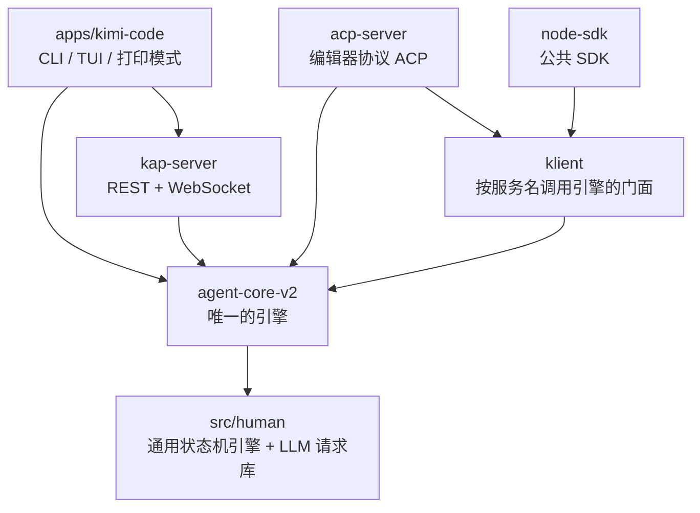
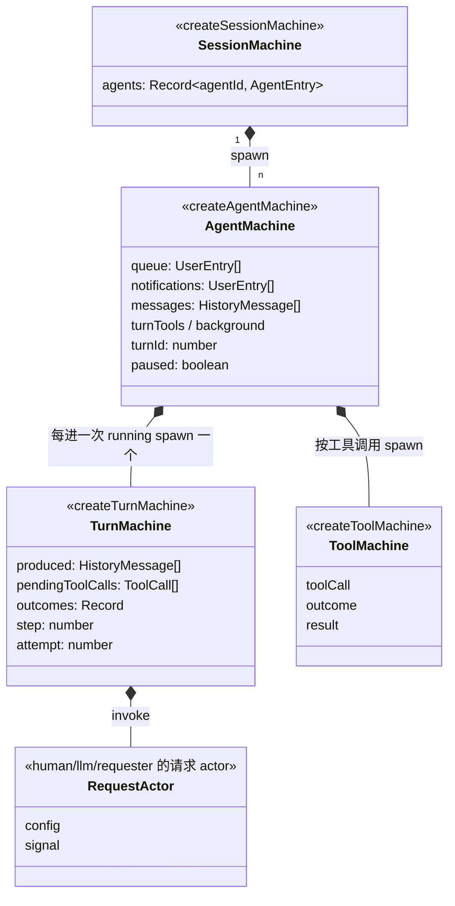
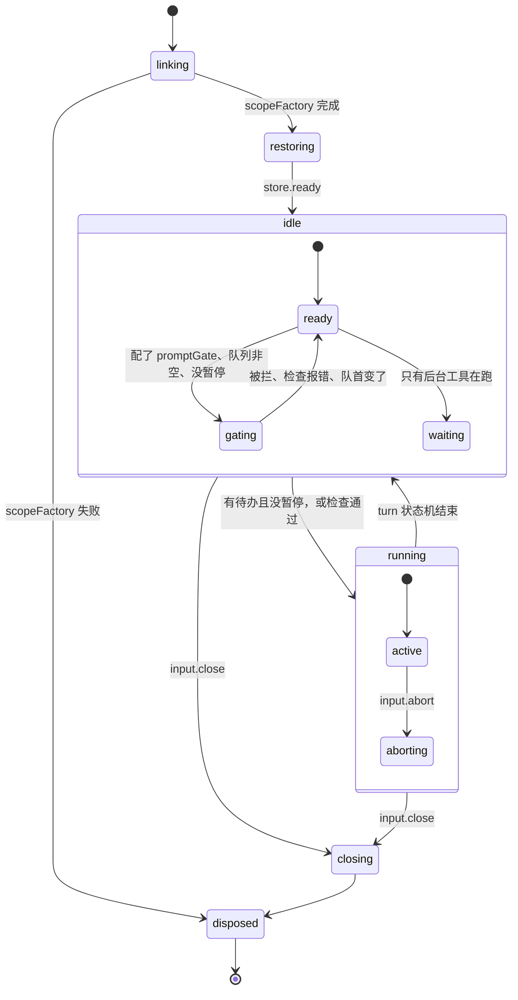
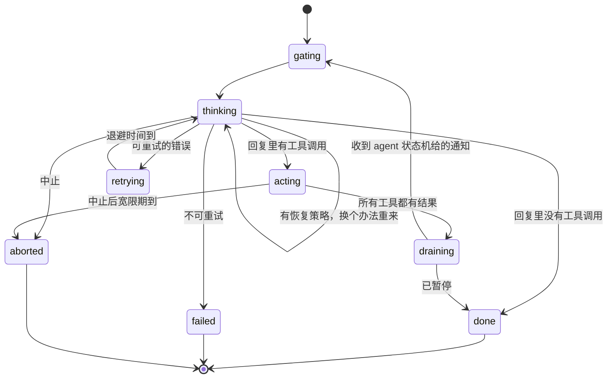
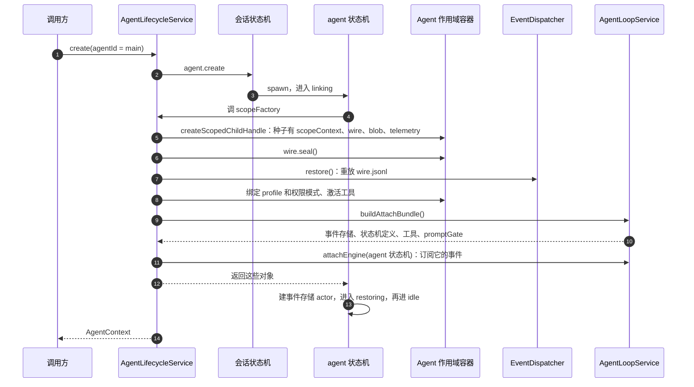
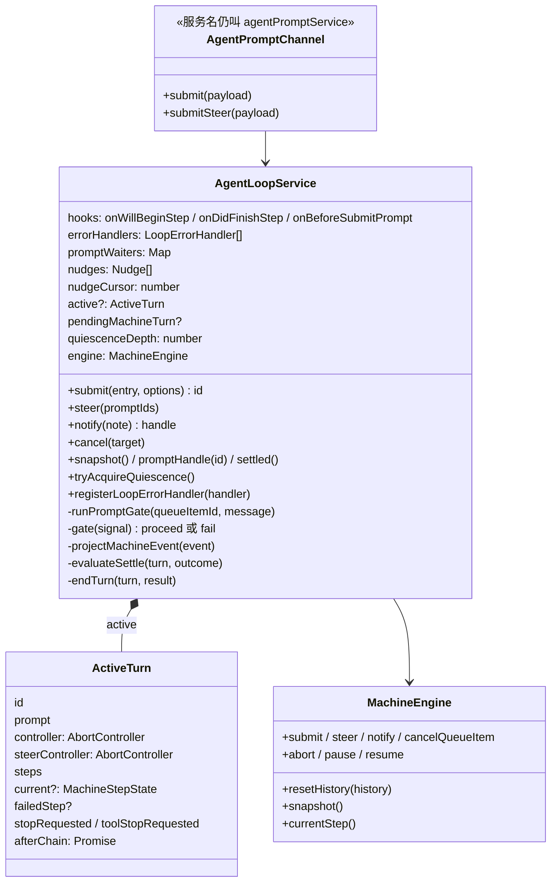
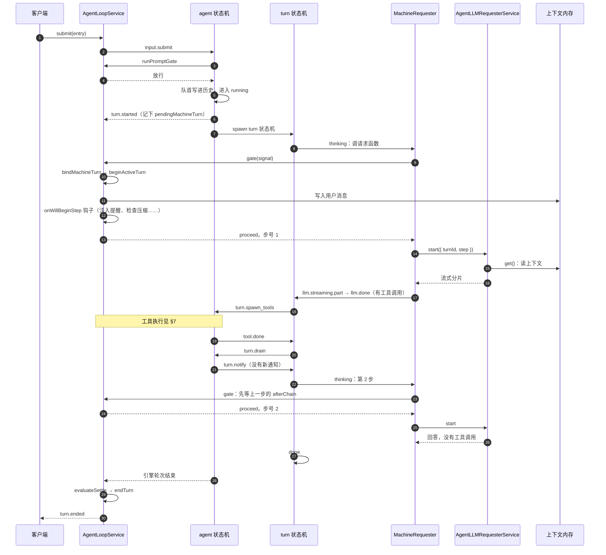
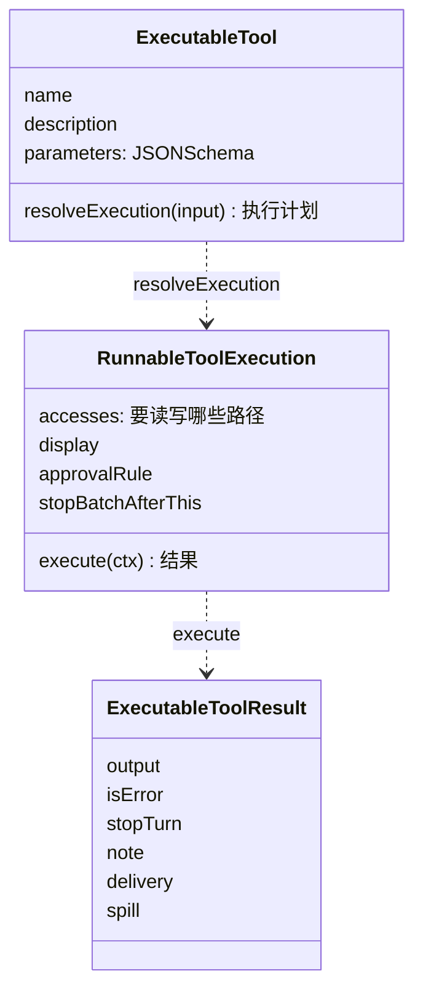
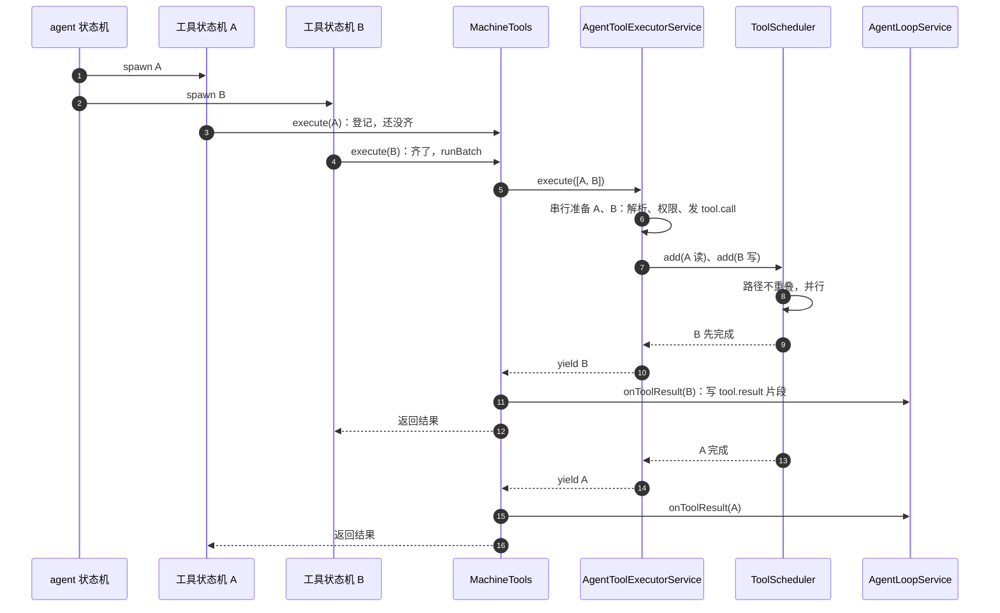
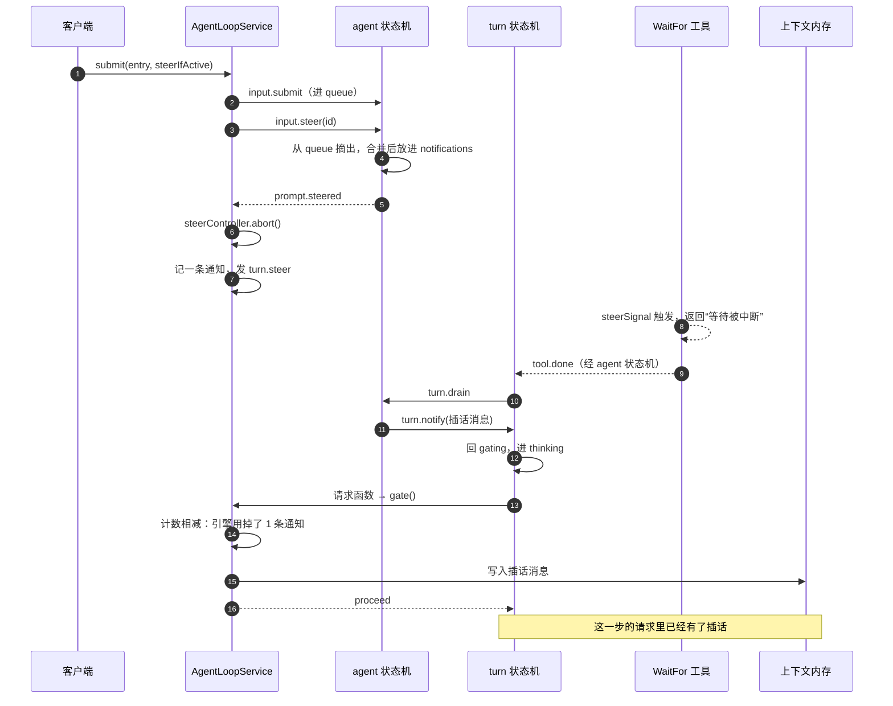

> 对照的是 MoonshotAI/kimi-code 的 `18c6d6427`（2026-10-16，应用版本 2.2.0）。初版对照的是 `21406fb4c`（09-30，2.1.1），10-16 核对了之后的 42 个提交：循环、状态机、上下文内存、持久化这些主干没有改动，新增的是外部变更通知（§6.5），另有权限开关（§7.4）、MCP 工具按需加载的默认值（§6.3）几处小改动，变化最大的 tower 功能本文没有展开。源码路径省略前缀 `packages/agent-core-v2/src/`，比如 `agent/loop/loopService.ts` 指 `packages/agent-core-v2/src/agent/loop/loopService.ts`。
>
> 有两点先说明。一是 `agent-core-v2`、`kap-server`、`transcript` 三个包不允许写注释，JSDoc 也不行，lint 里的 `scripts/check-no-comments.mjs` 会检查。设计说明只能去 `packages/agent-core-v2/docs/zh/` 下找：`llm.md` 讲 LLM 请求库的设计原则，`event-name.md` 讲状态机里状态、事件的命名规范。二是这个仓库重构很频繁，一天合好几个结构性 PR 很常见，所以下文只引文件和函数名，不引行号。

## 1. 包结构



| 包 | 行数（不含测试） | 干什么 |
|---|---|---|
| `agent-core-v2` | 约 14.2 万 | 唯一的引擎，本文几乎全部内容 |
| `kap-server` | 约 3.1 万 | 把会话暴露成 REST（`/api/v1`）和 WebSocket |
| `klient` | 约 5900 | 按“服务名 + 方法名”调用引擎的门面，`memory` 传输在同进程里直接拿服务实例，`ipc` 传输跨进程 |
| `acp-server` | 约 5600 | 编辑器用的 Agent Client Protocol |
| `node-sdk` | 约 1.1 万 | 公共 TypeScript SDK |
| `pi-tui` | 约 1.9 万 | 终端界面库，从 pi-mono 的 `packages/tui` 拷过来单独维护（见包里的 `UPSTREAM.md`） |
| `minidb` | 约 1.9 万 | 纯 Node 的嵌入式 KV 数据库，给会话索引和搜索用 |
| `tree-sitter-bash` | 约 5000 | 纯 TypeScript 的 bash 解析器，权限判断危险命令时用 |
| `kosong` | | 早期的 LLM 抽象层，引擎已经不依赖它。早期的执行环境抽象层 `kaos` 已经在 10-12 删掉了（#4184） |

`apps/` 下除了 `kimi-code`，还有 VS Code 插件、`kimi-inspect`（调试工具）和 `vis`（可视化）。

`agent-core-v2/src` 的一级目录：

| 目录 | 行数 | 放什么 |
|---|---|---|
| `agent/` | 约 3.6 万 | Agent 作用域的服务：循环、请求、上下文、工具执行、权限、压缩、任务…… |
| `app/` | 约 2.4 万 | App 作用域的服务：配置、事件总线、认证、MCP 注册、会话索引、遥测 |
| `features/` | 约 2.3 万 | 可插拔功能：`plan`、`goal`、`cron`、`swarm`、`tower`、`reminder`、`externalHooks`、`skill` |
| `human/` | 约 1.9 万 | 通用引擎：几台 XState 状态机、事件存储、一个 7700 行的 LLM 请求库 |
| `_base/` | 约 1 万 | 依赖注入内核、生命周期、事件、日志 |
| `workspace/` / `session/` | 约 6900 / 5900 | 工作区和会话级别的服务 |
| `wire/` / `state/` | 约 1500 / 1500 | 持久化文件 `wire.jsonl` 的读写，和事件派发器 |

`human/` 和其他目录要分开看：

- `human/` 是一套通用引擎，不依赖 kimi 的任何东西：没有依赖注入、没有工作区、没有权限模式，可以单独测试。
- `agent/`、`session/`、`features/` 是 kimi 的业务代码。

两边在三个地方对接，后面会分别讲到：会话服务创建 agent 时传入的 `scopeFactory`（§4）；开新一轮之前的检查 `runPromptGate`（§5.2）；每次请求模型之前的检查 `gate()`（§6.2）。

---

## 2. 服务装配：VS Code 风格的依赖注入

### 2.1 基础用法

kimi 的依赖注入内核在 `_base/di/`（5200 多行），用法和 VS Code 源码一样：

```ts
// 声明一个服务标识
export const IAgentLoopService = createDecorator<IAgentLoopService>('agentLoopService');

// 服务类在构造函数参数上用标识声明依赖
class AgentLoopService {
  constructor(
    @IAgentContextMemoryService private readonly context: IAgentContextMemoryService,
    @IAgentLLMRequesterService private readonly llmRequester: IAgentLLMRequesterService,
    ...
  ) {}
}
```

`InstantiationService` 根据参数上的装饰器自动 new 出依赖并注入；`ServiceCollection` 存“标识 → 实例或构造描述”；`createChild()` 生成子容器，子容器里找不到的服务往父容器找。

### 2.2 三级作用域

kimi 在这之上加了固定的作用域层级（`app/scopes.ts`）：

```ts
export enum LifecycleScope { App = 'app', Session = 'session', Agent = 'agent' }
export const SCOPE_TOPOLOGY = [LifecycleScope.App, LifecycleScope.Session, LifecycleScope.Agent];
```

| 作用域 | 一份对应什么 | 注册的服务数（`registerScopedService`） | 例子 |
|---|---|---|---|
| App | 整个进程 | 75 | 配置、事件总线、认证、MCP 注册表、会话索引 |
| Session | 一个会话 | 19 | `AgentLifecycleService`（管这个会话里的所有 agent） |
| Agent | 一个 agent（主 agent 和每个子 agent 各一份） | 44 | 循环、请求、上下文、工具执行、权限、压缩 |

服务注册时写明属于哪一级：`registerScopedService(LifecycleScope.Agent, IAgentLoopService, AgentLoopService)`。还可以指定激活方式：`OnScopeCreated`（作用域一建好就实例化）或 `OnDemand`（第一次用到时才实例化）。

新建会话时，`createScopedChildHandle(父容器, LifecycleScope.Session, sessionId, { seeds })` 生成一个会话级子容器；新建 agent 时再往下开 Agent 级子容器。作用域关闭时，里面的服务按创建的逆序释放。

功能（Feature）也走这套机制。比如 plan 模式：

```ts
// features/plan/planFeature.ts
export class PlanFeature extends Feature {
  static override readonly name = 'plan';
  constructor() {
    super();
    this.contributeAgentService(IAgentPlanService, AgentPlanService);
    this.contributeTool(IEnterPlanModeTool, EnterPlanModeTool, { name: 'EnterPlanMode', domain: 'plan' });
    this.contributeTool(IExitPlanModeTool, ExitPlanModeTool, { name: 'ExitPlanMode', domain: 'plan' });
  }
}
registerFeature(PlanFeature);
```

一个功能在 App 层登记一次，每个 Agent 作用域里各建一份服务实例。功能被关掉时，它注册的服务和订阅一起撤掉。

DI 目录里还有 `cascadeEngine.ts`（约 800 行）和 `fiber.ts`（约 700 行）：前者在运行时增删服务时，按依赖图算出受影响的服务，先逆序拆、再顺序重建；后者提供可撤销的功能单元。

### 2.3 同一个目录复用一套实例：`WorkspaceInstanceManager`

工作区（目录）这一级不是 DI 作用域，而是一个手写的管理器（`workspace/workspaceInstance/workspaceInstanceManagerService.ts`）：

```ts
async getOrCreate(ref: WorkspaceInstanceRef): Promise<WorkspaceInstance> {
  // key 是工作区 id 或根目录
  const existing = this.instances.get(workspace.id);
  if (existing !== undefined) return existing;      // 已经有了就复用
  const pending = this.inflight.get(workspace.id);
  if (pending !== undefined) return pending;        // 正在建就等它，避免同时建两份
  const materialization = this.materialize(workspace)...
}
```

`materialize` 里手动 `new` 一个 `WorkspaceInstance`，把应用级的依赖一个个传进去。同一个目录下的所有会话共用它。新建会话时（`sessionLifecycleService.materializeSession`），工作区级的对象作为种子放进会话子容器：

```ts
seeds: [
  ...sessionContextSeed(ctx),
  [ISessionSkillCatalogData, this.workspaceSkillCatalog.sessionData()],
  [ISessionInstructionsProvider, this.workspaceInstructions.sessionProvider()],
  [ISessionMcpHandle, this.workspaceMcp.sessionHandle()],
  [ISessionWorkspaceInfo, this.workspaceDirs.sessionInfo()],
  ...
]
```

所以同一个目录的 MCP 连接、技能目录、项目指令只建一份，每个会话拿到的是从它派生出来的会话级对象（`sessionData()`、`sessionHandle()` 这些）。

和另外几家对比：opencode 把目录直接做成 DI 的一级（`LayerMap` 按目录懒建、自动缓存）；pi 的 chord 只提供“按 key 的服务实例”，由提供者自己决定什么时候建；kimi 则是 DI 管 App / Session / Agent 三级，目录这一级单独写了个管理器。

---

## 3. 引擎：嵌套的状态机

kimi 的 agent 循环是用 XState 状态机写的：一个 agent 对应一台状态机，每开一轮再起一台子状态机。XState 是一个状态机库：用 `setup().createMachine()` 定义一张状态图，用 `createActor()` 跑起来，跑起来的实例叫 actor。父 actor 可以 `spawn` 子 actor，子 actor 用 `self._parent.send()` 往父 actor 发事件。`human/xstate2.ts` 是对 xstate 库的简单包装，不到 50 行。

### 3.1 四台状态机



| 状态机 | 文件 | 一台对应什么 | 管什么 |
|---|---|---|---|
| 会话状态机 | `human/session/machine.ts` | 一个会话 | 这个会话里所有 agent 状态机的父 actor：创建、分叉、停止、重启 |
| agent 状态机 | `human/agent/machine.ts` | 一个 agent | 有哪些待办输入、现在要不要开一轮、开了之后怎么中止和清理 |
| turn 状态机 | `human/agent/turn.ts` | 一个“引擎轮次” | 请求模型 → 跑工具 → 收通知 → 再请求，直到模型不再调工具；重试也在这里 |
| 工具状态机 | `human/tool/machine.ts` | 一个工具调用 | 执行一个工具 |

工具状态机由 agent 状态机启动，而不是 turn 状态机。turn 状态机进入 `acting` 时只给 agent 状态机发一个 `turn.spawn_tools`，由 agent 状态机按工具调用逐个 spawn。这样工具可以转到后台：turn 状态机结束了，后台工具还能接着跑。

### 3.2 agent 状态机



| 状态 | 做什么 |
|---|---|
| `linking` | 调创建时传入的 `scopeFactory` 回调，由 kimi 建好这个 agent 的 DI 作用域，返回事件存储、turn 状态机和工具状态机的定义、工具列表、`promptGate` 回调（§4） |
| `restoring` | 等事件存储折叠完历史，合并进状态 |
| `idle.ready` | 依次判断：配了 `promptGate` 且队列非空 → `gating`；有待办（通知或队列）→ `running`；只有后台工具在跑 → `waiting` |
| `idle.gating` | 把队首交给 `promptGate` 检查。被拦或检查报错就丢掉队首回 `ready`；通过就把队首和所有积压的通知一起写进历史，进 `running` |
| `running` | 发 `turn.started`，往事件存储写 `turn.started`，spawn 一台 turn 状态机，输入是当前历史 |
| `running.aborting` | 等 turn 状态机和工具收尾，默认 10 秒后强停；再收到一次中止就立刻强停 |

开一轮时最多只取一个用户 prompt，但积压的通知会全部带上。

### 3.3 turn 状态机



| 状态 | 做什么 |
|---|---|
| `thinking` | `step` 加一，给 agent 状态机发 `step.started`，调请求函数。重试和恢复也会重新进 `thinking`，所以每次尝试都算一个新的步 |
| `acting` | 给 agent 状态机发 `turn.spawn_tools`，等所有工具状态机的结果 |
| `draining` | 给 agent 状态机发 `turn.drain`，agent 状态机把这段时间积压的通知打包发回来（`turn.notify`），turn 状态机把它们加进本轮产出，回 `gating` 开下一步 |
| `retrying` | 等退避时间。默认每步最多尝试 10 次，`500ms × 2^i`，封顶 32 秒，加最多 25% 的抖动；服务端给了 `Retry-After` 就用它（`human/llm/requester/retry.ts`） |

可重试的 HTTP 状态码是 408、409、429、500、502、503、504、529；上下文溢出、请求太大、格式错误等不重试，交给上层处理（§9）。

### 3.4 事件存储

agent 状态机的历史不是直接改数组，而是先写事件、再“折叠”（从初始状态开始，逐个套用事件处理函数，得到当前状态）。折叠规则在 `human/agent/slices.ts`。实际写进存储的只有三种事件：`message.appended`、`turn.started`、`turn.ended`。

在 kimi 里，这个事件存储底下接的是 agent 的 `wire.jsonl` 文件（§10），记录类型加上 `agent.` 前缀。

---

## 4. 一个 agent 是怎么建起来的

`AgentLifecycleService`（`session/agentLifecycle/agentLifecycleService.ts`，Session 作用域）管一个会话里的所有 agent。它持有会话状态机，建 agent 的过程是：



`buildAgentScope` 里有一个变量叫 `stage`，依次是 `scope` → `seal` → `register` → `restore` → `bootstrap` → `toolActivation` → `attach`，失败时作为遥测字段上报，能看出是哪一步出的错。

每个 agent 的 DI 作用域，是在 agent 状态机的 `linking` 状态里、通过 kimi 提供的回调建出来的。所以 agent 和它的状态机生命周期一致：状态机进 `closing` 时会拆掉这个作用域。

`createAgentMachine({})` 创建 agent 状态机时没有传步数上限，引擎自带的步数限制是关闭的，kimi 在 `gate()` 里自己判断（§6.2）。

---

## 5. 适配层：`AgentLoopService`

状态机不知道 kimi 的权限、压缩、钩子，这些由 `AgentLoopService`（`agent/loop/loopService.ts`，约 2300 行，Agent 作用域）接进来。循环本身在状态机里跑，`AgentLoopService` 负责三件事：

1. 构造状态机需要的回调和对象（请求函数、工具执行器、事件存储、`promptGate`）。
2. 在 `runPromptGate` 和 `gate()` 这两个检查点里执行 kimi 自己的逻辑。
3. 把引擎的事件转换成 kimi 的上下文消息和界面事件。



### 5.1 两种“轮次”

代码里有两种轮次：

- 引擎轮次：agent 状态机进一次 `running` 到回 `idle`。
- kimi 轮次：`AgentLoopService` 里的 `ActiveTurn`，对外是 `Turn`，界面看到的 `turn.started` / `turn.ended` 就是它。

一个 kimi 轮次可以跨好几个引擎轮次。比如模型在写最后一步的回答时用户插了一句话，引擎会因为有新通知再开一轮，但对用户来说还是同一轮对话。

kimi 要自己维护轮次，是因为引擎开轮的时机（agent 状态机进 `running`）和 kimi 需要的时机不一样。kimi 开轮时要做一些引擎不管的事：固定本轮的模型配置、把用户消息写进上下文、发 `turn.prompt` 和 `turn.started`、分配遥测上下文。所以引擎开轮时，kimi 只记下 `pendingMachineTurn`，等第一次进 `gate()` 时才真正绑定（`bindMachineTurn`）。

### 5.2 开轮前的检查：`runPromptGate`

agent 状态机在 `idle.gating` 里调用 `runPromptGate`。它跑 `onBeforeSubmitPrompt` 钩子（外部 hooks 的 UserPromptSubmit 挂在这里，可以拦下输入），把文件引用展开成内容，按服务商调整图片格式。结果是拦下，或者放行（消息可能被改写过）。

### 5.3 四种输入方式

| 输入 | 入口 | 在引擎里落到哪 | 什么时候被模型看到 |
|---|---|---|---|
| 排队 | `submit(entry)` | agent 状态机的 `queue` | 当前轮结束、agent 状态机回 `idle`、`runPromptGate` 通过后，作为新一轮的第一条消息 |
| 插话 | `submit(entry, { steerIfActive: true })` 或 `steer(ids)` | 从 `queue` 挪进 `notifications` | turn 状态机下一次 `draining` 时；如果当前轮已经没有下一步，就在下一个引擎轮次开头，仍算同一个 kimi 轮次 |
| 通知（nudge） | `notify(note)` | agent 状态机的 `notifications` | 同插话。会话空闲时会触发新一轮 |
| 取消 | `cancel(target)` | 排队项：`input.cancel`；当前轮：`input.abort` | |

通知是给系统用的：后台任务完成、cron 到点、goal 功能要求继续，都用 `notify`。每条通知在 kimi 这边有一条记录，带两个回调：`onConsume`（被模型用掉时）和 `onDrop`（被作废时）。

客户端调用的是 `AgentPromptChannel`（`agent/loop/promptChannel.ts`）。原来的 `PromptService` 删掉后只剩这一层转发，服务标识名还叫 `agentPromptService`，所以 klient、kap-server 的调用方不用改。

---

## 6. 一次 prompt 的完整流程

场景：用户发一句话，模型调一次工具，然后回答。



### 6.1 请求函数不用状态机传来的消息

turn 状态机调请求函数时，会把 `history + produced`（开轮时的历史加本轮产出）作为消息传过去。但请求函数（`agent/loop/machine/requester.ts` 的 `generate`）并不用它：

1. 先调 `gate(signal)`。返回 `fail` 就发一个错误事件（`The agent loop gate stopped the step.`），直接返回。
2. 调 `service.start({ source: { type: 'turn', turnId, step } }, onPart, signal)`。状态机传进来的 `config` 和 `content` 两个参数都没有用到，请求内容由 `AgentLLMRequesterService` 自己从 kimi 的上下文内存里取。
3. 把结果转成 `llm.streaming.*` 和 `llm.done` 事件发回 turn 状态机。

所以 kimi 里有两份对话历史。一份在状态机里，由状态机的事件存储折叠出来，只用于状态机内部的判断（工具齐了没有、这一轮产出了什么）；另一份是 kimi 的上下文内存，由 `context.*` 持久化事件折叠出来，发给模型的是这一份。为什么这样设计见 §11.1。

### 6.2 `gate()`：每次请求模型前的检查

每次请求模型前都会调 `AgentLoopService.gate()`，重试也一样。它按顺序做这些事：

| # | 做什么 |
|---|---|
| 1 | 等上一步的 `afterChain` 跑完（写 `step.end`、跑 `onDidFinishStep` 钩子） |
| 2 | 有待绑定的引擎轮次就绑定成 kimi 轮次 |
| 3 | 已中止、钩子要求停、上一步失败，任一成立就返回 `fail` |
| 4 | 算出引擎刚刚用掉了几条通知：`kimi 记的通知总数 − 已处理的游标 − 引擎里还剩的通知数`。把这几条写进上下文内存，调它们的 `onConsume` |
| 5 | 上一次插话打断过工具，就换一个新的 `steerController` |
| 6 | 工具结果要求停、又没有新通知，返回 `fail` |
| 7 | 算步号：`max(turn 状态机的 step, 已通过检查的步数 + 1)` |
| 8 | 配了 `loop_control.max_steps_per_turn`、超过了、且这批通知没有声明“不受步数限制”，就记下超步数错误，返回 `fail` |
| 9 | 跑 `onWillBeginStep` 钩子 |
| 10 | 返回 `proceed` 和步号 |

`onWillBeginStep` 上挂着这些钩子：

| 注册名 | 来自 | 做什么 |
|---|---|---|
| `context-injector` | `features/reminder/reminderService.ts` | 跑所有提醒提供者（日期变化、plan 模式、权限模式、AGENTS.md、todo、goal、后台任务、可加载工具列表等），把结果直接写进上下文内存 |
| `full-compaction` | `agent/fullCompaction/fullCompactionService.ts` | 超过阈值就开始或等待压缩（§9.3） |
| `mcp` | `agent/mcp/mcpService.ts` | 等 MCP 服务器首次加载完，免得第一步看不到 MCP 工具 |
| `toolDedupe` | `agent/toolDedupe/toolDedupeService.ts` | 重复工具调用检测的步边界 |
| `goal-count-turn` | `features/goal/goalService.ts` | goal 功能计数 |

第 4 步要注意：kimi 不是从引擎事件里得知哪几条通知被用掉了，而是用两边的计数相减算出来的。这要求 kimi 发给引擎的通知和自己记的 `nudges` 数组一一对应、顺序一致，否则就会算错。

### 6.3 请求体每个字段从哪来

拼请求的是 `AgentLLMRequesterService`（`agent/llmRequester/llmRequesterService.ts`，Agent 作用域）：

| 字段 | 来源 | 每步会变吗 |
|---|---|---|
| 模型、服务商 | 本轮第一次请求时算一次（`profile.resolveModelContext()`），存进 `turnConfigs[turnId]` | 本轮内不变。轮中切模型，下一轮才生效 |
| 请求参数（温度、思考强度等） | 同上，`profile.resolveRequestParams()` | 本轮内不变 |
| 系统提示词 | 同上，`profile.getSystemPrompt()` | 本轮内不变 |
| `max_tokens` | 综合模型最大输出、预留上下文、配置上限、当前已用 token 数 | 每次重算。最近的提交（#4091）改成只有显式配置时才传这个上限 |
| 工具列表 | 工具注册表 → `toolSelect.shapeTools()` → 去掉“延迟披露”的工具（按需加载的 MCP 工具，模型要先调 `select_tools` 才能用；每个 MCP 服务器可以在 `mcp.json` 里设 `deferred`，10-14 起还有全局默认值 `default_deferred`） | 每次重算。MCP 工具刚连上、plan 模式刚切换、`select_tools` 刚加载了新工具，下一步就能看到 |
| 消息 | `context.get()` → `toolSelect.shapeHistory()` → 上下文投影 `projector.project()` → 解析媒体 | 每次重算。上一步写进去的回复、工具结果、刚消费的通知、钩子注入的提醒都在里面 |

也就是说，模型配置在一轮内固定，工具和消息每一步重新算。用户在一轮中途切模型，不会出现同一轮前后两步用不同模型的情况；而 MCP 工具一连上，下一步就能用。

上下文投影（`agent/contextProjector/projection.ts`）做四件事：跳过还没写完的草稿消息（`partial`）；把工具调用和结果配对，丢掉没有对应调用的结果；没有结果的工具调用补一条“已中断”；丢掉空白消息。还有一个更严格的版本 `projectStrict`，额外去掉重复的工具调用、合并连续的 assistant 消息，出错时换用（§9.1）。

请求发出后，`recordRequest` 发一个持久化的 `llm.request` 事件，记下系统提示词和工具列表的哈希；工具列表第一次出现时再发一个 `llm.tools_snapshot`。

### 6.4 引擎事件怎么转成 kimi 的事件

`projectMachineEvent` 是一个大 switch：

| 引擎事件 | kimi 这边做什么 |
|---|---|
| 引擎轮次开始 | 记 `pendingMachineTurn` |
| prompt 被拦、检查报错 | 被拦的 prompt 也写进上下文（让用户看到自己发了什么），状态记为 blocked / failed |
| 一步开始 | 发 `turn.step.started`，往上下文写 `step.begin` 片段 |
| 流式增量 | 发 `assistant.delta` / `thinking.delta` / `tool.call.delta` 给界面 |
| 一步完成 | 把回复的每个内容片段写成 `content.part`；没有工具调用就直接收尾这一步 |
| 工具开始 | 写 `tool.call` 片段 |
| 工具结束 | 等这一步的工具全部回来，就收尾这一步 |
| 重试 / 恢复 | 用 `step.end(error)` 关掉当前步，发 `turn.step.retrying` |
| 引擎轮次结束 | 把 `evaluateSettle` 接到 `afterChain` 后面 |

轮次是否结束由 `evaluateSettle` 判断，按顺序：

| # | 条件 | 结果 |
|---|---|---|
| 1 | 有失败的步、没中止 | 交给错误处理器（§9.2） |
| 2 | 中止了 | `cancelled`，给没回来的工具补“已中止”结果 |
| 3 | 被服务商安全策略拦了 | `failed` |
| 4 | 超步数 | `failed` |
| 5 | 钩子要求停 | `completed` |
| 6 | 还有没用掉的通知 | 什么都不做。引擎会因为有通知再开一轮，kimi 轮次继续 |
| 7 | 工具结果要求停 | `completed` |
| 8 | 引擎说失败 | `failed` |
| 9 | 其他 | `completed` |

`endTurn` 先等 `wire.jsonl` 写完（`drainPersisted`），再作废本轮范围内没用掉的通知，最后发 `turn.ended`。

`afterChain` 是挂在 `ActiveTurn` 上的一条 promise 链。每一步的收尾工作（写 `step.end`、跑钩子、判断轮次是否结束）都接在它后面，下一步的 `gate()` 第一件事就是 `await` 它。这样上一步没收尾完，下一步不会开始。

### 6.5 系统提示词过时了怎么办：`AgentChangeNotifierService`

系统提示词是绑定 profile 时渲染的，AGENTS.md 的内容、可用技能列表都渲染在里面。渲染结果作为 `ProfileBind` 事件写进 `wire.jsonl`，恢复会话时直接用记录里的文本，不重新渲染，这样提示缓存不会失效。代价是 AGENTS.md 改了、装了新技能、子 agent 的配置变了，系统提示词里写的还是旧的。

以前只有 AGENTS.md 有处理：监听文件变化，提醒模型“这些文件在注入后改过了，去读最新的”。10-16（#4019）把这件事统一交给新的 `AgentChangeNotifierService`（`agent/changeNotifier/`，Agent 作用域，只在主 agent 上工作）：

1. 绑定 profile 时，把这次渲染进系统提示词的 AGENTS.md、技能列表记成“模型已知的版本”（代码里叫 beliefs），作为状态 `changeNotifier.snapshot` 写进 `wire.jsonl`。
2. 项目指令、技能目录、子 agent 目录任何一个发出变化事件，就重新读一遍，和记下的版本比较。
3. 有差异就先更新记录，再调 `reminder.notify()`：往上下文内存追加一条 `<system-reminder>` 包着的 user 消息，不触发新的一轮，模型下一次请求时就能看到。提醒的内容有几类：哪些 AGENTS.md 改了或删了（让模型去读最新内容）；工作区里有哪些 AGENTS.md 没进系统提示词；新的技能列表（整个替换旧的）；子 agent 的 profile 和模型池增删了哪些。

用户在界面里执行 `/reload`（kap-server 的会话 reload 接口）时：先让旧会话的 notifier 静音，重载配置和插件，关掉会话再从 `wire.jsonl` 恢复，最后让新会话的 notifier 把三类变化各检查一遍。因为比较的基准是写在 `wire.jsonl` 里的“模型已知的版本”，而不是进程内存，所以重启、恢复之后也不会重复提醒或漏掉提醒。

这和 opencode 的 `InstructionState`、codex 的 `WorldState` 是同一个思路：系统提示词保持不动，变化作为追加的消息告诉模型。区别是 opencode 每一步开始前都会把所有指令来源重读一遍、算哈希比较，kimi 则是收到变化事件或者 `/reload` 时才比较。

---

## 7. 工具调用

### 7.1 工具的结构



工具分两步执行（`tool/toolContract.ts`）：先 `resolveExecution(args)` 把参数解析成一个执行计划，再对计划调 `execute`。解析阶段就能报错（比如路径越界），不用真跑。执行计划里声明了要读写哪些路径（`accesses`），调度器据此判断能不能并行。

结果里有几个特别的字段：`stopTurn` 让这一轮在工具之后结束（plan 模式里用户选“拒绝并退出”就是这样停下的）；`delivery = { kind: 'steer', message }` 表示工具想以用户身份插一句话，skill 工具就是这样把技能正文送回对话的；`spill` 是超长结果写到磁盘后的路径，结果超过 5 万字符就写盘，只给模型预览和路径。

### 7.2 按批执行

状态机这边是一个工具调用一台工具状态机，各自独立执行。但 kimi 的工具执行器需要拿到一整批调用，才能判断冲突、按顺序问权限、处理“前一个调用要求跳过后面所有调用”的情况。

`agent/loop/machine/tools.ts` 的 `createMachineTools` 在中间做转换：turn 状态机收到 `llm.done` 时，`beginBatch(expectedCalls)` 记下这一批应该有哪些工具调用；每台工具状态机调 `execute` 时只登记；等这一批全部登记齐了（`flushIfReady`），才一次性交给工具执行器。



### 7.3 工具执行器

`AgentToolExecutorService`（`agent/toolExecutor/toolExecutorService.ts`）对每个调用依次检查：

| # | 阶段 | 可能的结果 |
|---|---|---|
| 1 | 预检：解析参数、查注册表、看是否被禁用 | 找不到或被禁用 → 错误结果 |
| 2 | `resolveExecution(args)` | 抛错 → 错误结果 |
| 3 | 已中止 | “已中止”结果 |
| 4 | `onBeforeExecuteTool` 的所有监听者 | 有人否决（veto）→ 用否决的结果 |
| 5 | `onWillExecuteTool` | 改文件前做快照、等 MCP 加载 |
| 6 | 发 `tool.call`，交给调度器 | |
| 7 | `execution.execute(ctx)` | 抛错 → 错误结果；中止后 2 秒还不返回 → “已中止” |
| 8 | `onDidExecuteTool` 钩子 → 合并 `stopTurn` → 超长截断写盘 | |

准备阶段是串行的，因为权限审批要弹窗，一个一个弹比较好处理。执行阶段的并行度由 `ToolScheduler`（不到 100 行）决定：新任务和正在跑的、或排在它前面的任务有资源冲突就排队，否则立刻开跑。两个只读不冲突；至少一方要写、并且路径重叠才算冲突。

`onBeforeExecuteTool` 是一个可以否决的事件，上面挂了很多监听者：权限检查、plan 模式、tower、swarm、goal、外部 hooks、重复调用检测。

### 7.4 权限

`AgentPermissionGate` 监听 `onBeforeExecuteTool`，调权限策略服务，结果有三种：需要询问就弹审批、等用户回复；批准就放行；拒绝就否决。策略链（`agent/permissionPolicy/permissionPolicyService.ts`）按顺序执行，第一个给出结论的策略生效：

| # | 策略 | 大意 |
|---|---|---|
| 1 | `auto-mode-ask-user-question-deny` | 自动模式下禁止模型向用户提问 |
| 2 | `user-configured-deny` | 用户配置的拒绝规则 |
| 3 | `dangerous-command-ask` | 危险命令要问。用 `tree-sitter-bash` 解析命令，能看穿 `sudo`、`env`、嵌套 shell。非交互模式下没有这一条 |
| 4 | `auto-mode-approve` | 自动模式放行 |
| 5 | `session-approval-history` | 本会话已经批准过的同类操作 |
| 6 | `user-configured-ask` | 用户配置的询问规则 |
| 7 | `user-configured-allow` | 用户配置的允许规则 |
| 8 | `sensitive-file-access-ask` | 读写敏感文件要问 |
| 9 | `git-control-path-access-ask` | 动 `.git` 里的控制文件要问 |
| 10 | `yolo-mode-approve` | yolo 模式放行（解析不了的 bash 命令在 yolo 下也放行，#3869） |
| 11 | `default-tool-approve` | 默认放行的只读工具 |
| 12 | `git-cwd-write-approve` | 在 git 工作区内写文件放行 |
| 13 | `fallback-ask` | 兜底：问 |

第 3、8、9 条是三条内置的“守卫”（guard）策略。配置 `[permission] dangerous_command_guard = false`（或环境变量 `KIMI_CODE_DANGEROUS_COMMAND_GUARD=false`）可以把它们一起关掉；10-16（#4250）之前这个开关只管危险命令那一条。关掉之后，“需要时询问”模式下只剩用户自己配的 `ask` 规则会弹审批。`Read` / `Write` / `Edit` 工具对密钥文件的硬拦截不受影响，那不在策略链里。

### 7.5 插话怎么打断工具

插话到达时，`AgentLoopService` 会 abort 当前轮的 `steerController`，这个信号作为 `steerSignal` 传进每个工具的执行上下文，要不要响应由工具自己决定。目前只有等待后台任务的 `WaitFor` 工具会响应（`agent/tools/task/task-wait/taskWaitTool.ts`）：被插话打断时返回一个“等待被中断”的正常结果。这样这一批工具很快都有了结果，turn 状态机进 `draining`，把插话带进下一步。最近的提交（#4061）还把它的等待时间上限定成了 90 秒。

---

## 8. 插话的完整时序

场景：模型正在等一个后台任务，用户插一句话。



如果插话到达时模型正在写最后一步的回答（不再调工具），turn 状态机会直接 `done`。agent 状态机回到 `idle`，因为 `notifications` 不为空，马上再开一个引擎轮次。kimi 这边，`evaluateSettle` 看到还有没用掉的通知，不结束轮次；新引擎轮次第一次进 `gate()` 时，`bindMachineTurn` 发现已经有活动轮次，直接接上。这两步的顺序不会乱，因为 `evaluateSettle` 挂在 `afterChain` 上，而 `gate()` 第一件事就是等 `afterChain`。

外部想让 agent 接着干活，写法都一样：往上下文写一条消息，再发一个空通知。比如外部 hooks 的 Stop 钩子要求继续（`features/externalHooks/agent/agentExternalHooksService.ts`）：把继续的理由作为一条 `origin` 为 `system_trigger/stop_hook` 的用户消息写进上下文，再调一次不带消息的 `loop.notify()`。这条空通知让 `evaluateSettle` 不结束轮次，也让 agent 状态机再开一个引擎轮次。

---

## 9. 错误处理

错误在五个地方处理：

| 层 | 在哪 | 触发 | 做什么 | 请求内容变吗 |
|---|---|---|---|---|
| ① 换投影 | `AgentLLMRequesterService.runRequest` 里的循环 | 请求太大、图片格式错、请求结构错 | 换一种上下文投影立刻重发 | 变：去图、换严格投影 |
| ② 无限重试 | 同上 | 设了环境变量 `KIMI_CODE_INFINITE_RETRY` | 除中止和上下文溢出外一律退避重发 | 不变 |
| ③ 恢复 | turn 状态机 | 401 且凭据能刷新 | 刷新凭据，重进 `thinking` | 凭据变 |
| ④ 退避重试 | turn 状态机的 `retrying` | 可重试的错误 | 等一会，重进 `thinking` | 不变 |
| ⑤ 错误处理器 | `AgentLoopService` | 引擎轮次失败 | 第一个匹配的处理器接手，它要求继续就继续 | 变，比如压缩后的历史 |

①② 在 turn 状态机下面，重发时会通知 turn 状态机丢掉已经收到的分片，但不算新的尝试，也不会再走 `gate()`。③④ 在 turn 状态机里，每次都重进 `thinking`，所以每次重试都是一个新步：界面上会看到上一步以错误结束、新的一步开始，`onWillBeginStep` 钩子也会再跑一遍。

### 9.1 换投影

`nextProjectionPolicyForError`：

| 当前策略 | 错误 | 下一个策略 |
|---|---|---|
| 无 | 请求太大 | 图片降采样 |
| 已降采样 | 请求太大 | 去掉被拒的媒体 |
| 媒体没去除 | 图片格式错误 | 去掉被拒的媒体 |
| 结构没收紧 | 请求结构错误 | 严格投影 |

换过的策略按轮次记住，同一轮后面的请求直接用换过的策略，不用再失败一次。

### 9.2 压缩后继续

最常见的错误处理器是压缩：服务商报上下文溢出时，`AgentFullCompactionService` 开始压缩、等它完成、调 `ctx.retry()`。继续的方式是：用上下文内存重建引擎的历史（`resetHistory(historyFromContext(context.get()))`），再给引擎发一个空通知，让 agent 状态机开一个新的引擎轮次。新轮次进 `gate()` 时发现已经有活动轮次，直接接上，下一步用的就是压缩后的上下文。

连续 3 次压缩都没压下来就放弃。

### 9.3 压缩

`AgentFullCompactionService` 不在循环里，而是挂在循环的三个扩展点上：

| 扩展点 | 做什么 |
|---|---|
| `onWillBeginStep` | 超过触发线就后台开始压缩；超过阻塞线就等压缩完成再发这一步 |
| `onDidFinishStep` | 清零连续溢出计数，必要时再检查一次 |
| 错误处理器 | 上下文溢出时压缩后继续（§9.2） |

默认参数（`agent/fullCompaction/strategy.ts`）：

| 项 | 默认 | 说明 |
|---|---|---|
| `triggerRatio` | 0.85 | 请求 token 数 ≥ 窗口 × 0.85 就开始后台压缩，可配置（0.5 到 0.99） |
| `blockRatio` | 0.85 | 超过就阻塞等压缩 |
| `reservedContextSize` | 50000 | 另一条触发条件：用量加预留 ≥ 窗口 |
| `maxOverflowCompactionAttempts` | 3 | 连续因溢出压缩的上限 |
| `maxRecentMessages` / `maxRecentSizeRatio` | 4 / 0.2 | 摘要之后原样保留最近几条消息 |

压缩的过程：取当前上下文，加一条压缩指令（`agent/fullCompaction/compaction-instruction.md`），通过同一个请求服务发出去。发之前先估算一下，如果历史加压缩指令超过模型的有效窗口（扣掉给摘要预留的输出空间），就先从前面丢掉一部分（#3911）。压缩请求本身还是溢出，就再砍掉一部分重试；摘要被截断时丢掉最老的一条再试；最多尝试几次可以配置。成功后检查压缩期间历史有没有被改过，改过就放弃这次结果。

摘要后面会追加一段 Context Recovery 脚注（`agent/fullCompaction/context-recovery-footer.md`），写明这个 agent 的 `wire.jsonl` 路径和被压缩的行号范围，告诉模型“需要原始的命令输出、文件内容、错误信息时，去这个日志里查，别猜”。压缩掉的细节，模型可以自己用读文件工具查回来。

---

## 10. 持久化与恢复

### 10.1 一个 agent 一个 `wire.jsonl`

每个 agent 有一个只追加的 JSON Lines 文件，路径是数据目录下的 `sessions/<工作区 id>/<会话 id>/agents/<agentId>/wire.jsonl`。

kimi 的业务事件都继承 `Event2`，每个事件类有两个开关：`durable` 为真就写进 `wire.jsonl`、恢复时重放；`observable` 为真就发到事件总线，给界面和服务端订阅。

| 事件 | durable | observable | 作用 |
|---|---|---|---|
| `context.append_message` | ✓ | | 追加一条完整消息（用户输入、提醒、插话） |
| `context.append_loop_event` | ✓ | | 追加一个循环片段，见下 |
| `context.apply_compaction` | ✓ | | 用摘要替换历史 |
| `turn.prompt` / `turn.ended` | ✓ | `turn.ended` 也推 | 这一轮的输入、这一轮的结束 |
| `turn.started` | | ✓ | 界面开一轮 |
| `assistant.delta` 等 | | ✓ | 流式文字 |
| `prompt.submitted` / `prompt.queued` | | ✓ | 只推给界面 |
| `prompt.steered` / `prompt.completed` / `prompt.aborted` | ✓ | ✓ | |

assistant 消息和工具消息不是整条写，而是按循环片段写（`agent/contextMemory/loopEventFold.ts`）：

| 片段 | 折叠效果 |
|---|---|
| `step.begin` | 先把上一个草稿收尾，再追加一条带 `partial: true` 的空 assistant 消息当草稿 |
| `content.part` | 往草稿里追加文字或思考片段 |
| `tool.call` | 往草稿里追加一个工具调用，记为“待回填” |
| `tool.result` | 追加一条工具结果消息 |
| `step.end` | 正常结束就收尾草稿，去掉 `partial`；中断或出错就留到下一个 `step.begin` 再收尾 |

有两条规则保证历史一致。一是工具还没全部回来时，中途到达的普通消息（比如插话）先暂存，等最后一个结果回来再放出来，这样工具调用和结果在历史里是挨着的。二是草稿收尾前一直带着 `partial`，上下文投影会跳过它，所以进程崩在一步中间，重放出来的半条回复不会发给模型。

同一个 `wire.jsonl` 里还有引擎事件存储写的记录（`agent.message.appended`、`agent.turn.started`、`agent.turn.ended`），以及撤销时写的分支记录 `agent.switched`。

### 10.2 写和读

`EventDispatcherService`（`state/eventDispatcherService.ts`，Agent 作用域）是所有持久化状态的唯一写入口：

1. 对所有关心这个事件的状态，用 immer 算出新状态。
2. 事件是 durable 就 `wire.appendRecord(...)`。
3. 事件是 observable 就发到事件总线。

服务自己的字段里只放持有资源的东西（`AbortController`、promise、actor），纯数据都注册成“状态键”，由事件折叠出来。比如上下文内存 `AgentContextMemoryService` 自己不存消息数组，`append()` 就是发一个 `context.append_message` 事件。

恢复（`restore()`）时，先重放可撤销的状态（比如上下文内存，沿当前分支），再重放其余状态，然后把外置的图片等大块内容换回来，最后跑 `onDidRestore` 钩子。重放时不写盘、不发事件总线，所以恢复只重建内存状态，不会重新调模型或执行工具。

读文件时还有三层保护：没有元数据行就当最老的格式迁移；版本旧就逐条迁移并整个文件重写；最后一行被截断（写到一半崩了）就修复，修复失败则之后的写入全部拒绝。

`prompt.submitted` 和 `prompt.queued` 不写盘，引擎的排队也只在内存里。所以进程重启后，还没开始跑的排队输入会丢。

### 10.3 撤销：追加分支，不删行

撤销最近几轮（`agent/undo/undoService.ts`）的过程：先拿静默锁（没有活动轮次、没有待办时才能拿到，拿到就暂停引擎），追加一条 `agent.switched` 分支记录，然后整个重放一遍。这次沿新分支走，被撤销的轮次就不在了；再按新分支重建引擎的存储。文件里的行不会删，撤销掉的内容还在磁盘上。

---

## 11. 设计取舍

### 11.1 为什么有两份历史

| | 引擎历史 | kimi 上下文内存 |
|---|---|---|
| 类型 | `{ message, meta }` | 消息上直接挂 `id`、`origin`（12 种来源）、`note` 等 |
| 谁写 | agent 状态机开轮和轮次结束时 | 适配层写 `context.*` 和循环片段 |
| 知道什么 | 消息本身 | 消息来源、草稿、提醒、压缩边界、撤销锚点、外置的图片 |
| 发请求时用不用 | 不用 | 用 |

原因是分层。`human/` 不能依赖 kimi，它的历史类型里就不能有 kimi 的来源、撤销、压缩这些概念；而 kimi 的产品功能又都依赖这些概念。所以引擎留着自己的历史做内部判断，真正的对话记录由 kimi 维护。代价是同一段对话在 `wire.jsonl` 里写了两遍，错误恢复和撤销之后还要手动让两边一致。

### 11.2 引擎里有、产品层还没用的功能

`human/` 还在迁移中，下面这些在引擎里实现了、也有测试，但 kimi 产品层没有接：

| 引擎功能 | kimi 实际用的 |
|---|---|
| turn 状态机的步数上限 | 在 `gate()` 里自己判断 |
| turn 状态机的步前回调 | 在 `gate()` 里跑 `onWillBeginStep` |
| agent 状态机的 `reminders` 通道 | 提醒服务在步前钩子里直接写上下文 |
| 工具转后台 | 自己的 `IAgentTaskService` |
| `human/compaction/` | `AgentFullCompactionService` |

所以读 `human/` 的代码时，要确认 kimi 实际有没有用到，不然会误以为 kimi 的工具能转后台、turn 状态机有步数上限。

### 11.3 可以参考的做法

1. 循环写成状态机。`MachineEngine.snapshot()` 能直接读出 agent 状态机和 turn 状态机当前在哪个状态：在等工具、在退避、还是空闲但有后台任务。排查卡住的问题比 while 循环方便。
2. 权限、压缩、提醒、步数上限、钩子都放在 `runPromptGate` 和 `gate()` 这两个检查点里，引擎只管状态流转，可以单独测试。
3. 用 `afterChain` 把每一步的收尾串起来，上一步和下一步不会交叠。
4. 上下文按片段写盘，没写完的草稿带 `partial` 标记，崩溃恢复后历史仍然一致。
5. 模型配置按轮固定，工具和消息每步重算。
6. 错误分层处理：请求层处理只需重发的错误，上层处理需要改上下文的错误。
7. 撤销是追加分支记录而不是删行，再加上 Context Recovery 脚注，模型可以自己去日志里查被压缩或撤销掉的原文。

### 11.4 问题

1. 有两份历史，第一次读 `turn.ts` 很容易以为 `history + produced` 就是发给模型的内容。
2. 通知有没有被用掉靠计数相减，任何绕过 `notify()` 直接往引擎里加通知的代码都会让计数出错。
3. 一次提交要经过很多层：`AgentPromptChannel` → `AgentLoopService` → `MachineEngine` → agent 状态机 → `runPromptGate` → turn 状态机 → 请求函数 → `gate()` → `AgentLLMRequesterService`。
4. kimi 轮次和引擎轮次不是一一对应的，调试时看到的轮次号和界面上的经常对不上。
5. 重试也算新的一步，一次网络抖动可能让 `onWillBeginStep` 钩子跑十遍。
6. 排队中的输入不持久化，重启就丢。
7. 重构太频繁，一两周前的笔记就可能过时。

---

## 12. 和 pi-mono、opencode、codex 对照

| | kimi-code | pi-mono | opencode v2 | codex |
|---|---|---|---|---|
| 循环形式 | 嵌套的 XState 状态机 + 适配层 | `agent-loop.ts` 里的两层 while | runner 的 `drain` 循环 + 数据库收件箱 | `run_turn` 循环 |
| 发给模型的历史从哪来 | 上下文内存（由 `context.*` 事件折叠） | 每次请求从会话 JSONL 重新投影 | 每个 Step 从投影表重读 | 内存里的 `ContextManager` |
| 插话 | 排队项挪进通知，下一次 `draining` 带进去 | steer 队列 | 收件箱 `delivery = steer` | 待处理输入 + 邮箱 |
| 持久化 | 每个 agent 一个 `wire.jsonl`，durable 事件折叠 | 会话 JSONL 树 | SQLite + 事件投影 | rollout JSONL + SQLite |
| 服务装配 | VS Code 风格 DI，App / Session / Agent 三级 | 产品层手工组装；实验中的 chord | Effect Layer，进程级 / 目录级两级 | Rust 结构体手工组装 |
| 撤销 | 追加分支，不删行 | 会话树换叶子 | revert：暂存后提交 | 回滚标记 |
