> 本文对照的是 opencode `dev` 分支的 `7b99646cf1`（2026-10-16，`@opencode/cli` 2.0.30）。下文的源码路径都相对 `packages/`。
>
> 先说分支。2026-10-10 的 `5caf1f9f6f`（“chore: promote v2 to dev”）把重写后的 v2 合进了默认分支 `dev`，从此 `dev` 就是 v2，命令名还是 `opencode`（另有一个 `opencode2`）。v1 的维护线搬到了新开的 `v1` 分支（`packages/opencode`，1.19.x，只出补丁版本），它是 10-09 从合并前的 `dev` 分出来的。原来的 `v2` 分支停在合并那一刻，不再更新。所以现在看 v2 的代码直接看 `dev` 就行。
>
> 本文 10-08 的版本对照的是当时 `origin/v2` 的 `216c311744`（2.0.24）；10-16 按 `dev` 核对了这之后核心包的 122 个提交，主干结构没有变，变化集中在 Step 的结果类型（§5.5、§7.2）、工具参数校验（§7.1）、内置工具（§8）和指令来源（§6.1）。9 月更早的版本分析的是旧 `dev` 分支里一份 6 月从 v2 分出来的早期原型，很多名字（`promoteSteers`、`runTurnAttempt`、`PermissionV2`、`lildax`）在正式的 v2 里已经不存在了，旧版还能在博客仓库的 git 历史里找到。

## 1. 包与进程模型

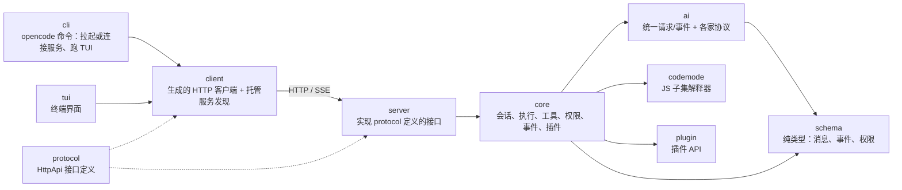

| 包 | 目录 | 行数（不含测试） | 干什么 |
|---|---|---|---|
| `@opencode/core` | `core/src` | 约 6.8 万 | 内核。会话门面、输入收件箱、执行调度、runner、工具、权限、事件总线、插件、服务装配 |
| `@opencode/ai` | `ai/src` | 约 3.1 万 | 模型层。`LLMRequest` / `LLMEvent` 统一格式，几十种协议，还有生图、语音、转写、视频 |
| `@opencode/protocol` | `protocol/src` | 约 4300 | 用 Effect 的 `HttpApi` 定义所有 HTTP 接口，server 和 client 都从这里生成 |
| `@opencode/server` | `server/src` | 约 4100 | 只实现 protocol 里定义的 handler，把调用转给 core |
| `@opencode/client` | `client/src` | 约 1.7 万 | 生成的客户端；还负责发现、拉起本机的托管服务 |
| `@opencode/cli` | `cli/src` | 约 1.2 万 | `opencode` 命令 |
| `@opencode/tui` | `tui/src` | 约 6.2 万 | 终端界面，通过 client 和 server 通信 |
| `@opencode/schema` | `schema/src` | 约 5700 | 纯类型：会话消息、会话事件、收件箱条目、权限规则等 |
| `@opencode/codemode` | `codemode/src` | 约 1.1 万 | 一个只支持 JavaScript 子集的解释器，给 Code Mode 用（§13） |
| `@opencode/plugin` | `plugin/src` | 约 3300 | 插件 API |

v2 的一个基本设计是：**客户端从不直接调用 core**。TUI、CLI、桌面端都是 HTTP 客户端，会话真正跑在一个 server 进程里。`cli/src/services/server-connection.ts` 的 `resolve` 决定连哪个 server：

| 方式 | 怎么触发 | 做什么 |
|---|---|---|
| 托管服务（默认） | 什么参数都不加 | `client` 的 `Service.ensure` 先读本机的注册文件找已经在跑的服务，做健康检查和版本检查；找不到就拉起 `opencode serve --service`，等它在注册文件里登记好 |
| 指定服务 | `--server <url>` | 直接连，版本不一致只打警告 |
| 独立模式 | `--standalone`，或配置里关掉了托管服务 | 在当前进程里起一个只给自己用的 server |

所以默认情况下，开好几个终端跑 `opencode`，用的是同一个后台服务，会话、权限请求、后台任务都在这个服务里。这也是后面“崩溃恢复”（§11）能成立的前提：同一时刻只有一个托管服务会去恢复会话。

别的设备也能连这个托管服务。`opencode pair` 让服务生成一个配对码，打印带配对码的链接（只能用一次，几分钟后过期），能从别的机器访问的地址还会印成二维码，手机或另一台电脑打开链接就成了这个服务的客户端。托管服务默认只监听本机，所以 `pair` 会提示两种办法：用 SSH 把端口转发过去，或者 `opencode service set hostname 0.0.0.0` 让局域网能访问。10 月新增的 `pair --remote`（`cli/src/services/remote-tunnel.ts`）是第三种：第一次使用时征求同意，然后托管服务通过 OpenTunnel 在一个随机子域名上对外暴露（端到端加密，还要服务密码），不在同一个网络里也能连。

---

## 2. 整体执行流程

先看一条输入从进来到处理完的大致路径。后面每一节展开其中一段。

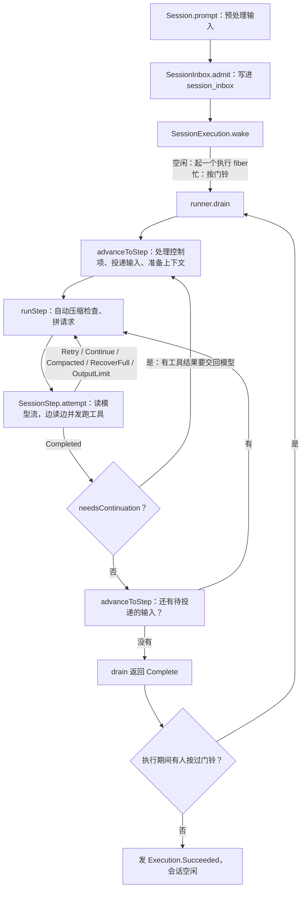

几个名词先说清楚：

- **输入（inbox item）**：用户的一句话、系统补的一条通知、一次手动压缩、一次会话迁移，都先作为一条记录放进会话的收件箱，再由 runner 取出来。
- **执行（execution）**：一个会话从忙到闲的一段时间，对应一个 fiber（Effect 里的轻量线程）。一个执行里可能跑好几次 `drain`。
- **Step**：一次逻辑上的模型请求加上它触发的工具调用。一个 Step 可能因为重试、压缩等原因发好几次物理请求（attempt）。

§3–§5 是调度，§6–§8 是一个 Step 里发生的事，§9–§10 是权限和压缩，§11 讲持久化和恢复，§12 回头看服务是怎么装配起来的，§13 是 Code Mode、子 agent 等扩展能力。

---

## 3. 输入：从 prompt 到收件箱

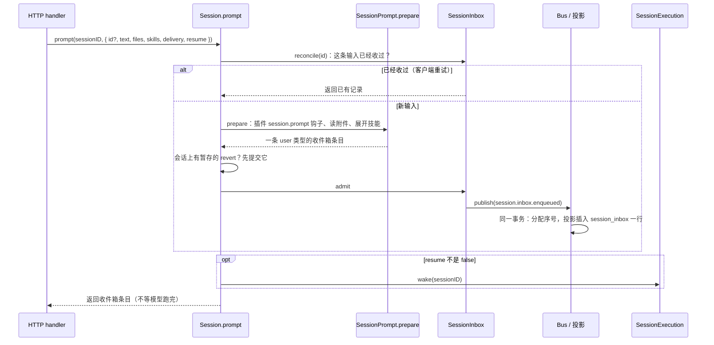

### 3.0 涉及的对象

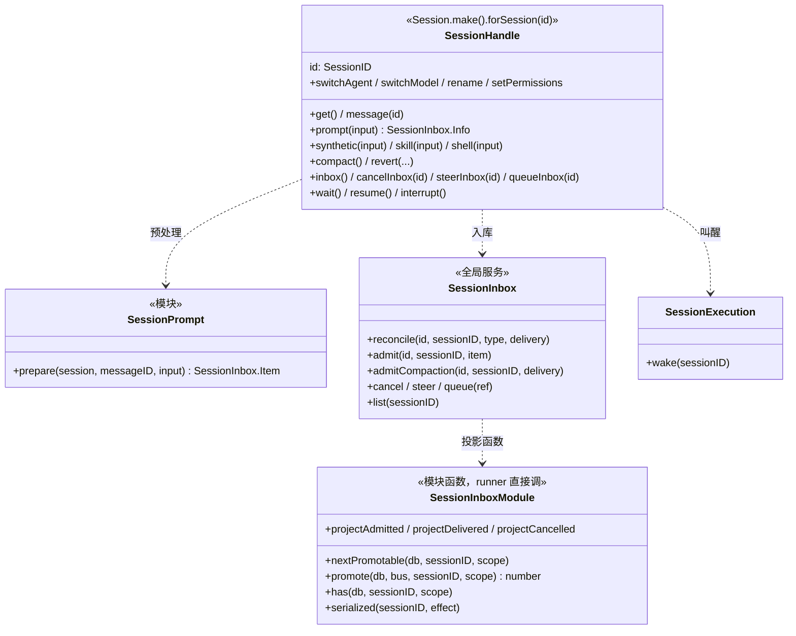

| 对象 | 存什么 | 干什么 |
|---|---|---|
| `Session.make` 返回的会话句柄（`core/src/session/session.ts`） | 只存会话 id。每次调用都重新读数据库，不缓存会话状态 | 对外的会话操作入口。决定输入的幂等规则、入库顺序、要不要叫醒执行。HTTP handler 最终都调到这里 |
| `SessionPrompt.prepare` | 无状态 | 把原始输入变成收件箱条目：插件钩子、附件、技能（§3.1） |
| `SessionInbox.Service` | 持有数据库和 Bus 的引用 | 入库、改投递方式、撤回。所有改动都在“每个会话一把锁”（`serialized`）里串行，并用事件 + 投影完成 |
| `SessionInbox` 模块函数 | 无状态 | runner 用的读取和投递：看下一条可投递的条目、正式投递、查有没有待处理的输入 |

会话句柄不会因为被拿到或丢掉而启动、停止执行；同一个会话的输入随时都能提交，和执行是否在跑无关。

### 3.1 预处理：`SessionPrompt.prepare`

`prepare`（`core/src/session/prompt.ts`）把客户端提交的原始输入变成一条可以入库的收件箱条目，但不入库：

1. 等插件激活完成，触发 `session.prompt` 钩子。插件可以改文字、附件、技能、metadata 和投递方式。
2. 附件逐个读出来（并发 8 个），单个不超过 20 MiB。`file://` 地址读文件，带 `?start=&end=` 时只取这几行；目录会被转成文件列表；`data:` 地址直接解码；图片会被规整，必要时缩小。
3. 用户点名的技能（skill）在这一步就读出正文，存进条目里。

预处理完，`Session.prompt` 还要做一件事：如果会话上有“暂存的回退”（用户选了回退到某个点但还没确认），新输入一进来就提交这次回退。

### 3.2 收件箱表

`admit` 发一个持久化事件 `session.inbox.enqueued`，它的投影往 `session_inbox` 插一行（`core/src/session/sql.ts`）：

| 列 | 含义 |
|---|---|
| `id` | 输入的 id，也是它以后变成消息时的消息 id |
| `session_id` | 所属会话 |
| `type` | `user`（用户输入）/ `synthetic`（系统补的通知，比如后台命令跑完了）/ `compaction`（手动压缩）/ `move`（会话迁移到别的目录） |
| `payload` | 条目内容（JSON） |
| `delivery` | `steer` 或 `queue`，见下 |
| `enqueued_seq` | 入队事件在会话事件流里的序号，决定先后顺序 |

这张表**只放还没处理的输入**。投递时，`session.inbox.delivered` 的投影在同一个事务里删掉这一行，再往 `session_message` 插一条可见的用户消息。所以“取出”和“出现在对话历史里”是原子的，不会出现一边成功一边失败。压缩、迁移这两种控制项被取出时只删行，不产生对话消息。

### 3.3 两种投递方式

| `delivery` | 什么时候被取出 | 用途 |
|---|---|---|
| `steer`（默认） | 下一个“安全的 Step 边界”：当前 Step 的模型回复和工具都结束之后 | 用户在模型干活时插一句话，模型在下一步就能看到 |
| `queue` | 会话本来要停下的时候。而且每次只取一条，取完让模型处理完再看下一条 | “做完手上的事再做这个” |

具体规则在 `SessionInbox.promote` 里：

```ts
// core/src/session/inbox.ts，promote 的主干
const steers = yield* pendingSteers(db, sessionID)
if (steers.length > 0 || scope === "steer") {
  const control = steers.findIndex((row) => row.type === "compaction" || row.type === "move")
  if (control === 0) return undefined                  // 排在最前面的是控制项：交给 runner 先处理
  return yield* publish(db, bus, sessionID, control === -1 ? steers : steers.slice(0, control))
}
// 没有 steer，且允许取 queue：只取最早的一条 queue
const queued = /* 最早一条 delivery = queue 的行 */
if (!queued) return 0
if (queued.type === "compaction" || queued.type === "move") return undefined
const promoted = yield* publish(db, bus, sessionID, [queued])
// 投递这条 queue 期间又来的 steer，跟着一起投
const arrivedSteers = yield* pendingSteers(db, sessionID)
...
```

有几个细节：

- **steer 一次全投**，所有等着的 steer 按顺序一起变成用户消息，但不会越过控制项。比如收件箱里是 `[steer A, 压缩, steer B]`，这次只投 A，压缩做完再投 B。
- **手动压缩会插队到 steer 前面**（`pendingSteers` 里的那段排序）。用户先说了两句话、又点了压缩，会先压缩再投递这两句话，这样它们原文保留在压缩点之后，而不是被压进摘要里。但压缩不会越过“迁移”，因为迁移会改变工作目录。
- **入参 `scope`** 决定能不能取 queue：`"steer"` 只取 steer，`"input"` 在没有 steer 时可以取一条 queue。谁传哪个，见 §5。

条目入库后还可以改：`session.inbox.update` 能把一条 steer 改成 queue 或反过来（改成 steer 会顺便 `wake`），`session.inbox.cancel` 能撤回还没投递的条目。

### 3.4 重复提交

客户端可以自己带 `id`。`reconcile` 先查收件箱，再查已经投递成消息的记录，查到了而且会话、类型都对得上，就直接返回已有的那条，不重新预处理，**以第一次为准**，重试时带的新内容会被忽略。会话或类型对不上则报冲突。不带 `id` 的话每次都生成新 id，等于新输入。

发布事件和查重之间有竞争：两个请求同时查不到、同时去插。投影插入用 `onConflictDoNothing`，没插进去就以 defect 的形式中止事务，`admit` 捕获后再查一次：查到了就返回那条，查不到才真的报错。

`resume: false` 只表示这次不叫醒执行，输入照样入库。执行如果正在跑，后面照样会把它取走。

整段 `prompt` 包在 `Effect.uninterruptibleMask` 里，只有预处理那一步允许被取消。这样不会出现“已经入库、还没 wake 就被取消”的情况。

---

## 4. 调度：同一个会话同一时刻只有一个执行

`SessionExecution`（`core/src/session/execution.ts`）是进程级的服务，按会话 id 管执行。它把调度规则交给一个通用的 `SessionRunCoordinator`（`run-coordinator.ts`），自己负责“真正执行时做什么”。

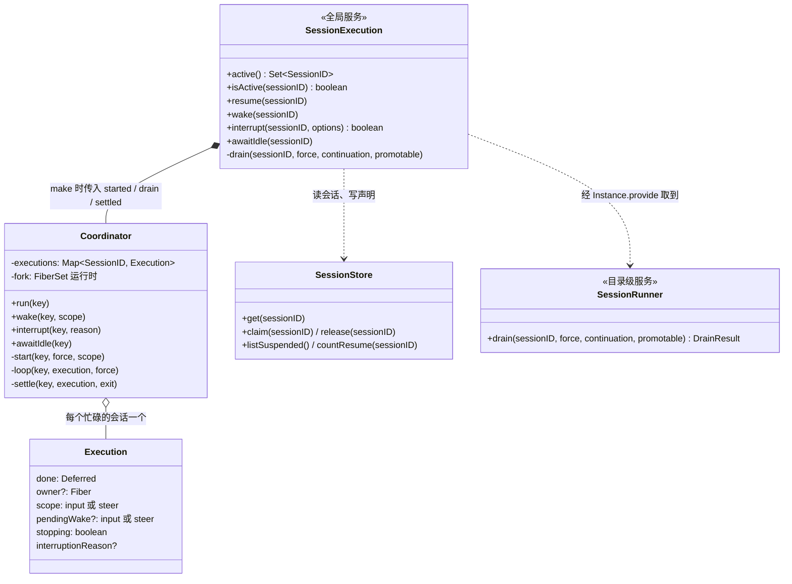

| 方法 | 干什么 | 谁调它 |
|---|---|---|
| `wake` | 空闲时起一个执行；忙时按门铃，不等待 | `Session.prompt`、`steerInbox`、后台任务完成通知等 |
| `resume`（coordinator 的 `run`） | 空闲时起执行并等它结束；忙时一起等；正在停止时等它停完再起新的 | 崩溃恢复（§11.4）、子 agent 任务（`subagent-job.ts`） |
| `interrupt` | 标记停止、清门铃、中断 fiber，立即返回 | 接口 `session.interrupt`；目录长时间不活跃时由 `location-activity.ts` 以 `inactivity` 原因中断 |
| `awaitIdle` | 等到这个会话没有执行为止（包括清理期间新起的后继执行），自己从不启动执行 | 接口 `session.wait` |

### 4.1 Coordinator 的状态

```ts
// core/src/session/run-coordinator.ts
type Execution<E, Reason> = {
  readonly done: Deferred.Deferred<void, E>   // 等这次执行结束的人在这上面等
  owner?: Fiber.Fiber<void>                   // 执行它的 fiber
  scope: Promotable                           // 这一轮 drain 能取哪些输入："input" 或 "steer"
  pendingWake?: Promotable                    // 门铃：执行期间又有人 wake 过
  stopping: boolean                           // 正在被中断
  interruptionReason?: Reason
}
```

整个 coordinator 就是一张 `Map<会话 id, Execution>`。

```ts
const wake = (key: Key, scope: Promotable = "input") =>
  Effect.sync(() => {
    const execution = executions.get(key)
    if (execution !== undefined) {
      // 合并多次 wake 时取范围大的："input" 包含 "steer"
      execution.pendingWake = execution.pendingWake === "input" ? "input" : scope
      return
    }
    start(key, false, scope)
  })
```

空闲时直接起一个执行；忙的时候只按一下“门铃”。执行的主循环是：

```ts
const loop = (key, execution, force) =>
  Effect.suspend(() => options.drain(key, force, execution.scope)).pipe(
    Effect.andThen(Effect.suspend(() => {
      if (execution.stopping || execution.pendingWake === undefined) return Effect.void
      execution.scope = execution.pendingWake
      execution.pendingWake = undefined
      return Effect.yieldNow.pipe(Effect.andThen(loop(key, execution, false)))
    })),
  )
```

drain 一次跑完，看门铃有没有响过；响过就再 drain 一次。为什么 runner 自己会查收件箱，还需要门铃？因为 runner“最后一次查收件箱发现是空的”和“决定退出”之间不是原子的。新输入恰好落在这个空档里，如果 wake 被忽略，这条输入就没人管了。门铃把这次通知留到 drain 结束后处理。反过来，输入已经被当前 drain 取走、门铃也响过，后面多出来的那次 drain 只会查一次库发现没事可做，不会多调一次模型。

### 4.2 执行开始和结束时做什么

`SessionExecution` 给 coordinator 传了三个回调：

| 回调 | 做什么 |
|---|---|
| `started` | 一段忙碌期开始时发 `session.execution.started`，**同一个事务里**写一个执行声明（claim，§11） |
| `drain` | 读会话，用 `instances.provide(session)` 进入会话所在目录的那套服务（§12），调 `runner.drain`。返回 `Moved`（会话迁移到别的目录了）或 `Reloaded`（目录的服务重载了）时，重新读会话再 drain 一次 |
| `settled` | 一段忙碌期结束时只发一个终止事件：成功 `succeeded`、失败 `failed`、被中断 `interrupted`。前两种和用户主动中断都会同时释放声明；**关机导致的中断不释放**，留给下次启动恢复 |

`run`（对外叫 `resume`）和 `wake` 的区别：`run` 会等执行结束；已经有执行在跑就一起等同一个 `done`。`wake` 只按门铃不等待。

`interrupt` 把执行标成 `stopping`，清掉已经响过的门铃（那些属于被中断的意图），然后中断 fiber，**不等清理完就返回**。清理期间新来的 wake 会正常重新起执行。接口上 `interrupt` 还有一个 `resume` 选项：中断后如果收件箱最前面是 steer 或控制项，就用 `"steer"` 范围再 wake 一次，接着处理用户插的话，但不会去取 queue 里的下一个任务。

---

## 5. Runner：从投递输入到一个个 Step

`runner.drain`（`core/src/session/runner/llm.ts`）是一次 drain 的全部逻辑。外层循环 `advanceToStep` 决定下一个 Step 用什么输入，内层 `runStep` 负责把这个 Step 跑完。

### 5.0 执行组件

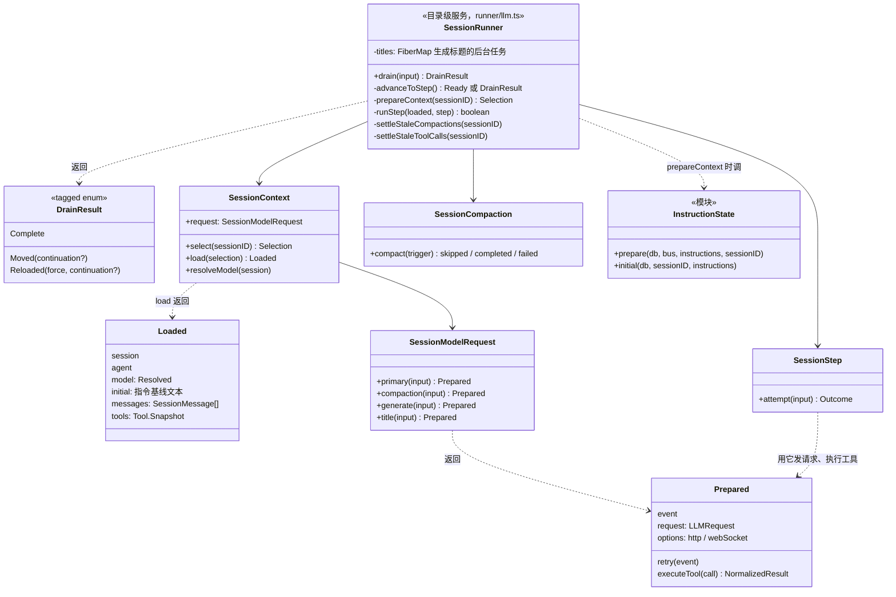

| 组件 | 作用 |
|---|---|
| `SessionRunner` | 一次 drain 的全部逻辑。自己不存会话状态，状态都在数据库里；只用一个 `FiberMap` 管生成标题的后台任务，避免同一会话重复生成 |
| `DrainResult` | drain 怎么结束的：`Complete` 没活了；`Moved` 会话搬到别的目录了；`Reloaded` 目录的服务重载了。后两种由 `SessionExecution` 换一套服务接着 drain，并带上当前步数，让步数限制跨过这次切换 |
| `SessionContext` | 分两段准备上下文：`select` 定会话、agent、指令来源和工具快照；`load` 再加上模型和历史（§6） |
| `SessionModelRequest` | 为四种请求（主对话、压缩、生成、标题）各自拼请求，各走各的插件钩子（§6.5） |
| `SessionStep` | 一次物理请求：读流、跑工具、得出 `Outcome`（§7） |
| `SessionCompaction` | 判断要不要压缩、执行压缩（§10） |
| `InstructionState` | 指令的增量同步（§6.2） |

### 5.1 一个例子

用户先发 A（steer），模型在调工具时又发了 B（steer）和 C（queue）：

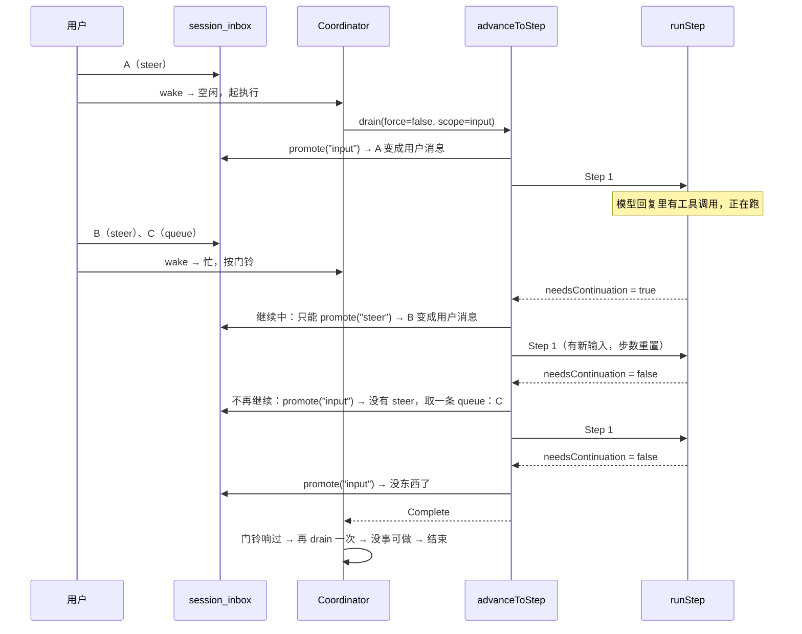

### 5.2 drain 开始前

```ts
if (!force && !continuing) {
  const pending = yield* SessionInbox.nextPromotable(db, sessionID, "input")
  if (!pending) return DrainResult.Complete()                       // 没活就直接走
  const control = pending.type === "compaction" || pending.type === "move"
  if (promotable === "steer" && pending.delivery === "queue" && !control) return DrainResult.Complete()
}
yield* plugins.awaitActivation
yield* settleStaleCompactions(sessionID)   // 上个进程死时没收尾的压缩，标成失败
yield* settleStaleToolCalls(sessionID)     // 上个进程死时还在跑的工具调用，标成失败
```

后两步是崩溃恢复的一部分（§11）：数据库里还显示 running 的压缩和工具调用，其实已经没人在跑了，要先收尾，否则模型下一次请求会看到一个永远没有结果的工具调用。

### 5.3 `advanceToStep`：下一个 Step 用什么输入

它是一个循环，每圈做这些事：

1. 目录的服务已经关闭（比如配置重载了）？返回 `Reloaded`，让外面换一套服务再来。
2. 在收件箱锁内看下一条可投递的条目（`nextPromotable`）。这里的范围是：刚进入 drain 或者上一个 Step 不需要继续时用 `"input"`，否则用 `"steer"`。也就是说，**模型还在干活时只接受插话，不接新任务**。
   - 是**压缩**：发 `inbox.delivered` 和 `compaction.started`，做一次手动压缩（§10），然后回到循环开头。
   - 是**迁移**：关掉模型的 WebSocket 连接，发 `inbox.delivered` 和 `session.moved`，返回 `Moved`。
3. 不需要继续、又没有可投递的输入（或者只有 queue 而当前范围是 steer），返回 `Complete`。
4. 准备上下文（`prepareContext`，§6），然后正式 `promote`。这一步会把输入变成对话消息。有新输入被投递时，步数重置为 1；如果会话还没有标题，后台起一个生成标题的任务，不阻塞模型请求。
5. `context.load` 加载模型和历史，返回 `Ready`。

整个 `advanceToStep` 跑在 `uninterruptibleMask` 里，只有真正等待的部分（准备上下文、压缩）允许被打断。这样不会出现“投递事件发了一半就被中断”。

主循环很短：

```ts
while (true) {
  const next = yield* advanceToStep()
  if (next._tag !== "Ready") return next              // Complete / Moved / Reloaded
  continuing = yield* runStep(next.context, step)     // 返回 needsContinuation
  step++
  force = false
  entering = false
}
```

### 5.4 步数上限

每个 agent 可以配置 `steps`（最多连续多少个 Step）。到上限时，`runStep` 不会直接停下，而是在消息末尾加一段 `MAX_STEPS_PROMPT`（“已经到最大步数，不许再调工具，总结一下做了什么、还剩什么”），同时把 `toolChoice` 设成 `"none"`。工具定义仍然带上，这样请求前缀不变，提示缓存还能命中。万一模型还是调了工具，执行时会直接返回错误“工具在最大步数之后被禁用”。

用户插话会重置步数：“新输入进来，模型又有了完整的步数额度”。一批 steer 只重置一次。

### 5.5 `runStep`：一个 Step 可能发好几次请求

```ts
while (true) {
  const loaded = initial ?? (yield* prepareContext(sessionID).pipe(Effect.flatMap(context.load)))
  initial = undefined
  const compacted = yield* compaction.compact({ reason: "auto", context: loaded })   // 先看要不要自动压缩
  if (compacted.status === "failed") return yield* new StepFailedError(...)
  if (compacted.status === "completed") { assistantMessageID = SessionMessage.ID.create(); continue }

  const transcript = SessionModelRequest.baseTranscript({ ... })     // §6.4
  const prepared = yield* context.request.primary({ ... })           // §6.5
  const outcome = yield* steps.attempt({ ..., prepared, retry, recoverOverflow, recoverContinuation })  // §7
  const completed = yield* Outcome.$match(outcome, { ... })
  if (completed !== undefined) return completed
}
```

`attempt` 的结果有六种，`runStep` 分别这样处理：

| 结果 | 含义 | `runStep` 怎么办 |
|---|---|---|
| `Completed` | 这次请求正常结束（工具也都跑完了） | 返回 `needsContinuation`，结束这个 Step |
| `Retry` | 还没有任何输出就失败了，可以重试 | 发 `session.retry.scheduled`，等一段时间，**用同一个 assistant 消息 id** 再来一次 |
| `Continue` | 已经输出了一部分，流断了 | 同样等待，然后补一条系统通知“上次回复被打断了，从断的地方接着说，别重复”，换一个新的 assistant 消息 id 再来 |
| `Compacted` | 服务端说上下文太长，已经压缩完 | 换新 assistant 消息 id 再来。这种恢复一个 Step 只做一次 |
| `RecoverFull` | 服务端拒绝了“接着上次的状态继续”（比如 WebSocket 续传的状态过期了） | 立即用完整上下文重发一次，不等待。也只做一次 |
| `OutputLimit` | 请求正常结束，但结束原因是 `length`：回复写到输出上限被截断了 | 见下 |

`OutputLimit` 是 10-13 加的（`a3f7f42ac9`）。以前被截断的回复按 `Completed` 处理，模型话说一半，会话就停了。现在 `runStep` 这样处理：

- 先看最近三条 user / assistant 消息（包括刚截断的这条）是不是**全都**是因为 `length` 结束的 assistant 消息。是的话说明已经续写过两次还是写不完，报 `output-limit` 错误，Step 失败。
- 这一步里有本地工具调用（`needsContinuation`），就按普通的 `Completed` 结束 Step，工具结果交回模型时它自然会接着写。
- 否则补一条系统通知：“上次回复到了输出上限，不要道歉、不要复述，把剩下的工作拆成小块”，换一个新的 assistant 消息 id 再来一次。

每次循环都重新 `prepareContext` + `load`，因为等待期间指令可能变了、历史可能多了东西。但重试**不会再投递新输入**，用户在这期间的插话要等这个 Step 结束。

---

## 6. 一次请求是怎么拼出来的

这一节回答：发给模型的那个请求里，每个字段从哪来。

### 6.1 `SessionContext.select`：先定下 agent、指令来源和工具

```ts
// core/src/session/context.ts，select 的主干
const session = yield* store.get(sessionID)
if (session.location.directory !== location.directory || ...) return yield* Effect.interrupt   // 会话已经搬走了
yield* mcpTools.flush
const agent = yield* agents.select(session.agent)
const permissions = Permission.merge(agent.info.permissions, session.permissions ?? [])
const loaded = yield* Effect.all({
  tools: registry.snapshot(permissions),          // 工具快照，§8
  builtins: builtins.load(),                      // 内置指令：日期、环境等
  discovery: discovery.load(),                    // 项目里发现的 AGENTS.md 之类
  skills: skillInstructions.load(permissions),    // 可用技能的说明
  references: referenceInstructions.load(),
  mcp: mcpInstructions.load(permissions),         // MCP 服务给的说明
  entries: entries.load(sessionID),               // 通过 API 给这个会话设置的指令条目
}, { concurrency: "unbounded" })
return {
  session, agent, tools: loaded.tools,
  instructions: Instructions.combine([
    CodeModeInstructions.make(loaded.tools.codeModeCatalog),
    loaded.mcp, loaded.references, loaded.skills, loaded.discovery, loaded.builtins, loaded.entries,
  ]),
}
```

`discovery` 这一项除了自动发现的 `AGENTS.md`，还包括配置文件 `instructions` 数组里点名的文件。v2 的配置格式早就接受这个字段，但直到 10-15（`1e63a3bb73`）才真正去读：`config/plugin/instruction.ts` 把每一项解析成文件，加进 `InstructionDiscovery` 的文件表，排在 `AGENTS.md` 之后。相对路径和通配符从工作目录往上一直找到项目根，`~/` 从家目录算，`http(s)://` 地址在加载配置时抓取（5 秒超时，抓不到就保留上次的内容）。本地文件改了会像 `AGENTS.md` 一样作为指令变化出现（§6.2）。

指令来源的顺序是有讲究的：按“在不同会话之间有多通用”从高到低排，越通用的越靠前。这样拼出来的指令开头部分在很多会话里都一样，提示缓存更容易命中。日期、环境这些每天每个目录都不一样的，放在最后。

注意权限在这里已经起作用了：被整个禁用的工具（规则是 `资源 = "*"`、`效果 = deny`）直接不进工具快照，模型根本看不到。

### 6.2 `InstructionState`：指令只发变化的部分

系统指令（AGENTS.md、技能列表、MCP 说明、环境信息……）在会话中途可能会变。v2 的做法是：**会话开始时的指令作为基线放在 system 里，之后的变化作为一条条“系统消息”按时间顺序追加进对话**。

每次进入 Step 前，`prepareContext` 都会调 `InstructionState.prepare`（`core/src/session/instruction-state.ts`）：

1. 并发读一遍所有指令来源，每个来源得到一个 JSON 值（或者“暂时读不到”“已经没了”）。
2. 每个值算 SHA-256，和库里记的当前值比较，得到一个 delta：`{ 来源 key → 新哈希 或 "removed" }`。
3. 有变化就发 `session.instructions.updated { delta, text }`。值本身存进 `instruction_blob` 表（按哈希去重，同样的内容只存一份）；`text` 是渲染好的变化说明，比如“AGENTS.md 更新了，新内容是……”，**渲染一次就冻结在事件里**，因为以后再渲染需要当时目录里的那些来源，不一定还在。
4. 投影更新 `instruction_state` 表，投影出一条 `system` 类型的会话消息。

| `instruction_state` 列 | 含义 |
|---|---|
| `initial_values` | 这个“纪元”开始时的值（来源 key → 哈希），渲染成请求开头的 system 基线 |
| `current_values` | 最新的值，下次比较用 |
| `epoch_start` / `through_seq` | 纪元从哪个事件序号开始、更新到哪 |

第一次（新会话）的 delta 必须完整，不带 `text`，它就是基线。这时某个来源读不到，整个初始化会被挡住（`InitializationBlocked`），输入留在收件箱里不投递；之后的读不到则保留旧值，不算变化。

压缩完成时（`compaction.ended`）纪元前移：当前值变成新的初始值。压缩之后，请求开头的基线就是最新的指令，之前那些“变化消息”已经被压缩掉了，不需要再出现。

### 6.3 `SessionHistory`：读哪些历史

`context.load` 调 `SessionHistory.entriesForRunner`，在一个事务里读出两样东西：指令基线（`InstructionState.initial` 渲染出的文本），和最近一次完成的压缩之后的所有消息（含压缩消息本身）。

“最近一次压缩”要看压缩的种类：本地生成的摘要对任何模型都有效；provider 原生压缩生成的加密窗口只能在同一个服务端上回放（§10）。所以按当前模型的“来源”（provenance）挑，换了模型就跳过不兼容的原生压缩，往前找本地摘要，或者干脆用原始记录。

会话消息再由 `toLLMMessages`（`runner/to-llm-message.ts`）转成模型消息：

| 会话消息 | 变成什么 |
|---|---|
| `user` | user 消息：技能正文 + 文字 + 附件 |
| `synthetic` / `skill` | user 消息（系统补的通知、技能激活） |
| `system` | system 消息（指令变化，§6.2） |
| `shell` | user 消息：“用户执行了这条命令，输出是……”。后台命令的结果不在这里进上下文，而是跑完时通过收件箱的 synthetic 条目进 |
| `assistant` | assistant 消息，含工具调用和结果 |
| `compaction`（已完成） | 本地摘要：一条 user 消息，内容是 `<conversation-checkpoint>` 包着的摘要和最近原文；原生压缩：解码出服务端给的窗口 |
| `model-switched` | 必要时变成一个思考强度变化的标记 |
| `location-switched` | user 消息：“工作目录改成了……” |
| `agent-switched` / `idle` | 不进上下文 |

### 6.4 `baseTranscript`：system 部分

```ts
system: [
  input.agent.system ? input.agent.system : SessionSystemPrompt.make(toolNames),  // agent 自带的提示词，或者默认提示词
  input.initial,                                                                   // 指令基线
].filter((part) => part.length > 0).map(SystemPart.make),
messages: toLLMMessages(input.messages, input.model.ref, providerMetadataKey),
```

所以 system 只有两块：agent 的提示词和指令基线。后续的指令变化都在 `messages` 里。

### 6.5 `SessionModelRequest.prepare`：最终的请求

`primary` 调 `prepare("primary", ...)`（`core/src/session/model-request.ts`）。它依次：

1. 触发插件的 `session.context` 钩子。插件能改 system、messages、生成参数，还能改工具定义：改描述、改参数、删工具、改名。钩子改过之后，按对象身份把定义对回原来的工具，凭空多出来的定义被丢掉。
2. 算默认的输出上限：模型目录里的上限（没有就 32000，最多 256000），再看上下文窗口还剩多少：`窗口 − 实测输入 − 估算新增 × 1.15`，最少留 1024。
3. 拼 `LLMRequest`，再触发 `session.model.request` 钩子，插件能改 baseURL 和请求头。
4. 如果有插件订阅了 `session.http.request` / `http.response`，包一层 HTTP 拦截；模型走 WebSocket 时，绑定会话级的 WebSocket 连接（`SessionModelTransport`），握手和每一帧也都能被钩子改。

最后的请求字段：

| 字段 | 来源 |
|---|---|
| `model` | 会话选的模型；`model.request` 钩子改了 baseURL 时换路由 |
| `system` | §6.4 的两块，经过 `session.context` 钩子 |
| `messages` | §6.3 的历史，经过钩子；模型不支持的媒体换成一句错误说明；图片总量超过 25 MiB 时从前往后删图，删到 15 MiB 以下，并写明“这张图被删了，别凭记忆描述它” |
| `tools` | 工具快照的定义（§8），经过钩子 |
| `toolChoice` | 平时不设；到步数上限时为 `"none"` |
| `generation` / `providerOptions` | 钩子给的 options 里，`maxTokens`、`temperature` 这类通用字段放 `generation`，其他放 `providerOptions` |
| `http.headers` | `x-opencode-session-id`、`x-session-affinity`（会话亲和，让同一会话落到同一个后端）、项目 id、客户端名等 |
| `promptCacheKey` | 从会话亲和 id 来，同一会话的请求共用 |

返回的 `Prepared` 里除了 `request` 还有一个 `executeTool`，它只认这次请求里宣告过的工具（§8）。

---

## 7. `SessionStep.attempt`：读流、并发跑工具

`attempt`（`core/src/session/runner/step.ts`）负责一次物理请求：发请求、读流、启动工具、等它们结束、决定结果。

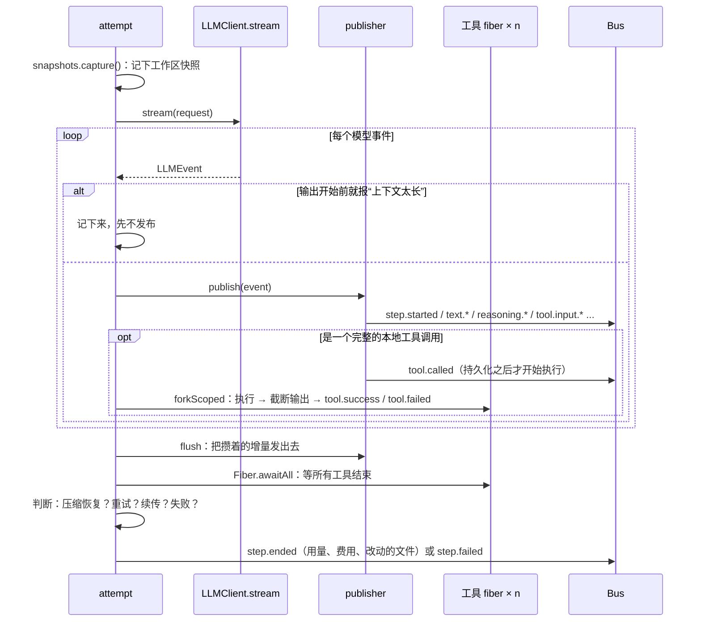

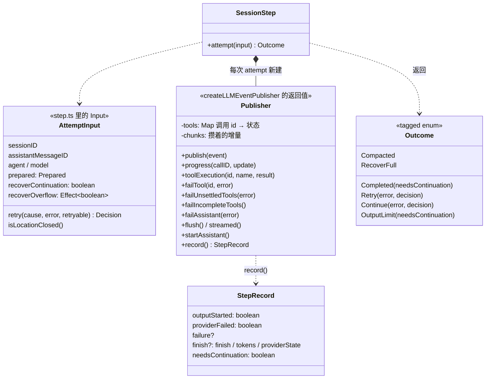

`createLLMEventPublisher`（`runner/publish-llm-event.ts`）造出的发布器是这一步的记账本：它把模型事件翻译成会话事件发出去，同时记下“输出开始了没有”“服务端报错了没有”“每个工具调用到哪一步了”。`attempt` 最后所有的判断，都是看 `record()` 给出的这份快照做的。

模型事件和会话事件的对应关系：

| 模型事件（`LLMEvent`） | 会话事件 | 持久化 |
|---|---|---|
| 第一个事件 | `step.started` | 是 |
| `text-start` / `text-delta` / `text-end` | `text.started` / `text.delta` / `text.ended` | 增量不持久化，开始和结束持久化 |
| `reasoning-*` | `reasoning.started` / `delta` / `ended` | 同上 |
| `tool-input-start` / `delta` / `end` | `tool.input.started` / `delta` / `ended` | 同上 |
| `tool-call` | `tool.called` | 是 |
| `tool-result` / `tool-error`（服务端执行的工具） | `tool.success` / `tool.failed` | 是 |
| 本地工具执行完 | `tool.success` / `tool.failed`（由工具 fiber 发） | 是 |
| `step-finish` / `finish` | 记下来，收尾时发 `step.ended` | 是 |
| `provider-error` | 记下来，收尾时发 `step.failed` | 是 |

### 7.1 边读边跑工具

模型流里每出现一个完整的工具调用，就为它 `forkScoped` 一个 fiber 去执行，不等流读完。几个工具调用可以并发跑。规则是：

- **先持久化，再执行**。`tool.called` 事件写进库以后才开始执行工具，这样进程死了也知道“这个调用开始过”。
- 每个工具 fiber 自己负责发结果事件：成功就 `toolOutput.truncate`（§8.4）后发 `tool.success`；工具返回 `Tool.Error` 就发 `tool.failed`，模型能看到错误信息。
- 用户拒绝权限或者关掉提问对话框，不算工具失败，而是作为“拒绝”留在 fiber 的错误通道里，由 `attempt` 统一处理（§9）。
- 流要读到底，不是看到 finish 事件就停，这样下一次请求能接着用这次响应留下的状态。
- **参数不合法就不执行，也不修补**。以前 `ai` 包解析不了工具参数时，会尽量从半截 JSON 里抢救出一个对象（解析不出就当成 `{}`）照样执行。10 月起（`c9e1ed7080`、`a3f7f42ac9`）改成发一个 `tool-input-error` 事件，这个调用直接标失败、不执行，错误信息里附上参数的前 2048 个字符，让模型知道自己写成了什么样。失败原因分三种：JSON 解析不了；本次回复因为 `length` 结束，参数是被输出上限截断的（提示模型把大块内容拆成几次调用）；流结束了参数还没写完。

文本和推理的增量（`text.delta`、`reasoning.delta`）是**临时事件**，只推给在线的客户端，不写库，而且会攒一小段时间批量发。每段文字结束时的 `text.ended` 才是持久化的，带完整内容。

### 7.2 读完之后怎么收尾

收尾整段是不可中断的（工作本身可以被取消，但最后的工具结果和 Step 事件一定要写完）：

1. 发 `step.streamed`；流被中断了就中断所有工具 fiber。
2. 等所有工具 fiber 结束，把它们的结局分成三类：用户拒绝、被中断、意外崩溃。
3. **溢出恢复**：输出还没开始、服务端说上下文太长、`recoverOverflow` 也同意（一个 Step 只给一次机会，由 runner 控制），就压缩并返回 `Compacted`。
4. **完整重发**：传输层说“要用完整上下文重发”，而且还没输出，返回 `RecoverFull`。
5. **重试**：失败、还没有任何输出、重试策略同意 → 返回 `Retry`。已经有输出了、流中途断了、策略同意，且没有用户拒绝 → 先把这次的 Step 收尾，再返回 `Continue`。
6. 其他情况：有拒绝的工具发失败（“用户拒绝了这次调用”），还没结果的工具统一标失败，Step 标中断或失败。
7. 有结束原因就算用量和费用，再抓一次工作区快照，和开始时的快照比，得到这一步改了哪些文件，一起写进 `step.ended`。

最后返回 `Completed({ needsContinuation })`；如果结束原因是 `length`，返回 `OutputLimit({ needsContinuation })`，交给 runner 决定要不要续写（§5.5）。`needsContinuation` 的定义很直接：这一步里有没有**本地执行的**工具调用（被调用或者已经有结果）。有，就需要把结果交回模型，runner 会再跑一个 Step；provider 自己执行的工具（比如服务端的网页搜索）不算。

### 7.3 重试策略

`runner/retry.ts`：

| 项 | 值 |
|---|---|
| 哪些错误会重试 | 限流、服务端内部错误、请求没发出去或不确定发没发出去的传输错误、被判为“流不完整”的输出 |
| 间隔 | 从 2 秒开始指数增长，每次最多 10 秒，加随机抖动 |
| 次数 | 最多 10 次（全失败的话大约等 84 秒） |
| `Retry-After` | 服务端给了更长的等待时间就听它的，但最多 15 分钟 |
| 超时 | 超时的请求本身已经等了很久，最多只重试 3 次 |
| 插件 | `session.retry` 钩子能看到每次决定，可以否决或改延迟 |

（设计文档 `specs/v2/session.md` 里写的是“最多重试 4 次”，代码已经改成 10 次，以代码为准。）

---

## 8. 工具

### 8.1 工具的形状

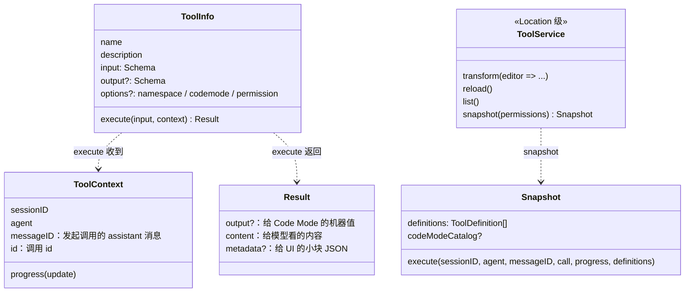

一个工具就是一个对象：名字、描述、输入输出 schema、`execute`。`execute` 返回三样东西：`output` 是给 Code Mode 脚本用的结构化值，不写库；`content` 是给模型看的内容，写库；`metadata` 是给界面用的小块 JSON。

### 8.2 注册

工具都通过 `Tool.Service.transform` 注册，内置工具、插件、MCP 都一样。注册是有作用域的：同名工具后注册的生效；关掉某次注册的作用域，就只删掉它自己，之前被它盖住的那个又露出来。

内置工具在 `core/src/tool/plugin/` 下，每个都是一个内部插件：

| 工具 | 说明 |
|---|---|
| `read` / `write` / `edit` / `patch` | 读写文件。后三个共用权限动作 `edit`。`patch` 一次提交多个文件的增删改 |
| `glob` / `grep` | 找文件、搜内容 |
| `shell` | 执行命令，输出写到文件，返回截断后的尾部 |
| `question` | 向用户提问（§9.3） |
| `subagent` | 派子 agent（§13） |
| `skill` | 加载技能 |
| `webfetch` / `websearch` | 抓网页、搜索 |
| `opencode` 命名空间 | `session_rename`、`session_move`、`worktree_create` / `worktree_list` / `worktree_remove`、`models`、`list_mcp_resources` / `read_mcp_resource` 这些管理 opencode 自身的小工具。三个 worktree 工具是 10-08 从插件挪进 core 的（`7d179e83f4`），`worktree_remove` 会删文件，所以要过 `edit` 权限 |

### 8.3 快照：每次请求固定一份

`snapshot(permissions)` 在 `select` 时调用（§6.1），为这次请求固定一份工具：

1. 去掉被权限整个禁用的工具。
2. 分成两组：`codemode: false` 的工具**直接**声明给模型；其余的（默认值）都收进 Code Mode。
3. Code Mode 里有工具时，额外声明一个名叫 `execute` 的工具：模型写一段脚本，在脚本里调这些工具（§13）。

上面表里的内置工具，除了 `opencode` 命名空间，都标了 `codemode: false`，模型直接看到它们。`opencode` 命名空间里那些不常用的管理工具，和插件、MCP 加进来的工具一样进 Code Mode，不占工具声明。

Code Mode 的工具目录写进 system 时有预算（约 2000 token，`codemode/catalog.ts`）：每个命名空间都列出名字和工具数，具体的工具签名则各命名空间轮流挑，挑到预算用完为止。目录不全时，说明里会告诉模型“目录只列了一部分”，让它在 `execute` 脚本里先调 `search(...)` 找到工具，再按返回的路径调用。工具可以标 `pinned: true`，保证自己的签名一定被列出来；`session_move` 和三个 worktree 工具就是这样标的。少数本身就把工具包成了 Code Mode 的 MCP 服务是例外，会被自动设成 `codemode: false`，避免两层 Code Mode 套在一起（`plugin/mcp-codemode-defaults.ts`）。

快照的 `execute` 只执行这次请求宣告过的工具。之后注册表变了，只影响后面的请求。被钩子删掉的工具、名字对不上的工具、最后一步的工具调用，都各自返回一个错误结果，不影响同一批里的其他调用。

一次本地调用的完整过程：

```text
tool.execute.before 钩子（可以修复参数）
  → 用输入 schema 校验参数（不合法就不执行）
  → 工具的 execute
  → 用输出 schema 编码 output
  → tool.execute.after 钩子（可以改结果）
  → 规整 content，压缩图片
  → runner 里的 ToolOutput.truncate
  → tool.success / tool.failed 事件
```

### 8.4 输出截断

`ToolOutput.truncate`（`core/src/tool-output.ts`）只量文本部分：超过 2000 行或 50 KiB，就把完整内容存进托管目录下的 `tool-output/` 文件里，保留 7 天；给模型的内容换成“头部 + 省略标记 + 尾部”，并在 metadata 里记下文件路径。完整内容存不下来时，这次调用算失败，不会发一个丢了数据的“成功”。

工具自己也可以先截（比如 shell 把完整输出写进自己的文件，只返回尾部），那是工具自己的事，两层限制互不相干。

---

## 9. 权限与用户交互

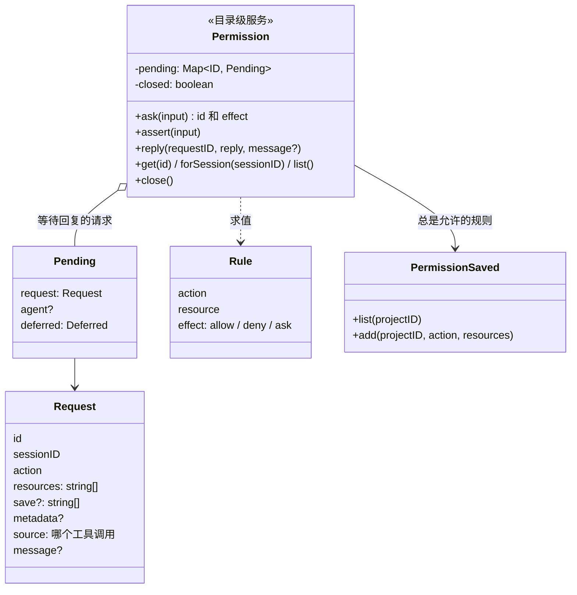

### 9.1 规则怎么算

一条权限规则是 `{ action, resource, effect }`，`effect` 是 `allow` / `deny` / `ask` 三种，`action` 和 `resource` 都支持通配符。`Permission.Service`（`core/src/permission.ts`）判断一次请求：

```ts
const rules = merge(agent.permissions, session.permissions)        // agent 的规则 + 会话的规则
if (任一资源命中 deny) return "deny"
const all = [...rules, ...已保存的 always 规则]                       // 用户点过“总是允许”的
const effect = 任一资源是 ask ? "ask" : "allow"                       // 每个资源取最后一条匹配的规则；都没匹配算 ask
const event = yield* hooks.trigger("permission", "evaluate", { ..., effect })   // 插件可以改结论
return event.effect
```

注意 deny 先于保存的规则判断：用户以前点过“总是允许”，也盖不过配置里的 deny。组织通过 Console 下发的托管策略（`managed-policy.ts`）拥有最终决定权，仓库里的配置不能关掉它。

### 9.2 工具怎么问

权限检查不是注册表替工具做的，而是**工具自己在执行时调** `permission.assert`，因为只有工具知道要检查什么资源。比如 `grep` 会先解析出根目录，再用 `action: "grep"`、`resources: [pattern]` 去问。

`assert` 的三种结果：

| 结论 | 怎么办 |
|---|---|
| `deny` | 抛 `BlockedError`，工具把它转成普通的工具失败，模型能看到“被拒绝了” |
| `allow` | 直接返回 |
| `ask` | 发 `permission.asked` 事件，客户端弹框；工具 fiber 在这里等用户回复 |

用户的回复有三种（`permission.reply`）：

- `once`：只放行这一次。
- `always`：放行，并把请求里带的 `save` 模式存成规则（按项目保存）；然后重新评估这个会话里其他还在等的请求，现在已经满足的一并放行。
- `reject`：拒绝。**同一会话里其他正在等的请求也全部拒绝**，因为并行的几个工具调用多半是一件事，一个被拒，其他没必要再问。拒绝时可以附一句话（“别改这个文件，改那个”），这时是 `CorrectedError`，工具把它当普通失败交给模型，模型可以按这句话调整，继续干活。

不带话的拒绝走了一条特殊的路：`assert` 把 `DeclinedError` 变成 defect 抛出去，穿过工具里的各种错误转换，到 `SessionModelRequest.executeTool` 才还原成类型化的错误。这样工具没办法把“用户说不”吞掉变成一条普通输出。`attempt` 拿到拒绝后，把被拒的调用标为失败，然后**中断整个 Step**，等用户下一句话，而不是让模型自己接着试。

### 9.3 提问：Form

`question` 工具背后是 `Form.Service`（`core/src/form.ts`）：工具创建一个表单（几个问题、选项），发事件让客户端显示，等用户回答或取消。用户关掉对话框和拒绝权限一样，作为 defect 穿出去，中断这一步。接口上也能直接创建和回复表单（`session.form.*` 路由）。

---

## 10. 压缩

### 10.1 什么时候压缩

| 触发 | 在哪 | 条件 |
|---|---|---|
| `auto` | 每个 Step 开头（`runStep` 循环里） | 开着自动压缩，且估算的上下文 ≥ 阈值。刚压缩完、或者原生压缩的窗口还没测过实际大小时不触发 |
| `overflow` | `attempt` 里 | 服务端在输出开始前就说“太长”。一个 Step 只给一次机会；第二次溢出、已经有输出后溢出、关了自动压缩时溢出，都算失败 |
| `manual` | `advanceToStep` 处理收件箱的压缩控制项 | 用户主动 `/compact`。关了自动压缩也照样能做 |

阈值（`calculateCeiling`）：取模型的输入上限，没有就用上下文窗口。配置了 `buffer` 就是 `窗口 − buffer`；否则留 10% 和 16000 中较大的那个（窗口小于 32000 时只留 10%）。窗口未知时自动压缩不触发，只有服务端拒绝才会触发溢出压缩。

默认设置：`auto: true`，`keep: 15000`（摘要旁边原样保留最近约 15000 token 的对话）。

溢出压缩时，既然服务端已经拒绝了，说明估算偏低，第一次就把目标定在估算值的 70%；如果压缩请求本身也太长，再依次降到 50%、35%。

压缩请求的输出上限要按实际发出去的请求来算。拼请求时按目标大小留了输出空间，但对话已经压不动时，真正发出去的请求可能比目标大，输入加输出就超过了窗口。10-15（`ae8d59f8b5`）起，每次发压缩请求前都按这次请求的估算大小重新算一遍输出上限，只往小调。

### 10.2 两种压缩方式

| | 本地摘要（默认） | 原生压缩 |
|---|---|---|
| 条件 | 模型没声明原生压缩 | 模型配置 `compaction.type = "native"` |
| 谁来做 | `compaction` agent（可以配一个便宜的模型） | 服务端自己 |
| 结果 | 一段按模板写的摘要（`text`）+ 最近 `keep` token 原文（`recent`） | 一个加密的压缩窗口，存在 `providerContext` 里 |
| 以后怎么用 | 一条 user 消息：`<conversation-checkpoint><summary>…</summary><recent-context>…</recent-context></conversation-checkpoint>` | 原样回放给同一个服务端；换了服务端就不能用，退回原始记录 |

本地摘要再次压缩时，会把上一次的摘要也作为输入，生成覆盖全部内容的新摘要：

```text
第一次：[E1 … E8][E9 E10]               →  [S1 + "E9 E10"]
再一次：[S1 + "E9 E10"][E11 … E18][E19] →  [S2 + "E19"]    S2 覆盖 S1、E9 E10 和 E11–E18
```

模型的回复不符合模板时，会追加一句提醒再试一次；还是不行就算压缩失败。

压缩不会删除任何原始记录。读历史时从最近一次完成的压缩开始读（§6.3），之前的消息还在库里，界面照样能翻看。

---

## 11. 事件、持久化与恢复

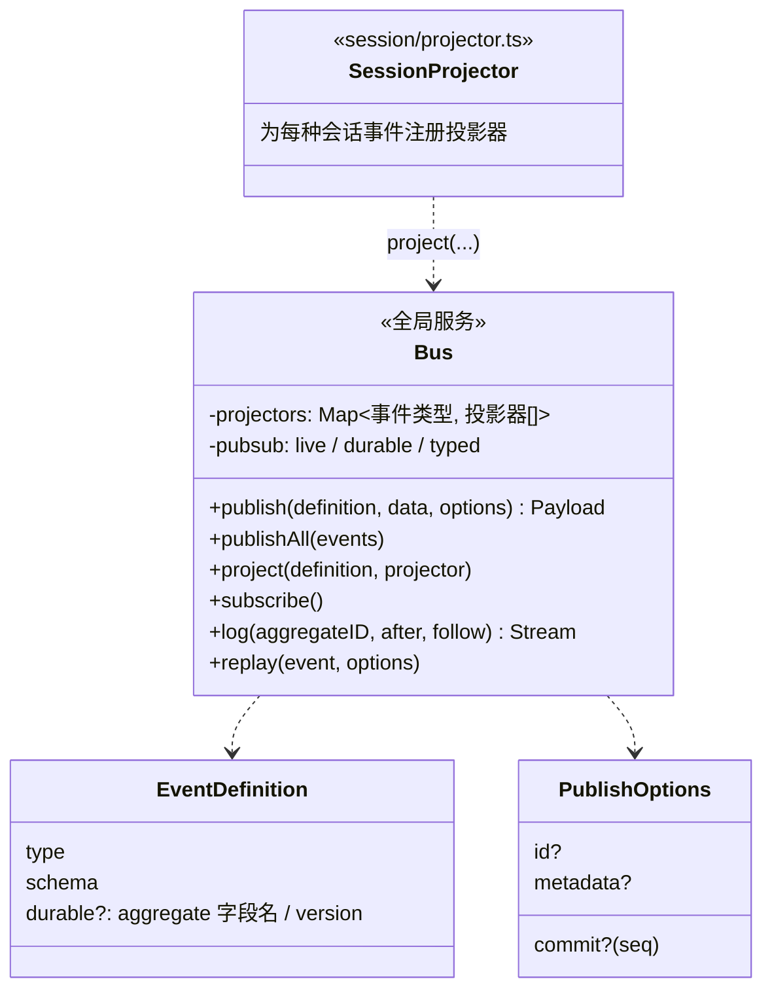

### 11.1 一次 publish 做了什么

v2 的所有状态变化都是事件。`Bus.publish`（`core/src/bus.ts`）发一个持久化事件时，在**一个 SQLite 事务**里做完这些事：

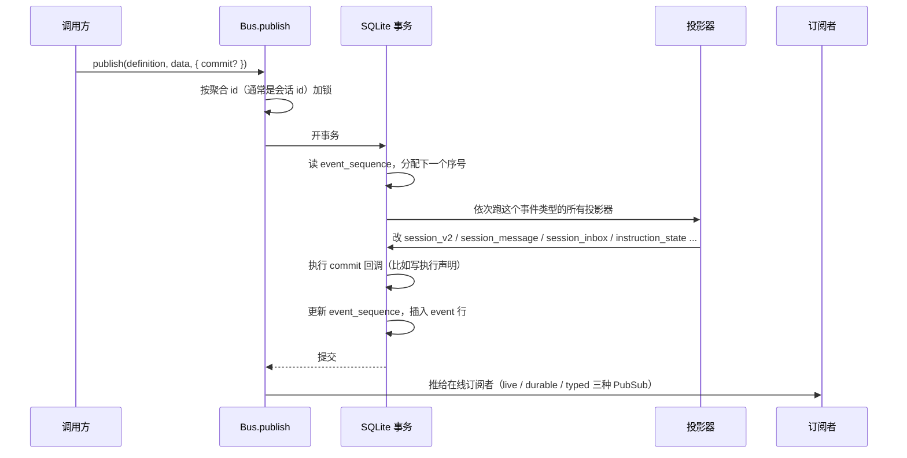

投影器出错时用 defect 中止整个事务，所以“事件写进去了但投影没做”这种状态不存在。前面说的“投递输入同时插入消息”“开始执行同时写声明”都是靠这一点保证的。

事件分两种：

| 种类 | 例子 | 写库 | 能回放 |
|---|---|---|---|
| 持久化（`Event.durable`） | `session.inbox.*`、`step.*`、`text.ended`、`tool.called/success/failed`、`compaction.*`、`execution.*` | 是 | 是 |
| 临时（`Event.ephemeral`） | `text.delta`、`reasoning.delta`、`tool.input.delta`、`compaction.delta` | 否 | 否 |

会话相关的事件一共 51 种（`schema/src/session-event.ts`）。

### 11.2 表

| 表 | 内容 |
|---|---|
| `event` / `event_sequence` | 事件日志；每个聚合的最新序号 |
| `session_v2` | 会话：目录、标题、agent、模型、权限、用量合计、空闲时间、执行声明（`time_suspended`）、恢复次数（`resume_attempts`）等 |
| `session_message` | 投影出来的对话消息，`(session_id, seq)` 唯一 |
| `session_inbox` | 待投递的输入（§3.2） |
| `instruction_state` / `instruction_blob` / `instruction_entry` | 指令状态、指令内容（按哈希）、通过 API 设置的指令条目 |

### 11.3 客户端怎么同步

客户端有两种拿数据的方式：

- **查询当前状态**：`session.get`、`session.message`、`session.inbox.list`、`session.context` 这些接口，直接读投影表。
- **订阅事件**：`session.log({ sessionID, after?, follow? })` 读持久化事件日志。`follow: true` 时先订阅、再回放、回放完发一个同步标记，然后转为实时推送，所以不会漏也不会重。临时事件不在这条流里。

另外还有一个实例级的实时事件流（`/api/event`，SSE），覆盖所有目录。server 对每个事件只编码一次，再分发给每个连接自己的队列（每个最多 4096 条）；某个连接读得太慢、队列满了，就单独断开它，不影响别人（`specs/v2/event-stream-architecture.md`）。

### 11.4 崩溃恢复

恢复靠的是 §4.2 说的**执行声明**：

1. 一段忙碌期开始时，`execution.started` 事件的 commit 回调写下声明（`session_v2.time_suspended`）。
2. 成功、失败、用户中断时，终止事件的 commit 回调同时清掉声明。
3. 关机导致的中断故意**不清**；进程被杀、崩溃根本来不及清。所以“声明还在、却没有终止事件”就说明这个会话的执行是被意外打断的。

托管服务启动时调 `SessionRestart.resumeSuspendedSessions`（`session/execution/restart.ts`）：

1. 先处理后台任务：被打断的后台 shell 命令补一条通知（“服务重启，命令被取消”）；被打断的后台子 agent 重新跑起来。
2. 对每个有声明的会话：恢复次数加一（先写库再恢复，所以恢复过程中又崩了也会被计数）。超过 10 次就发一个失败事件放弃；否则补一条系统通知“服务刚重启，从断的地方继续，别重复已经做完的事”，然后 `resume`。
3. 恢复出来的 drain 开头（§5.2）会把还显示在跑的工具调用和压缩标成失败，模型能看到“这个工具被中断了”。

这套机制保证**至少一次**，不保证恰好一次。工具可能已经执行了一半（比如写了一半文件），恢复时不会重放这个工具调用，而是告诉模型它被中断了，由模型自己判断。

---

## 12. 服务怎样装配

### 12.1 两级服务

v2 整个建在 Effect 4 上，之前用的是 4.0 的 rc 版（本文上一版对照时是 `4.0.0-rc.112`），10-10（`41b03dea0f`）升到了正式版 4.0.1，原来 `effect/unstable/http`、`effect/unstable/socket` 这些模块也随之转正成 `effect/http`、`effect/socket`。

core 里的服务分两级：

| 级别 | 声明方式 | 例子 | 生命周期 |
|---|---|---|---|
| 全局 | `makeGlobalNode` | `Database`、`Bus`、`SessionStore`、`SessionInbox`、`SessionExecution`、`Job` | 整个进程一份 |
| 目录（Location） | `makeLocationNode` | `SessionRunner`、`SessionContext`、`Tool`、`Permission`、`Plugin`、`Agent`、`Model`、`FileSystem`、`Config` | 每个“目录 + 工作区”一份 |

`makeGlobalNode` / `makeLocationNode`（`util/src/effect/app-node.ts`）是对 `LayerNode` 的包装：每个服务声明自己的 layer 和依赖的其他节点，启动时由图编译器按依赖关系组装。目录级节点可以依赖全局节点，反过来不行。

为什么要分目录？因为同一个服务进程里，不同会话可能在不同的项目目录下，各自有自己的配置、插件、工具、权限规则、模型列表。这些都按目录各建一套。

### 12.2 从会话找到它那套服务

```ts
// core/src/location-services.ts
Instance.node.replace(
  Layer.succeed(Instance.Service, {
    provide: (session) => Effect.provide(map.get(session.location)),
  }),
)
```

`map` 是一个 `LayerMap`（按 key 懒建、缓存的 layer 集合），key 是会话的 `location`（目录 + 工作区）。第一次用到某个目录时才建那套服务，之后一直缓存。`SessionExecution.drain` 里的 `instances.provide(session)`（§4.2）就是从这里取的。

配置变了要重载时，`LocationServiceMap.reload` 让所有目录的缓存失效并立即重建。正在跑的 runner 会看到 `LocationLifecycle.isClosed()` 为真，返回 `Reloaded`，由 `SessionExecution` 用新的那套服务接着跑（§5.3 第 1 步）。

### 12.3 插件

v2 的内核几乎全是插件拼起来的。`core/src/plugin/internal.ts` 列了内部插件，分 `pre` 和 `post` 两批：`pre` 里有工具参数修复、MCP、git/hg、agent、命令、技能、models.dev 模型目录、各家服务商、全部内置工具等；`post` 里是把配置文件应用上去的一组插件（指令、agent、压缩、格式化、工具输出、权限策略……）。

插件能做两类事：

- **transform**：往有状态的注册表里加东西或改东西。`ctx.tool.transform`、`ctx.agent.transform`、`ctx.provider.transform`、`ctx.model.transform`、`ctx.mcp.transform` 等。每次读注册表时，按注册顺序把所有 transform 在一个新值上重放一遍，所以插件卸载后它的修改自然消失。
- **hook**：在执行过程中插一脚。

| 域 | 钩子 |
|---|---|
| `session` | `prompt`、`context`、`compaction`、`generate`、`title`、`model.request`、`http.request`、`http.response`、`experimental.ws.handshake/send/receive`、`retry` |
| `tool` | `execute.before`、`execute.after` |
| `permission` | `evaluate` |
| `shell` | `create.before` |
| `aisdk` | 模型、包、选项、SDK 相关的几个 |

其中 OpenCode 自己的 Console 连接插件和权限策略插件是受保护的，仓库配置不能把它们移除（`internal.ts` 里的 `guarded`）。

---

## 13. 其他能力

### 13.1 Code Mode

`@opencode/codemode` 是一个只支持 JavaScript 子集的解释器：只有它实现了的语法和内置对象能用，没有定时器、`process`、文件系统、模块，程序只能通过宿主给的工具和外界打交道，宿主还能限制执行时间、调用次数和输出大小。它不是沙箱里的真 JS，而是“只认识这些语法”的解释器。

core 把它包成一个叫 `execute` 的工具（`core/src/codemode/tool.ts`）。模型写一段脚本，在里面调 Code Mode 收纳的那些工具（§8.3），可以写循环、并发调用、对结果做处理，只把最后的结果交回给模型。工具目录（有哪些工具、怎么调）作为一个指令来源放进 system（§6.1 里的 `CodeModeInstructions`）。

这样做的好处和 pi-mono 的 codemode 一样：插件、MCP 带来的大量工具不用一个个声明给模型，中间结果也不进上下文。

### 13.2 子 agent 与后台任务

`subagent` 工具在当前会话下建一个子会话，用指定的 agent（可选指定模型）跑一个任务：

- **前台**（默认）：等子会话跑完，返回它最后一条回复，以及子会话 id。之后可以带着这个 id 继续和同一个子 agent 对话。
- **后台**（`background: true`）：立即返回“已经在后台跑了”，由 `Job.Service` 管着。子会话结束时，通过收件箱给父会话投一条 synthetic 通知，父会话的模型自然就看到了结果。工具描述里专门叮嘱模型：别轮询、别重复做同样的事。

后台任务的生命周期比启动它的目录服务长：父会话所在目录长时间不活跃，那套目录级服务会被回收（§4 的 `inactivity`），以前这时子 agent 的完成通知会跟着丢掉。10-08（`ee0e614221`）起，`SubagentJob` 成了一个全局服务，任务和监听它完成的 fiber 都用全局的上下文启动，不再挂在发起它的目录上。

用户在界面上跑的 shell 命令也走类似的路：立即在后台开始，结束后作为 synthetic 输入入库（`resume: false`，不会叫醒空闲的会话）。

### 13.3 会话迁移

`session.move` 把会话搬到另一个目录（比如一个新开的 git worktree）。它不是立即生效的，而是作为一个 `move` 控制项进收件箱（§3），等 runner 走到 Step 边界时处理：关掉模型连接，发 `session.moved`，返回 `Moved`；`SessionExecution` 重新读会话，用新目录的那套服务接着 drain。模型会看到一条“工作目录已经改成……”的消息。指令状态保留，所以新目录的 AGENTS.md 等会作为一次指令变化出现。

### 13.4 回退和分叉

- **回退**分两步。先 `revert.stage`：用工作区快照把文件恢复到那条消息时的样子（也可以只回退对话、不动文件），并记下回退前的快照，这时还能 `revert.clear` 撤销，把文件恢复回去。下一次提交新输入时才 `commit`：删掉那条消息之后的对话记录，清空指令状态，下一步重新建立基线。
- **分叉**（`session.fork`）从某条消息处复制出一个新会话，复制到那里为止的消息，指令基线直接用父会话最新的值。

### 13.5 从 v1 迁移

server 启动时会在后台跑 `core/src/database/v1-migration.bun.ts`（1100 多行），把 v1 的会话数据导进新表，客户端可以通过 migration 接口看进度。v1 和 v2 的工具名、参数有的不一样，导入后的会话里如果还能看到这些旧工具调用，会额外告诉模型“这些工具现在叫什么、参数怎么变了”，免得它照着旧的格式再调一次。

---

## 14. 和 pi-mono、codex 对照

| | opencode v2 | pi-mono | codex |
|---|---|---|---|
| 进程模型 | 客户端 / 服务端分离，默认共享一个托管服务 | 单进程，`AgentSession` 直接跑 | TUI 默认连共享的本地 app-server daemon |
| 输入排队 | 持久化的收件箱表，steer / queue，控制项也排在里面 | 内存里的两个队列 | 内存里的 pending input + 邮箱 |
| 上下文来源 | 每个 Step 从投影表重读 | 每次请求从会话 JSONL 重新投影 | 内存里的 `ContextManager`，rollout 记录变化 |
| 指令变化 | 按来源算哈希 delta，变化作为 system 消息追加 | system 消息里的段落补丁 | `WorldState` 各 section 比较后追加更新 |
| 工具执行 | 读流时就并发起 fiber，先持久化 `tool.called` 再执行 | 读完流后统一执行，可并行 | 读流时启动，有并行门 |
| 大量工具 | Code Mode（`execute` 工具） | codemode 扩展 + tool_search | Code Mode + 工具搜索 |
| 崩溃恢复 | 执行声明 + 启动时自动续跑，最多 10 次 | 主线没有；实验性的 pi-durable 在做 | 从 rollout 恢复历史，不自动续跑 |

三家都在往同一个方向走：**持久化的记录是唯一的事实来源，内存只是缓存**。opencode v2 走得最彻底，连“待处理的输入”和“正在执行”都写进了数据库，代价是每一步都要和数据库、事件投影打交道，代码量（core 6.8 万行）也是三家里最大的。
