## 1. 核心包与依赖

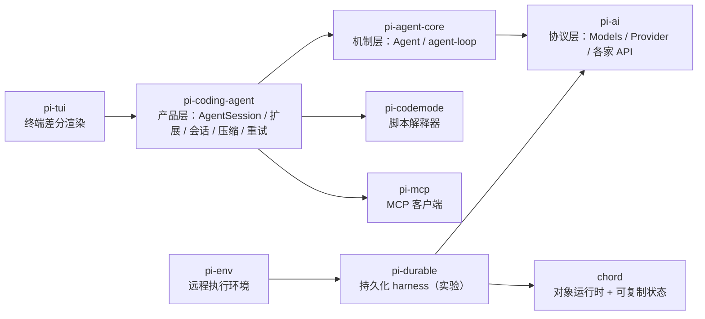

| 包（npm 名） | 目录 | 干什么 | 本篇重点 |
|---|---|---|---|
| `@earendil-works/pi-ai` | `packages/ai` | 统一 40 多家 provider 的流式调用、模型目录、鉴权 | §5 |
| `@earendil-works/pi-agent-core` | `packages/agent` | 主循环、事件、工具执行 | §3 |
| `@earendil-works/pi-coding-agent` | `packages/coding-agent` | 交互式 CLI 产品：会话、扩展、压缩、重试、三种模式 | §4、§6–§12 |
| `@earendil-works/pi-codemode` / `pi-mcp` | `packages/codemode`、`packages/mcp` | 让模型写 JS 脚本批量调工具；MCP 客户端。coding-agent 用它们做了两个内置扩展 | §4.4 |
| `@earendil-works/pi-durable` | `packages/durable` | 把会话、模型调用、工具调用都先写进存储再往下走的 harness，进程死了能接着跑。还是实验性的 | §13 |
| `@earendil-works/pi-env` | `packages/env` | 给 durable 用的远程执行环境：工具通过 SSH 在另一台机器上跑 | §13.5 |
| `@earendil-works/chord` | `packages/chord` | 跨进程的对象运行时：契约、对象、可复制状态、热重载，只依赖 TypeBox | §14 |

`pi-ai`封装了对各个模型厂商的调用，`pi-agent-core`是Agent最核心的事件循环逻辑，是我们需要重点学习的部分，`pi-coding-agent`是基于core封装的完整产品。如果我们想要做自己的 Coding Agent，那么就可以使用 `pi-ai` 和 `pi-agent-core`。

10 月初 `pi-agent-core` 做了一次瘦身（`7fd478a2e`）：以前放在 `packages/agent/src/harness/` 下的 2 万多行实验性 harness 整个删掉了，现在这个包只剩 `Agent`、`agent-loop.ts`、代理流和类型定义，一共 2500 行左右。harness 的思路搬进了新的 `pi-durable` 包，见 §13。

本文对照的是 pi-mono 2026-10-16 的 `790271cd0`（`pi-coding-agent` 1.3.0）。10-08 的上一版对照的是 `1cedd3272`，这之间的 147 个提交里，主线（`pi-agent-core` 一行没改，`AgentSession` 和 `pi-ai` 有几处修改，见 §6、§7.2、§8.3）变化不大，大的变化在实验部分：

- 10-12 的 `7472cda0d` 删掉了实验性的 server 栈：`packages/client`、`packages/protocol`、`packages/server` 三个包，以及 coding-agent 里的 `src/experimental/`、`src/client/`。coding-agent 从此不再依赖 chord，主产品 `pi` 和 durable、chord 完全没有关系了。
- 同一天的 `0104fef1e` 把 chord 整个换成了一套新运行时（代码里叫 chord2），它来自 pi-private 仓库里的 `apps/p2`（取代原来 Pi Mobile 的新应用，不开源）。§14 按新版重写。
- durable 继续往前走：工具嵌套调用、按需加载的工具、能在重启后续跑的 Code Mode 等（§13.5）。

---

## 2. 数据模型

这一节主要讲模块之间是如何传递数据的，从用户输入的表示，到agent运行时的参数，到工具调用，再到llm调用，最后落盘，整个链路中，数据类型如何定义。

### 2.1 消息定义：模型层message与产品层message

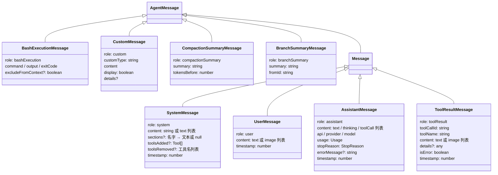

| 类型 | 谁产生它 | 发给模型前变成什么 |
|---|---|---|
| `SystemMessage` | 新会话第一条由 `Agent` 根据初始提示词和工具生成；之后由 `AgentSession` 在提示词或工具变化时追加（§2.5） | 原样。不支持对话中途 system 消息的模型，由协议模块合并成一条放到最前面 |
| `UserMessage` | `AgentSession.prompt()` 把用户输入包成它 | 原样 |
| `AssistantMessage` | provider 的流函数边流边填 | 原样 |
| `ToolResultMessage` | `agent-loop.ts createToolResultMessage` | 原样 |
| `Message` = 上面四个的联合 | — | — |
| `BashExecutionMessage` | 用户在 TUI 里敲 `!ls` | 变成 `user` 消息；`!!` 前缀的直接丢掉 |
| `CustomMessage` | 扩展调 `pi.sendMessage()` | 变成 `user` 消息 |
| `BranchSummaryMessage` | 在会话树上跳分支时 | 变成 `user` 消息，前后包一段固定文案 |
| `CompactionSummaryMessage` | 压缩完成后 | 变成 `user` 消息，前后包一段固定文案 |
| `AgentMessage` = `Message` ∪ 四种自定义 | — | 靠 `convertToLlm` 转换 |

`Message`是模型接口需要的参数信息，而在产品层有一些动作操作也需要进入模型上下文，比如压缩后的总结，因此在基础`Message`上封装了一层，Agent层循环内部全程用 `AgentMessage[]`，只在真正发请求的时候才用 `convertToLlm` 转成 `Message[]`。

`AssistantMessage.stopReason` 的取值后面会反复用到：

| 值 | 含义 | 循环怎么处理 |
|---|---|---|
| `"stop"` | 正常说完 | 没有工具调用就结束这一轮 |
| `"toolUse"` | 要调工具 | 执行工具 |
| `"length"` | 输出被 token 上限截断 | 这一轮的工具调用全部不执行，直接返回错误（§8） |
| `"error"` | 出错 | 循环直接退出，产品层决定重不重试（§10） |
| `"aborted"` | 被用户中断 | 循环直接退出 |
| `"pending"` | 还在流 | 只在流的过程中出现 |
| `"deferred"` | 延迟响应（少数 provider） | 主线不管 |

### 2.2 模型、工具、上下文

这部分比较简单，基本就是对需要发给llm的参数，做了一下封装。

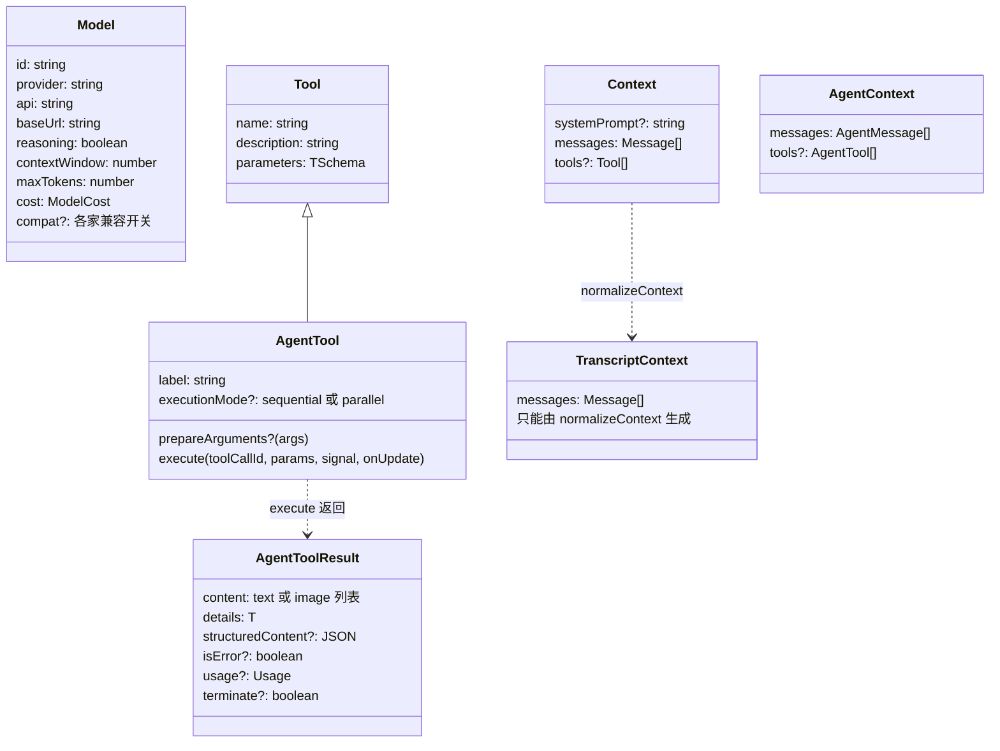

| 类型 | 说明 |
|---|---|
| `Model` | 一个模型的全部元数据。`contextWindow` 和 `maxTokens` 决定压缩时机和请求上限。`compat` 是每家 API 的兼容开关（比如 Anthropic 的 `forceAdaptiveThinking`）。 |
| `Tool` | 发给模型看的工具定义：名字、描述、参数 JSON Schema（TypeBox）。 |
| `AgentTool` | 在 `Tool` 上加了怎么执行：`execute` 方法、可选的参数整形 `prepareArguments`、是否允许并行。 |
| `AgentToolResult` | 工具执行返回值。`content` 给模型看，`details` 给 UI 看，`structuredContent` 给程序调用方看（比如 codemode 脚本，§4.4）。`isError: true` 表示失败但不抛异常。`terminate` 是"这批工具跑完后停下"的提示。 |
| `Context` | pi-ai 对外的上下文格式，系统提示词和工具还可以单独放在 `systemPrompt`、`tools` 两个字段里。 |
| `TranscriptContext` | 协议模块真正收到的上下文，只有 `messages`。`normalizeContext` 把 `Context.systemPrompt` 和 `Context.tools` 折成开头的一条 `SystemMessage`，所以到了协议这一层，提示词和工具只能从 system 消息里读。这个类型带了一个品牌字段，只有 `normalizeContext` 能造出来，防止没折叠过的 `Context` 直接传进协议代码。 |
| `AgentContext` | 循环用的上下文，消息是 `AgentMessage[]`，工具是 `AgentTool[]`。以前还有 `systemPrompt` 字段，现在去掉了：提示词就在 `messages` 里的 system 消息中。`tools` 只表示“这次运行能执行哪些工具”，模型能看到哪些工具，由 system 消息声明（§2.5）。 |

### 2.3 两条事件流

Message是agent对接llm接口的中间层，Event则是对接上层应用的中间层，上层应用通过订阅event事件来获取所有信息。pi有两层事件，与Message类似，除了模型返回的消息，还有一些agent的执行状态比如start end等：

| 事件类型 | 谁发 | 谁收 | 内容 |
| --- | --- | --- | --- |
| `AssistantMessageEvent` | provider 的流函数 | `agent-loop.ts` 的 `for await` | `start` / `text_delta` / `thinking_delta` / `toolcall_start` / `toolcall_delta` / `toolcall_end` / `done` / `error`，每个都带一个 `partial`（当前累积到的整条消息） |
| `AgentEvent` | 循环的 `emit()` | `Agent.processEvents` → 所有订阅者 | `agent_start` / `turn_start` / `message_start` / `message_update` / `message_end` / `tool_execution_start` / `tool_execution_update` / `tool_execution_end` / `turn_end` / `agent_end` |

`message_update` 事件把上面那层的 `AssistantMessageEvent` 原样带上（字段名 `assistantMessageEvent`），所以 UI 能拿到最细粒度的增量。

产品层在 `AgentEvent` 上还有一批动作事件：`agent_settled` / `queue_update` / `compaction_start` / `compaction_end` / `auto_retry_start` / `auto_retry_end` / `entry_appended` / `bash_execution_update` 等，合起来叫 `AgentSessionEvent`。

### 2.4 SessionEntry

```mermaid
classDiagram
  class SessionEntryBase {
    type: string
    id: string
    parentId: string | null
    timestamp: string
  }
  class SessionMessageEntry {
    type: message
    message: AgentMessage
  }
  class CompactionEntry {
    type: compaction
    summary
    firstKeptEntryId
    tokensBefore
    systemMessage?: 压缩时刻完整的提示词和工具
  }
  class ContextEditEntry {
    type: context_edit
    targetId
    replacement: 新 content 或 null
  }
  class UsageEntry {
    type: usage
    kind / provider / model
    usage
  }
  class BranchSummaryEntry {
    type: branch_summary
    fromId
    summary
  }
  class ModelChangeEntry {
    type: model_change
    provider
    modelId
  }
  class ThinkingLevelChangeEntry {
    type: thinking_level_change
    thinkingLevel
  }
  class CustomEntry {
    type: custom
    customType
    data
  }
  class CustomMessageEntry {
    type: custom_message
    customType
    content
    display
  }
  class LabelEntry {
    type: label
    targetId
    label
  }
  class SessionInfoEntry {
    type: session_info
    name
  }
  SessionEntryBase <|-- SessionMessageEntry
  SessionEntryBase <|-- CompactionEntry
  SessionEntryBase <|-- BranchSummaryEntry
  SessionEntryBase <|-- ModelChangeEntry
  SessionEntryBase <|-- ThinkingLevelChangeEntry
  SessionEntryBase <|-- CustomEntry
  SessionEntryBase <|-- CustomMessageEntry
  SessionEntryBase <|-- LabelEntry
  SessionEntryBase <|-- SessionInfoEntry
  SessionEntryBase <|-- ContextEditEntry
  SessionEntryBase <|-- UsageEntry
```

SessionEntry就是持久化存储时的格式，文件是一个JSONL，第一行是 `SessionHeader`（带 `id` / `cwd` / `parentSession`），后面每行一个entry。
每个entry都有 `id` 和 `parentId`，所以整个文件其实是一棵树，而不是按顺序排下来的一串记录，详见 §11。

现在一共 11 种条目，比 9 月多了两种：

- `context_edit`：只追加、不改旧条目的“上下文修改”。`replacement` 为 `null` 表示把 `targetId` 指向的那条从模型上下文里拿掉，不为空就替换它的 `content`。原条目还留在文件里，UI 和导出照样能看到。自动重试、溢出恢复丢弃失败的那次回答，用的就是它（§10）。扩展也可以在 `turn_end` 时写（§4.3）。
- `usage`：记一笔不属于对话本身的花费，比如提示缓存预热（`CacheWarmer`）产生的用量。

`CompactionEntry` 多了 `systemMessage`：压缩那一刻把当前完整的提示词和工具声明存一份，因为压缩会把前面那些 system 消息一起摘要掉（§11）。

### 2.5 提示词和工具也写进对话记录

9 月中旬以前，系统提示词和工具列表是两个独立的字段：`AgentContext.systemPrompt` 和 `AgentContext.tools`，每次请求都整份带上。现在（#9548，`9e05370b2`）它们变成了对话记录里的 `SystemMessage`，和用户消息、模型回复排在同一个列表里。

为什么要改？一是提示词缓存。以前切一个工具、改一段提示词，请求最前面的 system 部分就变了，整段缓存作废。现在变化写成一条新的 system 消息，追加在对话后面，前面已经缓存的部分不动。二是可以回放：会话文件里记着每次提示词和工具是怎么变的，恢复会话、跳分支时能还原出当时模型看到的东西。

#### system 消息怎么表示变化

| 位置 | 写什么 | 含义 |
|---|---|---|
| 对话开头第一条 | `content` 是基础提示词，`sections` 是各个具名段落，`toolsAdded` 是初始工具 | 完整声明 |
| 后面的 system 消息 | `sections` 里只放变了的段落，值为 `null` 表示删掉这段；`toolsAdded` / `toolsRemoved` 是工具的增减；`content` 非空就是追加的说明 | 增量补丁 |

pi-ai 的 `utils/transcript.ts` 提供了一组回放函数：`getCurrentSystemMessage(messages)` 从头扫到尾，把所有 system 消息依次叠上去，得到“现在”的提示词和工具；`getCurrentTools` 只算工具；`getCurrentSystemPrompt` 渲染成一段文本。`agent.state.systemPrompt` 现在是只读的 getter，就是调的这个回放。

coding-agent 的默认提示词按段落拆好（`system-prompt.ts` 的 `buildSystemPromptSections`）：`preamble`（开场白）、`tools`（工具简介）、`rules`（规则）、`docs`（pi 文档位置）、`addendum`（追加提示词）、`project_context`（AGENTS.md 等）、`skills`、`cwd`，扩展还能加自己的段落。`diffSystemPromptSections` 拿新旧两份逐段比较，只把变了的段落放进补丁。

#### 谁来写 system 消息

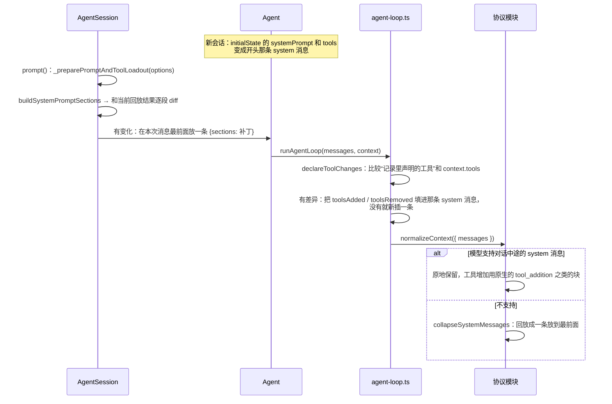

分工是这样的：提示词段落的变化由产品层 `AgentSession` 算，工具的增减由核心层的 `declareToolChanges`（`agent-loop.ts`）在每次请求前算。`context.tools` 是“能执行的工具”，system 消息里声明的是“模型能看到的工具”，`declareToolChanges` 负责让两者一致。

协议模块那边，每个模型的 `compat.supportsMidConvoSystemMessages` 决定能不能把 system 消息原样留在对话中间。Anthropic 的部分模型还支持 `supportsMidConvoToolChanges`，工具增减直接写成 `tool_addition` / `tool_removal` 块。不支持的模型由 `resolveTranscript` 退回老办法：全部回放成一条，放在请求最前面。

#### 每次请求都从会话文件重新算上下文

另一个相关的变化（`466db0fec`）：产品层不再信任内存里的 `agent.state.messages`，而是在每次请求前，从 `SessionManager` 重新算一遍上下文。

`AgentSession` 给 `Agent` 装了一个 `prepareRequest` 回调（`_installAgentRequestProjection`），它在每次模型请求前、待发送的消息都已经追加之后执行：调 `sessionManager.buildSessionProjection()`，用投影出来的 `messages` 换掉循环里的上下文，再把 `agent.state.tools` 作为可执行工具一起交回去。所以：

- 会话文件（JSONL 里的条目树）是上下文的唯一来源。`context_edit`、压缩、分支摘要这些条目，都在投影时生效。
- 直接给 `agent.state.messages` 赋值，不会再影响后面的请求（coding-agent 0.87.0 的 Breaking 变更）。想改上下文，就通过 `session.sessionManager` 往会话里追加条目，再调 `session.refreshContext()`；或者用 `navigateTree()` 换分支。
- 恢复旧会话时，历史从 `new Agent({ initialState: { messages } })` 传进去，而不是事后赋值。

---

## 3. 核心层：`pi-agent-core`

这一层主要看两个文件：`agent.ts`（有状态的壳）和 `agent-loop.ts`（无状态的循环）。

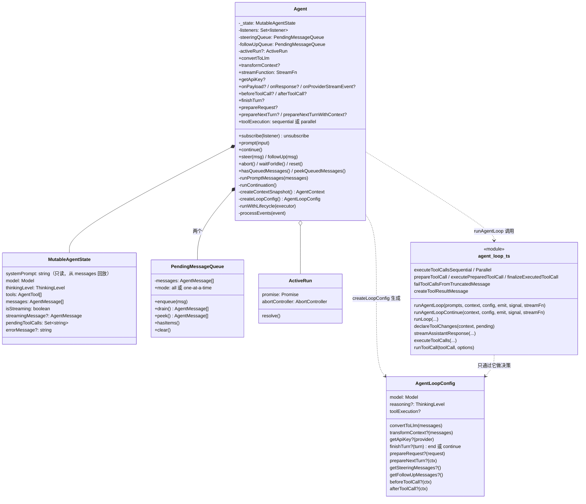

### 3.1 `Agent`

Agent持有当前对话状态，保存在_state，每轮agentloop把状态复制一份，把agentloop发出的事件转成状态更新并广播给订阅者。自己几乎没有任何业务逻辑，只保存了一些回调函数，所以他的agent设计是只保存状态+配置，其中配置包括各种回调。

Agent 里存了这些字段：

| 字段 | 含义 |
|---|---|
| `_state: MutableAgentState` | 当前模型、思考等级、工具列表、消息列表，以及运行时的流状态。`systemPrompt` 现在是只读的 getter，每次都从 `messages` 里的 system 消息回放出来（§2.5）。构造时传进来的 `initialState.systemPrompt` 和 `tools` 只用来生成开头那条 system 消息，`messages` 本身已经以 system 消息开头时就不再生成。 |
| `listeners` | 订阅者集合。`AgentSession` 是其中一个。 |
| `steeringQueue` / `followUpQueue` | 两个待投递队列，分别对应"插话"和"追加"。默认模式都是 `one-at-a-time`。 |
| `activeRun?: ActiveRun` | 当前是否正在运行 |
| `convertToLlm` / `transformContext` / `streamFunction` / `getApiKey` / `onPayload` / `onResponse` / `onProviderStreamEvent` | 全是公开的可替换回调。产品层构造时传进来（§6）。`onProviderStreamEvent` 是新加的，能拿到 provider 原始的流事件 |
| `beforeToolCall` / `afterToolCall` / `finishTurn` / `prepareRequest` / `prepareNextTurn` / `prepareNextTurnWithContext` | 也是公开回调。`finishTurn` 取代了原来的 `shouldStopAfterTurn`，`prepareRequest` 是新加的（§3.3）。 |
| `sessionId` / `thinkingBudgets` / `transport` / `maxRetryDelayMs` / `toolExecution` | 透传给流函数的选项。`toolExecution` 默认 `"parallel"`。 |

主要方法：

| 方法 | 干什么 | 谁调它 |
|---|---|---|
| `subscribe(listener)` | 注册事件监听。监听器按注册顺序 `await`，`agent_end` 的监听器跑完运行才算结束。 | `AgentSession` 构造函数 |
| `prompt(input, images?)` | 发起新运行。已有运行在跑就抛错。先 `normalizePromptInput` 把字符串包成 `UserMessage`，再 `runPromptMessages`。 | `AgentSession._startRun` |
| `continue()` | 不加新消息，从现有上下文继续。最后一条是 assistant 时：先看 steer 队列有没有东西，有就当作新 prompt 跑；再看 followUp 队列；都没有就抛错。最后一条是 user/toolResult 时走 `runContinuation`。 | `AgentSession._startRun` 的重试/压缩后继续 |
| `steer(msg)` / `followUp(msg)` | 入队，不做别的。 | `AgentSession._queueSteer` / `_queueFollowUp` |
| `hasQueuedMessages()` | 两个队列任一非空。 | `AgentSession._handlePostAgentRun` |
| `abort()` | 触发 `activeRun.abortController.abort()`。 | `AgentSession.abort` |
| `waitForIdle()` | 等当前这次运行跑完再返回；没在运行就直接返回。 | `AgentSession.waitForIdle` |
| `reset()` | 清空消息、运行时状态、两个队列。运行中调用会抛错。 | 新会话 |
| `runPromptMessages(messages, options)` | 核心：`runWithLifecycle` 包住 `runAgentLoop(messages, createContextSnapshot(), createLoopConfig(options), processEvents, signal, streamFunction)`。 | `prompt` / `continue` |
| `createContextSnapshot()` | 返回 `{ messages: slice(), tools: slice() }`。返回的是拷贝，循环改它不会影响 Agent 自己的状态。提示词已经在 `messages` 里了，不再单独带。 | `runPromptMessages` |
| `createLoopConfig(options)` | 把 Agent 上所有回调和选项打包成一个 `AgentLoopConfig` 对象。`reasoning` 由 `thinkingLevel === "off" ? undefined : thinkingLevel` 算出。`getSteeringMessages` 就是 `steeringQueue.drain()`，`getFollowUpMessages` 就是 `followUpQueue.drain()`。 | `runPromptMessages` |
| `runWithLifecycle(executor)` | 建 `ActiveRun`，置 `isStreaming = true`，跑 executor；异常走 `handleRunFailure`（合成一条 `stopReason: "error"` 的 assistant 消息并补发四个事件）；`finally` 走 `finishRun`（清运行时状态，并通知所有在 `waitForIdle()` 上等着的调用方“跑完了”）。 | `runPromptMessages` / `runContinuation` |
| `processEvents(event)` | 先更新状态，再通知监听器：`message_start`/`message_update` 更新 `streamingMessage`；`message_end` 把消息 push 进 `_state.messages`；`tool_execution_start/end` 增删 `pendingToolCalls`；`turn_end` 记 `errorMessage`。然后按顺序 `await` 每个监听器。 | 循环的 `emit` |

循环拿到的 `context.messages` 是拷贝，循环往里 push 消息**不会**改 `_state.messages`。`_state.messages` 只在 `processEvents` 收到 `message_end` 时才更改。也就是说，Agent 的状态只靠事件来更新，和循环内部用的那个临时数组是两份数据。

### 3.2 `PendingMessageQueue`

| 方法 | 行为 |
|---|---|
| `enqueue(msg)` | push |
| `drain()` | `mode === "all"` 时全部取走；`"one-at-a-time"` 时只取第一条，剩下的留着 |
| `hasItems()` / `clear()` | 顾名思义 |


### 3.3 `AgentLoopConfig`

`agent-loop.ts` 里没有类，只有一组函数。循环不认识 `Agent`，也不关心是谁在调它：需要做决定的地方（取插话、下一轮前的准备、工具执行前后……）都去调 `AgentLoopConfig` 上的回调，状态变化则通过 `emit` 事件往外报。`Agent.createLoopConfig` 负责把回调打包传进来，但回调的实现大多来自产品层：有的是 `sdk.ts` 创建 `Agent` 时传入的，有的是 `AgentSession` 构造后直接赋值的。

| 回调 | 循环在哪一步调 | `AgentSession` 给它塞的是什么 |
|---|---|---|
| `getSteeringMessages()` | 循环开始前一次；每轮结束后一次；`prepareNextTurn` 之后若还没拿到则再补一次 | `steeringQueue.drain()` |
| `getFollowUpMessages()` | 内层循环退出后 | `followUpQueue.drain()` |
| `prepareNextTurn(ctx)` | 第二轮起，每轮开头 | 先压缩（如果快满了），再算出提示词段落的补丁（作为一条 system 消息交回）、最新的工具列表、模型、思考等级（§10.3） |
| `prepareRequest(request)` | **每次**模型请求前，包括第一次；待发送的消息已经追加完 | 用 `SessionManager` 的投影替换上下文（§2.5）；当前模型是虚拟模型时，在这里决定这次实际路由到哪个模型 |
| `transformContext(messages)` | 发请求前 | `ExtensionRunner.emitContext`，让扩展改消息 |
| `convertToLlm(messages)` | 发请求前 | `messages.ts` 的转换，外面再包一层"屏蔽图片"的开关 |
| `getApiKey(provider)` | 发请求前 | `AgentSession` 没设；鉴权在更下面的 `ModelRuntime.streamSimple` 里做 |
| `beforeToolCall(ctx)` | 参数校验后、执行前 | `ExtensionRunner.emitToolCall`，扩展可以 `block` |
| `afterToolCall(ctx)` | 执行后、发事件前 | `ExtensionRunner.emitToolResult` + 图片规范化 |
| `finishTurn(turn)` | 每轮的 assistant 消息和工具结果都处理完、发 `turn_end` **之前** | 发扩展的 `turn_end` 边界事件，扩展可以追加条目、要求继续（§4.3）。返回 `{action:"end"}` 直接结束运行，返回 `{action:"continue"}` 保证至少再请求一次模型 |

### 3.4 `agent-loop.ts`

对外的入口函数：

| 函数 | 用途 |
|---|---|
| `agentLoop(prompts, context, config, signal, streamFn)` | 返回 `EventStream`，给想用 `for await` 消费事件的人 |
| `agentLoopContinue(context, config, signal, streamFn)` | 同上，但不加新消息。最后一条不能是 assistant |
| `runAgentLoop(prompts, context, config, emit, signal, streamFn)` | `await` 版本，`Agent` 用的就是它。先用 `declareToolChanges` 给 prompts 补上工具变化（§2.5），再拼进 context，发 `agent_start` / `turn_start` / 每条 prompt 的 `message_start`+`message_end`，然后 `runLoop` |
| `runAgentLoopContinue(...)` | `await` 版本的继续 |

真正的循环逻辑在 `runLoop` 里，§7 逐行讲；工具执行相关的函数放到 §8 讲。

---

## 4. 产品层：`pi-coding-agent`

产品层的核心是 `AgentSession`。它持有一个 `Agent`，再加上会话、设置、扩展、工具注册表、模型运行时。

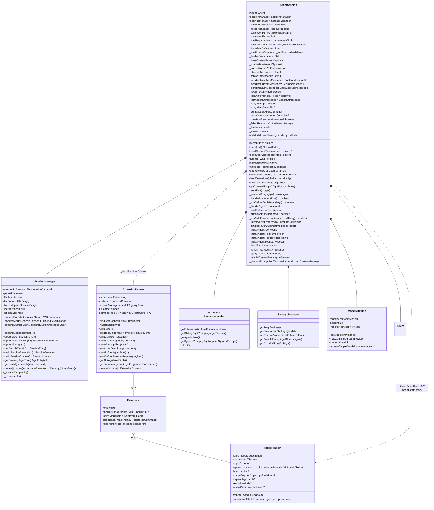

### 4.1 `AgentSession`

这里实现了agentloop之上的应用层，过滤输入、排队、持久化、通知扩展、自动压缩、自动重试、管理工具和系统提示词等。

`AgentSession` 的字段按用途分组如下：

| 分组 | 字段 | 含义 |
|---|---|---|
| 三个核心依赖 | `agent` / `sessionManager` / `settingsManager` | 构造时传入，`readonly` |
| 运行时依赖 | `_modelRuntime` / `_resourceLoader` / `_cwd` / `_scopedModels` | 模型鉴权、扩展和技能加载、工作目录、可循环切换的模型子集 |
| 扩展 | `_extensionRunner`/ `_extensionRunnerRef` / `_extensionUIContext` / `_extensionMode` / 若干 handler | `_extensionRunnerRef` 是一个 `{ current }` 对象，`Agent` 的 `streamFn` 闭包通过它拿到当前的 runner（reload 后 runner 会换） |
| 工具 | `_toolRegistry`（名字→`AgentTool`）/ `_toolDefinitions`（名字→定义+来源）/ `_baseToolDefinitions`（内置八个）/ `_toolPromptSnippets` / `_toolPromptGuidelines` / `_allowedTools` / `_excludedTools`（`--tools` 和 `--exclude-tools` 编译成的匹配函数，支持 `+name` / `-name` 和通配）/ `_hiddenDeclarations` | 注册表是"全部可用的"，`agent.state.tools` 是"当前激活的"（§6.4） |
| 系统提示词 | `_baseSystemPromptOptions` / `_runSystemPromptOptions` | 存的不再是拼好的字符串，而是“怎么拼”的参数：工具、技能、AGENTS.md、自定义段落等。base 由工具集和资源算出；run 是这次运行用的，扩展在 `before_agent_start` 里改的就是它，一次运行结束就清。真正发给模型的是由它算出的段落补丁（§2.5） |
| 排队 | `_steeringMessages: string[]` / `_followUpMessages: string[]` | 只存文本，用来在 UI 上显示排队的内容；实际的消息对象在 `Agent` 的两个队列里 |
| 延后投递 | `_pendingNextTurnMessages` / `_pendingCustomMessages` / `_pendingBashMessages` | 三种"现在不能插进去、等合适时机再插"的消息（§9.3） |
| 运行状态 | `_isAgentRunActive` / `_agentRunAbortRequested` / `_idleWaitPromise` / `_resolveIdleWait` / `_turnIndex` / `_lastAssistantMessage` / `_lastAssistantToolResults` | `isStreaming` 就是 `_isAgentRunActive`；`_lastAssistantMessage` 在 `message_end` 时记下，`_handlePostAgentRun` 用完清掉 |
| 重试 | `_retryAttempt` / `_retryAbortController` / `_failedResponse` | 当前第几次重试；`_failedResponse` 是上一次失败的回答，下一次请求路由虚拟模型时要用 |
| 消息与条目的对应 | `_entryIdsByMessage: WeakMap` | 消息对象 → 它在会话文件里的条目 id。`context_edit` 要指名改哪一条，靠的就是它 |
| 压缩 | `_compactionAbortController`（手动）/ `_autoCompactionAbortController`（自动）/ `_branchSummaryAbortController` / `_overflowRecoveryAttempted` | `isCompacting` 看这三个 controller 任一非空；`_overflowRecoveryAttempted` 保证溢出恢复只试一次 |
| bash | `_bashAbortControllers` | 用户 `!cmd` 的取消句柄 |

方法按流程分组（详细流程见 §6–§10）：

| 分组 | 方法 |
|---|---|
| 装配 | `constructor` / `_buildRuntime` / `_refreshToolRegistry` / `_bindExtensionCore` / `_installAgentToolHooks` / `_installAgentNextTurnRefresh` / `_installAgentRequestProjection` / `_installAgentBoundaryHooks` / `_rebuildSystemPrompt` / `_applyToolLoadout` / `setActiveToolsByName` / `bindExtensions` / `reload` |
| 输入 | `prompt` / `_runInputHandlers` / `_tryExecuteExtensionCommand` / `_expandSkillCommand` / `steer` / `followUp` / `_queueUserInput` / `_queueSteer` / `_queueFollowUp` / `sendCustomMessage` / `sendUserMessage` |
| 运行 | `_startRun` / `_prepareRun` / `_handlePostAgentRun` / `_runBeforeSettleBoundary` / `abort` / `waitForIdle` / `_emitAgentSettled` |
| 事件 | `_handleAgentEvent` / `_emitExtensionEvent` / `_emit` / `subscribe` / `dispose` |
| 重试 | `_isRetryableError` / `_prepareRetry` / `_omitRecoveryAttempt` / `_willRetryAfterAgentEnd` / `abortRetry` |
| 压缩 | `_checkCompaction` / `_runAutoCompaction` / `compact` / `_compactBeforeNextAssistantResponse` / `getContextUsage` |
| 会话树 | `navigateTree` / `getSessionStats` / `exportToJsonl` |
| 模型 | `setModel` / `cycleModel` / `setThinkingLevel` / `cycleThinkingLevel` |
| bash | `executeBash` / `recordBashResult` / `abortBash` |

### 4.2 `SessionManager`

`SessionManager` 负责管理会话文件。内存里是一棵树（`byId` + `leafId`），磁盘上是 JSONL。每次写入都是追加一个entry，再把 `leafId` 指向它。

| 字段 | 含义 |
|---|---|
| `fileEntries: FileEntry[]` | 文件里所有行，包括头 |
| `byId: Map<string, SessionEntry>` | 按 id 索引 |
| `leafId: string \| null` | 当前叶子。`null` 表示"还没有条目"或"回到根之前" |
| `persist: boolean` / `flushed: boolean` | 是否落盘；是否已经把整个文件写出去过一次 |
| `labelsById` / `labelTimestampsById` | 条目标签（给树导航用） |

| 方法 | 干什么 |
|---|---|
| `appendMessage(message)` | 包成 `SessionMessageEntry`，`parentId = leafId`，`_appendEntry` |
| `appendCompaction(summary, firstKeptEntryId, tokensBefore, details, fromHook, usage)` | 追加一个 `compaction` 条目，顺便把当前回放出来的完整 system 消息存进 `systemMessage`。`firstKeptEntryId` 可以传 `null`，表示前面的全部摘要掉，这时它取这条压缩条目自己的 id |
| `appendContextEdit(targetId, replacement)` | 追加一个 `context_edit` 条目（§2.4） |
| `branchWithSummary(branchFromId, summary, ...)` | 先把 `leafId` 挪到目标，再追加一个 `branch_summary` 条目记录"从哪来" |
| `branch(id)` / `resetLeaf()` | 只挪叶子，不写条目 |
| `getBranch(fromId?)` | 从叶子（或指定 id）沿 `parentId` 一路走到根，返回这条路径上的条目（顺序是根→叶） |
| `buildSessionProjection()` | 调模块级函数 `buildSessionProjection(entries, leafId, byId)`，得到 `{ entries, messages, thinkingLevel, model }`。`entries` 里每一项记着“哪个原始条目贡献了哪些消息”，`context_edit` 就是在这一步生效的。`AgentSession` 每次请求前都调它（§2.5） |
| `buildSessionContext()` | `buildSessionProjection` 的简化版，只返回 `{ messages, thinkingLevel, model }` |
| `_appendEntry(entry)` | push 进 `fileEntries`、写 `byId`、`leafId = entry.id`、`_persist` |
| `_persist(entry)` | 延迟写文件：会话里出现第一条 user 或 assistant 消息之前不写文件（`_hasConversation`）；出现时用 `"wx"`（不存在才创建）一次写出全部条目；之后每条追加。这样用户打开后什么都没问的会话，不会留下空文件。以前的条件是“第一条 assistant 出现”，结果第一轮没跑完时用户的提问会丢，所以改成了从 user 消息开始写（#10000） |
| `static create / open / continueRecent / inMemory / forkFrom` | 五种构造方式 |

上下文怎么从这棵树上算出来，靠的是文件里的三个模块级函数，§11 再讲。

### 4.3 `ExtensionRunner`

持有所有加载好的扩展，负责把事件分发给它们的处理函数，并给处理函数造一个 `ExtensionContext`。

| 字段 | 含义 |
|---|---|
| `extensions: Extension[]` | 每个 `Extension`（`types.ts`）里有 `handlers: Map<事件类型, 处理函数[]>`、`tools`、`commands`、`flags`、`shortcuts` |
| `runtime: ExtensionRuntime` | 加载期共享状态：flag 值、待注册的 provider、`assertActive` / `invalidate`（reload 后旧的 ctx 会失效） |
| `getModel` / `isIdleFn` / `abortFn` / `compactFn` / `getContextUsageFn` 等十几个函数字段 | 默认是空实现，`bindCore` 时由 `AgentSession` 注入真实现（`agent-session.ts`） |

分发方法都在 `runner.ts` 里。同一个事件可能有多个扩展在处理，这些方法的区别主要在于怎么合并多个处理函数的返回值：

| 方法 | 语义 |
|---|---|
| `emit(event)` | 逐个扩展、逐个处理函数 `await`。异常被吞掉并 `emitError`。只有 `session_before_*` 四种事件看返回值：谁返回 `cancel` 就立刻停 |
| `emitToolCall(event)` | 逐个调，谁先返回 `block` 就停，后面的不再调。异常不吞，直接抛（`agent-session.ts` 会把非 Error 包一层） |
| `emitToolResult(event)` | 逐个调，按字段（`content` / `details` / `isError` / `usage`）覆盖，后面的覆盖前面的 |
| `emitContext(messages)` | 先 `structuredClone`，然后分两轮。第一轮发 `context`：处理函数**看不到** system 消息，返回的列表链式传给下一个，最后由 runner 把 system 消息按原位置放回去。第二轮发 `context_with_system`：处理函数拿到包括 system 消息在内的完整列表，返回什么就发什么，提示词和工具声明归它管 |
| `emitBoundary(event, preview)` | 只用于 `turn_end` 和 `agent_before_settle` 两个“边界”事件。处理函数依次执行，每个都能看到前面攒下的 `entries`（待写入的条目草稿）和 `continue` 标记，可以改写它们；每跑完一个，runner 都会用一个内存里的临时 `SessionManager` 把草稿应用一遍，重新算出“写进去之后上下文长什么样”给下一个处理函数看。草稿可以是 `custom`、`custom_message`、`context_edit`、`compaction` 四种 |
| `emitMessageEnd(event)` | 允许扩展替换整条消息（要求 role 不变）；`AgentSession` 拿到替换后用 `_replaceMessageInPlace` 原地改对象，这样 agent 状态、后续事件、会话持久化三处看到的是同一个对象 |
| `emitBeforeProviderRequest(payload)` | 链式改请求体 |
| `emitBeforeProviderHeaders(headers)` | 处理函数直接改传进来的 headers，返回值被忽略 |
| `emitUserBash(event)` | 第一个有返回值的处理函数直接生效，用户的 `!cmd` 由它接管。处理函数抛错或返回格式不对，就把异常往上抛，这条命令不执行（以前是吞掉异常、照常执行） |
| `emitInput(text, images, source, behavior)` | 返回 `handled`（扩展吃掉了）/ `transform`（改写）/ 什么都不返回（原样） |
| `emitBeforeAgentStart(...)` | 处理函数拿到可修改的 `systemPromptOptions`（提示词的各个组成部分），后一个能看到前一个的修改；也可以返回要注入的自定义消息，或者用 `systemPrompt` 整个替换这次的提示词 |
| `emitResourcesDiscover(...)` | 收集扩展补充的技能、提示词模板、主题路径 |

`hasHandlers(type)` 是所有 `emit*` 前的快速检查，没人订阅就不构造事件对象。

`turn_end` 和 `agent_before_settle` 是这次新加的“边界”机制。以前扩展在 `agent_end` 里想补一句话让模型继续，只能 `sendMessage` 塞进队列，再靠 `_handlePostAgentRun` 发现队列非空、重新跑一轮。现在这两个时间点允许扩展直接返回 `{ entries, continue }`：`entries` 由 `AgentSession` 一次性写进会话，`continue: true` 表示要求再请求一次模型。`AgentSession` 会先检查续跑是否可行（比如上下文最后一条已经是 assistant 回复、又没有新输入，就不能续），不可行就报错，不会发出一个必然被拒的请求。

为什么要拆这么多方法，监听事件流、按类型分发一个入口不够吗？其实按类型分发的逻辑是有的，写在 `AgentSession._emitExtensionEvent` 里：它订阅 `Agent` 的事件流，把 `agent_start`、`turn_*`、`message_*`、`tool_execution_*` 按类型转给通用的 `emit`。这类事件只是通知，扩展只能看，不能改。

剩下的 `emit*` 单独拆出来，有两个原因。

一是这些事件大多不在事件流里。`tool_call` 发生在工具执行前，循环停在 `beforeToolCall` 里等结果；`context`、`before_provider_request` 发生在发请求前的回调里；`input`、`before_agent_start` 更是在循环启动之前。事件流是单向广播，发出去就结束了，没办法把“拦下这个工具”这样的结果带回去。

二是调用方要拿返回值做决定，而每种事件的合并规则都不一样（见上表）。如果都塞进一个 `emit`，里面就得按事件类型写一大串 switch；拆成独立的方法，返回类型也能写得更准确。

所以 runner 自己不监听任何东西，什么时候发、发哪种事件，都由调用方决定。各个方法的调用位置：

| 调用位置 | 调的方法 |
|---|---|
| `AgentSession._emitExtensionEvent`（事件流分发） | `emit`；`message_end` 走 `emitMessageEnd` |
| `AgentSession._installAgentToolHooks`（挂到 `beforeToolCall` / `afterToolCall`） | `emitToolCall` / `emitToolResult` |
| `AgentSession._installAgentBoundaryHooks`（挂到 `finishTurn`）、`_runBeforeSettleBoundary` | `emitBoundary`（`turn_end`、`agent_before_settle`） |
| `sdk.ts` 里 `new Agent` 的 `transformContext` / `onPayload` / `onResponse` / `onProviderStreamEvent` 回调 | `emitContext` / `emitBeforeProviderRequest` / `emit({ type: "after_provider_response" })` / `emit({ type: "provider_stream_event" })` |
| `sdk.ts` 的 `transformHeaders` | `emitBeforeProviderHeaders` |
| `AgentSession.prompt()` 第③步、第⑨步（§7.1） | `emitInput` / `emitBeforeAgentStart` |
| `AgentSession` 加载资源时 | `emitResourcesDiscover` |
| `AgentSession` 的压缩、分支树、reload，`AgentSessionRuntime` 的切换会话、fork | `emit({ type: "session_before_*" })`，看 `cancel` |
| `InteractiveMode` / RPC 模式处理用户的 `!cmd` | `emitUserBash` |

#### 扩展侧

上面是 runner 这一侧：`emit*` 负责遍历、按事件合并返回值。扩展这一侧要做的事很简单，就是把处理函数登记到自己的 `handlers` 表里。runner 没有全局的事件注册表，事件分发就是去逐个查每个扩展的这张表。

一个扩展就是一个默认导出的函数，类型是 `ExtensionFactory = (pi: ExtensionAPI) => void | Promise<void>`（`extensions/types.ts`）。下面是示意：

```ts
import type { ExtensionAPI } from "@earendil-works/pi-coding-agent";

export default function (pi: ExtensionAPI) {
  pi.on("tool_call", async (event, ctx) => {
    if (event.toolName === "bash" && String(event.input.command).includes("rm -rf")) {
      return { block: true, reason: "危险命令" };        // 返回格式由事件决定，见上表
    }
  });

  pi.on("session_before_switch", async (event, ctx) => {
    if (ctx.hasUI && !(await ctx.ui.confirm("切换会话？", "当前会话有未保存的内容"))) {
      return { cancel: true };
    }
  });
}
```

仓库里的 `packages/coding-agent/examples/extensions/` 有近 80 个真实例子，`confirm-destructive.ts` 就是第二个处理函数的完整版。

`pi.on` 的实现很短（`extensions/loader.ts`），现在还会返回一个取消订阅的函数：

```ts
on(event: string, handler: HandlerFn): () => void {
  assertActive();
  const registeredHandler: HandlerFn = (...args) => handler(...args);   // 包一层，同一个函数注册两次也能分别取消
  const list = extension.handlers.get(event) ?? [];
  list.push(registeredHandler);
  extension.handlers.set(event, list);
  return () => { /* 从 handlers 表里删掉 registeredHandler */ };
}
```

类型层面，`ExtensionAPI.on` 按事件名写了 41 个重载（`types.ts`），所以事件名写对之后，`event` 的字段和处理函数该返回什么都有类型提示。同一个事件被多个处理函数订阅时，执行顺序是先按扩展的加载顺序，再按同一扩展内的注册顺序。

那为什么 runner 那边有十几个 `emit*`，扩展这边却只有一个 `on`，而不是 `onToolCall`、`onToolResult` 这样分开？因为登记、类型、合并这三件事是分开处理的：

| 事情 | 由谁负责 | 各事件之间有没有区别 |
|---|---|---|
| 登记"这个事件来了调我" | `pi.on`（上面几行） | 没有，都是往 `handlers` 表里 push |
| 处理函数收到什么、该返回什么 | 类型重载 | 有，编译期体现 |
| 多个返回值怎么合并、调用方拿去做什么 | runner 的 `emit*` | 有，运行时体现 |

```ts
on(event: "tool_call",      handler: ExtensionHandler<ToolCallEvent, ToolCallEventResult>): void;
on(event: "tool_result",    handler: ExtensionHandler<ToolResultEvent, ToolResultEventResult>): void;
on(event: "context",        handler: ExtensionHandler<ContextEvent, ContextEventResult>): void;
on(event: "message_update", handler: ExtensionHandler<MessageUpdateEvent>): void;   // 没有返回值
```

写 `pi.on("tool_call", (e) => ...)` 时，`e` 自动推断成 `ToolCallEvent`，编辑器提示可以返回 `{ block, reason }`；写 `message_update` 就没有返回值可填。效果和单独写一个 `onToolCall` 差不多。扩展作者也不需要知道合并规则，按类型提示返回就行，runner 会按这个事件的规则处理。DOM 的 `addEventListener`、Node 的 `EventEmitter.on` 也是这么设计的，好处是接口少，以后新增事件只要加一个重载和对应的 `emit*`，已有扩展的写法不用变。

##### 事件列表

扩展一共能订阅 41 种事件，按触发位置分类如下：

| 位置 | 事件 | 能改什么 |
| --- | --- | --- |
| 启动 | `project_trust` / `resources_discover` | 决定是否信任项目；补充技能、提示词模板、主题路径 |
| 输入 | `input` | 吃掉或改写 |
| 运行前 | `before_agent_start` | 改提示词的组成部分、追加 custom 消息、整个替换提示词 |
| 请求前 | `context` → `context_with_system` → `cache_warming_decision` → `before_provider_request` → `before_provider_headers` | 改消息列表（不含 / 含 system 消息）→ 决定要不要预热缓存 → 改请求体 JSON → 改请求头 |
| 响应 | `provider_stream_event` / `after_provider_response` | 只读：provider 原始流事件；状态码和头 |
| 工具 | `tool_call`（可 block）→ `tool_execution_start/update/end` → `tool_result`（可改结果） | 权限、改结果 |
| 消息 | `message_start` / `message_update` / `message_end`（可替换消息） | — |
| 轮次 | `turn_start` / `turn_end`（可写条目、要求继续）/ `agent_start` / `agent_end` / `agent_before_settle`（可写条目、要求继续）/ `agent_settled` | 见上面的“边界”机制 |
| 会话 | `session_start` / `session_info_changed` / `session_before_compact`（可接管或取消）/ `session_compact` / `session_compact_failed` / `session_before_tree` / `session_tree` / `session_before_switch` / `session_before_fork` / `session_shutdown` | 压缩和树导航都能被扩展替换 |
| 模型 | `model_select` / `thinking_level_select` | — |
| 界面与外部服务 | `ui_prompt_start` / `ui_prompt_end` / `mcp_servers_change` | 只读：扩展弹出阻塞式对话框的开始和结束；MCP 服务列表变化 |
| 用户 bash | `user_bash` | 接管 `!cmd` |

##### 加载时序

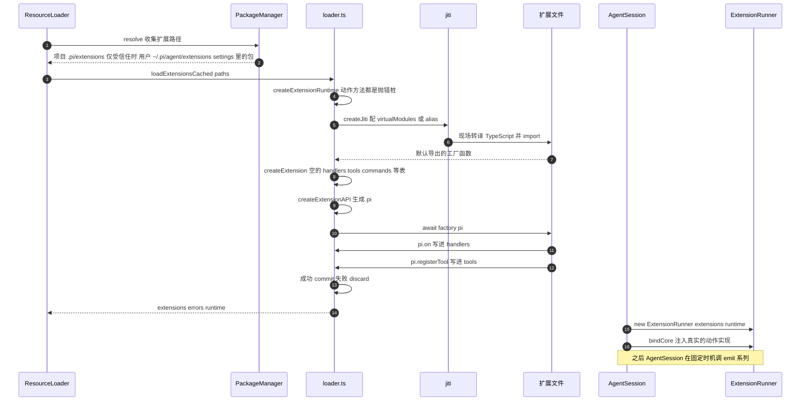

| 步骤 | 说明 |
| --- | --- |
| 收集路径 | 来源有三类：项目的 `.pi/extensions/`（只在项目被信任时才加载，`package-manager.ts`）、用户的 `~/.pi/agent/extensions/`、settings 里声明的包。命令行 `--extension` / `-e`（`cli/args.ts`）临时指定的路径，合并时排在最前并去重 |
| 目录里认哪些文件 | 只看一层：直接放的 `*.ts` / `*.js`；子目录里的 `index.ts` / `index.js`；子目录里 `package.json` 的 `pi.extensions` 字段声明的入口 |
| 加载模块 | 用 jiti 导入，取默认导出；不是函数就报“没有导出有效的工厂函数” |
| 建空壳 | `Extension` 对象里的 `handlers`、`tools`、`commands`、`flags`、`shortcuts`、渲染器表全是空的 |
| 调工厂 | `await factory(pi)`，成功 `commit()`，抛错 `discard()` 并把错误记进 `errors`，这个扩展不会进列表，其他扩展照常加载 |
| 建 runner | 拿 `extensions` 和共享的 `runtime` 构造 `ExtensionRunner`，随后 `_bindExtensionCore` 调 `runner.bindCore`（`runner.ts`）把真实现塞进去 |

##### jiti

jiti 是 Node 上的运行时模块加载器，能直接 `import` 一个 `.ts` 文件：加载时现场转译成 JavaScript 再执行，并且允许自定义模块解析。pi 在 `loadExtensionModule`（`loader.ts`）里创建 jiti，用它来做四件事：

1. 扩展不用构建。放一个 `.ts` 文件就生效，不需要 `tsc`，也不需要 `package.json`。
2. 把扩展里的 `import` 解析到宿主进程里的那一份模块。扩展目录通常没有 `node_modules`，原生 `import "@earendil-works/pi-coding-agent"` 找不到包。pi 按运行形态二选一：Bun 单文件二进制、Node SEA、自带 Node 的发行包没有磁盘上的包文件，用 `virtualModules`（`VIRTUAL_MODULES`）直接把宿主进程里已加载的模块对象交给扩展；普通 Node 构建版用 `alias`（`getAliases`）把包名映射到 pi 自己的 `dist` 文件。两种方式都能保证扩展和宿主用的是同一个模块实例，`instanceof`、TypeBox schema、全局注册表在两边一致。
3. 兼容老扩展。映射表同时收录新旧两个包名前缀 `@earendil-works/*` 和 `@mariozechner/*`，并把 `@earendil-works/pi-ai` 根入口指到 `compat` 入口，老扩展用旧的全局 API 也能跑。
4. 支持热重载。`moduleCache: false`，每次都重新读文件。pi 自己在外层按“工作目录 + 代次”缓存工厂函数（`useExtensionCacheCwd`），`/reload` 走到 `ResourceLoader.reload`（`core/resource-loader.ts`），调 `clearExtensionCache` 让代次加一，缓存作废，改过的扩展代码就能生效。

jiti 本身现在也是第一次需要加载扩展时才 `import()` 进来（`loader.ts` 里的 `createJitiPromise`），虚拟模块表同理。普通 Node 环境下还用了 jiti 的“懒转译”：先尝试原生加载，失败了、确实需要转译 TypeScript 时才加载 Babel。没装扩展的用户启动时就不用付这部分开销。

##### `pi` 的方法

`createExtensionAPI`（`loader.ts`）生成的 `pi` 对象里，方法按“写到哪”分成两类，区别在于加载期间能不能调用：

| 类别 | 方法 | 写到哪 | 加载期（工厂函数执行中）能否调用 |
|---|---|---|---|
| 注册方法 | `on`、`registerTool`、`registerCommand`、`registerShortcut`、`registerFlag`、`registerMessageRenderer`、`registerEntryRenderer`、`registerMarkdownTransformer` | 直接写进这个扩展自己的 `Extension` 对象 | 能，本来就该在这时调 |
| 延后生效的注册 | `registerProvider`、`unregisterProvider`、`registerFlag` 的默认值 | 加载期先排进待办队列，`commit()` 时才应用；`bindCore` 时模型注册表就绪后才真正注册 provider | 能，但效果推迟 |
| 动作方法 | `sendMessage`、`sendUserMessage`、`appendEntry`、`setSessionName`、`setLabel`、`getActiveTools`、`setActiveTools`、`getCommands`、`setModel`、`setThinkingLevel`、`exec` 等 | 委托给共享的 `runtime` | 不能。`createExtensionRuntime` 里它们是抛错桩，报 “Action methods cannot be called during extension loading”，`bindCore` 后才换成真实现 |
| 扩展间通信 | `events.emit(channel, data)`、`events.on(channel, handler)` | 共享的事件总线 | 能。加载失败时，加载期订阅的会被自动退订 |

加载过程用 `commit` / `discard` 做成了类似事务的效果（`loader.ts`）：工厂函数跑到一半抛错时，已排队的 flag 默认值和 provider 注册全部丢弃，事件总线订阅退订，这个 `pi` 被标记为失败，之后再调任何方法都会抛错。

##### `ctx`

每次 `emit*` 都会调 `createContext()`（`runner.ts`）新造一个 `ExtensionContext`，里面是 `ui`、`hasUI`、`cwd`、`sessionManager`、`modelRegistry`、`model`、`signal`、`isIdle()`、`abort()`、`compact()`、`getContextUsage()`、`getSystemPrompt()` 等。这些成员都是 getter 或闭包，调用时才去取值，所以 `bindCore` / `bindUI` 之后的变化能反映出来。里面没有能直接修改 `agent.state` 的方法，扩展要改状态只能调 `pi.setXxx()`。

`ctx` 的每个成员都会先 `assertActive()`。会话被替换（`newSession`、`fork`、`switchSession`）或 `reload` 之后，`runtime.invalidate()` 把旧的 `pi` 和 `ctx` 标记为过期，扩展如果把它们存下来以后再用，会收到一段明确的报错，告诉你改用新会话回调里传入的 `ctx`（`loader.ts` 中 `createExtensionRuntime` 里的 `invalidate`）。

##### 注意事项

1. 返回值的格式由事件决定，runner 按上面 `emit*` 那张表里的规则合并：`session_before_*` 返回 `{ cancel }`，`tool_call` 返回 `{ block }`，`context` 返回 `{ messages }`，`input` 返回 `{ action }`……返回格式不对，大多数事件不会报错，只是没有效果。
2. `tool_call` 的处理函数抛错，等于拦截这次工具调用。其他事件的异常会被捕获、上报，不影响后面的扩展；`emitToolCall` 不捕获，异常一路抛到 `agent.beforeToolCall`，这次工具调用被拦下。权限类扩展出错时因此不会误放行。
3. 高频事件的处理函数要尽量快。流式输出的每个分片都会触发一次 `message_update`，而 `AgentSession` 是先 `await` 扩展处理完、再通知 UI 等其他监听者（`core/agent-session.ts`）。订阅了它的扩展处理得慢，整个流式输出都会跟着卡。只有 `tool_call`、`tool_result` 等少数调用点会先查 `hasHandlers(type)` 跳过无人订阅的情况。

### 4.4 `ToolDefinition` 与 `AgentTool`

产品层定义工具用 `ToolDefinition`（`extensions/types.ts`），比 `AgentTool` 多了 `promptSnippet`（进系统提示词的一行简介）、`promptGuidelines`（进系统提示词的规则条目）、`renderCall` / `renderResult`（TUI 渲染），而且 `execute` 多一个参数 `ctx: ExtensionContext`。

进循环前要包一层：`wrapRegisteredTool(tool, runner)` 调 `wrapToolDefinition(def, ctxFactory)`，把 `ToolDefinition` 变成 `AgentTool`，`execute` 调用时补上 `runner.createToolContext(toolCallId, signal)` 造的 `ExtensionToolContext`。以前这里还有第二层包装，专门检查“执行过程中有没有激活新工具”，并把新工具名写进结果的 `addedToolNames`。现在工具的增减由 `declareToolChanges` 统一写成 system 消息（§2.5），这一层就删掉了。

内置八个工具在 `tools/index.ts` 的 `ToolName`：`read` / `bash` / `powershell` / `edit` / `write` / `grep` / `find` / `ls`。默认激活四个：`read` / `bash` / `edit` / `write`（`settings-manager.ts` 的 `DEFAULT_TOOL_NAMES`）。

#### 工具的暴露方式与内置扩展

`ToolDefinition` 这次多了几个字段，用来区分“模型能不能看到这个工具”和“能不能调用这个工具”：

| `exposure` | 声明给模型 | 能调用 | 注册时自动激活 |
|---|---|---|---|
| `direct`（默认） | 激活时声明 | 激活时可调 | 是 |
| `model-only` | 激活时声明 | 不能直接调，用于编排类、交互类工具 | 是 |
| `codemode` | 不声明，除非被显式激活 | 只要注册了就能被脚本调用 | 否 |
| `deferred` | 不声明，`tool_search` 搜到后才声明 | 同上 | 否 |
| `hidden` | 不声明 | 不能调 | 否 |

另外还有 `outputSchema`（成功结果里 `structuredContent` 的 JSON Schema）、`defaultActive`、`namespace`（比如所属的 MCP 服务）、`prepareLoadout`。`prepareLoadout` 在激活的工具变化时调用，能改写其他工具给模型看的描述，或者把某些工具的声明从请求里藏起来（藏起来的工具仍算激活，仍然可调），`AgentSession._applyToolLoadout` 负责调它。

这些字段主要是为 coding-agent 自带的四个内置扩展准备的（`src/extensions/index.ts`）。它们走的是普通扩展的路子，用户装了同名的第三方扩展就能替换掉：

| 内置扩展 | 做什么 |
|---|---|
| `codemode` | 注册一个 `codemode` 工具（默认不激活）：模型写一段 JavaScript，在 `pi-codemode` 自带的解释器里跑，脚本通过 `tools.xxx()` 调用其他工具。嵌套调用走 `ctx.executeTool()`，也要经过参数校验、`tool_call` / `tool_result` 钩子和权限检查。只有脚本的输出会回到模型，中间结果不会。`store()` / `load()` 的值写进会话的 `codemode-store` 自定义条目，所以每个分支各自独立 |
| `tool-search` | 注册 `tool_search` 工具（默认不激活），按关键词搜 `codemode` / `deferred` 工具，搜到就激活，让它们出现在声明里 |
| `mcp` | 连接 `mcp.json` 里配置的 MCP 服务，工具注册成 `mcp__<server>__<tool>`。默认暴露方式是 `codemode`：MCP 工具不进模型的工具声明，只能从 codemode 脚本里调，同时自动激活 `codemode` 工具。设成 `deferred` 就改为激活 `tool_search`。连接在后台进行，第一次提问只等有 `direct` 工具的服务。会调用其他工具的工具（`codemode`、`tool_search`）在定义里用 `reachesTools(input)` 声明这次调用会碰到哪些工具，MCP 扩展据此只等这次调用需要的服务连好，并决定该激活哪个工具；以前它是自己解析 codemode 脚本来判断的，10-12（`24382bedd`）改成了现在这样，`pi-codemode` 也不再内置任何 MCP 相关的代码 |
| `llama.cpp` | 把本地 llama.cpp 服务注册成一个服务商：聊天模型走 `openai-completions` 协议，也能当分类模型用；`/llama` 命令可以从 Hugging Face 下载、加载模型 |

这样做的目的是让 MCP 带来的几十上百个工具不撑大请求：它们不进工具声明，模型需要时再去搜、或者在脚本里调。

---

## 5. 模型层：`pi-ai`

### 5.1 服务商与协议

pi-ai 把一次模型调用拆成两个互相独立的问题：

| 维度 | 字段 | 回答什么问题 | 取值例子 | 由谁实现 |
|---|---|---|---|---|
| 服务商 | `Model.provider`，对应 `Provider.id` | 请求发到哪、用什么凭证、有哪些模型、价格多少 | `anthropic`、`deepseek`、`moonshotai`、`openrouter`、`ollama`（用户自定义） | `providers/*.ts` 里每家一个 `createProvider(...)` 调用 |
| 协议 | `Model.api` | 请求体长什么样、流式响应怎么解析 | `openai-completions`、`openai-responses`、`anthropic-messages`、`google-generative-ai` 等 10 种（`ai/src/types.ts`） | `api/*.ts` 里每种协议一个模块，导出 `stream` 和 `streamSimple` |

每个 `Model` 上同时有这两个字段（`ai/src/types.ts`），用户可以自己加服务商，扩展也可以自己注册新协议。

为什么要这样拆？现在很多厂商提供的是 OpenAI 兼容接口或 Anthropic 兼容接口，协议一样，只是地址、鉴权、模型列表不同。如果按厂商来写，27 家 OpenAI 兼容厂商就得写 27 份差不多的请求代码；按协议来写，41 家提供聊天模型的内置服务商共用 10 份协议实现，每家厂商只剩一份配置。（内置服务商一共 42 家，多出来的 `typesafe` 只提供分类模型，见 §5.3。）

各协议被多少家服务商使用（按 `providers/*.ts` 里各家传给 `createProvider` 的 `api` 统计）：

| 协议 | 实现文件 | 使用它的内置服务商 |
|---|---|---|
| `openai-completions` | `api/openai-completions.ts` | 27 家：deepseek、moonshotai、moonshotai-cn、zai、zai-coding-cn、groq、cerebras、together、fireworks、huggingface、nvidia、baseten、openrouter、cloudflare-workers-ai、cloudflare-ai-gateway、github-copilot、opencode、opencode-go、ant-ling、azure（Azure Foundry 的 Chat Completions 部署）、xiaomi 系列四家、qwen-token-plan 系列三家 |
| `anthropic-messages` | `api/anthropic-messages.ts` | 11 家：anthropic、kimi-coding、minimax、minimax-cn、openrouter、vercel-ai-gateway、fireworks、github-copilot、opencode、opencode-go、cloudflare-ai-gateway |
| `openai-responses` | `api/openai-responses.ts` | 7 家：openai、xai、meta、github-copilot、opencode、opencode-go、cloudflare-ai-gateway |
| `google-generative-ai` | `api/google-generative-ai.ts` | google、opencode |
| 其余六种 | `openai-codex-responses`、`azure-openai-responses`、`google-vertex`、`mistral-conversations`、`bedrock-converse-stream`、`pi-messages` | 各自只有一家（`pi-messages` 是 radius） |

反过来，一家服务商也可以用多个协议。OpenRouter 对 Claude 模型走 `anthropic-messages`、其他模型走 `openai-completions`；opencode 一家就用了四种协议。这时 `createProvider` 的 `api` 参数传一个“协议名 → 实现”的映射，调用时按 `model.api` 挑（`providers/openrouter.ts`）：

```ts
export function openrouterProvider(): Provider<"anthropic-messages" | "openai-completions"> {
  return createProvider({
    id: "openrouter",
    baseUrl: "https://openrouter.ai/api/v1",
    auth: { apiKey: envApiKeyAuth("OpenRouter API key", ["OPENROUTER_API_KEY"]), oauth: … },
    models: Object.values(OPENROUTER_MODELS),
    api: {
      "anthropic-messages": anthropicMessagesApi(),
      "openai-completions": openAICompletionsApi(),
    },
  });
}
```

### 5.2 `compat`

很多厂商都说自己兼容 OpenAI 接口，但真接起来细节各不一样：DeepSeek 回放历史时要求 assistant 消息带上 `reasoning_content`；Moonshot 不认 `reasoning_effort`，也不认工具定义里的 `strict`；OpenRouter 的思考参数要写成 `reasoning: { effort }`。

pi-ai 并没有给每家单独写一套实现，大家共用 `openai-completions` 这一份代码，代码里需要区分厂商的地方去查一张开关表，这张表就是 `Model.compat`（`ai/src/types.ts`）。

不同协议的开关不一样，所以 `compat` 的类型跟着 `api` 走：`api` 是 `openai-completions` 时是 `OpenAICompletionsCompat`，是 `anthropic-messages` 时是 `AnthropicMessagesCompat`。把开关填到了错误的协议上，编译就会报错。

开关的值怎么来，看 `api/openai-completions.ts` 里的两个函数：

1. `detectCompat(model)` 先根据 `model.provider`，或者 `model.baseUrl` 里的域名，判断是哪家厂商，给一组默认值。因为也看域名，用户自己配一个叫 `my-ds` 的服务商，只要地址是 `deepseek.com`，拿到的也是 DeepSeek 的默认值。
2. `getCompat(model)` 再用模型上手写的 `model.compat` 一项项覆盖上去。

构造请求时先调一次 `getCompat(model)`，后面遇到厂商有差异的地方就查这个结果。`openai-completions` 下常见的几个开关：

| 开关 | 默认 | 哪些厂商不同 | 影响请求体的哪里 |
|---|---|---|---|
| `thinkingFormat` | `openai`：`reasoning_effort` | deepseek 用 `thinking: { type }`；zai 用 `thinking: { type }`；together 用 `reasoning: { enabled }`；openrouter 用 `reasoning: { effort }` | 思考强度参数的字段名和结构 |
| `requiresReasoningContentOnAssistantMessages` | false | deepseek 为 true | 回放历史时 assistant 消息补 `reasoning_content` |
| `maxTokensField` | `max_completion_tokens` | deepseek、moonshot、together、nvidia、zai 等用 `max_tokens` | 输出上限的字段名 |
| `supportsDeveloperRole` | 标准厂商为 true | 非标准厂商为 false；openrouter 也为 false，但它上面的 `anthropic/*`、`openai/*` 模型为 true | 系统提示词用 `developer` 还是 `system` 角色 |
| `supportsStore` | 标准厂商为 true | cerebras、xai、deepseek、moonshot 等为 false | 是否发 `store` 字段 |
| `supportsStrictMode` | true | moonshot、together、nvidia、cloudflare-ai-gateway 为 false | 工具定义里是否带 `strict` |
| `sendSessionAffinityHeaders` | false | openrouter 为 true | 是否发会话亲和头，让同一会话落到同一副本、提高缓存命中 |
| `cacheControlFormat` | 无 | openrouter 上的 `anthropic/*` 模型为 `anthropic` | 给系统提示词、最后一个工具、最后一条消息加 `cache_control` |

`anthropic-messages` 协议也是同样的做法（`api/anthropic-messages.ts`），开关有 `supportsEagerToolInputStreaming`（工具参数是否逐字流式返回）、`supportsLongCacheRetention`（是否支持 1 小时缓存）、`sendSessionAffinityHeaders`（Fireworks、OpenRouter 需要）。

那什么时候加开关、什么时候单独写一个协议？差异只是字段名不同、支不支持某个参数这种程度，就放进 `compat`，所以 DeepSeek、Moonshot 在 pi 里只是 `openai-completions` 加一组开关。像 `azure-openai-responses`、`openai-codex-responses` 这种，地址规则、鉴权方式或者请求结构差得比较多，才拆成独立的协议。

### 5.3 类图

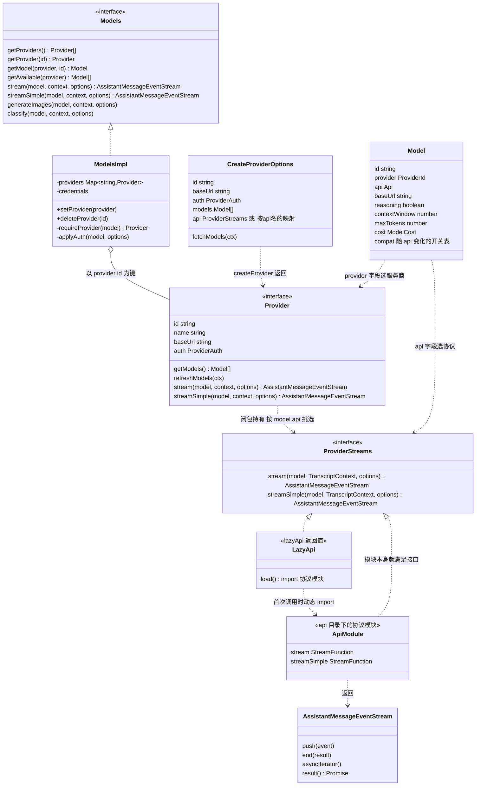

| 类型 | 说明 |
| --- | --- |
| `Model` | 纯数据。`provider` 决定 `Models` 把请求交给哪个 `Provider`；`api` 决定 `Provider` 用哪份协议实现；`compat` 决定协议实现内部走哪些分支 |
| `Models` 接口 | 对外门面。`coding-agent` 的 `ModelRuntime`（`model-runtime.ts`）实现了它，再套一层凭证管理。`stream` / `streamSimple` 接收的是普通 `Context`，在这里调 `normalizeContext` 转成 `TranscriptContext` 再往下传（§2.2） |
| `ModelsImpl` | 默认实现，内部一个 `provider id → Provider` 的 Map。`setProvider` 按 id 放入 |
| `Provider` 接口 | 一家服务商。它是接口而不是类，内置的都是 `createProvider` 拼出来的普通对象；`coding-agent` 的 `composeModelProvider` 也会拼一个 |
| `CreateProviderOptions` | `createProvider` 的入参。注意 `api` 字段的类型是“单个 `ProviderStreams`，或者 `{ 协议名: ProviderStreams }`” |
| `ProviderStreams` | 每个协议实现都要满足的结构：一个对象，带 `stream` 和 `streamSimple`，可选 `fetchDeferred` / `cancelDeferred`。每个 `api/*.ts` 模块的导出都满足它 |
| `lazyApi(load)` | 把“动态 import 一个协议模块”包装成 `ProviderStreams`。`providers/*.ts` 传给 `createProvider` 的都是它，比如 `anthropicMessagesApi()` 就是 `lazyApi(() => import("./anthropic-messages.ts"))`。所以启动时注册 42 家服务商并不会加载协议代码，要等第一次调用时才加载 |
| `lazyStream(model, setup)` | 先同步返回一个空的外层流，`setup()` 异步完成后把内层流的事件转发过去；`setup` 抛错就合成一条 `error` 事件。`StreamFn` 约定出错时不抛异常，而是把错误作为事件放进流里（见 `agent/src/types.ts` 的注释），靠的就是这一层 |
| `EventStream<T, R>` | 生产者 `push`，消费者 `for await`。内部两个 FIFO：一个存还没被消费的事件，一个存等着事件的消费者。`isComplete(event)` 为真时流结束，在等 `result()` 的一方拿到最终结果 |
| `AssistantMessageEventStream` | 特化：`done` 或 `error` 事件算完成，结果是那条 `AssistantMessage` |

模型现在分三类（`ModelTypeMap`）：`chat` 是一般的对话模型，走上面这套流式接口；`image` 是生图模型，只能用 `generateImages()`（目前只有 `openrouter-images` 一种协议）；`classifier` 是分类模型，只能用 `classify()`，协议有 `typesafe-system-one`、`cloudflare-workers-ai-system-one`、`llama-cpp-classify`、`openai-decisions` 四种。`getModels()` 只列聊天模型，`getAllModels()` 才包括三类。coding-agent 里，分类模型和生图模型主要给 codemode 脚本通过 `models.*` 调用。

### 5.4 `createProvider`

`createProvider` 返回一个满足 `Provider` 接口的普通对象，函数体里主要做了这几件事：

1. 合并模型列表：`getModels` 返回“静态列表 `input.models` + 最近一次 `fetchModels` 拉到的动态列表”，同 id 以动态的为准。
2. 判断 `api` 是单个实现还是映射：看 `input.api.stream` 是不是函数。是就记为 `single`，否则记为 `byApi`。`apiFor(model)` 返回 `single ?? byApi[model.api]`。
3. 生成 `stream` / `streamSimple`：两者都走 `dispatch`。`apiFor(model)` 找不到实现时，不抛异常，而是返回一条“`Provider xxx has no API implementation for "yyy"`”的错误流。
4. 按需加上可选方法：底层任意一份实现有 `fetchDeferred` / `cancelDeferred`，才给返回对象加上同名方法。

返回对象的字段：

| 字段 | 来源 |
|---|---|
| `id` / `name` / `baseUrl` / `headers` / `auth` | 原样取自入参，`name` 缺省用 `id` |
| `getModels` | 第 1 步的合并函数 |
| `refreshModels` | 入参有 `fetchModels` 才有：先恢复上次持久化的列表，允许联网时再拉新的，通过 `context.publish` 事务化地替换 |
| `filterModels` | 原样取自入参 |
| `stream` / `streamSimple` | 第 3 步的闭包，内部持有 `single` 或 `byApi` |

所以 `Provider` 自己并不处理协议，只是按 `model.api` 把调用转给对应的实现，协议相关的代码都在各个协议模块里。

### 5.5 调用流程

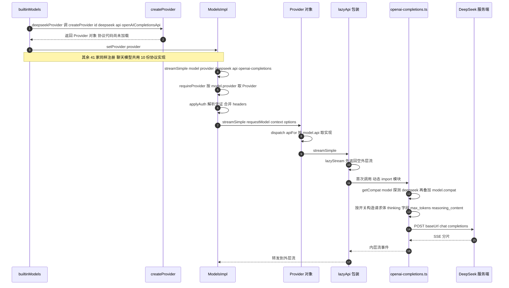

图里编号对应的步骤：

1–4. `builtinModels()`（`providers/all.ts`）对 `builtinProviders()` 返回的 42 个对象逐个 `setProvider`。每个对象都是 `createProvider` 拼的，协议实现都是 `lazyApi` 包装，此时一个协议模块都没加载。

5–7. `ModelsImpl.streamSimple`（`models.ts`）用 `lazyStream` 包住整个过程：`requireProvider` 用 `model.provider` 查 Map，`applyAuth` 解析凭证、合并 headers，有 `baseUrl` 覆盖就换掉模型的 `baseUrl`。

8–10. `Provider.streamSimple` 再按 `model.api` 选出对应协议的实现。

11–12. `lazyApi` 在首次调用时 `import()` 协议模块，之后走模块缓存。

13–14. 协议模块内部再根据 `compat` 处理各厂商的差异，这一步只是模块里的 if 判断，不再换对象。

### 5.6 自定义服务商

这样设计的好处是，想接本地的 Ollama、vLLM，或者新出的兼容厂商，只需要写配置，不用写代码。`coding-agent/docs/models.md` 的最小例子：

```json
{
  "providers": {
    "ollama": {
      "baseUrl": "http://localhost:11434/v1",
      "api": "openai-completions",
      "apiKey": "ollama",
      "compat": { "supportsDeveloperRole": false, "supportsReasoningEffort": false },
      "models": [{ "id": "gpt-oss:20b", "reasoning": true }]
    }
  }
}
```

`ollama` 是一个 pi-ai 不认识的服务商 id，但 `openai-completions` 是认识的协议。`coding-agent` 的 `composeModelProvider`（`core/provider-composer.ts`）为它拼一个 `Provider` 对象，调用时按三级顺序找实现：

1. 扩展注册了同名协议的 `streamSimple`，用扩展的；
2. 存在同 id 的内置服务商且它支持这个 `api`，用内置服务商的；
3. 否则从全局协议注册表按 `model.api` 取（`getApiProvider(model.api)`）。注册表在 `ai/src/compat.ts` 的 `BUILTIN_APIS` 里预置了全部 10 种协议。

`compat` 可以写在服务商层（对所有模型生效），也可以写在单个模型上覆盖。模型没写的字段，`findModelDefaults` 按“同 id 的已知模型 → 同协议的已知模型 → 任一 `openai-completions` 模型 → 第一个模型”的顺序找一个模型借默认值。

### 5.7 `anthropic-messages` 协议模块

`streamSimple` 把通用的 `SimpleStreamOptions`（`reasoning` 等级、`thinkingBudgets`）翻译成 Anthropic 特有的 `thinkingEnabled` / `thinkingBudgetTokens` / `effort`，再调 `stream`。`stream` 内部流程（其他协议大同小异）：

1. 造一条 `stopReason: "pending"` 的空 `AssistantMessage` 当累积器
2. 先用 `resolveTranscript` 处理 system 消息：模型的 `compat.supportsMidConvoSystemMessages` 为真，就把对话中间的 system 消息原样保留；否则回放成一条放到最前面。然后 `buildParams(model, context, isOAuth, options)` 把消息转成 Anthropic 的格式：开头那条 system 消息放进 `params.system`（OAuth 令牌时强制在最前面加一句 "You are Claude Code..."），它声明的工具放进 `params.tools`；后面的 system 消息变成对话里的 system 内容块，模型支持 `supportsMidConvoToolChanges` 时，工具增减写成 `tool_addition` / `tool_removal` 块，这样已经缓存的请求前缀不用变
3. `options.onPayload?.(params, model)` 让上层（扩展）改请求体
4. `retryProviderRequest(() => client.beta.messages.create(params).asResponse())`：HTTP 层的重试，看 `x-should-retry` 头和 408/409/429/5xx（`utils/provider-retry.ts`）
5. `options.onResponse?.(status, headers)` 通知上层
6. `stream.push({ type: "start", partial })`，然后逐个 SSE 事件更新累积器并 `push` 对应的 `text_delta` / `toolcall_delta` 等
7. 最后 `push({ type: "done", message })` 或 `{ type: "error", error }`

第 2 步用的是 `model.baseUrl` 和 `model.compat`，没有写死 `api.anthropic.com`，所以 Anthropic 官方、Kimi Coding、MiniMax、Vercel AI Gateway 都能共用这一个模块。

---

## 6. 启动装配

`pi` 命令启动到 `AgentSession` 可用，经过这些步骤。后面各个回调具体指向谁，都是在这一步定下来的。

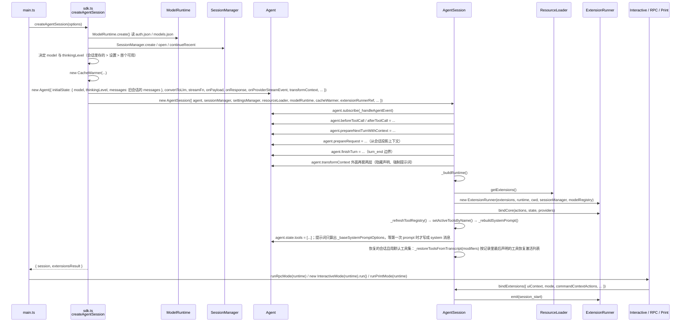

### 6.1 `createAgentSession`

| 步骤 | 决定了什么 |
|---|---|
| 决定模型 | 旧会话里记的模型优先（前提是那家 provider 还配了鉴权），否则 `findInitialModel` 按设置的默认 provider/model 找 |
| 决定思考等级 | 旧会话 > 每模型覆盖 > 全局默认 > `"medium"`，最后 `clampThinkingLevel` 夹到模型支持的范围 |
| 决定初始工具 | `options.tools`（白名单）> `settings.defaultTools` > `["read","bash","edit","write"]`，再减去 `excludeTools` |
| `new Agent(...)` | 见下表 |
| 恢复历史 | 有旧会话：作为 `initialState.messages` 传给 `new Agent`。没有：往会话里写 `model_change` 和 `thinking_level_change` 两条条目，以便下次恢复 |
| `new AgentSession(...)` | — |

`new Agent` 时传进去的每个回调（`sdk.ts`）：

| 参数 | 塞的是什么 | 为什么 |
|---|---|---|
| `initialState` | `{ systemPrompt: "", model, thinkingLevel, tools: [], messages: 旧会话的 messages }` | 提示词留空，所以不会生成开头的 system 消息；提示词和工具由 `AgentSession` 在第一次 prompt 时以 system 消息的形式补上（§2.5） |
| `convertToLlm` | `messages.ts` 的转换，外面包一层：设置里 `blockImages` 打开时把所有图片换成文字 "Image reading is disabled." | 防御性：即使某个扩展往上下文塞了图片也发不出去 |
| `streamFn` | 闭包：读设置里的超时/重试参数，调 `modelRuntime.streamSimple(model, context, { ...options, timeoutMs, maxRetries, maxRetryDelayMs, transformHeaders })`。`transformHeaders` 先合并 provider 归属头，再让扩展改（`before_provider_headers`）。如果是本会话的请求，还会交给 `CacheWarmer`：空闲时它按估算的概率决定要不要发预热请求，让服务端的提示缓存别过期，花费记成 `usage` 条目（扩展可以通过 `cache_warming_decision` 干预） | 每次请求都重新读设置，所以改设置立即生效 |
| `onPayload` | 若有扩展订阅 `before_provider_request`，让扩展改请求体 | 扩展可以改最终发出去的 JSON |
| `onResponse` | 若有扩展订阅 `after_provider_response`，把状态码和响应头发给扩展 | 给限流类扩展看头 |
| `onProviderStreamEvent` | 若有扩展订阅 `provider_stream_event`，把 provider 原始的流事件转给扩展 | 给需要原始数据的扩展用 |
| `transformContext` | `runner.emitContext(messages)` | 扩展可以在发请求前改消息 |
| `steeringMode` / `followUpMode` | 从设置读，默认都是 `"one-at-a-time"` | — |
| `sessionId` | `sessionManager.getSessionId()` | 透传给 provider 做缓存亲和 |

`extensionRunnerRef` 的作用：`streamFn` / `onPayload` / `onResponse` 三个闭包在 `new Agent` 时就固定了，但 `ExtensionRunner` 要到 `AgentSession._buildRuntime` 才创建，而且 `reload()` 会换新的。所以用一个 `{ current }` 对象包一层（`sdk.ts`），闭包每次调用时再去取最新的 runner。

### 6.2 `AgentSession` 构造函数

构造函数按顺序做了这几件事：

1. 存依赖
2. `agent.subscribe(this._handleAgentEvent)`：从此循环发的每个事件都先经过 `AgentSession`
3. `_installAgentToolHooks()`：给 `agent.beforeToolCall` 和 `agent.afterToolCall` 赋值（§8.2）
4. `_installAgentNextTurnRefresh()`：给 `agent.prepareNextTurnWithContext` 赋值（§10.3）
5. `_installAgentRequestProjection()`：给 `agent.prepareRequest` 赋值，每次请求前从会话投影上下文（§2.5）
6. `_installAgentBoundaryHooks()`：给 `agent.finishTurn` 赋值，发 `turn_end` 边界事件（§4.3）
7. `_installHiddenDeclarationsProjection()` 和 `_installAgentForcedPromptProjection()`：在 `agent.transformContext` 外面各套一层。前者把 `prepareLoadout` 要求隐藏的工具声明从请求里去掉；后者在扩展用 `before_agent_start` 整个替换了提示词时，把所有 system 消息折成一条带新提示词的，只影响这次请求，不写进记录
8. `_buildRuntime({ activeToolNames, includeAllExtensionTools: true })`
9. 用的是默认工具集（没有用 `--tools` 白名单点名工具）时，`_restoreToolsFromTranscript(modifiers)` 按会话记录里最后声明的工具恢复激活列表，再套用命令行里 `--tools +name` / `-name` 这种增减项。以前的判断条件是“没传初始工具”，而 SDK 总会传，所以这一步其实从来没执行过，恢复的会话会丢掉中途激活的工具；10-13（`6f2f164ab`）修好了

每个 `_install*` 都先把 `Agent` 上原来的回调存下来，新回调里再调用它，所以多层安装可以叠加，SDK 调用方自己设的回调也不会被覆盖。

### 6.3 `_buildRuntime`

1. `createAllToolDefinitions(cwd, { read: { autoResizeImages }, bash: { commandPrefix, shellPath } })`（`tools/index.ts`）造八个内置 `ToolDefinition`，存进 `_baseToolDefinitions`
2. `resourceLoader.getExtensions()` 拿已加载的扩展
3. `new ExtensionRunner(...)`，写进 `_extensionRunnerRef.current`
4. `_bindExtensionCore(runner)`：把 `sendMessage` / `sendUserMessage` / `appendEntry` / `setActiveTools` / `setModel` / `compact` / `abort` 等二十来个动作绑进 runner，扩展调 `pi.xxx()` 时最终落到 `AgentSession` 的方法上
5. `_refreshToolRegistry({ activeToolNames, includeAllExtensionTools })`

### 6.4 `_refreshToolRegistry` 和 `setActiveToolsByName`

这两个方法决定模型能看到哪些工具：

1. 收集三种来源：`runner.getAllRegisteredTools()`（扩展注册的）、`_customTools`（SDK 调用方传的）、`_baseToolDefinitions`（内置）
2. 用 `_allowedTools` / `_excludedTools` 两个匹配函数过滤。MCP 工具比较特殊：白名单没点名 MCP 时，它们仍然注册，但只能通过 codemode 或 `tool_search` 用
3. 全部包装成 `AgentTool`（§4.4），放进 `_toolRegistry`；同时从定义里抽出 `promptSnippet` 和 `promptGuidelines` 存进两个 Map
4. 算出"这次要激活哪些"：有白名单就激活白名单里全部；首次装配时激活全部扩展工具；reload 时只把新出现的工具加进激活列表
5. `setActiveToolsByName(names)` → `_applyToolLoadout(names)`：从注册表挑出对象（`hidden` 的和不允许激活的跳过），跑一遍各工具的 `prepareLoadout`，结果赋给 `agent.state.tools`；然后 `_rebuildSystemPrompt(validToolNames)` 重算提示词参数

`_rebuildSystemPrompt` 不再直接生成提示词字符串，而是把激活工具的 snippet 和 guidelines、`resourceLoader` 给的自定义提示词/追加提示词/技能/AGENTS.md 内容，整理成 `_baseSystemPromptOptions`。下一次请求前，`_preparePromptAndToolLoadout` 用它调 `buildSystemPromptSections`，和记录里当前的段落比较，有变化才生成一条 system 消息（§2.5）。所以激活的工具一变，提示词也会跟着变，但只追加变了的段落。

---

## 7. prompt 执行流程

这张图是整个主流程，参与者从左到右依次是 UI 到网络请求。

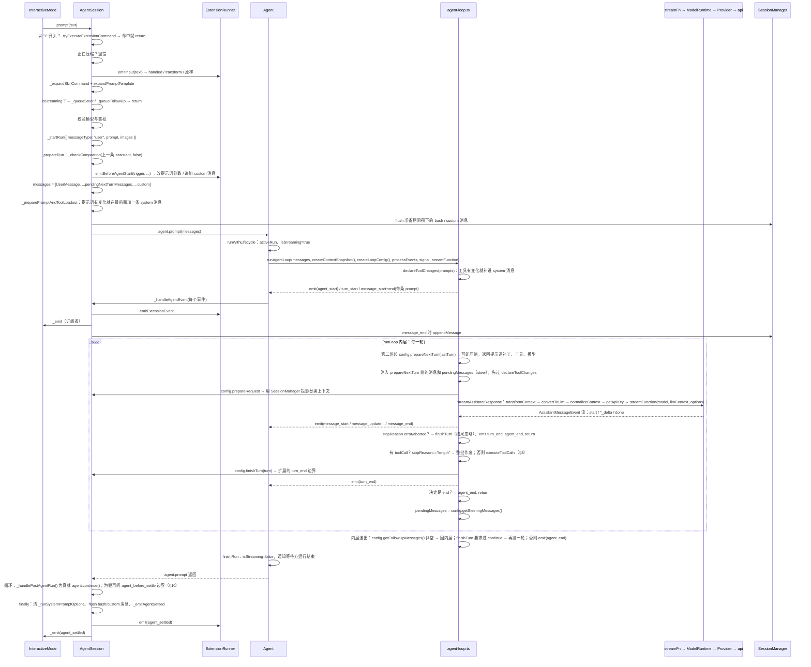

### 7.1 `AgentSession.prompt`

| 步 | 做什么 | 提前返回的条件 |
|---|---|---|
| ① | `text` 以 `/` 开头就试 `_tryExecuteExtensionCommand`。扩展命令即使在流式输出中也会立刻执行，它自己通过 `pi.sendMessage()` 管理和模型的交互 | 命中命令 |
| ② | `_compactionAbortController` 非空就抛错 | 抛错 |
| ③ | `_runInputHandlers`：让订阅了 `input` 的扩展先看一眼 | 扩展返回 `handled` |
| ④ | `/skill:name args` 展开成 `<skill>` 块；`/template args` 展开提示词模板 | — |
| ⑤ | `isStreaming` 为真：按 `options.streamingBehavior` 走 `_queueFollowUp` 或 `_queueSteer`。没给 behavior 就抛错 | 排队后返回 |
| ⑥ | 没模型抛错；`modelRuntime.hasConfiguredAuth` 或 `checkAuth` 都不通过就抛错（OAuth 场景给不同文案） | 抛错 |
| ⑦ | `_startRun({ messageType: "user", prompt, images })`，见 §7.2 | — |

### 7.2 `_startRun`

10-12（`a447ba11f`）原来的 `_runAgentPrompt` 拆成了 `_startRun(trigger)` 和 `_prepareRun(trigger)` 两个方法。拆分的原因是：以前只有用户输入开跑时才会走“补查压缩 → `before_agent_start` → 组消息”这一套，扩展用 `sendMessage({ triggerTurn: true })` 发 custom 消息开跑时直接调 `_runAgentPrompt`，扩展收不到 `before_agent_start`，提示词补丁也不会生成。现在两条路都走 `_startRun`，区别只在 `trigger` 是 `{ messageType: "user", prompt, images }` 还是 `{ messageType: "custom", message }`，扩展可以从事件的 `messageType` 看出这次是哪种。

`_prepareRun(trigger)` 做开跑前的准备，返回这次运行的起始消息：

| 步 | 做什么 |
|---|---|
| ① | `_checkCompaction(lastAssistant, skipAbortedCheck=false)`：上一次被用户中断的响应也可能已经溢出，这里补查一次 |
| ② | `emitBeforeAgentStart(trigger, _baseSystemPromptOptions)`：扩展可以改其中的段落、选中的工具，可以追加 custom 消息，也可以用 `systemPrompt` 整个替换这次的提示词。这一步放在处理图片之前，因为扩展可能会换模型，图片要按新模型的要求缩放 |
| ③ | 组 `messages`：第一条是用户消息（文本 + 按模型缩放过的图片）或触发这次运行的 custom 消息，后面跟 `_pendingNextTurnMessages` 里攒的 custom 消息，再跟扩展追加的 custom 消息 |
| ④ | `_preparePromptAndToolLoadout(result.systemPromptOptions)`：按扩展改过的参数设置工具、生成段落补丁。有补丁就把这条 system 消息放到 `messages` 最前面；参数存进 `_runSystemPromptOptions`，这次运行后面几轮都用它 |

`_startRun` 拿到消息后，先把准备期间攒下的 bash 消息和 custom 消息 flush 进会话（§9.3），这样它们排在这次运行的起始消息前面，和空闲时提交的效果一样；然后开跑：

```ts
this._isAgentRunActive = true;
const messages = await this._prepareRun(trigger);   // 出错就复位状态、flush、抛出
this._flushPendingBashMessages();
this._flushPendingCustomMessages();
try {
  await this.agent.prompt(messages);
  while (!this._agentRunAbortRequested) {
    if (await this._handlePostAgentRun()) {        // §10：重试 / 压缩 / 队列里还有东西
      await this.agent.continue();
      continue;
    }
    if (!(await this._runBeforeSettleBoundary())) break;   // 扩展的 agent_before_settle 可以要求再跑
    await this.agent.continue();
  }
} finally {
  this._runSystemPromptOptions = undefined;        // 这次运行的提示词参数只活一次运行
  this._flushPendingBashMessages();
  this._flushPendingCustomMessages();
  await this._emitAgentSettled();                  // agent_settled 事件；在 waitForIdle 上等着的调用方此时返回
}
```

这里有两层循环：`agent.prompt()` 里面是 `runLoop` 的循环，外面还有一层，用来做重试、压缩这类产品层的处理。外层每次先问 `_handlePostAgentRun`，它说不用继续时，再给扩展最后一次机会（`agent_before_settle`），都不需要继续才真正结束。用户按 Esc 会置 `_agentRunAbortRequested`，外层看到就立刻退出。

### 7.3 `runLoop`

```ts
let currentContext = initialContext;            // 快照，循环内可以换（prepareNextTurn）
let config = initialConfig;                     // 同上，可以换模型/思考等级
let lastCompletedTurn;                          // 上一轮的结果，给 prepareNextTurn 用
let explicitContinuation = false;               // finishTurn 是否要求过继续
let pendingMessages = await config.getSteeringMessages?.() || [];   // 开局先拉一次：用户可能在等待时已经打了字

while (true) {                                  // 外层：处理 followUp
  let hasMoreToolCalls = true;

  while (hasMoreToolCalls || pendingMessages.length > 0) {   // 内层：处理工具轮次和 steer
    let preparedMessages = [];
    if (lastCompletedTurn) {                    // 不是第一轮
      const next = await config.prepareNextTurn?.(lastCompletedTurn);
      if (next) {
        currentContext = next.context ?? currentContext;
        preparedMessages = next.messages ?? [];  // 比如提示词段落的补丁
        config = {...config, model, reasoning};
      }
      if (pendingMessages.length === 0)         // 只有上一次没拉到才补拉
        pendingMessages = await config.getSteeringMessages?.() || [];
      await emit({ type: "turn_start" });
    }

    // 先补上工具变化，再把这些消息注入上下文
    for (const m of declareToolChanges(currentContext, [...preparedMessages, ...pendingMessages])) {
      emit(message_start); emit(message_end); currentContext.messages.push(m); newMessages.push(m);
    }
    pendingMessages = [];

    const update = await config.prepareRequest?.({ context: currentContext, model, thinkingLevel }, signal);
    if (update) { currentContext = update.context ?? currentContext; config = {...config, model, reasoning}; }

    const message = await streamAssistantResponse(currentContext, config, signal, emit, streamFunction);
    newMessages.push(message);

    if (message.stopReason === "error" || message.stopReason === "aborted") {
      await config.finishTurn?.({ message, toolResults: [], ... });   // 照样调，但结果不看
      emit(turn_end); emit(agent_end); return;  // 循环不重试，交给产品层
    }

    const toolCalls = message.content.filter(c => c.type === "toolCall");
    hasMoreToolCalls = false;
    if (toolCalls.length > 0) {
      const batch = message.stopReason === "length"
        ? await failToolCallsFromTruncatedMessage(toolCalls, emit)           // 整批作废
        : await executeToolCalls(currentContext, message, config, signal, emit);
      toolResults.push(...batch.messages);
      hasMoreToolCalls = !batch.terminate;
      for (const r of toolResults) { currentContext.messages.push(r); newMessages.push(r); }
    }

    lastCompletedTurn = { message, toolResults, context: currentContext, newMessages };
    const decision = await config.finishTurn?.(lastCompletedTurn, signal);   // 在 turn_end 之前
    await emit({ type: "turn_end", message, toolResults });

    if (decision?.action === "end") { emit(agent_end); return; }

    explicitContinuation = decision?.action === "continue";
    pendingMessages = await config.getSteeringMessages?.() || [];
    if (hasMoreToolCalls || pendingMessages.length > 0) explicitContinuation = false;  // 本来就要继续
  }

  const followUps = await config.getFollowUpMessages?.() || [];
  if (followUps.length > 0) { pendingMessages = followUps; continue; }       // 回内层
  if (explicitContinuation) { explicitContinuation = false; continue; }      // finishTurn 要求的那一次
  break;
}
await emit({ type: "agent_end", messages: newMessages });
```

内层循环在没有工具调用、也没有插话时退出；退出后外层再看有没有追加消息，有就继续跑。

和 9 月比，这段循环有三处变化：

- `shouldStopAfterTurn` 换成了 `finishTurn`。它在 `turn_end` 事件**之前**调，能返回 `{action:"end"}`（立刻结束，不再看队列）或 `{action:"continue"}`（保证至少再请求一次模型）。如果本来就有工具结果或插话要继续，`continue` 不会多请求一次；只有本来要停的时候，它才让循环带着当前上下文再跑一轮。出错和中断时也会调，但结果被忽略。
- 新增的 `prepareRequest` 在**每次**请求前都调，包括第一次。`prepareNextTurn` 只在第二轮起的每轮开头调，不会覆盖第一次请求，所以“每次请求都从会话投影上下文”这件事只能放在 `prepareRequest` 里。
- 注入消息前都过一遍 `declareToolChanges`，保证 system 消息里声明的工具和 `context.tools` 一致（§2.5）。

为什么只在为空时才补拉？`prepareNextTurn` 可能很慢（比如在压缩），这期间用户说的话不应该被拖到再下一轮，所以要补拉一次；但如果上一次已经拉到了，`one-at-a-time` 模式下再拉就会在同一轮塞进两条，所以只在为空时补拉。

### 7.4 `streamAssistantResponse`

| 步 | 做什么 |
|---|---|
| ① | `transformContext`（扩展改 `AgentMessage[]`） |
| ② | `convertToLlm`（`AgentMessage[]` → `Message[]`） |
| ③ | `llmContext = normalizeContext({ messages: llmMessages })`。不再单独传 `systemPrompt` 和 `tools`，它们都在 system 消息里 |
| ④ | `getApiKey?.(provider) \|\| config.apiKey`：每次都重新取，为了会过期的 OAuth token |
| ⑤ | `streamFunction(config.model, llmContext, { ...config, apiKey, signal })`。注意 `config` 整个展开进去，所以 `reasoning` / `sessionId` / `transport` / `thinkingBudgets` / `onPayload` / `onResponse` / `maxRetryDelayMs` 都到了 provider |
| ⑥ | 消费流：`start` 事件时把 `partial` push 进 `context.messages`，之后每个增量事件用 `context.messages[last] = event.partial` 替换，并发 `message_update`；`done` / `error` 时用 `response.result()` 拿最终消息替换掉，发 `message_end`。最终消息上会记下这次请求用的 `thinkingLevel` |

注意流一开始就 push 了 partial，所以用户中途按 Esc 时，`context.messages` 末尾是半条 assistant 消息。这条在 `agent_end` 之后由 `Agent.processEvents` 的 `message_end` 落进 `_state.messages`，`SessionManager` 也会存下来。

### 7.5 事件回到 UI

一个 `text_delta` 到达终端要经过：

1. provider 的 `stream.push({ type: "text_delta", partial })`（`anthropic-messages.ts`）
2. `agent-loop.ts` 收到，`emit({ type: "message_update", assistantMessageEvent, message: {...partial} })`
3. `Agent.processEvents`（`agent.ts`）：`_state.streamingMessage = message`，然后 `await listener(event, signal)`
4. `AgentSession._handleAgentEvent`：先 `_emitExtensionEvent`（转成扩展的 `message_update` 事件），再 `_emit(event)` 给订阅者
5. `InteractiveMode.handleEvent`（`interactive-mode.ts`）的 `case "message_update"` 更新组件并 `ui.requestRender()`
6. `TuiBase.requestRender`（`tui/src/tui.ts`）合并到下一帧（最小间隔 16ms），再由具体的屏幕实现重绘。默认的全屏模式是 `TuiAltScreen.doRender`（`tui-alt-screen.ts`）：在终端的备用屏幕上按布局排出整屏内容，和上一帧逐行比较，只重写变了的行；设置 `tuiMode` 改回普通模式时用 `TuiMainScreen.doRender`（`tui-main-screen.ts`），在正常滚动区里做同样的逐行比较

这条路径上每一步都是 `await`，`processEvents` 会按顺序等每个监听器处理完，所以监听器慢了，整个流都会变慢。RPC 模式专门加了一个背压监听器（`rpc-mode.ts`）在 stdout 写不动时等待。

---

## 8. 工具调用

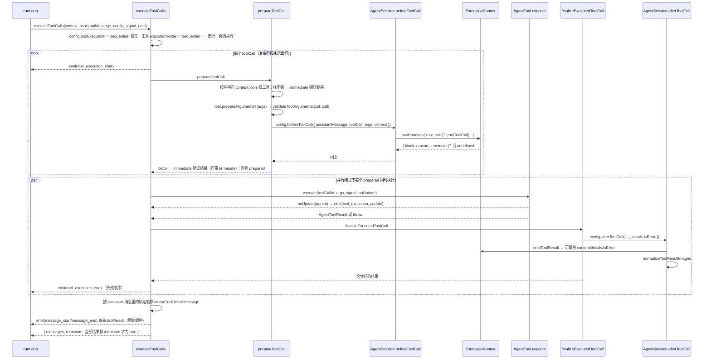

### 8.1 执行阶段

| 阶段 | 函数 | 输入 → 输出 |
|---|---|---|
| 准备 | `prepareToolCall` | `toolCall` → `{ kind: "prepared", tool, args }` 或 `{ kind: "immediate", result, isError }` |
| 执行 | `executePreparedToolCall` | `prepared` → `{ result, isError, durationMs }`。`tool.execute` 抛错就包成错误结果；也可以不抛错、直接返回 `isError: true`，这样 `details` 和 `structuredContent` 能保留给 UI。`durationMs` 是用单调时钟量的执行耗时，会带到 `tool_execution_end` 事件和 toolResult 消息上。`onUpdate` 回调在 `execute` 返回后失效 |
| 收尾 | `finalizeExecutedToolCall` | 调 `afterToolCall`，逐字段合并覆盖，`afterToolCall` 自己抛错也变成错误结果 |

这三个阶段现在还被包成一个单独导出的函数 `runToolCall(toolCall, options)`，给循环之外的调用方用，比如下面要讲的嵌套调用。

串行版三个阶段对每个调用依次做完再做下一个。并行版的准备阶段仍然是串行的（保证 `beforeToolCall` 的调用顺序确定），执行和收尾用 `Promise.all`。`tool_execution_end` 按完成顺序发，但 `toolResult` 消息按原始顺序发，保证上下文里的顺序和模型请求的顺序一致。

### 8.2 `beforeToolCall` 与 `afterToolCall`

`beforeToolCall`：没有扩展订阅 `tool_call` 就返回 `undefined`；有就 `emitToolCall`，扩展返回 `{ block: true, reason }` 即拒绝。pi 的权限控制只有这一个钩子，而且默认没有扩展订阅它。

`afterToolCall`：先让扩展改结果（`tool_result` 事件），然后 `normalizeToolResultImages` 按设置缩放图片。两者都没改就返回 `undefined`，循环保留原结果。

工具自己也能调别的工具：`ExtensionToolContext.executeTool(name, args)`。codemode 脚本里的 `tools.xxx()` 走的就是它。`AgentSession._executeNestedToolCall` 用 `runToolCall` 跑这次嵌套调用，候选工具是“可调用的工具”（激活的 `direct` 工具，加上所有 `codemode` / `deferred` 工具，§4.4），`beforeToolCall` / `afterToolCall` 还是同一套，事件里多带一个 `parentToolCallId`。所以权限类扩展对嵌套调用一样有效。嵌套调用的记录和用量最后挂在父工具的 toolResult 消息上（`nestedCalls`）。

### 8.3 输出截断

`stopReason === "length"` 时不执行任何一个工具调用，每个都生成一条错误 `toolResult`，文案让模型重新发完整参数。源码注释里写了原因：流式返回的工具参数是边收边用一个容错的 JSON 解析器补全的，截断的消息里，工具调用可能解析成功、校验也通过，但参数其实不完整。自己写 agent 时要注意这一点。

没有截断、但模型写出来的参数本身不是合法 JSON 时，以前也是这个容错解析器兜底：只保留出错位置之前解析出的字段，工具照样执行。10-14（`87f9a3641`）起，`pi-ai` 对**已经结束**的工具调用改用严格解析（只保留修复非法字符串转义这类小修补），解析失败时参数记为 `{}`，原因和原始文本放进 `argumentsError`，`validateToolArguments` 会把它作为校验错误返回给模型，工具不执行。opencode 在同一周做了同样的修改（见 opencode 篇 §7.1）。

### 8.4 `edit` 工具

```
execute(toolCallId, { path, edits }, signal, onUpdate, ctx)
  absolutePath = resolveToCwd(path, ctx.cwd || cwd)
  withFileMutationQueue(absolutePath, async () => {     // 同一文件的写串行化
    access → readFile → 去 BOM → 统一成 LF
    applyEditsToNormalizedContent(content, edits)      // 每个 oldText 必须唯一匹配
    还原换行 + BOM → writeFile
    return { content: [text "Successfully replaced N block(s)"], details: { diff, patch, firstChangedLine } }
  })
```

`withFileMutationQueue`（`tools/file-mutation-queue.ts`）：按真实路径（`realpath`）做 key，同一文件的操作排成一条 promise 链，不同文件互不等待。只要工具可以并行执行，就需要这样的机制，否则两个 `edit` 同时改一个文件会互相覆盖。

`bash`（`tools/bash.ts`）的执行体要点：输出走 `OutputAccumulator`，超过 2000 行或 50KB（`tools/truncate.ts`）就截断并把全文写到临时文件，结果里附 "Full output: 路径"；`onUpdate` 按 100ms 节流推增量。

---

## 9. 插话与排队

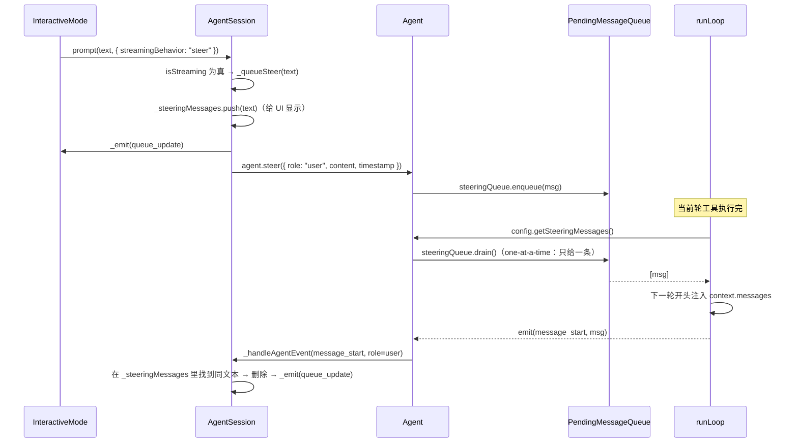

### 9.1 两个队列的区别

| | `steer` | `followUp` |
|---|---|---|
| 入口 | `AgentSession.steer` / `prompt(..., {streamingBehavior:"steer"})` | `AgentSession.followUp` / `prompt(..., {streamingBehavior:"followUp"})` |
| 循环在哪取 | 每轮结束后、开局、准备后补拉 | 内层循环退出后 |
| 语义 | "等等，改用另一个方案"，插进正在进行的任务 | "还有另一件事"，等手头的做完 |
| TUI 默认 | 正在流时直接回车就是 steer（`interactive-mode.ts`） | 需要专门的快捷键 |

### 9.2 `one-at-a-time` 模式

`PendingMessageQueue.drain()` 在 `one-at-a-time` 模式下只返回第一条。所以用户连打三句插话，会分三轮投进去，每轮模型只看到一句。`"all"` 模式一次全投。设置项 `steeringMode` / `followUpMode`（`settings-manager.ts` 的 `getSteeringMode`），RPC 命令 `set_steering_mode` 可改。

### 9.3 待发送消息

| 字段 | 谁往里放 | 什么时候 flush | 为什么不能立刻插 |
|---|---|---|---|
| `_pendingCustomMessages` | `sendCustomMessage` 在流式中且 `triggerTurn: false` | `turn_end` 时、下一次运行开跑前、运行结束时 | 立刻插会落在 assistant 的 toolCall 和 toolResult 之间，严格校验顺序的 provider 会拒绝 |
| `_pendingBashMessages` | `recordBashResult` 在流式中 | 下一次运行开跑前和运行结束时（`_startRun`） | 同上 |
| `_pendingNextTurnMessages` | `sendCustomMessage` 带 `deliverAs: "nextTurn"` | 下一次运行组起始消息时（`_prepareRun`） | 语义就是"和用户下一句一起发" |

`sendCustomMessage` 的完整分支：`nextTurn` → 攒着；流式中且要触发 → `agent.steer` 或 `agent.followUp`；不流式且要触发 → `_startRun`（同样会发 `before_agent_start`）；流式中不触发 → 攒到 turn_end；不流式不触发 → 立刻追加进状态和会话。

---

## 10. 重试与压缩

`agent.prompt()` 返回后，`_handlePostAgentRun` 决定要不要 `agent.continue()`：

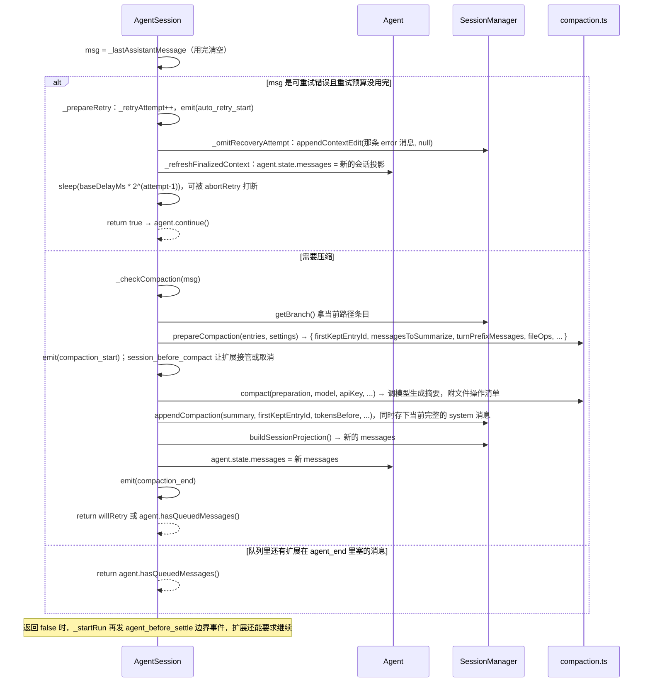

### 10.1 重试

| 判定 | 规则 |
| --- | --- |
| 是不是溢出 | 三种：错误文案匹配溢出模式；`stop` 但 `input + cacheRead > contextWindow`（静默溢出）；`length` 且 `output === 0` 且输入占满 99%（服务端截断输入）。溢出归压缩管，不重试 |
| 可不可以重试 | `isRetryableAssistantError`：`stopReason === "error"` 且文案先排除"配额/账单"类（`NON_RETRYABLE_PROVIDER_LIMIT_ERROR_PATTERN`），再匹配"过载/限流/5xx/网络/超时/流提前结束"这一大串正则。这套判定已经从 coding-agent 挪进了 pi-ai 的 `utils/retry.ts`，压缩和分支摘要的模型调用也用同一套（`retryAssistantCall`） |
| 延迟 | `retryDelayMs`：`baseDelayMs * 2^(attempt-1)`，上限 `maxAgentDelayMs`（默认 60 秒）。设置默认 `maxRetries: 3`，`baseDelayMs: 2000`（`settings-manager.ts`） |

`_prepareRetry` 做的事：计数、发 `auto_retry_start`、调 `_omitRecoveryAttempt` 把失败的那条 assistant 消息“从模型上下文里拿掉”、可中断地睡眠、返回 `true`。然后 `agent.continue()` 看到最后一条是 user 或 toolResult，走 `runContinuation`。

“拿掉”的做法变了。以前是直接从 `agent.state.messages` 里删，会话文件里还留着，内存和文件就对不上了。现在会话文件是唯一来源（§2.5），删内存没有用，所以 `_omitRecoveryAttempt` 往会话里追加一条 `context_edit(targetId, null)`，再用新的投影刷新 `agent.state.messages`。原始消息还在文件里，UI 能看到失败记录，但之后的请求和恢复都不会再带上它。消息对象和条目 id 的对应关系靠 `_entryIdsByMessage` 找。

失败的那次回答还会记进 `_failedResponse`，下一次请求如果用的是虚拟模型，路由时会知道“上一次失败了”（`reason: "retry"`），可以换一个实际模型。

重试计数在下一条成功的 assistant `message_end` 时归零。

注意这里有两层重试。这里说的是 agent 层的重试，会重新发整个请求；`ai` 包里还有 provider 层的重试（`provider-retry.ts`），在 HTTP 层根据状态码和 `x-should-retry` 头重试，次数由 `maxRetries` 选项控制。前者处理流中断、模型返回错误这类情况，后者处理连接层面的失败。

### 10.2 压缩判定

| 情况 | 条件 | 动作 |
|---|---|---|
| 排除 | 设置没开；被用户中断（`aborted`）且 `skipAbortedCheck`；这条 assistant 比最近一次压缩还早 | 不压 |
| 情况 1：溢出，响应没完成 | `isContextOverflow` 或 `isRecoverableLength`（`length` 且输出小于期望上限），`stopReason !== "stop"` | 用 `_omitRecoveryAttempt` 把这条 assistant 和它的工具结果从上下文里拿掉，`_runAutoCompaction("overflow", willRetry=true)`，压完 `continue`。只试一次（`_overflowRecoveryAttempted`） |
| 情况 2：溢出，响应完成了 | 同上但 `stopReason === "stop"` | `_runAutoCompaction("overflow", false)`，不重试（`continue` 不能从完成的 assistant 继续） |
| 情况 3：阈值 | `contextTokens > contextWindow - reserveTokens`（`shouldCompact`，`compaction.ts`；默认 `reserveTokens: 16384`） | `_runAutoCompaction("threshold", false)` |

`contextTokens` 怎么算：优先用这条 assistant 的 `usage`（`totalTokens` 或四项相加）；如果是错误消息或 usage 全零，用 `estimateContextTokens(messages)`（`compaction.ts`）：找最后一条有效 usage 的 assistant，它的 usage 加上它之后所有消息的字符估算。会话里有 `context_edit` 时，模型上次报的 usage 已经和现在的上下文对不上了，改用 `estimateProjectedContextTokens`，只信任编辑之后的 usage。

还有两个判断用来避免误触发：消息来自别的模型（比如刚从小窗口模型换到大窗口模型）时不按溢出处理；消息比最近一次压缩还早时也不处理。

### 10.3 每轮开头的压缩

除了运行结束后检查，每轮开头也会检查一次：`prepareNextTurnWithContext` 里的 `_compactBeforeNextAssistantResponse` 先算一遍会话投影，超过阈值就 `_runAutoCompaction("threshold", false)`，再用压缩后的投影作为下一轮的上下文。同一个回调还会重新算提示词参数，用 `_preparePromptAndToolLoadout` 得到段落补丁（作为 `messages` 交回循环），并把 `tools` / `model` / `thinkingLevel` 从 `agent.state` 刷新到下一轮的 config 里。所以运行中途换了模型、激活了新工具或改了 AGENTS.md，会从下一轮开始生效，而且是以一条追加的 system 消息生效。

当前选的是虚拟模型时，每轮开头还不知道实际会路由到哪个模型，没法按窗口大小判断。这种情况放到 `prepareRequest` 里：先路由，再按路由到的实际模型检查阈值，超了就压缩后重新投影。

### 10.4 压缩实现

| 函数 | 做什么 |
|---|---|
| `prepareCompaction(pathEntries, settings)` | 找上一次压缩的位置当边界；`findCutPoint` 从最新往回累加估算 token，累到 `keepRecentTokens`（默认 20000）就切。切点可以是 user 或 assistant 消息，不会是 toolResult。切在一轮中间时 `isSplitTurn = true`，那一轮的前半段单独摘要。如果最后一批工具结果本身就超过了保留预算，就退到最近一个安全的 assistant 边界再切，保证更早的历史还能被压掉（#9740）。同时用 `extractFileOpsFromMessage`（`utils.ts`）从 assistant 的 toolCall 参数里抽出 read/write/edit 的路径 |
| `compact(preparation, model, apiKey, ...)` | `generateSummaryWithUsage`（外面包了 `retryAssistantCall`，流断了会按重试设置再试）：把要压的消息 `convertToLlm` 后 `serializeConversation` 成文本，包进 `<conversation>` 标签，有上次摘要就再包一个 `<previous-summary>`，加上 `SUMMARIZATION_PROMPT` 或 `UPDATE_SUMMARIZATION_PROMPT` 发给模型。`maxTokens = min(0.8 * reserveTokens, model.maxTokens)`。摘要末尾追加 `formatFileOperations(readFiles, modifiedFiles)` |
| 结果 | `{ summary, firstKeptEntryId, tokensBefore, usage, details: { readFiles, modifiedFiles } }` |

摘要末尾附上文件清单这个做法很实用，压缩之后模型最容易忘掉的就是自己改过哪些文件。

---

## 11. 会话树

前面说过会话文件是一棵树。`session-manager.ts` 里的几个模块级函数负责从树和当前叶子出发，算出要发给模型的消息列表。因为现在每次请求都要走一遍（§2.5），这几个函数就是模型上下文的唯一出处：

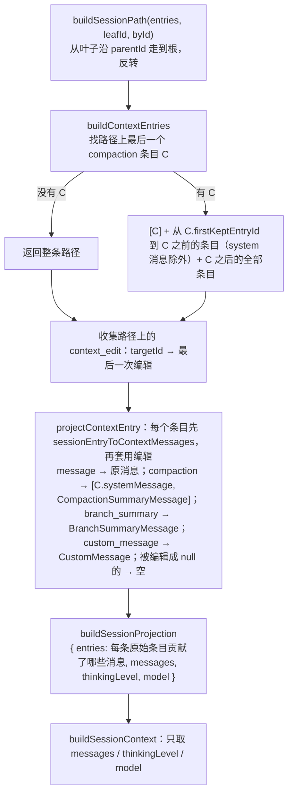

压缩那一步要注意 system 消息的处理。压缩点之前的 system 消息（包括开头那条完整的提示词）都被摘要掉了，所以 `buildContextEntries` 在保留区间里会跳过 system 消息，改用压缩条目上存的 `systemMessage`：它是压缩那一刻回放出来的完整提示词和工具，放在摘要前面，作为新的开头。这样压缩之后，模型看到的仍然是“一条完整的 system + 摘要 + 保留的消息”。

`getSessionContextSettings` 沿路径扫 `thinking_level_change` / `model_change` 条目和 assistant 消息，得到这条分支当前用的模型和思考等级。

分支是这样产生的：`navigateTree(targetId)`（`agent-session.ts`）把叶子挪到任意历史条目上；如果 `summarize`，先用 `collectEntriesForBranchSummary` 收集从旧叶子到公共祖先之间的条目，让模型摘要，再 `branchWithSummary` 写一个 `branch_summary` 条目。之后新消息就接在目标条目下面，形成分支。

延迟写文件的逻辑见 §4.2 的 `_persist`。

---

## 12. 三种运行模式

`main.ts` 按 `appMode` 分发。三种模式都拿同一个 `AgentSessionRuntime`（`agent-session-runtime.ts`，它包着 `AgentSession` 并负责 `newSession` / `fork` / `switchSession` 时换一个新的）。

| 模式 | 入口 | 怎么进 | 怎么出 |
|---|---|---|---|
| 交互式 TUI | `InteractiveMode`（`interactive-mode.ts`，7127 行） | 编辑器回车 → `session.prompt(text)`；正在流就 `prompt(text, {streamingBehavior:"steer"})`；`!cmd` 走 `handleBashCommand`；正在压缩就攒进本地队列 | `session.subscribe(handleEvent)`，`handleEvent` 的 `switch` 对 30 种事件各更新对应组件，然后 `ui.requestRender()` |
| RPC | `runRpcMode`（`rpc/rpc-mode.ts`） | stdin 一行一个 JSON 命令，`handleCommand` 的 `switch` 有 33 个 `case`：`prompt` / `steer` / `follow_up` / `abort` / `set_model` / `compact` / `bash` / `fork` / `get_tree` …，几乎一一对应 `AgentSession` 的公开方法。`prompt`、`steer`、`follow_up` 的响应现在带一个 `disposition`，告诉调用方这条输入是被扩展处理掉了（`handled`）、排进了队列（`queued`），还是开始了一次新运行（`started`）。`prompt` 的响应要等预检（扩展命令、输入钩子、鉴权检查）通过才发 | `session.subscribe(e => output(toJsonEvent(e)))`，每个事件一行 NDJSON。`toJsonEvent`（`modes/json-event.ts`）把 `message_update` 里的 `partial` 整条消息去掉只留增量，省带宽 |
| print / json | `runPrintMode`（`modes/print-mode.ts`） | 命令行参数里的消息依次 `prompt` | `json` 模式同 RPC 的输出；`print` 模式只打最后一条 assistant 文本 |

`InteractiveMode` 和 `pi-tui` 的关系：`InteractiveMode` 持有一个 `TUI`（`tui/src/tui.ts` 接口），往里 `addChild` 各种 `Component`（只有 `render(width): string[]` 和可选的 `handleInput`）。`TuiBase.requestRender` 把多次请求合并成一帧。

TUI 现在默认是全屏模式（设置项 `tuiMode` 默认 `"fullscreen"`）：`TuiAltScreen`（`tui-alt-screen.ts`）切到终端的备用屏幕，整个界面由程序自己管理滚动，支持鼠标滚轮、选中复制、在对话记录里搜索。旧的 `TuiMainScreen`（`tui-main-screen.ts`）在终端原本的滚动区里输出，作为普通模式保留。两种都是和上一帧逐行比较，只重写变了的行。

---

## 13. durable：会持久化的 harness（实验）

主循环的状态全在内存里：`runLoop` 的局部变量记着跑到第几轮、有没有工具没跑完。进程一退出，这些就没了。会话文件只记了已经完成的消息，没记“正在干什么”。

9 月的时候，pi 在 `packages/agent/src/harness/` 里试过一版解决方案（Lane / Drive / HookRegistry，2 万多行），10 月 1 日整个删掉了（`7fd478a2e`），换成独立的新包 `@earendil-works/pi-durable`（`packages/durable`，不含测试约 2.2 万行）。它的 README 第一句就是“实验性，API 随时会变”。

目前主产品 `pi` 命令（`AgentSession`）**没有**用它。10 月上旬 coding-agent 的 `src/experimental/` 下还有几个基于 durable 的原型（一个小型 TUI 编码 agent、session worker、演示用的旅行规划 agent），10-12 随实验性 server 栈一起删掉了。现在公开仓库里依赖 durable 的只有 `pi-env`（§13.5）；从 chord 的文档看，它真正的使用者是私有仓库里的 p2 应用：p2 的会话 worker 把 durable 的 Harness 作为一个 chord 对象提供出来（§14.4）。所以第一次读同样可以跳过这一节。

### 13.1 核心概念

durable 的原则只有一条：**任何东西在显示出来之前，都已经提交到存储里了**。用户输入、模型的每个流式片段、工具调用的意图、工具结果，都是先写进去再往下走。进程在任何地方被杀掉，重新打开存储就能从断的地方接着跑。

| 概念 | 是什么 | 对应主循环里的什么 |
|---|---|---|
| `Harness` | 打开的一个存储，加上在它上面跑 agent 的机制。所有修改走同一条原子提交线 | `AgentSession` + `SessionManager` |
| `Conversation` | 一份对话记录。`root()` 是根对话，还可以新建、fork | 一个会话分支 |
| Entry | 对话里不可变的一条记录：`pi.user`、`pi.assistant`、`pi.tool-result`、`pi.system`（提示词或工具变化）、`pi.reset`（开始新上下文）、`pi.compaction`，也可以自定义 | `SessionEntry` |
| Commit | 一次原子写：`conversation.commit(tx => …)` 里追加条目、改文档、建任务，要么全成功要么全不写 | 无（主循环每条消息单独追加） |
| Document | 和对话记录放在一起的类型化 JSON 状态，由 chord 管理。内置的有 `pi.agent`（模型、扩展等选择）、`pi.provider`（提示缓存用的会话 id）、`pi.live`（正在进行的生成和工具）、`pi.inbox`（排队的输入）、`pi.usage`（花费） | `Agent` 的内存状态、两个队列 |
| Task | 一个持久化的状态机，每走一步都存一个检查点（checkpoint），重启后从最后一个检查点继续 | `runLoop` 的局部变量 |
| Submission | 交给对话的东西：用户输入或者一条要写入的条目，可以等它完成 | `prompt()` / `steer()` / `followUp()` |
| Extension / Registry | 一组工具、提示词段落、钩子、任务的打包；Registry 是本进程装了哪些扩展，运行中也能改 | coding-agent 的扩展 |

### 13.2 类图

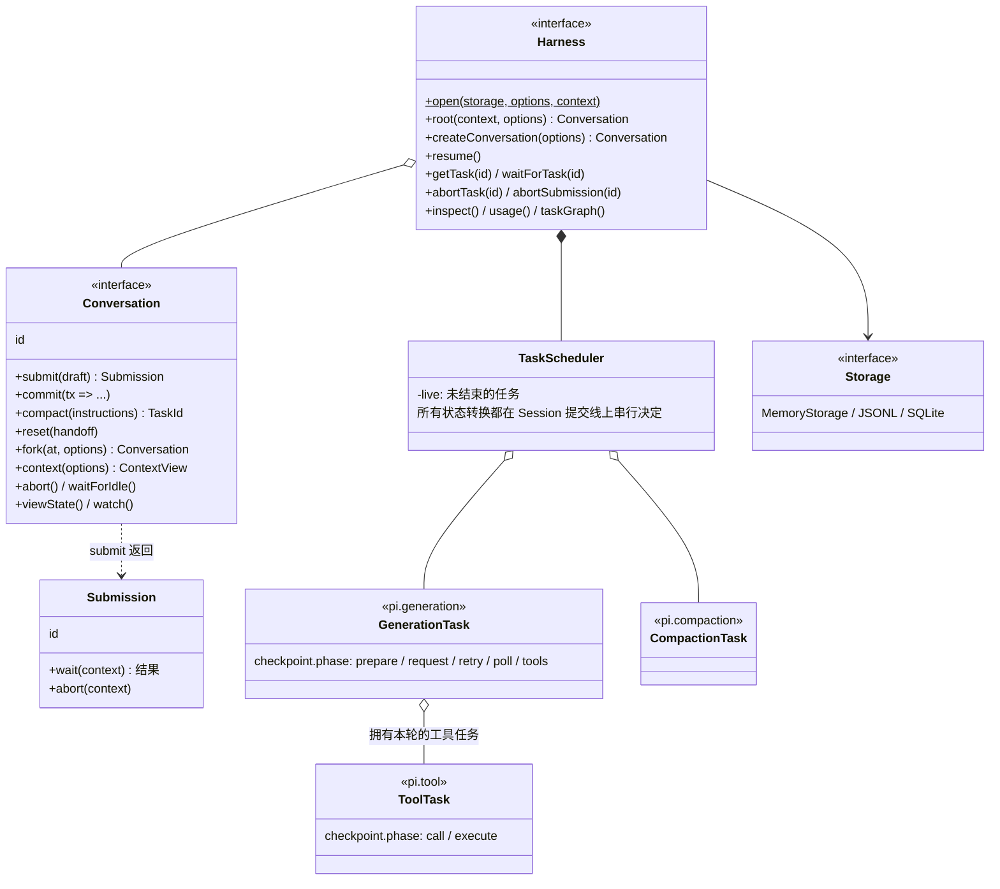

任务和对话组成一棵“所有权树”：生成任务归对话所有，工具任务归生成任务所有，子 agent 的对话又可以归某个工具任务所有。中止、等待空闲、级联清理，都是沿着这棵树走。

### 13.3 一次输入的执行过程

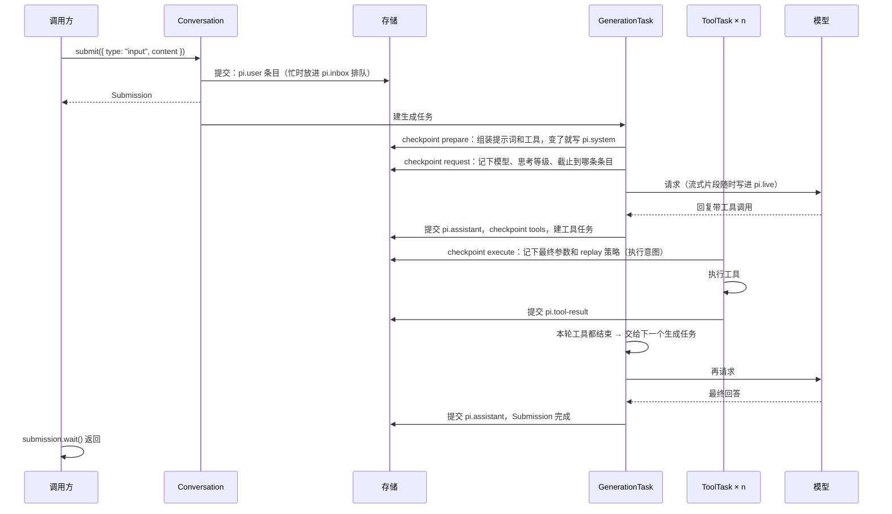

生成任务的检查点有五个阶段（`harness/generation.ts`）：

| 阶段 | 存了什么 | 进程在这里死掉，重启后怎么办 |
|---|---|---|
| `prepare` | 第几次尝试；为溢出等待的压缩任务 | 重新准备请求 |
| `request` | 模型、思考等级、请求参数、这次请求包含到哪条条目（`cutoff`） | 用同样的参数重新发请求 |
| `retry` | 重试要等到什么时候 | 等到点再发 |
| `poll` | 延迟响应的句柄、下次轮询时间 | 接着轮询 |
| `tools` | 哪条回答发起了工具调用、建了哪些工具任务、串行模式下还有哪些没开始 | 继续等工具任务 |

工具任务的恢复最讲究。工具可能有副作用（比如写文件、发请求），执行到一半进程死了，没法知道它到底做了多少。所以 `ToolTask` 在执行前先提交一个 `execute` 检查点，记下“我要用这些参数执行它”。重启时如果看到这个检查点，说明执行过但不知道结果：工具声明了 `replay: "safe"`（可以安全重跑）就重跑一遍；否则不重跑，直接写一条“工具被中断，可能已经部分执行”的错误结果，让模型自己判断。

### 13.4 和主循环的对比

| | 主循环（`Agent` + `AgentSession`） | durable |
|---|---|---|
| 运行状态 | 内存里的局部变量 | 每步一个检查点，写进存储 |
| 排队 | 两个内存队列（steer / followUp） | `pi.inbox` 文档，`whenBusy: "steer"` / 默认跟进 / `"reject"` |
| 扩展点 | `AgentLoopConfig` 上的匿名回调 + coding-agent 的 41 种事件 | 具名钩子：生成任务的 `beforeRequest` / `afterResponse` / `onYield` / `afterTools`，工具任务的 `beforeTool` / `afterTool`，压缩任务的 `beforeCompact` |
| 存储 | 一个 JSONL 文件 | `Storage` 接口，自带内存、JSONL、SQLite 三种实现 |
| 多会话 | 一个 `AgentSession` 一棵树 | 一个 Harness 多个 Conversation，可 fork，子 agent 是被工具任务拥有的子对话 |
| 界面 | 订阅事件流，自己维护显示状态 | `conversation.viewState()` 直接给出可订阅的“结构化视图”，包括流式片段、队列、重试、压缩状态 |

可以看出，durable 把主循环里很多“隐式的东西”变成了显式的、可持久化的数据：轮次变成任务，队列变成文档，回调变成具名钩子。代价是复杂度高得多，所以现在还标着实验性。

### 13.5 10 月的新进展

10-08 到 10-16 之间 durable 有 40 个提交，比较值得看的是这几块：

**工具调用工具**。工具在 `execute` 里用 `api.executeTool(name, args, context)` 调别的工具，这次调用是一个**归调用方所有的子工具任务**：照样做参数校验、跑 `ToolTask` 钩子、有自己的输出上限和 replay 策略，结果直接返回给调用方，不进对话记录。每个嵌套调用有一个 key（默认是它在调用方里的序号），调用方的结果存在调用方任务的文档里（每个嵌套调用一份，10-10 的 `4ac0bd8c7`）。所以一个 `replay: "safe"` 的工具崩溃后重跑时，只要按同样顺序调用，就能拿回上次已经发起的嵌套调用，不会重复执行；不是 replay-safe 的工具不会重跑，它留下的嵌套调用在重启时整体作废（`abandonOnRestart`）。

**谁能看到、谁能调用**。工具上的 `callers` 声明谁能调它：模型、其他工具，或者都可以（默认）。会话的 `modelTools` 再收窄“给模型看哪些”，但不影响工具之间互相调用。比如只把 `codemode` 给模型看，`read`、`bash`、MCP 工具都只能从脚本里调。`deferred: true` 的工具平时不给模型看，`tool_search` 扩展（`@earendil-works/pi-durable/tool-search`，10-12 的 `77332f7a3`）让模型按关键词搜，搜到的通过 `control.addTools` 写进这个分支的 `modelTools`，压缩之后也一直可见。这和 coding-agent 主线的 `ToolExposure`（§4.4）是同一个思路，只是在 durable 里这些选择也是持久化的。

**能续跑的 Code Mode**（`@earendil-works/pi-durable/codemode`，10-11 的 `7b597d148`）。模型写的 JavaScript 在 `pi-codemode` 的 QuickJS 沙箱里跑，每次 `tools.xxx()` 都是一个嵌套工具调用。难点在于脚本本身是内存里的执行状态，没法存检查点。durable 的做法是让脚本**确定性地**运行：沙箱用虚拟时钟、固定种子的随机数、UTC 时区（`sandbox.start`，`0fb1aee74`），脚本每拿到一个调用结果，先把结果写进日志再交给脚本。重启后把脚本从头再跑一遍，按顺序把日志里的结果喂回去，于是它会发出同样的调用、带同样的参数，这些调用按 key 接回原来的嵌套任务，然后脚本从断的地方继续。如果重跑时脚本走了不同的分支、沙箱指纹或 Code Mode 版本变了、或者超时已过，就以错误结束这次调用。沙箱也可以放在 Cloudflare 的 Durable Object 里远程跑（`RemoteCodemodeSandbox`，`748b351fe`）。

**其他**：

- `read` 工具能返回图片，可选用基于 WebAssembly 的 Photon 做缩放和方向校正，Node 下在 worker 线程里处理（`42a3497d0`、`cdaf6c227`）。
- SQLite 存储的表名可以加前缀（`{ prefix: "pi_" }`），这样 durable 能和宿主应用自己的表放在同一个数据库里，比如同一个 Cloudflare Durable Object 的存储（`f7e3cb543`）。
- 压缩可以按模型单独配置（`compaction.modelOverrides`，`c4cf7957b`）；阻塞式压缩失败时这次运行直接失败，不再悄悄继续（`89e5c2c07`）。
- `pi-env`（`packages/env`）是 durable 的远程执行环境：在远程机器上部署一个 Rust 写的小 daemon（`pi-env`，按 SHA-256 命名、每次启动前校验），通过 SSH 的标准输入输出走一套分帧协议。`RemoteExecutionEnv` 实现了 durable 的 `ExecutionEnv` 接口，所以工具在另一台机器上读写文件、跑命令，而 durable 的 worker、存储、凭据都留在本地。10 月新增了伪终端（交互式命令）和列目录（`listFiles`）。

---

## 14. chord：跨进程的对象运行时（实验）

`@earendil-works/chord`（`packages/chord`，不含测试约 1.36 万行，只依赖 TypeBox）是 pi 仓库里一个独立的底层包，不依赖任何其他 pi 包。

这个包在 10-12 被整个换掉了（`0104fef1e`）。上一版本文讲的 facet / `FacetHost` / `defineService` / bundler 那套“插件和服务”运行时已经删除，现在的实现来自私有仓库 pi-private 里的 `apps/p2`（代码里叫 chord2），连同测试和文档一起搬了过来。上一版用来举例的实验性 pi server / client 也在同一天删掉了（§1）。所以现在公开仓库里：

- `pi-durable` 只用它的 `replicatedState`（可观察、可增量同步的 JSON 状态）来放文档、对话视图、任务图；
- 完整的对象运行时（host、对象、热重载）在公开仓库里没有应用在用，真正的使用者是 p2。下面的例子都来自 chord 自己的 README 和 `docs/guide.md`。

### 14.1 概念

chord 用**对象**来组装一个跨好几个进程（一个 server、若干 worker、浏览器标签页）的应用，而且能在运行中热重载代码。

| 概念 | 是什么 |
|---|---|
| 契约（contract） | 一种对象的运行时描述：名字、版本、输入（对象的地址）、成员。用 TypeBox schema 写，因为打包后的插件没有 TypeScript 类型，运行时要校验的都得写在契约里。分两种：`remote` 能被其他进程访问，所有跨进程的东西都要有 schema；`local` 只在本进程用，成员可以是函数、原生对象 |
| 对象（object） | 某种契约的一个实例：一个地址上的状态加代码。每个 `(契约, 输入, principal)` 一个，第一次被 `get` 时创建，最后一个引用释放后销毁 |
| 引用（reference） | 谁都拿不到对象本身，只能拿到引用。引用在本进程和跨进程用法一样，热重载后仍然有效 |
| principal | 调用方是谁，由应用自己定义（比如 owner、guest、worker）。同一个对象地址，owner 和 guest 拿到的是两个不同的对象，可以有不同的方法（契约里的 `variants`）。principal 由连接所在的链路打上，调用方没法自己伪造 |
| 状态 | 可观察的 JSON。远端的订阅者先拿到快照，之后只收增量 |
| host | 一个进程里的运行时：`createHost` 建，`serve` 提供对象，`root` 开一个调用范围，`load` / `reload` 装载、热重载插件 |
| 插件和 facet | 一个插件按 host 的种类分成几个 facet（`server.ts`、`worker.ts`、`web.tsx`），每个 facet 在对应的 host 上 `serve` 一些对象类型 |
| 链路（link） | host 之间交换 JSON 帧的通道：内存、Node IPC、WebSocket |

远程契约里还写明了**对象住在哪个 host**，调用方从不指定 host：

```ts
export const Chat = remote("pi.chat", {
  version: 1,
  input: Type.Object({ session: Type.String(), conversation: Type.Number() }),
  host: hostFamily("session:", "session"),  // { session: "S1", … } 的对象住在 session:S1 这个 host 上
  variants: {
    viewer: { state: { view: ConversationViewSchema } },
    participant: {
      state: { view: ConversationViewSchema },
      methods: { send: method(SendInputSchema, Type.Object({ submissionId: Type.Number() })), stop: method() },
    },
  },
});
```

### 14.2 提供一个对象

```ts
host.serve(Counter, ({ name }, principal, self) => {
  const count = self.state("count", Type.Number(), 0);   // 有名字的状态格子，热重载后保留
  return {
    variant: "default",
    count,
    increment: async ({ by }, ctx) => { count.change(ctx, (n) => n + by); },
  };
});

await host.root(async (ctx) => {
  const clicks = await ctx.get(Counter, { name: "clicks" });   // 拿到时状态已经就绪；这个 root 结束时释放
  clicks.count.subscribe((n) => console.log("count", n));
  await clicks.increment({ by: 2 }, ctx);
});
```

工厂函数是同步的，只**声明**这个对象需要什么，慢的事情（连接、打开文件）在声明之后由运行时去做：

| 声明 | 是什么 | 热重载时 |
|---|---|---|
| `self.state(name, schema, initial)` | 一个可观察的 JSON 格子 | 同名格子保留原值；版本号升高时走迁移函数 |
| `self.get(Type, input)` | 对另一个对象的引用 | 新代码还声明就保留，否则释放 |
| `self.resource(name, { version, open, close })` | 连接、文件监听、socket 这类资源 | 保留；`version` 变了才重开 |
| `self.on(name, source, handler)` | 对状态或事件源的订阅 | 同一个订阅，换成新的 handler |
| `self.task(async (ctx) => …)` | 长期运行的后台任务 | 旧的通过 `ctx.signal` 中止，结束后新代码再启动 |
| `self.derive(sources, fn)` | 从状态派生出的值 | 重新建 |
| `self.register(Registry, { key: value })` | 往一张注册表里登记条目 | 提交时整体替换 |

规则很简单：**要跨过热重载保留的状态，必须放在格子里**，不能放在闭包变量里，闭包变量只活到下一次重载。

对象的生命周期靠引用计数：被另一个对象 `self.get`、被一次调用 `ctx.get`、被远端连接持有、或者声明成 `lifetime: "host"`（随 host 一起存在），任何一种引用都能让它活着；最后一个引用释放后（再等 `linger` 这么久）就销毁：中止任务、移除订阅、倒序关闭资源，再释放它自己持有的引用。

### 14.3 进程之间

```ts
// server
const server = createHost<Principal>({ name: "server", self: { kind: "host" }, principalKey });
server.accept(webSocketLink(wss, { principal: (req) => authenticate(req) }));   // 按 cookie 打上 owner 或 guest
server.route("session:", {
  authorize: (principal, host) => canReach(principal, host),
  resolve: (host) => workers.ensure(host),           // 需要时拉起这个会话的 worker 进程
  principal: (host) => workers.principal(host),
});

// worker
const worker = createHost<Principal>({
  name: `session:${id}`,
  self: { kind: "host" },
  principalKey,
  upstream: { link: ipcLink(process), principal: { kind: "server" } },
});
```

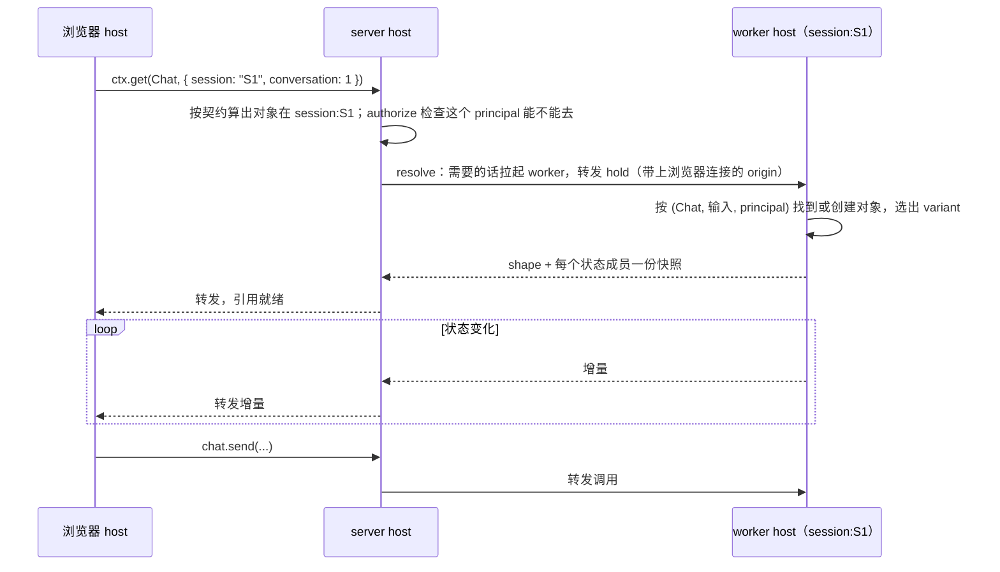

server 在各个子进程之间做中继：worker 到 worker、浏览器到 worker 都经过它。浏览器断开时，它在各个 worker 里持有的引用正好全部释放。转发来的 principal 只接受来自父链路的，对象自己发起的调用以所在 host 的身份进行。

链路有流控：对方确认处理过的帧，未确认的超过一个窗口（默认 256 KiB）时，状态更新先在发送端按成员合并着等；每条链路等待的增量有上限（默认四个窗口），超出时最老的那些换成一次当前值的整体重置。调用、返回值和新引用的第一份快照不受这个限制，所以一次 `get` 不会排在别人的状态更新后面。代价是负载高时，调用的返回值可能比它引起的状态变化先到。

### 14.4 和 durable 的结合

chord 的文档里专门有一段讲 durable：worker 的 host 把 durable 的 Harness 作为一个 `lifetime: "host"` 的本地对象提供出来，插件往一张注册表里登记 durable 扩展，就像登记别的东西一样：

```ts
host.serve(Harness, (_, _host, self) => {
  const durable = self.resource("durable", {
    version: 1,
    open: () => DurableHarness.open(storage, { models, registry: durableRegistry(host, Extensions) }),
    close: (h) => h.close(),
  });
  return { conversation: (id: number) => durable.value.conversation(id) };
}, { lifetime: "host" });
```

热重载换掉一个扩展（比如一个拦危险命令的守卫）时，已经在跑的 durable 阶段继续用旧的注册表快照，下一个阶段用新的，任何时刻都不会有一个阶段没有守卫。

### 14.5 热重载

`host.reload(facets)` 分五步：

1. **加载**新模块。
2. **准备**：在现有对象上跑新的工厂函数，但没有副作用：写格子会抛错，订阅和任务不启动，注册只收集，变了的资源在旧资源旁边新开一份。再用所有在线的使用方检查契约兼容。任何一步失败，一切保持原样。
3. **闸门**：只有格子的版本升高、或者独占资源变了时才需要，等到安全点再迁移。
4. **提交**：一个同步步骤里装上新代码、替换注册表、重启任务、重新绑定订阅，并通知订阅者状态的形状变了。
5. **退役**：旧代码继续跑完它已经开始的 root，跑完后连同只有它声明的东西一起丢掉。

修 bug、加方法、加格子、加资源这类兼容的修改，不需要等待，立即切换：已经开始的 root 在旧代码上跑完，新的 root 用新代码。跨 host 时由 server 统一协调准备和提交；重载之后才拉起的 worker，会先追上 server 的代码版本再接收请求。浏览器不参与提交，只通过形状和重置消息得知代码变了，契约不兼容时调用会返回 `upgrade_required`。

### 14.6 增量同步

可复制状态能高效同步，靠的是 `@earendil-works/chord/delta` 里的增量跟踪器（`delta/tracker.ts`，2200 多行）。这部分在 10-12 的替换中没有变：

```ts
import { applyImmutable, track } from "@earendil-works/chord/delta";

const tracker = track({ output: "", count: 0 });
const change = tracker.beginChange();
change.state.output += "done\n";      // 在草稿上像改普通对象一样改
change.state.count += 1;
const prepared = change.prepare();     // 得到新的不可变值 + 一批操作
tracker.adopt(prepared);
const replica = applyImmutable(prepared.base, prepared.ops);   // 另一端按操作重放
```

记录下来的操作是有语义的：字符串的追加和从头截断、数组的插入删除和重排、设值、删除。模型流式输出时，`output` 字段每次只多一小段，传过去的就只是“追加这一段”，而不是整个字符串。改动太多时会合并成一次整体替换。

几条约定：

- 不可变：已发布的值不能再改，未改动的子树在前后修订之间共享。为了性能，它靠约定而不是冻结或深拷贝来保证这一点，改了已发布的值就是违约。
- 有界：本进程里，每个订阅最多排队 100 个待投递的修订，再多就换成一次完整快照；跨进程时由链路的流控兜底（§14.3）。
- 远端断线或提供者被替换时，副本变成“未就绪”，重新同步后才恢复。

### 14.7 和其他几家的对比

opencode 和 kimi-code 也都有自己的服务装配机制，但侧重点不同：

| | pi 的 chord | opencode v2 | kimi-code |
|---|---|---|---|
| 依赖怎么声明 | 对象的工厂函数里用 `self.get` 声明对其他对象的引用 | Effect 的 Layer + 自己的 `LayerNode` 图 | VS Code 风格的 `createDecorator` / `InstantiationService` |
| 层级 | 没有固定层级；按 host 分（server / worker / 浏览器），契约写明对象住在哪个 host | 进程级 / 目录级两级 | App / Session / Agent 三级子容器 |
| 按 key 的实例 | 每个 `(契约, 输入, principal)` 一个对象，第一次 `get` 时创建，靠引用计数销毁 | 目录级服务由 `LayerMap` 按目录懒建并缓存 | 工作区由 `WorkspaceInstanceManager.getOrCreate` 缓存 |
| 跨进程 | 核心能力：引用透明地跨进程，状态以增量复制，server 负责中继和权限 | 不在装配机制里，靠 HTTP 接口加事件流 | 不在装配机制里，靠 wire 协议 |
| 热重载 | 核心能力：两阶段提交，状态格子跨重载保留 | 配置变了，目录级服务整套重建，正在跑的 runner 换一套服务接着跑 | `/reload` 重载配置和插件后关掉会话、从 `wire.jsonl` 恢复；DI 的 `cascadeEngine` 支持运行时增删服务 |

chord 最有特点的是后两行：把“跨进程”和“热重载”都放进了对象模型本身。一个对象在本进程还是在另一个进程、代码是不是刚换过，对使用者都是透明的。代价是跨进程的接口必须是严格 JSON，所有调用都是异步的，要保留的状态必须老老实实放进格子里。

---

## 15. 可以借鉴的设计与不足

### 可以借鉴的设计

| # | 做法 | 在哪 |
|---|---|---|
| 1 | 循环本身不做决定，需要决定的地方都交给回调。想改行为只需要改回调，不用动循环代码 | `AgentLoopConfig`，`agent/src/types.ts` |
| 2 | 重试和压缩放在循环外面，由 `AgentSession` 处理，`agent-loop.ts` 的 949 行里没有重试逻辑 | `agent-session.ts` |
| 3 | 输出被截断时，这一批工具调用全部不执行 | `agent-loop.ts` |
| 4 | 内部用 `AgentMessage`，可以随意扩展类型，发请求前才转成 `Message` | `messages.ts`，`agent-loop.ts` |
| 5 | 循环拿到的是上下文的拷贝，Agent 的状态只通过事件更新 | `agent.ts` |
| 6 | `prepareNextTurn` 放在每轮开头，之后如果还没拿到插话就再补拉一次 | `agent-loop.ts` |
| 7 | 并行执行工具时，准备阶段仍然串行，结果消息按原始顺序返回 | `agent-loop.ts` |
| 8 | 同一个文件的写操作排队串行执行 | `tools/file-mutation-queue.ts` |
| 9 | 压缩摘要末尾附上读写过的文件清单 | `compaction/utils.ts` |
| 10 | 没有对话内容之前不创建会话文件 | `session-manager.ts` |
| 11 | 会话存成树，压缩和分支都是树上的条目，上下文每次请求前都从树上重新计算，会话文件是唯一来源 | `session-manager.ts`，`agent-session.ts` 的 `prepareRequest` |
| 12 | 扩展替换消息时直接修改原对象，状态、事件、持久化三处用的是同一个对象 | `agent-session.ts` |
| 13 | 流函数出错不抛异常，而是把错误作为事件放进流里，由 `lazyStream` 保证 | `ai/src/api/lazy.ts` |
| 14 | 用 `{ current }` 对象包一层，解决闭包创建时依赖还没准备好的问题 | `sdk.ts` |
| 15 | 提示词和工具的变化写成追加的 system 消息，只发变了的段落，已缓存的请求前缀不动；不支持的模型再回放成一条 | `ai/src/utils/transcript.ts`，`agent-loop.ts` 的 `declareToolChanges` |
| 16 | 丢弃失败的回答不删记录，而是追加一条 `context_edit`，记录完整、上下文干净 | `session-manager.ts`，`agent-session.ts` |
| 17 | 工具分“声明给模型”和“能被调用”两件事，MCP 之类的大量工具不进声明，靠搜索或脚本调用 | `extensions/types.ts` 的 `ToolExposure`，`src/extensions/` |

### 不足

| # | 问题 | 影响 |
|---|---|---|
| 1 | 没有 OS 级沙箱，权限只有 `beforeToolCall` 一个钩子且默认没人订阅 | 需要隔离只能自己套容器 |
| 2 | 循环状态全在内存 | 进程死了运行就没了；`pi-durable` 在解决，但主线还没切过去 |
| 3 | 事件监听器全部 `await` 串行 | 一个慢监听器拖慢整个流；RPC 模式要专门加背压 |
| 4 | `AgentSession` 4428 行，`interactive-mode.ts` 7127 行 | 产品层没有再分层，什么都往 `AgentSession` 里放，而且还在变大（9 月分别是 3552 和 6620 行） |
| 5 | 排队队列的 UI 显示靠文本匹配（`_handleAgentEvent` 用 `indexOf(messageText)` 找）| 两条相同文本的插话会错删 |
| 6 | 重试判定靠正则匹配错误文案 | 新 provider 的新文案要手动加进 `RETRYABLE_PROVIDER_ERROR_PATTERN`（现在在 pi-ai 的 `utils/retry.ts`） |
| 7 | 回调一层套一层：`prepareRequest`、`finishTurn`、`transformContext` 都被 `AgentSession` 的多个 `_install*` 依次包装 | 一次请求前到底改了几次上下文，要把这些包装按安装顺序串起来看才清楚 |
